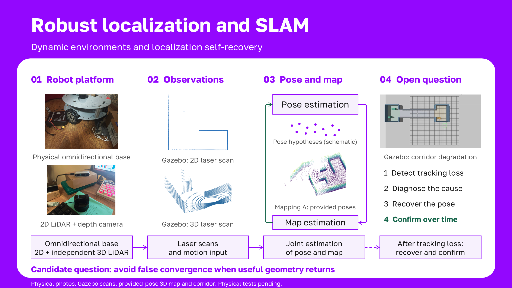

# SLAM Learning

**Robust localization and SLAM in dynamic environments**

Dynamic map cleaning · Static structure retention · Downstream localization

English | [中文](docs/HOME.zh-CN.md) | [**Minimal English · Practice**](docs/MINIMAL.md) | [**极简中文 · 实践**](docs/MINIMAL.zh-CN.md)

[Open question](#open-question) · [Direction](#direction-analysis) · [Related works](#related-works) · [Metrics](#metrics)

[Practice](#practice) · [Hypothesis](#hypothesis) · [Hypothesis test experiment](#hypothesis-test-experiment) · [Hardware experiment](#hardware-experiment) · [Branches](#branches)

## Open question

**Broad direction: reliable mapping and localization in changing environments.** Self-recovery under degradation and large change spans mapping, registration, relocalization and sensor fusion; it is too broad for the present paper set and experiments.

**Focused question: given multi-frame scans and mapping poses, how can dynamic traces be removed while retaining static structure, and under which contamination and geometry conditions does this map improvement reduce held-out localization error?** Validate the map first, then test localization; cleaning does not guarantee accurate pose. [Scope and paper basis](docs/testing/MAPPING-FOCUS.md) · [Earlier recovery background](docs/self-recovery/DESIGN.md).

## Direction analysis

**SLAM** estimates motion and a map jointly. The current intervention is at the map layer, controlling mapping poses and the downstream localizer. Dynamic cleaning, persistent-change updates and corridor observability are separate mechanisms. IR-MCL/AdaM-MCL remain localization references.

The current chain is **dynamic trace removal → static constraint retention → held-out localization test**. The diagram above remains an earlier recovery-context illustration, rather than the current focused research framework. [Earlier editable diagram](docs/assets/slam-recovery-flow.en.v2.pptx) · [Image sources](docs/assets/direction/sources.json). Hardware photographs document existing equipment; physical experiments remain pending.

| Deliverable | Content |
| --- | --- |
| Native reproduction | Author source/data/protocol, each paper's metrics and actual reproduced scope |
| Robot tests | Sim2Real-AlgoBench omnidirectional chassis, native 2D and independent 3D LiDAR profiles, progressively harder mapping/localization/recovery |
| Question analysis | Separate weak constraints from map mismatch; narrow using reproducible failures, keeping methods open |

Semantic mapping and earlier projections remain in the [original repository](https://github.com/p20030920p/SLAM_Learning).

## Related works

**Author-code live execution with RViz + Terminal.** The display observes current computation; points/particles are thinned only for visualization. Observer overhead is excluded from paper runtime comparisons.

Latest author-code runs; datasets and failure analysis are in each paper card. SA: static retention; DA: dynamic removal.

| Method | Map type | Metric / effect |
| --- | --- | --- |
| DUFOMap | 3D dynamic-point-cleaned map | SA 97.98% / DA 98.70%; cleaning works |
| BeautyMap | 3D offline-cleaned map | SA 96.95% / DA 98.34%; cleaning works |
| IR-MCL | Neural occupancy field | RMSE 5.31 cm / 1.07°; Seq-1 localization works |
| AdaM-MCL | Authored 128-cell grid | RMSE 32.23 cells; historical sustained convergence 0/10 |
| srrg_mapper2d | Native 2D point map (Gazebo) | Ghost removal 42.31% / static coverage 99.51% |

### DUFOMap — dynamic-point removal during map integration

**Input:** successive 3D LiDAR scans and provided sensor poses. **Process:** observed free space supplies evidence that earlier occupied points are transient; an octree accumulates this evidence with margins for pose uncertainty. **Output:** a map with dynamic remnants removed. It does not estimate the robot pose. [Paper and reproduced scope](docs/papers/dufomap.md).

In the live video, gray points are retained, red points are removed, and cyan points are the current scan. Watch how decisions change as later scans supply evidence. KITTI-00, 141 scans; SA 97.98% / DA 98.70%. SA measures retained static points and DA measures removed dynamic points; neither is localization error.

**Live execution**

[Live MP4](results/reference/desktop-live-dufomap/execution.mp4) · [record](results/reference/desktop-live-dufomap/record.json)

### BeautyMap — clean an existing point-cloud map

**Input:** the full accumulated 3D map, scans and provided poses. **Process:** the native occupancy representation detects inconsistent occupied structure, followed by the authors' static-structure recovery stage. **Output:** a cleaned reference map. This offline map cleaner is shown while it computes; the input map already exists at the start. [Paper and reproduced scope](docs/papers/beautymap.md).

Gray/red show retained/removed points. Watch the cumulative removal decisions, rather than interpreting the complete initial map as online SLAM. KITTI-00, 141 scans; SA 96.95% / DA 98.34%. Cleaner maps may help downstream localization, but that requires a separate test.

**Live execution**

[Live MP4](results/reference/desktop-live-beautymap/execution.mp4) · [record](results/reference/desktop-live-beautymap/record.json)

### IR-MCL — localize with a neural observation model

**Input:** a pretrained neural occupancy field, measured 2D scans and motion input. **Process:** each particle represents a possible robot pose; the field renders a predicted scan at that pose, scan agreement changes particle weights, and resampling concentrates the belief. **Output:** an estimated pose and particle distribution. [Paper, original code and protocol](docs/papers/ir-mcl.md).

In RViz, the map supplies context, yellow particles show pose hypotheses, blue is the displayed estimate and green is the reference trajectory. Watch particle concentration and agreement with the reference. The displayed weighted particle mean is an observer; scoring uses the native saved estimate. Bonn IPBLab Seq 1: 1543 processed / 1354 scored poses, fresh RMSE 5.31 cm / 1.07°. This author-data run is separate from deployment into Gazebo.

**Live execution**

[Live MP4](results/reference/desktop-live-ir-mcl/execution.mp4) · [record](results/reference/desktop-live-ir-mcl/record.json)

### AdaM-MCL — combine learned proposals and particle tracking

**Input:** a map, laser observation, motion input and trained proposal model. **Process:** the learned model proposes candidate poses; the adaptive mixture combines proposals with conventional particle tracking. **Output:** pose belief, including hypotheses after a kidnapping event. [Paper and limits](docs/papers/adam-mcl.md).

Our run uses an authored 128-cell map and a 2432-step checkpoint: 123 filter updates, RMSE 32.23 cells. The released paper dataset/checkpoint was unavailable. This verifies a limited original-code workflow; it neither reproduces the paper's metre-scale scores nor demonstrates successful recovery. [Score correction](results/reference/adam-mcl/ERRATUM.md).

**Live execution**

[Live MP4](results/reference/desktop-adam-mcl/execution.mp4) · [record](results/reference/desktop-adam-mcl/record.json)

**Measured result replay**

[Result MP4](results/reference/desktop-adam-mcl/result.mp4)

<!-- SRRG_RELATED -->
### srrg_mapper2d · native 2D dynamic-map maintenance

[IROS 2018 论文](https://iris.uniroma1.it/handle/11573/1340118) · [作者建图库](https://gitlab.com/srrg-software/srrg_mapper2d) · [ROS入口](https://gitlab.com/srrg-software/srrg_mapper2d_ros) · [merger2d.cpp](https://gitlab.com/srrg-software/srrg_scan_matcher/-/blob/master/src/merger2d.cpp)。

The paper evaluates long-term dynamic 2D mapping on LCAS–STRANDS and MIT Stata Center, integrating dynamic handling into scan alignment, merging and graph maintenance. The author libraries have now been compiled and tested in all four local scenes.

[2D 实践：视频与指标](#srrg-2d) · [失败诊断](#srrg-diagnostics) · [原文适用条件](docs/papers/srrg_mapper2d.zh-CN.md)

<!-- /SRRG_RELATED -->

## Metrics

### Map-cleaning metrics · SA / DA / AA / HA

**Shared metrics.** DUFOMap and BeautyMap use the same SA/DA definitions. $S,D$ count ground-truth static/dynamic points; $S_k,D_r$ count correctly kept static and removed dynamic points. AA (DUFOMap) is the geometric mean; HA (BeautyMap) is the harmonic mean. [DUFOMap definition](https://arxiv.org/html/2403.01449v1#S4.SS2) · [BeautyMap definition](https://arxiv.org/html/2405.07283v1#S4).

$$
\begin{aligned}
\mathrm{SA} &= 100\frac{S_k}{S}, &
\mathrm{DA} &= 100\frac{D_r}{D},\\
\mathrm{AA} &= \sqrt{\mathrm{SA}\,\mathrm{DA}}, &
\mathrm{HA} &= \frac{2\,\mathrm{SA}\,\mathrm{DA}}{\mathrm{SA}+\mathrm{DA}}.
\end{aligned}
$$

**Map-cleaning metrics: dynamic removal and static retention; higher is better.** Legacy projections score unique 5cm cells; native SRRG uses 10cm support and 15cm coverage tolerance; 3D scores source points. These definitions differ. N/A means no dynamic samples. Persistent-change old maps score static A only; no B update was tested. Pose RMSE is reported separately. Legacy DUFOMap/BeautyMap projections remain as cross-dimensional references; native 2D SRRG is added below.

### Measured result calculation

Each saved native pose update is paired with independent Gazebo robot truth within **0.05 simulation seconds**. Both use the same map/world frame; no spatial fitting is applied. The scored files include initialization and retain rejected timestamp counts.

$$e_i=\sqrt{(\hat x_i-x_i)^2+(\hat y_i-y_i)^2},\quad \mathrm{RMSE}_{xy}=\sqrt{\frac1N\sum_{i=1}^N e_i^2}.$$

Native 3D GICP uses full 3D maps/clouds and XYZ outputs in `*-poses3d.csv`, with the same ≤0.05 s synchronization rule. Missing outputs are not filled with zero; report count, first/last timestamp and common coverage. Unequal corridor coverage prevents ranking whole-run RMSE. Dynamic removal/static retention are separate map metrics.

$$e_{i,xyz}=\sqrt{(\hat x_i-x_i)^2+(\hat y_i-y_i)^2+(\hat z_i-z_i)^2},\quad \mathrm{RMSE}_{xyz}=100\sqrt{\frac1N\sum_{i=1}^N e_{i,xyz}^2}\;\text{cm}.$$

Yaw differences are wrapped to $[-\pi,\pi]$ before RMS and converted to degrees. Metres × 100 gives centimetres. **Live execution** records real computation in wall time; **Measured result replay** draws saved estimates and truth in simulation time, with no new inference. The replay curve is instantaneous error, while its RMSE label uses the full scored CSV. [CSV, window rules and recovery criterion](docs/testing/LIVE.md#how-errors-are-calculated) · [Executable score code](src/scripts/presentation/observe_session.py).

### Reproduction results

| Work | Data | Result |
| --- | --- | --- |
| [DUFOMap](https://github.com/p20030920p/SLAM_Learning/blob/535a2780af7ca7eb3aa02f722e1340fe90bc2dcf/docs/DUFOMAP_TABLE4.md) | KITTI-00, 141 scans | Table IV accuracy matched |
| [BeautyMap](https://github.com/p20030920p/SLAM_Learning/blob/535a2780af7ca7eb3aa02f722e1340fe90bc2dcf/docs/KITTI_PAPER_PROTOCOL.md) | Historical KITTI-02, 91 scans | Table III accuracy matched |
| [IR-MCL](docs/papers/ir-mcl.md) | Bonn IPBLab, released localization sequence, 1543 scans | Location RMSE 5.32 cm against the paper's 5.13 cm |
| [AdaM-MCL](docs/papers/adam-mcl.md) | Authored 128-cell plan, one held-out scene, 123 updates × 10 repeats | Released pipeline executed; no paper value compared |

### Evidence

Values below come from the papers linked by the original repositories and our recorded author-code runs. Each table concerns one method; no cross-method ranking is implied.

#### DUFOMap

KITTI-00, 141 released scans; full setting: voxel 0.1 m, d_s=0.2 m, d_p=1. [Original repository](https://github.com/KTH-RPL/dufomap/tree/9e239ddd5995136e14f5212f33382a6ebc59e518) · [Paper Table IV](https://arxiv.org/html/2403.01449v1#S5.T4) · [Our results](https://github.com/p20030920p/SLAM_Learning/blob/535a2780af7ca7eb3aa02f722e1340fe90bc2dcf/docs/DUFOMAP_TABLE4.md).

| Metric | Paper % | Reproduced % |
| --- | ---: | ---: |
| SA | 97.96 | 97.9635 |
| DA | 98.72 | 98.7196 |
| AA | 98.34 | 98.3408 |

All three full-setting values match the paper at two decimals. Across all five Table IV settings, all 15 accuracy entries match; runtime and online experiments are outside this comparison.

#### BeautyMap

Historical KITTI-02, frames 860–950, 91 scans; XY=1 m, Z=0.5 m, range=40 m. [Original repository](https://github.com/MKJia/BeautyMap/tree/98bce4a97db96ddd0d5342e31425c7679f58ba2e) · [Paper Table III](https://arxiv.org/html/2405.07283v1#S4.T3) · [Our results](https://github.com/p20030920p/SLAM_Learning/blob/535a2780af7ca7eb3aa02f722e1340fe90bc2dcf/docs/KITTI_PAPER_PROTOCOL.md).

| Metric | Paper % | Reproduced % |
| --- | ---: | ---: |
| SA | 83.40 | 83.3978 |
| DA | 82.41 | 82.4092 |
| HA | 82.90 | 82.9006 |

All three values match at two decimals. All nine accuracy entries across XY=0.5/1/2 m match. This uses historical preprocessing/GT and the author's HA scorer; the exact paper method commit remains unidentified. Other sequences and runtime are outside this comparison.

#### IR-MCL

Bonn IPBLab, the single released localization sequence; scored window 1354 of 1543 scans, because the repository's own evaluation drops the first 20 s. [Original repository](https://github.com/PRBonn/ir-mcl/tree/aab8c91b37e59f94442d8eddfa2f920ab1ecc4c5) · [Paper IV-B localization table](https://arxiv.org/html/2210.03113v2#S4.SS2) · [Our run](results/reference/ir-mcl/runs/ir-mcl-wsl/record.json).

| Metric | Paper, Seq 1 | Reproduced |
| --- | ---: | ---: |
| Location RMSE (cm) | 5.13 | 5.32 |
| Yaw RMSE (deg) | 1.05 | 1.07 |
| Location < 5 cm (%) | 63.15 | 61.74 |
| Location < 10 cm (%) | 97.27 | 96.01 |
| Location < 20 cm (%) | 100.00 | 100.00 |
| Yaw < 0.5° (%) | 47.12 | 47.64 |
| Yaw < 1° (%) | 74.59 | 75.85 |
| Yaw < 2° (%) | 94.24 | 93.57 |

The paper's Seq-1 percentages are exact integer counts over 1354 samples, the same window this repository's evaluation produces, so the rows are directly comparable. The C++ motion model seeds its generator from `std::random_device`, so repeated runs differ slightly; a second full run gave 5.28 cm. The upstream README's supplementary 6.62 cm / 1.11° aggregates the whole self-recorded dataset, not Seq 1, and is not used here.

#### AdaM-MCL

Authored 128-cell indoor plan, one held-out scene, 123 filter updates, 200 particles and $T_{\mathrm{cut}}=0.6$ — the particle number and trust threshold of the paper's synthetic setting. [Original repository](https://github.com/Runjian-Chen/AdaM_MCL/tree/e8aedd2bae03816aabd5300e5ca2fe181b39d830) · [Paper Table II](https://arxiv.org/html/2009.00211v3) · [Our run](results/reference/adam-mcl/runs/adam-mcl-wsl/record.json).

| Metric | Paper Table II | This run |
| --- | ---: | ---: |
| Global localization $E_{pos}$ | 0.153 m | not compared |
| Kidnapping $E_{pos}$ | 0.128 m | not compared |

**No numeric comparison is made.** The paper's 20 simulation maps are 43 m × 43 m with six evaluation sequences and released checkpoints, all of them external downloads; this run authors its own plans and trains for 2 432 optimizer steps against the authors' 2 880 000, so cells are not metres. Measured here, in cells: mean per-trial position RMSE 34.82 over 10 repeats, mean final error 47.71, 0.43 s per filter update, and 0 of 10 repeats holding the paper's convergence rule rescaled to this plan. [Score correction](results/reference/adam-mcl/ERRATUM.md).

## Practice

[Minimal practice: GIF previews and videos](docs/MINIMAL.md)

[Keyboard demos](demo/README.md) · [Video gallery](demo/gallery.html) · [Code Notebook](notebooks/presentation/SLAM_实验逐步展示.ipynb).

### Practice index

[Simulation setup](#simulation-sensors-and-chassis) · [SRRG native 2D mapping](#srrg-2d) · [2D · AMCL](#2d--amcl) · [3D · GICP](#3d--gicp) · [2D recordings](#2d-localization-recordings) · [3D recordings](#3d-map-cleaning-and-localization-recordings) · [Earlier NDT / GICP](#earlier-raw-map-3d-static-trials) · [Supplementary recordings](#supplementary-live-scene-recordings)

| Scene | 2D · AMCL | 3D · GICP |
| --- | --- | --- |
| Pure static | [SRRG mapping](#srrg-static-2d) / [Legacy localization](#scene-static-2d) | [View recordings](#scene-static-3d) |
| Moving obstacles | [SRRG mapping](#srrg-dynamic-2d) / [Legacy localization](#scene-dynamic-2d) | [View recordings](#scene-dynamic-3d) |
| Persistent change | [SRRG mapping](#srrg-large-change-2d) / [Legacy localization](#scene-change-2d) | [View recordings](#scene-change-3d) |
| Corridor degradation | [SRRG mapping](#srrg-corridor-2d) / [Legacy localization](#scene-corridor-2d) | [View recordings](#scene-corridor-3d) |

[3D map cleaning results](#map-review-3d) · [Hypotheses and new experiments](#hypothesis-experiments)

### Simulation setup · sensors and chassis

| Item | Actual configuration |
| --- | --- |
| Platform | Sim2Real omni chassis; ROS 2 Jazzy + Gazebo Harmonic; ideal simulated sensors, physical tests pending |
| Chassis | Three omni wheels, 120° spacing; wheel radius 0.06364 m; wheel-centre radius 0.1934 m; collision cylinder radius 0.20 m, height 0.14 m |
| Mass / contact | Base link 0.953513 kg; each wheel 0.20 kg; passive rollers approximated by spherical contact and directional friction, μ=0.02 / 2.0 |
| 2D lidar | Generic gpu_lidar, 720 rays, 360°, 10 Hz, 0.08–12 m; base_link offset (0.06, 0, 0.16) m |
| 3D lidar | Generic gpu_lidar, 720 azimuth × 16 elevation samples, 360° × 30° (±15°), 10 Hz, 0.08–12 m; offset (0, 0, 0.30) m |
| RGB camera | 640×480, 15 Hz, 80° horizontal FOV; offset (0.18, 0, 0.12) m |
| Depth hypothesis arm | Actual rendered depth_camera: 320×240, 10 Hz, 80° horizontal FOV, 0.25–4 m; no hardware noise model; native 2D/SRRG arms omit the 3D lidar |
| Map representation | 3D source points; legacy 2D projection: 0.05 m cells, world Z=0.12–1.20 m, one-cell occupied dilation; SRRG has its own native 2D map and scoring tolerance |

[Actual robot URDF](config/robot_profiles/omni-3d-v1/omni_car_lidar3d.urdf) · [Depth/sensor-arm generation](src/scripts/presentation/probe_sensors.py) · [Map projection](src/scripts/presentation/build_maps.py). Sensor offsets are relative to base_link, not height above the floor. The 16-line simulator is not a claim of a specific commercial lidar model.

<!-- SRRG_PRACTICE -->

### Native 2D mapping · srrg_mapper2d

[↑ Practice index](#practice-index)

Actual 2D lidar and wheel odometry, with no 3D lidar or truth registration. Native author Mapper2D registration and pose graph; the main group uses the author default with graph merging off and local projective merging on. The numerical failure with graph merging on is retained separately.

Metrics use unique 10cm observed support and 15cm coverage tolerance. Ghost removal scores only historical dynamic positions later verified free by actual rays, excluding current objects. Raw accumulation uses each frame’s then-current estimate; SRRG also optimizes the graph. This is an end-to-end comparison, distinct from exact 3D point retention.

#### Pure static · 2D

| Method | Map type | Metric / effect |
| --- | --- | --- |
| Raw | Native 2D point map | Ghost removal N/A; static coverage 100.00% |
| srrg_mapper2d | Native 2D point map | Ghost removal N/A; static coverage 99.84% |

Mapping trajectory XY RMSE (not held-out localization B): 0.71 cm.

No native tracker reset or sustained 20cm pose warning was logged; this does not guarantee perfect map geometry.

[MP4](results/reference/srrg-2d-static/execution.mp4) · [record](results/reference/srrg-2d-static/record.json)

#### Moving obstacles · 2D

| Method | Map type | Metric / effect |
| --- | --- | --- |
| Raw | Native 2D point map | Ghost removal 0.00%; static coverage 100.00% |
| srrg_mapper2d | Native 2D point map | Ghost removal 42.31%; static coverage 99.51% |

Mapping trajectory XY RMSE (not held-out localization B): 0.64 cm.

No native tracker reset or sustained 20cm pose warning was logged; this does not guarantee perfect map geometry.

[MP4](results/reference/srrg-2d-dynamic/execution.mp4) · [record](results/reference/srrg-2d-dynamic/record.json)

#### Persistent change · 2D

| Method | Map type | Metric / effect |
| --- | --- | --- |
| Raw | Native 2D point map | Ghost removal N/A; static coverage 100.00% |
| srrg_mapper2d | Native 2D point map | Ghost removal N/A; static coverage 99.71% |

Mapping trajectory XY RMSE (not held-out localization B): 0.46 cm.

Loads the static-A author map and calls the native multi-session update with a known start. This short route does not reproduce the paper’s long-term evaluation.

Retention of observed added structures: 98.90% (91 support cells). This scene adds structures without removing old ones; dynamic removal is N/A.

No native tracker reset or sustained 20cm pose warning was logged; this does not guarantee perfect map geometry.

[MP4](results/reference/srrg-2d-large-change/execution.mp4) · [record](results/reference/srrg-2d-large-change/record.json)

#### Corridor degradation · 2D

| Method | Map type | Metric / effect |
| --- | --- | --- |
| Raw | Native 2D point map | Ghost removal N/A; static coverage 83.43% |
| srrg_mapper2d | Native 2D point map | Ghost removal N/A; static coverage 82.24% |

Mapping trajectory XY RMSE (not held-out localization B): 83.23 cm.

The first 50 recording simulation seconds retain 72 rays within 3.5m in the original 720 angular bins; other bins are invalid, then full observations return.

| Event | Simulation seconds | Video time (approx.) |
| --- | --- | --- |
| native_mapper_reset | 11.1 | [4.6s](results/reference/srrg-2d-corridor/execution.mp4#t=4.6) |
| observation_change | 7.5 | [2.7s](results/reference/srrg-2d-corridor/execution.mp4#t=2.7) |
| observation_change | 57.6 | [50.9s](results/reference/srrg-2d-corridor/execution.mp4#t=50.9) |
| pose_error_warning | 11.5 | [5.0s](results/reference/srrg-2d-corridor/execution.mp4#t=5.0) |

[MP4](results/reference/srrg-2d-corridor/execution.mp4) · [record](results/reference/srrg-2d-corridor/record.json)

#### Retained failure diagnostics

| Video | Outcome |
| --- | --- |
| [GIF](results/reference/srrg-diagnostic-20261015-025711-mapping-srrg-static-dd423d/execution.gif) · [MP4](results/reference/srrg-diagnostic-20261015-025711-mapping-srrg-static-dd423d/execution.mp4) · [record](results/reference/srrg-diagnostic-20261015-025711-mapping-srrg-static-dd423d/record.json) | 联调失败：Eigen ABI不一致（首次运动） |
| [GIF](results/reference/srrg-diagnostic-20261015-030327-mapping-srrg-static-a275d3/execution.gif) · [MP4](results/reference/srrg-diagnostic-20261015-030327-mapping-srrg-static-a275d3/execution.mp4) · [record](results/reference/srrg-diagnostic-20261015-030327-mapping-srrg-static-a275d3/record.json) | 联调失败：作者stdout诊断污染传输；已隔离 |
| [GIF](results/reference/srrg-diagnostic-20261015-030729-mapping-srrg-dynamic-14123d/execution.gif) · [MP4](results/reference/srrg-diagnostic-20261015-030729-mapping-srrg-dynamic-14123d/execution.mp4) · [record](results/reference/srrg-diagnostic-20261015-030729-mapping-srrg-dynamic-14123d/record.json) | 图合并开启：最后成功输出仿真66.0s／录制55.4s，随后g2o数值分解失败并崩溃；不是动态清理率为零。 |

[Paper datasets and scope](docs/papers/srrg_mapper2d.zh-CN.md) · [Metrics and degradation timestamps](docs/testing/MAP-METRICS.zh-CN.md)
<!-- /SRRG_PRACTICE -->

### 2D · AMCL

**[Pure static](#scene-static-2d)** · [record](results/reference/robot-live-static/record.json)

| Method | Map type | Metric / effect |
| --- | --- | --- |
| Raw | Raw 2D projection | Dynamic cell removal N/A; static retention 100.00% |
| DUFOMap | Dynamic-point-cleaned 2D projection | Dynamic cell removal N/A; static retention 100.00% |
| BeautyMap | Offline-cleaned 2D projection | Dynamic cell removal N/A; static retention 96.51% |

Localization separately (XY RMSE, cm): Raw 7.28 / DUFOMap 7.28 / BeautyMap 6.89.

Raw and DUFOMap projections are identical; BeautyMap is 0.39 cm lower in this run. Recovery was not tested.

**[Moving obstacles](#scene-dynamic-2d)** · [record](results/reference/robot-2d-dynamic-matched/record.json)

| Method | Map type | Metric / effect |
| --- | --- | --- |
| Raw | Raw 2D projection | Dynamic cell removal 0.00%; static retention 100.00% |
| DUFOMap | Dynamic-point-cleaned 2D projection | Dynamic cell removal 8.33%; static retention 100.00% |
| BeautyMap | Offline-cleaned 2D projection | Dynamic cell removal 33.33%; static retention 96.64% |

Localization separately (XY RMSE, cm): Raw 7.52 / DUFOMap 8.19 / BeautyMap 7.29.

Paired new mapping A: DUFOMap is 0.67 cm higher, BeautyMap 0.23 cm lower. One trial gives no stable ranking; the previous run is retained.

**[Persistent change](#scene-change-2d)** · [record](results/reference/robot-live-large-change/record.json)

| Method | Map type | Metric / effect |
| --- | --- | --- |
| Raw | Raw 2D projection | Dynamic cell removal N/A; static retention 100.00% (static-A old map) |
| DUFOMap | Dynamic-point-cleaned 2D projection | Dynamic cell removal N/A; static retention 100.00% (static-A old map) |
| BeautyMap | Offline-cleaned 2D projection | Dynamic cell removal N/A; static retention 96.51% (static-A old map) |

Localization separately (XY RMSE, cm): Raw 6.84 / DUFOMap 6.84 / BeautyMap 6.39.

Frozen old maps; no online map update was called, and the route did not induce loss.

**[Corridor degradation](#scene-corridor-2d)** · [record](results/reference/robot-corridor-v2/record.json)

| Method | Map type | Metric / effect |
| --- | --- | --- |
| Raw | Raw 2D projection | Dynamic cell removal N/A; static retention 100.00% |
| DUFOMap | Dynamic-point-cleaned 2D projection | Dynamic cell removal N/A; static retention 100.00% |
| BeautyMap | Offline-cleaned 2D projection | Dynamic cell removal N/A; static retention 100.00% |

Localization separately (XY RMSE, cm): Raw 72.53 / DUFOMap 72.53 / BeautyMap 72.53.

The three projected maps are identical; 13.3 s corrects an offset initial belief and cannot distinguish cleaning.

### 3D · GICP

**[Pure static](#scene-static-3d)** · [record](results/reference/robot-3d-static/record.json)

| Method | Map type | Metric / effect |
| --- | --- | --- |
| Raw | Raw 3D point map | Dynamic point removal N/A; static retention 100.00% |
| DUFOMap | Dynamic-point-cleaned 3D map | Dynamic point removal N/A; static retention 100.00% |
| BeautyMap | Offline-cleaned 3D map | Dynamic point removal N/A; static retention 83.33% |

Localization separately (XYZ RMSE, cm): Raw 0.95 / DUFOMap 0.99 / BeautyMap 1.07.

No moving contamination needs cleaning; no localization improvement in this trial.

**[Moving obstacles](#scene-dynamic-3d)** · [record](results/reference/robot-3d-dynamic/record.json)

| Method | Map type | Metric / effect |
| --- | --- | --- |
| Raw | Raw 3D point map | Dynamic point removal 0.00%; static retention 100.00% |
| DUFOMap | Dynamic-point-cleaned 3D map | Dynamic point removal 46.59%; static retention 100.00% |
| BeautyMap | Offline-cleaned 3D map | Dynamic point removal 74.36%; static retention 81.15% |

Localization separately (XYZ RMSE, cm): Raw 0.98 / DUFOMap 0.98 / BeautyMap 1.04.

Native cleaning removes dynamic map points, without a clear downstream GICP gain.

**[Persistent change](#scene-change-3d)** · [record](results/reference/robot-3d-large-change/record.json)

| Method | Map type | Metric / effect |
| --- | --- | --- |
| Raw | Raw 3D point map | Dynamic point removal N/A; static retention 100.00% (static-A old map) |
| DUFOMap | Dynamic-point-cleaned 3D map | Dynamic point removal N/A; static retention 100.00% (static-A old map) |
| BeautyMap | Offline-cleaned 3D map | Dynamic point removal N/A; static retention 83.33% (static-A old map) |

Localization separately (XYZ RMSE, cm): Raw 0.93 / DUFOMap 1.01 / BeautyMap 1.04.

Static-A 3D maps remain frozen; change detection/updating was not executed. No localization gain.

**[Corridor degradation](#scene-corridor-3d)** · [record](results/reference/robot-3d-corridor/record.json)

| Method | Map type | Metric / effect |
| --- | --- | --- |
| Raw | Raw 3D point map | Dynamic point removal N/A; static retention 100.00% |
| DUFOMap | Dynamic-point-cleaned 3D map | Dynamic point removal N/A; static retention 100.00% |
| BeautyMap | Offline-cleaned 3D map | Dynamic point removal N/A; static retention 99.90% |

Localization separately (XYZ RMSE, cm): Raw 474.38 / DUFOMap 497.05 / BeautyMap 592.00.

Raw and DUFOMap 3D maps are byte-identical yet tracking differs. Output coverage is unequal; do not rank cleaners.

[Cause analysis, point-level map quality and parameter checks](docs/testing/MAP-2D-3D.md) · [Separate 2D / 3D video groups](demo/gallery.html)

### 2D localization recordings

**Fresh live tests on this Windows computer, 2026-10-14–15.** Each method has its own actual RViz window, map topic, native AMCL pose/particles and isolated display TF. Each GIF records Gazebo + that method’s RViz + Terminal, during the same live scene input.

**Raw / DUFOMap / BeautyMap are map-processing choices; the live localizer is AMCL.** Mapping uses provided poses and common 2D projection; this is a scoped 3D-map-to-2D-localization adaptation. Results below come from these new runs, including initialization; one trial per condition.

[Scoring and controls](docs/testing/LIVE.md) · [Other localization libraries and deployment](docs/testing/LOCALIZERS.md) · [Recording names](demo/recording-index.json) · [One-click method demos](demo/README.md#逐方法独立-rviz-现场对照)

#### Pure static

<!-- MAP_QUALITY_VIDEO_TABLE -->
| Method | Map type | Metric / effect |
| --- | --- | --- |
| Raw | 2D | Dynamic cell removal N/A; static retention 100.00% |
| DUFOMap | 2D | Dynamic cell removal N/A; static retention 100.00% |
| BeautyMap | 2D | Dynamic cell removal N/A; static retention 96.51% |
<!-- /MAP_QUALITY_VIDEO_TABLE -->

[↑ Back to Practice index](#practice-index)

Localizer: AMCL; 290 updates per case, position RMSE includes initialization.

This route did not induce loss; recovery remains untested.

##### Raw map + AMCL

**Live execution — Raw RViz**

[Live MP4](results/reference/robot-live-static/executions/raw.mp4) · [RViz config](results/reference/robot-live-static/view-raw.rviz) · [record](results/reference/robot-live-static/record.json)

**Measured result replay — Raw**

[Result MP4](results/reference/robot-live-static/methods/raw/result.mp4) · [case record](results/reference/robot-live-static/methods/raw/record.json) · RMSE **7.28 cm** · 290 native updates.

##### DUFOMap map + AMCL

**Live execution — DUFOMap RViz**

[Live MP4](results/reference/robot-live-static/executions/dufomap.mp4) · [RViz config](results/reference/robot-live-static/view-dufomap.rviz) · [record](results/reference/robot-live-static/record.json)

**Measured result replay — DUFOMap**

[Result MP4](results/reference/robot-live-static/methods/dufomap/result.mp4) · [case record](results/reference/robot-live-static/methods/dufomap/record.json) · RMSE **7.28 cm** · 290 native updates.

##### BeautyMap map + AMCL

**Live execution — BeautyMap RViz**

[Live MP4](results/reference/robot-live-static/executions/beautymap.mp4) · [RViz config](results/reference/robot-live-static/view-beautymap.rviz) · [record](results/reference/robot-live-static/record.json)

**Measured result replay — BeautyMap**

[Result MP4](results/reference/robot-live-static/methods/beautymap/result.mp4) · [case record](results/reference/robot-live-static/methods/beautymap/record.json) · RMSE **6.89 cm** · 290 native updates.

#### Moving obstacles

<!-- MAP_QUALITY_VIDEO_TABLE -->
| Method | Map type | Metric / effect |
| --- | --- | --- |
| Raw | 2D | Dynamic cell removal 0.00%; static retention 100.00% |
| DUFOMap | 2D | Dynamic cell removal 8.33%; static retention 100.00% |
| BeautyMap | 2D | Dynamic cell removal 33.33%; static retention 96.64% |
<!-- /MAP_QUALITY_VIDEO_TABLE -->

[↑ Back to Practice index](#practice-index)

Localizer: AMCL; 291 updates per case, position RMSE includes initialization.

##### Raw map + AMCL

**Live execution — Raw RViz**

[Live MP4](results/reference/robot-2d-dynamic-matched/executions/raw.mp4) · [RViz config](results/reference/robot-2d-dynamic-matched/view-raw.rviz) · [record](results/reference/robot-2d-dynamic-matched/record.json)

**Measured result replay — Raw**

[Result MP4](results/reference/robot-2d-dynamic-matched/methods/raw/result.mp4) · [case record](results/reference/robot-2d-dynamic-matched/methods/raw/record.json) · RMSE **7.52 cm** · 291 native updates.

##### DUFOMap map + AMCL

**Live execution — DUFOMap RViz**

[Live MP4](results/reference/robot-2d-dynamic-matched/executions/dufomap.mp4) · [RViz config](results/reference/robot-2d-dynamic-matched/view-dufomap.rviz) · [record](results/reference/robot-2d-dynamic-matched/record.json)

**Measured result replay — DUFOMap**

[Result MP4](results/reference/robot-2d-dynamic-matched/methods/dufomap/result.mp4) · [case record](results/reference/robot-2d-dynamic-matched/methods/dufomap/record.json) · RMSE **8.19 cm** · 291 native updates.

##### BeautyMap map + AMCL

**Live execution — BeautyMap RViz**

[Live MP4](results/reference/robot-2d-dynamic-matched/executions/beautymap.mp4) · [RViz config](results/reference/robot-2d-dynamic-matched/view-beautymap.rviz) · [record](results/reference/robot-2d-dynamic-matched/record.json)

**Measured result replay — BeautyMap**

[Result MP4](results/reference/robot-2d-dynamic-matched/methods/beautymap/result.mp4) · [case record](results/reference/robot-2d-dynamic-matched/methods/beautymap/record.json) · RMSE **7.29 cm** · 291 native updates.

#### Persistent change

<!-- MAP_QUALITY_VIDEO_TABLE -->
| Method | Map type | Metric / effect |
| --- | --- | --- |
| Raw | 2D | Dynamic cell removal N/A; static retention 100.00% (static-A old map) |
| DUFOMap | 2D | Dynamic cell removal N/A; static retention 100.00% (static-A old map) |
| BeautyMap | 2D | Dynamic cell removal N/A; static retention 96.51% (static-A old map) |
<!-- /MAP_QUALITY_VIDEO_TABLE -->

[↑ Back to Practice index](#practice-index)

Localizer: AMCL; 290 updates per case, position RMSE includes initialization.

This route did not induce loss; recovery remains untested.

##### Raw map + AMCL

**Live execution — Raw RViz**

[Live MP4](results/reference/robot-live-large-change/executions/raw.mp4) · [RViz config](results/reference/robot-live-large-change/view-raw.rviz) · [record](results/reference/robot-live-large-change/record.json)

**Measured result replay — Raw**

[Result MP4](results/reference/robot-live-large-change/methods/raw/result.mp4) · [case record](results/reference/robot-live-large-change/methods/raw/record.json) · RMSE **6.84 cm** · 290 native updates.

##### DUFOMap map + AMCL

**Live execution — DUFOMap RViz**

[Live MP4](results/reference/robot-live-large-change/executions/dufomap.mp4) · [RViz config](results/reference/robot-live-large-change/view-dufomap.rviz) · [record](results/reference/robot-live-large-change/record.json)

**Measured result replay — DUFOMap**

[Result MP4](results/reference/robot-live-large-change/methods/dufomap/result.mp4) · [case record](results/reference/robot-live-large-change/methods/dufomap/record.json) · RMSE **6.84 cm** · 290 native updates.

##### BeautyMap map + AMCL

**Live execution — BeautyMap RViz**

[Live MP4](results/reference/robot-live-large-change/executions/beautymap.mp4) · [RViz config](results/reference/robot-live-large-change/view-beautymap.rviz) · [record](results/reference/robot-live-large-change/record.json)

**Measured result replay — BeautyMap**

[Result MP4](results/reference/robot-live-large-change/methods/beautymap/result.mp4) · [case record](results/reference/robot-live-large-change/methods/beautymap/record.json) · RMSE **6.39 cm** · 290 native updates.

#### Corridor degradation

<!-- MAP_QUALITY_VIDEO_TABLE -->
| Method | Map type | Metric / effect |
| --- | --- | --- |
| Raw | 2D | Dynamic cell removal N/A; static retention 100.00% |
| DUFOMap | 2D | Dynamic cell removal N/A; static retention 100.00% |
| BeautyMap | 2D | Dynamic cell removal N/A; static retention 100.00% |
<!-- /MAP_QUALITY_VIDEO_TABLE -->

[↑ Back to Practice index](#practice-index)

AMCL, 508 updates; RMSE includes a 1 m initial offset. All three projected maps are identical.

Full-scan control: 71.60 cm, sustained convergence 6.6 s after the same reference event. This corrects an offset initial belief. [Recovery criterion and record](results/reference/robot-corridor-v2/record.json).

##### Raw map + AMCL

**Live execution — Raw RViz**

[Live MP4](results/reference/robot-corridor-v2/executions/degraded_raw.mp4) · [RViz config](results/reference/robot-corridor-v2/view-degraded_raw.rviz) · [record](results/reference/robot-corridor-v2/record.json)

**Measured result replay — Raw**

[Result MP4](results/reference/robot-corridor-v2/methods/degraded_raw/result.mp4) · [case record](results/reference/robot-corridor-v2/methods/degraded_raw/record.json) · RMSE **72.53 cm** · 508 native updates.

##### DUFOMap map + AMCL

**Live execution — DUFOMap RViz**

[Live MP4](results/reference/robot-corridor-v2/executions/degraded_dufomap.mp4) · [RViz config](results/reference/robot-corridor-v2/view-degraded_dufomap.rviz) · [record](results/reference/robot-corridor-v2/record.json)

**Measured result replay — DUFOMap**

[Result MP4](results/reference/robot-corridor-v2/methods/degraded_dufomap/result.mp4) · [case record](results/reference/robot-corridor-v2/methods/degraded_dufomap/record.json) · RMSE **72.53 cm** · 508 native updates.

##### BeautyMap map + AMCL

**Live execution — BeautyMap RViz**

[Live MP4](results/reference/robot-corridor-v2/executions/degraded_beautymap.mp4) · [RViz config](results/reference/robot-corridor-v2/view-degraded_beautymap.rviz) · [record](results/reference/robot-corridor-v2/record.json)

**Measured result replay — BeautyMap**

[Result MP4](results/reference/robot-corridor-v2/methods/degraded_beautymap/result.mp4) · [case record](results/reference/robot-corridor-v2/methods/degraded_beautymap/record.json) · RMSE **72.53 cm** · 508 native updates.

**Physical robot tests remain pending.** Keyboard demos: `F:\be2演讲\实机脚本\20–23`; `24` automatically records all four scenes. Historical executions/replays remain in the repository, separately from the videos above.

### 3D map cleaning and localization recordings

Native GICP outputs from fresh Gazebo B; complete XYZ/rotation scores and output-loss evidence are retained. Map processing A uses supplied poses, not full 3D SLAM.

#### 3D map result review

[↑ Back to Practice index](#practice-index)

| Method | Map type | Metric / effect |
| --- | --- | --- |
| Raw | 3D point map | Static retained 100%; dynamic removed 0% |
| DUFOMap | 3D point map | Static retained 99.998%; dynamic removed 46.59% |
| BeautyMap | 3D point map | Static retained 81.15%; dynamic removed 74.36% |

Real RViz result review of saved native outputs; no new inference. Grey: background points; red: confidently labelled residual moving-box returns.

[MP4](results/reference/robot-3d-map-review-v2/execution.mp4) · [point audit](results/reference/robot-3d-map-audit/record.json)

#### Pure static · 3D

<!-- MAP_QUALITY_VIDEO_TABLE -->
| Method | Map type | Metric / effect |
| --- | --- | --- |
| Raw | 3D | Dynamic point removal N/A; static retention 100.00% |
| DUFOMap | 3D | Dynamic point removal N/A; static retention 100.00% |
| BeautyMap | 3D | Dynamic point removal N/A; static retention 83.33% |
<!-- /MAP_QUALITY_VIDEO_TABLE -->

[↑ Back to Practice index](#practice-index)

No moving contamination needs cleaning; no localization improvement in this trial.

##### Raw 3D map + GICP

[Live MP4](results/reference/robot-3d-static/executions/raw.mp4) · [record](results/reference/robot-3d-static/record.json)

##### DUFOMap 3D map + GICP

[Live MP4](results/reference/robot-3d-static/executions/dufomap.mp4) · [record](results/reference/robot-3d-static/record.json)

##### BeautyMap 3D map + GICP

[Live MP4](results/reference/robot-3d-static/executions/beautymap.mp4) · [record](results/reference/robot-3d-static/record.json)

#### Moving obstacles · 3D

<!-- MAP_QUALITY_VIDEO_TABLE -->
| Method | Map type | Metric / effect |
| --- | --- | --- |
| Raw | 3D | Dynamic point removal 0.00%; static retention 100.00% |
| DUFOMap | 3D | Dynamic point removal 46.59%; static retention 100.00% |
| BeautyMap | 3D | Dynamic point removal 74.36%; static retention 81.15% |
<!-- /MAP_QUALITY_VIDEO_TABLE -->

[↑ Back to Practice index](#practice-index)

Native cleaning removes dynamic map points, without a clear downstream GICP gain.

##### Raw 3D map + GICP

[Live MP4](results/reference/robot-3d-dynamic/executions/raw.mp4) · [record](results/reference/robot-3d-dynamic/record.json)

##### DUFOMap 3D map + GICP

[Live MP4](results/reference/robot-3d-dynamic/executions/dufomap.mp4) · [record](results/reference/robot-3d-dynamic/record.json)

##### BeautyMap 3D map + GICP

[Live MP4](results/reference/robot-3d-dynamic/executions/beautymap.mp4) · [record](results/reference/robot-3d-dynamic/record.json)

#### Persistent change · 3D

<!-- MAP_QUALITY_VIDEO_TABLE -->
| Method | Map type | Metric / effect |
| --- | --- | --- |
| Raw | 3D | Dynamic point removal N/A; static retention 100.00% (static-A old map) |
| DUFOMap | 3D | Dynamic point removal N/A; static retention 100.00% (static-A old map) |
| BeautyMap | 3D | Dynamic point removal N/A; static retention 83.33% (static-A old map) |
<!-- /MAP_QUALITY_VIDEO_TABLE -->

[↑ Back to Practice index](#practice-index)

Static-A 3D maps remain frozen; change detection/updating was not executed. No localization gain.

##### Raw 3D map + GICP

[Live MP4](results/reference/robot-3d-large-change/executions/raw.mp4) · [record](results/reference/robot-3d-large-change/record.json)

##### DUFOMap 3D map + GICP

[Live MP4](results/reference/robot-3d-large-change/executions/dufomap.mp4) · [record](results/reference/robot-3d-large-change/record.json)

##### BeautyMap 3D map + GICP

[Live MP4](results/reference/robot-3d-large-change/executions/beautymap.mp4) · [record](results/reference/robot-3d-large-change/record.json)

#### Corridor degradation · 3D

<!-- MAP_QUALITY_VIDEO_TABLE -->
| Method | Map type | Metric / effect |
| --- | --- | --- |
| Raw | 3D | Dynamic point removal N/A; static retention 100.00% |
| DUFOMap | 3D | Dynamic point removal N/A; static retention 100.00% |
| BeautyMap | 3D | Dynamic point removal N/A; static retention 99.90% |
<!-- /MAP_QUALITY_VIDEO_TABLE -->

[↑ Back to Practice index](#practice-index)

Raw and DUFOMap 3D maps are byte-identical yet tracking differs. Output coverage is unequal; do not rank cleaners.

##### Raw 3D map + GICP

[Live MP4](results/reference/robot-3d-corridor/executions/raw.mp4) · [record](results/reference/robot-3d-corridor/record.json)

##### DUFOMap 3D map + GICP

[Live MP4](results/reference/robot-3d-corridor/executions/dufomap.mp4) · [record](results/reference/robot-3d-corridor/record.json)

##### BeautyMap 3D map + GICP

[Live MP4](results/reference/robot-3d-corridor/executions/beautymap.mp4) · [record](results/reference/robot-3d-corridor/record.json)

### Earlier Raw-map 3D static trials

The following short static trials use live 3D points and a fixed Raw 3D map. No IMU or deskew. Scores cover XY/yaw and initialization; sensor input and duration differ from the AMCL trials. [Libraries and scope](docs/testing/LOCALIZERS.md).

| Method | Map type | Metric / effect |
| --- | --- | --- |
| NDT_OMP | Raw 3D prior map | XY RMSE 0.93 cm; first trial 34.43 cm |
| GICP | Raw 3D prior map | XY RMSE 1.09 cm; static validation only |

#### Pure static — NDT_OMP

**Live execution**

[Live MP4](results/reference/robot-ndt-static/execution.mp4) · [record](results/reference/robot-ndt-static/record.json)

**Measured result replay**

[Result MP4](results/reference/robot-ndt-static/result.mp4) · XY RMSE **0.93 cm** · yaw **0.17°** · 402 updates.

#### Pure static — GICP

**Live execution**

[Live MP4](results/reference/robot-gicp-static/execution.mp4) · [record](results/reference/robot-gicp-static/record.json)

**Measured result replay**

[Result MP4](results/reference/robot-gicp-static/result.mp4) · XY RMSE **1.09 cm** · yaw **0.16°** · 397 updates.

NDT also produced 34.43 cm in its first trial with the same estimator parameters; that run is retained. The cause of the variation is not yet established, so the latest score is not a robustness claim. [Initial trial](results/reference/robot-ndt-static-initial/record.json).

### Supplementary live scene recordings

Actual native Gazebo + RViz + Terminal. The RViz viewport fills its window and is centred for the map; the earlier custom-viewer clips remain archived.

#### S1 static · slam_toolbox mapping

[MP4](results/reference/robot-supp-static/execution.mp4) · [record](results/reference/robot-supp-static/record.json)

#### S2 dynamic · slam_toolbox mapping

[MP4](results/reference/robot-supp-dynamic/execution.mp4) · [record](results/reference/robot-supp-dynamic/record.json)

#### S3 persistent change · Raw map + AMCL

[MP4](results/reference/robot-supp-large-change/execution.mp4) · [record](results/reference/robot-supp-large-change/record.json)

#### S4 new corridor · limited → restored AMCL

[MP4](results/reference/robot-corridor-v2/executions/degraded_raw.mp4) · [record](results/reference/robot-corridor-v2/record.json)

## Hypothesis

The current question is about **map cleaning**. Test hypotheses in order; a failed condition stops a claim from propagating to localization. Existing pose-only Guard/Depth/Search experiments remain as a labelled exploratory appendix.

| Hypothesis, easy → hard | Existing simple test / outcome |
| --- | --- |
| M1: temporal visibility can remove dynamic traces | Dynamic scene: DUFOMap removes 46.59% / BeautyMap 74.36% of 3D dynamic points; native 2D SRRG removes 42.31% of verified dynamic ghost cells. Different denominators; no cross-method ranking. |
| M2: removal can preserve static constraints | Same scene: 3D static retention DUFOMap 99.998%, BeautyMap 81.15%; SRRG 2D static coverage 99.51%. BeautyMap's removal gain has a static-loss cost here. |
| M3: a 3D cleaning gain survives 2D projection | Re-score the same maps: projected dynamic-cell removal is only 8.33% / 33.33%; supported only partially. Native 2D SRRG is a separate representation/control. |
| M4: cleaner maps lower held-out pose error when ghosts corrupt useful constraints | Dynamic GICP XYZ RMSE Raw/DUFO/Beauty=0.98/0.98/1.04 cm: no benefit established. Vary contamination and repeat with a frozen localizer; this dose-response experiment is pending. SRRG's separate localization B is also pending. |
| M5: a 2D lidar + depth camera can disambiguate occluded static structure | Existing Depth experiments test pose estimation only, with no stable general gain. A temporal depth visibility gate for map updates, compared with 2D-only SRRG and 3D reference, remains an untested mapping hypothesis. |

[Mapping question, paper links and controlled next tests](docs/testing/MAPPING-FOCUS.md) · [Map-quality evidence and failure timestamps](docs/testing/MAP-METRICS.zh-CN.md). Static and corridor scenes are controls: deleting points cannot create missing geometry. Persistent change needs a separate map-update test.

## Hypothesis test experiment

This appendix preserves earlier pose-level exploration with frozen maps; it does not validate dynamic mapping.

The earlier results suggest three directions to test:

- **H1 · Guard:** suppress inconsistent matches and reduce lidar corrections along weak directions, while retaining wheel-odometry prediction.
- **H2 · Depth:** use a 2D lidar plus a depth camera to add visible height structure; test the same idea with 3D lidar.
- **H3 · Search and confirm:** search multiple nearby pose candidates and accept a unique, motion-consistent candidate only after consecutive confirmation.

These are small custom ground-robot prototypes. The 2D arm has no 3D lidar; the 3D arm uses XYZ observations with x/y/yaw motion constraints. Mapping A uses supplied poses, all maps stay frozen, and localization B never reads truth. The four original scenes remain; the separately labelled height control adds two high blocks. Single ideal-simulation trials cannot establish a ranking.

[Frozen hypotheses, controls and interpretation](docs/testing/HYPOTHESES.md) · [Video directory](demo/hypotheses.html) · [One-click scripts](demo/README.md#开放问题假设与简单实验)

<!-- PROBE_APPENDIX_RESULTS -->

| Scene | 2D + depth | 3D + depth |
| --- | --- | --- |
| Pure static | [View experiment](#probe-calibrated-2d-static) | [View experiment](#probe-calibrated-3d-static) |
| Moving obstacles | [View experiment](#probe-calibrated-2d-dynamic) | [View experiment](#probe-calibrated-3d-dynamic) |
| Persistent change | [View experiment](#probe-calibrated-2d-large-change) | [View experiment](#probe-calibrated-3d-large-change) |
| Original corridor degradation | [View experiment](#probe-calibrated-2d-corridor) | [View experiment](#probe-calibrated-3d-corridor) |
| Height landmarks · derived control | [View experiment](#probe-calibrated-2d-height-corridor) | [View experiment](#probe-calibrated-3d-height-corridor) |

[Coarse-to-fine follow-up](#probe-refinement-index)

[Interpretation and next directions](#hypothesis-findings)

This matrix fixes the raw source maps and shares identical paired inputs across five prototypes. Red: Plain; yellow: Guard; orange: Depth; purple: lidar search; green: depth + search; blue: native AMCL/GICP. Report XY for 2D and XYZ for 3D; these single trials do not establish a ranking.

### 2D · native-window experiments

#### Pure static · 2D

[↑ Back to index](#hypothesis-experiment-index)

| Method | Map / observations | Metric / effect |
| --- | --- | --- |
| Raw + AMCL | Same-source 2D grid projection | XY RMSE 6.82 cm |
| Plain ICP | 2D lidar point map | XY RMSE 0.15 cm |
| H1 · Guard | 2D lidar point map | XY RMSE 0.15 cm; close to plain |
| H2 · Guard + Depth | 2D lidar point map + depth map | XY RMSE 0.21 cm; 0.06 cm above guard |
| H3 · LiDAR Search | 2D lidar point map | XY RMSE 0.15 cm; close to guard |
| H3 · Depth + Search | 2D lidar point map + depth map | XY RMSE 0.21 cm; close to depth |

Each prototype: 264 frames; usable depth: 219/264; native anchor: 287 outputs. Body height is calibrated from mapping A.

The native anchor last published at simulation 73.2s; prototypes extend to 99.4s. Missing outputs are not filled; native RMSE covers its available outputs only.

[MP4](results/reference/probe-calibrated-2d-static/execution.mp4) · [record](results/reference/probe-calibrated-2d-static/record.json) · [CSV](results/reference/probe-calibrated-2d-static/recover-samples.csv)

#### Moving obstacles · 2D

[↑ Back to index](#hypothesis-experiment-index)

| Method | Map / observations | Metric / effect |
| --- | --- | --- |
| Raw + AMCL | Same-source 2D grid projection | XY RMSE 7.08 cm |
| Plain ICP | 2D lidar point map | XY RMSE 0.37 cm |
| H1 · Guard | 2D lidar point map | XY RMSE 0.19 cm; 0.18 cm below plain |
| H2 · Guard + Depth | 2D lidar point map + depth map | XY RMSE 0.18 cm; close to guard |
| H3 · LiDAR Search | 2D lidar point map | XY RMSE 0.19 cm; close to guard |
| H3 · Depth + Search | 2D lidar point map + depth map | XY RMSE 0.18 cm; close to depth |

Each prototype: 265 frames; usable depth: 181/265; native anchor: 292 outputs. Body height is calibrated from mapping A.

The native anchor last published at simulation 72.3s; prototypes extend to 99.7s. Missing outputs are not filled; native RMSE covers its available outputs only.

[MP4](results/reference/probe-calibrated-2d-dynamic/execution.mp4) · [record](results/reference/probe-calibrated-2d-dynamic/record.json) · [CSV](results/reference/probe-calibrated-2d-dynamic/recover-samples.csv)

#### Persistent change · 2D

[↑ Back to index](#hypothesis-experiment-index)

| Method | Map / observations | Metric / effect |
| --- | --- | --- |
| Raw + AMCL | Same-source 2D grid projection | XY RMSE 6.28 cm |
| Plain ICP | 2D lidar point map | XY RMSE 7.98 cm |
| H1 · Guard | 2D lidar point map | XY RMSE 0.49 cm; 7.49 cm below plain |
| H2 · Guard + Depth | 2D lidar point map + depth map | XY RMSE 0.49 cm; close to guard |
| H3 · LiDAR Search | 2D lidar point map | XY RMSE 0.49 cm; close to guard |
| H3 · Depth + Search | 2D lidar point map + depth map | XY RMSE 0.49 cm; close to depth |

Each prototype: 263 frames; usable depth: 187/263; native anchor: 288 outputs. Body height is calibrated from mapping A.

The native anchor last published at simulation 71.3s; prototypes extend to 99.3s. Missing outputs are not filled; native RMSE covers its available outputs only.

The old map remains frozen; this tests inconsistent-observation handling without map updates.

[MP4](results/reference/probe-calibrated-2d-large-change/execution.mp4) · [record](results/reference/probe-calibrated-2d-large-change/record.json) · [CSV](results/reference/probe-calibrated-2d-large-change/recover-samples.csv)

#### Original corridor degradation · 2D

[↑ Back to index](#hypothesis-experiment-index)

| Method | Map / observations | Metric / effect |
| --- | --- | --- |
| Raw + AMCL | Same-source 2D grid projection | XY RMSE 100.61 cm; sustained recovery 45.7s after restoration |
| Plain ICP | 2D lidar point map | XY RMSE 1037.69 cm; no sustained recovery |
| H1 · Guard | 2D lidar point map | XY RMSE 100.48 cm; 937.21 cm below plain; no sustained recovery |
| H2 · Guard + Depth | 2D lidar point map + depth map | XY RMSE 100.54 cm; 0.06 cm above guard; no sustained recovery |
| H3 · LiDAR Search | 2D lidar point map | XY RMSE 70.40 cm; 30.08 cm below guard; sustained recovery 5.8s after restoration |
| H3 · Depth + Search | 2D lidar point map + depth map | XY RMSE 70.44 cm; 30.11 cm below depth; sustained recovery 5.8s after restoration |

Each prototype: 338 frames; usable depth: 195/338; native anchor: 600 outputs. Body height is calibrated from mapping A.

[MP4](results/reference/probe-calibrated-2d-corridor/execution.mp4) · [record](results/reference/probe-calibrated-2d-corridor/record.json) · [CSV](results/reference/probe-calibrated-2d-corridor/recover-samples.csv)

#### Height landmarks · derived control · 2D

[↑ Back to index](#hypothesis-experiment-index)

| Method | Map / observations | Metric / effect |
| --- | --- | --- |
| Raw + AMCL | Same-source 2D grid projection | XY RMSE 67.00 cm; sustained recovery 11.7s after restoration |
| Plain ICP | 2D lidar point map | XY RMSE 285.54 cm; no sustained recovery |
| H1 · Guard | 2D lidar point map | XY RMSE 101.15 cm; 184.39 cm below plain; no sustained recovery |
| H2 · Guard + Depth | 2D lidar point map + depth map | XY RMSE 100.77 cm; 0.38 cm below guard; no sustained recovery |
| H3 · LiDAR Search | 2D lidar point map | XY RMSE 70.93 cm; 30.22 cm below guard; sustained recovery 5.0s after restoration |
| H3 · Depth + Search | 2D lidar point map + depth map | XY RMSE 21.15 cm; 79.61 cm below depth; sustained recovery 0.2s after restoration |

Each prototype: 345 frames; usable depth: 239/345; native anchor: 620 outputs. Body height is calibrated from mapping A.

Two high blocks are added in this feasibility control; report it separately from the original corridor.

[MP4](results/reference/probe-calibrated-2d-height-corridor/execution.mp4) · [record](results/reference/probe-calibrated-2d-height-corridor/record.json) · [CSV](results/reference/probe-calibrated-2d-height-corridor/recover-samples.csv)

### 3D · native-window experiments

#### Pure static · 3D

[↑ Back to index](#hypothesis-experiment-index)

| Method | Map / observations | Metric / effect |
| --- | --- | --- |
| Raw + GICP | 3D lidar point map | XYZ RMSE 1.08 cm |
| Plain ICP | 3D lidar point map | XYZ RMSE 0.12 cm |
| H1 · Guard | 3D lidar point map | XYZ RMSE 0.12 cm; close to plain |
| H2 · Guard + Depth | 3D lidar point map + depth map | XYZ RMSE 0.21 cm; 0.09 cm above guard |
| H3 · LiDAR Search | 3D lidar point map | XYZ RMSE 0.12 cm; close to guard |
| H3 · Depth + Search | 3D lidar point map + depth map | XYZ RMSE 0.21 cm; close to depth |

Each prototype: 266 frames; usable depth: 184/266; native anchor: 994 outputs. Body height is calibrated from mapping A.

[MP4](results/reference/probe-calibrated-3d-static/execution.mp4) · [record](results/reference/probe-calibrated-3d-static/record.json) · [CSV](results/reference/probe-calibrated-3d-static/recover-samples.csv)

#### Moving obstacles · 3D

[↑ Back to index](#hypothesis-experiment-index)

| Method | Map / observations | Metric / effect |
| --- | --- | --- |
| Raw + GICP | 3D lidar point map | XYZ RMSE 1.39 cm |
| Plain ICP | 3D lidar point map | XYZ RMSE 0.17 cm |
| H1 · Guard | 3D lidar point map | XYZ RMSE 0.13 cm; 0.04 cm below plain |
| H2 · Guard + Depth | 3D lidar point map + depth map | XYZ RMSE 0.13 cm; close to guard |
| H3 · LiDAR Search | 3D lidar point map | XYZ RMSE 0.13 cm; close to guard |
| H3 · Depth + Search | 3D lidar point map + depth map | XYZ RMSE 0.13 cm; close to depth |

Each prototype: 258 frames; usable depth: 154/258; native anchor: 951 outputs. Body height is calibrated from mapping A.

[MP4](results/reference/probe-calibrated-3d-dynamic/execution.mp4) · [record](results/reference/probe-calibrated-3d-dynamic/record.json) · [CSV](results/reference/probe-calibrated-3d-dynamic/recover-samples.csv)

#### Persistent change · 3D

[↑ Back to index](#hypothesis-experiment-index)

| Method | Map / observations | Metric / effect |
| --- | --- | --- |
| Raw + GICP | 3D lidar point map | XYZ RMSE 1.25 cm |
| Plain ICP | 3D lidar point map | XYZ RMSE 3.69 cm |
| H1 · Guard | 3D lidar point map | XYZ RMSE 0.24 cm; 3.45 cm below plain |
| H2 · Guard + Depth | 3D lidar point map + depth map | XYZ RMSE 0.35 cm; 0.11 cm above guard |
| H3 · LiDAR Search | 3D lidar point map | XYZ RMSE 0.24 cm; close to guard |
| H3 · Depth + Search | 3D lidar point map + depth map | XYZ RMSE 0.35 cm; close to depth |

Each prototype: 264 frames; usable depth: 163/264; native anchor: 950 outputs. Body height is calibrated from mapping A.

The old map remains frozen; this tests inconsistent-observation handling without map updates.

[MP4](results/reference/probe-calibrated-3d-large-change/execution.mp4) · [record](results/reference/probe-calibrated-3d-large-change/record.json) · [CSV](results/reference/probe-calibrated-3d-large-change/recover-samples.csv)

#### Original corridor degradation · 3D

[↑ Back to index](#hypothesis-experiment-index)

| Method | Map / observations | Metric / effect |
| --- | --- | --- |
| Raw + GICP | 3D lidar point map | XYZ RMSE 397.82 cm; no sustained recovery |
| Plain ICP | 3D lidar point map | XYZ RMSE 733.38 cm; no sustained recovery |
| H1 · Guard | 3D lidar point map | XYZ RMSE 100.49 cm; 632.88 cm below plain; no sustained recovery |
| H2 · Guard + Depth | 3D lidar point map + depth map | XYZ RMSE 100.62 cm; 0.12 cm above guard; no sustained recovery |
| H3 · LiDAR Search | 3D lidar point map | XYZ RMSE 56.77 cm; 43.72 cm below guard; sustained recovery 6.2s after restoration |
| H3 · Depth + Search | 3D lidar point map + depth map | XYZ RMSE 57.56 cm; 43.06 cm below depth; sustained recovery 6.6s after restoration |

Each prototype: 247 frames; usable depth: 122/247; native anchor: 712 outputs. Body height is calibrated from mapping A.

The native anchor last published at simulation 75.6s; prototypes extend to 132.8s. Missing outputs are not filled; native RMSE covers its available outputs only.

[MP4](results/reference/probe-calibrated-3d-corridor/execution.mp4) · [record](results/reference/probe-calibrated-3d-corridor/record.json) · [CSV](results/reference/probe-calibrated-3d-corridor/recover-samples.csv)

#### Height landmarks · derived control · 3D

[↑ Back to index](#hypothesis-experiment-index)

| Method | Map / observations | Metric / effect |
| --- | --- | --- |
| Raw + GICP | 3D lidar point map | XYZ RMSE 512.79 cm; no sustained recovery |
| Plain ICP | 3D lidar point map | XYZ RMSE 46.60 cm; sustained recovery 8.7s after restoration |
| H1 · Guard | 3D lidar point map | XYZ RMSE 100.36 cm; 53.76 cm above plain; no sustained recovery |
| H2 · Guard + Depth | 3D lidar point map + depth map | XYZ RMSE 100.38 cm; 0.02 cm above guard; no sustained recovery |
| H3 · LiDAR Search | 3D lidar point map | XYZ RMSE 47.70 cm; 52.66 cm below guard; sustained recovery 8.7s after restoration |
| H3 · Depth + Search | 3D lidar point map + depth map | XYZ RMSE 50.79 cm; 49.59 cm below depth; sustained recovery 12.8s after restoration |

Each prototype: 203 frames; usable depth: 124/203; native anchor: 716 outputs. Body height is calibrated from mapping A.

The native anchor last published at simulation 75.1s; prototypes extend to 132.5s. Missing outputs are not filled; native RMSE covers its available outputs only.

Two high blocks are added in this feasibility control; report it separately from the original corridor.

[MP4](results/reference/probe-calibrated-3d-height-corridor/execution.mp4) · [record](results/reference/probe-calibrated-3d-height-corridor/record.json) · [CSV](results/reference/probe-calibrated-3d-height-corridor/recover-samples.csv)

### Follow-up hypothesis: coarse-to-fine search and recovery confirmation

An approximately 20cm plateau in the initial height control motivated a 0.1m refinement of the 0.4m candidate grid and checks against more evaluated alternatives. H1/H2, score thresholds and consecutive confirmation stay fixed. New inference uses exactly the retained B arrays above; these videos replay its saved results.

| Scene | 2D inference | 3D inference |
| --- | --- | --- |
| Original corridor degradation | [2D](#probe-calibrated-refinement-2d-corridor) | [3D](#probe-calibrated-refinement-3d-corridor) |
| Height landmarks · derived control | [2D](#probe-calibrated-refinement-2d-height-corridor) | [3D](#probe-calibrated-refinement-3d-height-corridor) |

#### 2D · Original corridor degradation · same-input refinement

[↑ Back to index](#hypothesis-experiment-index)

| Method | Map / observations | Metric / effect |
| --- | --- | --- |
| Coarse · lidar | Lidar point map | XY RMSE 70.40 cm；sustained convergence 61.1s from first output |
| Coarse · depth + lidar | Lidar + depth point maps | XY RMSE 70.44 cm；sustained convergence 61.1s from first output |
| Fine · lidar | Lidar point map | XY RMSE 70.40 cm；sustained convergence 61.1s from first output |
| Fine · depth + lidar | Lidar + depth point maps | XY RMSE 70.44 cm；sustained convergence 61.1s from first output |

[Result replay MP4](results/reference/probe-calibrated-refinement-2d-corridor/result.mp4) · [record](results/reference/probe-calibrated-refinement-2d-corridor/record.json)

#### 2D · Height landmarks · derived control · same-input refinement

[↑ Back to index](#hypothesis-experiment-index)

| Method | Map / observations | Metric / effect |
| --- | --- | --- |
| Coarse · lidar | Lidar point map | XY RMSE 70.93 cm；sustained convergence 60.7s from first output |
| Coarse · depth + lidar | Lidar + depth point maps | XY RMSE 21.15 cm；sustained convergence 55.9s from first output |
| Fine · lidar | Lidar point map | XY RMSE 70.93 cm；sustained convergence 60.7s from first output |
| Fine · depth + lidar | Lidar + depth point maps | XY RMSE 16.20 cm；sustained convergence 3.3s from first output |

[Result replay MP4](results/reference/probe-calibrated-refinement-2d-height-corridor/result.mp4) · [record](results/reference/probe-calibrated-refinement-2d-height-corridor/record.json)

#### 3D · Original corridor degradation · same-input refinement

[↑ Back to index](#hypothesis-experiment-index)

| Method | Map / observations | Metric / effect |
| --- | --- | --- |
| Coarse · lidar | Lidar point map | XYZ RMSE 56.77 cm；sustained convergence 63.7s from first output |
| Coarse · depth + lidar | Lidar + depth point maps | XYZ RMSE 57.56 cm；sustained convergence 64.1s from first output |
| Fine · lidar | Lidar point map | XYZ RMSE 56.77 cm；sustained convergence 63.7s from first output |
| Fine · depth + lidar | Lidar + depth point maps | XYZ RMSE 56.84 cm；sustained convergence 63.7s from first output |

[Result replay MP4](results/reference/probe-calibrated-refinement-3d-corridor/result.mp4) · [record](results/reference/probe-calibrated-refinement-3d-corridor/record.json)

#### 3D · Height landmarks · derived control · same-input refinement

[↑ Back to index](#hypothesis-experiment-index)

| Method | Map / observations | Metric / effect |
| --- | --- | --- |
| Coarse · lidar | Lidar point map | XYZ RMSE 47.70 cm；sustained convergence 66.1s from first output |
| Coarse · depth + lidar | Lidar + depth point maps | XYZ RMSE 50.79 cm；sustained convergence 70.2s from first output |
| Fine · lidar | Lidar point map | XYZ RMSE 47.70 cm；sustained convergence 66.1s from first output |
| Fine · depth + lidar | Lidar + depth point maps | XYZ RMSE 47.71 cm；sustained convergence 66.1s from first output |

[Result replay MP4](results/reference/probe-calibrated-refinement-3d-height-corridor/result.mp4) · [record](results/reference/probe-calibrated-refinement-3d-height-corridor/record.json)

<!-- PROBE_APPENDIX_RESULTS_END -->

### Directions supported by these trials

- **Robust matching with wheel prediction**: persistent-change RMSE falls from Plain's 7.98 to Guard's 0.49cm in 2D, and from 3.69 to 0.24cm in 3D. Guard is worse in the 3D height corridor, retaining a 1m bias while Plain eventually recovers. Tracking protection does not replace relocalization.
- **2D lidar, depth and candidate refinement**: in the added-height control, same-input refinement advances sustained convergence from 55.9s to 3.3s after first output; full XY RMSE falls from 21.15 to 16.20cm. The original corridor does not improve, and the 3D height trial does not recover early.
- **Bounded search and recovery checks**: after full observations return in the original corridor, lidar search reaches sustained convergence in 5.8s/6.2s for 2D/3D. High scores and two consistent proposals are not sufficient: coarse depth search accepted an approximately 20cm bias in the 2D height control, which refinement corrected.

[Detailed diagnosis and next directions](docs/testing/HYPOTHESES.md#hypothesis-findings) · [Per-frame summary](results/analysis/hypotheses/calibrated-summary.json) · [Initial trials and unsuccessful refinements](demo/hypotheses-diagnostics.html). These ideal simulations use supplied-pose mapping A and frozen-map localization B. Autonomous mapping using only inexpensive sensors, physical kidnapping and hardware performance remain untested.

## Hardware experiment

<!-- Pending: hardware experiment content to be supplied. -->

## Branches

| Branch | Role |
| --- | --- |
| main | Curated submission: dynamic-environment localization, scoped mapping/localization reproductions and a candidate recovery experiment. |
| [reproduce/author-originals](https://github.com/p20030920p/SLAM_Learning/tree/reproduce/author-originals) | Original pipelines, paper-table scoring and recordings. |
| [notes/personal-study-guide-20261008](https://github.com/p20030920p/SLAM_Learning/tree/notes/personal-study-guide-20261008) | Personal study notes and hardware trials under `src/physical/`, including operations and failures. |

[AI use](docs/guides/DISCLOSURE.md) · [Sources/licenses](docs/guides/ATTRIBUTION.md) · [Citation](docs/CITATION.cff) · [License](src/LICENSE)
