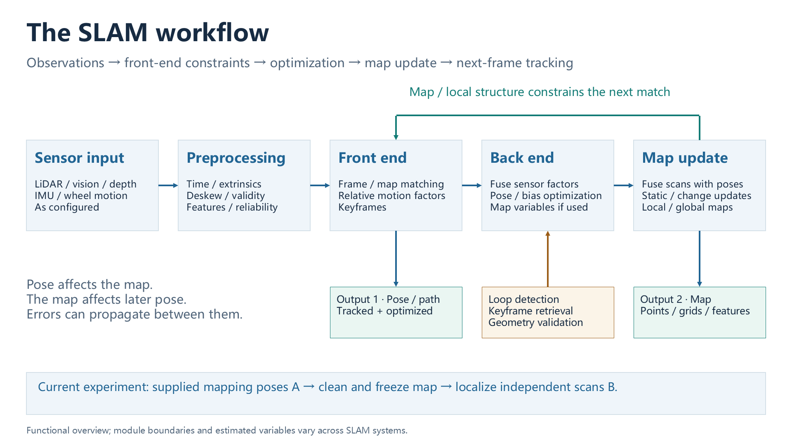
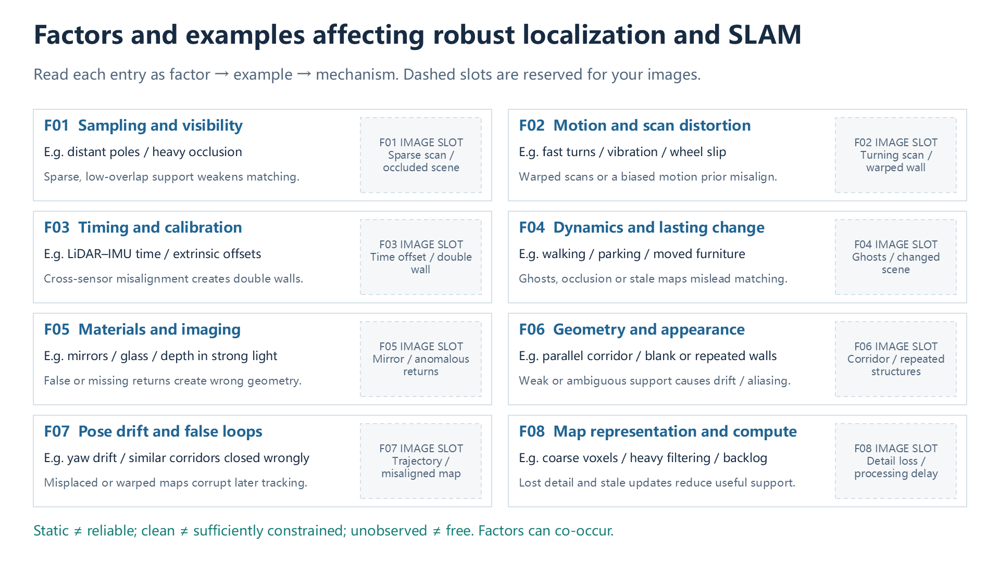

# SLAM Learning

**Robust localization and SLAM in dynamic environments**

Dynamic map cleaning · Static structure retention · Downstream localization

English | [中文](docs/HOME.zh-CN.md)

[Direction](#direction-analysis) · [Physical test problems](#problem-getting-from-physical-test) · [Open question](#open-question) · [Hypothesis](#hypothesis) · [Related works](#related-works) · [Metrics](#metrics)

[Practice](#practice) · [Hypothesis test experiment](#hypothesis-test-experiment) · [Hardware experiment](#hardware-experiment) · [Branches](#branches)

## Direction analysis

**1. The SLAM workflow: estimate pose and map together.** Observations pass through synchronization, calibration and deskewing; the front end forms matching constraints, the back end optimizes poses and other states, and mapping fuses observations at estimated poses. The map constrains later tracking. Loop retrieval needs geometric validation; a false loop can damage the map. A good prior map is not a prerequisite for starting SLAM.

**2. Factors and examples affecting robust localization and SLAM.** Read each entry as factor→example→mechanism. The eight families cover observations, motion, calibration, changing scenes and the algorithm/system. A stationary mirror can still create unreliable geometry. Dynamic removal, lasting-change updates and degeneracy detection require separate tests. Examples are analysis prompts; image slots await measured evidence.

The current research chain is **dynamic trace removal → static constraint retention → held-out localization test**. Mapping poses and the localizer are controlled while intervening at the map layer. Independent testing determines whether cleaner maps lower pose error. IR-MCL/AdaM-MCL remain localization references.

[Editable PowerPoint source (slides 1–2 Chinese, 3–4 English)](docs/assets/direction/v3/direction-analysis.editable.pptx) · [Design and slot IDs](docs/assets/direction/v3/design.json) · [Sources and scope](docs/assets/direction/v3/sources.json) · [Figure checks](docs/assets/direction/v3/audit.json)

Insert your own images

Open slide 4, select the appropriate dashed F01–F08 box, delete its hint text and choose **Shape Format → Shape Fill → Picture**. Slots have an approximately **1.61:1** aspect ratio; crop the image first if needed. Titles, examples and mechanisms remain independently editable. Alternatively, delete a slot and align an ordinary inserted picture to its former bounds.

Use one clear phenomenon per field. For larger before/after comparisons, duplicate a slide and record matching viewpoints, frame IDs and conditions. Save the PPTX and export PNGs to replace the corresponding previews, or run the [export script](src/scripts/presentation/draw_direction_figures.ps1) with `-ExportOnly` to refresh all four previews without reconstructing objects.

| Deliverable | Content |
| --- | --- |
| Native reproduction | Author source/data/protocol, each paper's metrics and actual reproduced scope |
| Robot tests | Sim2Real-AlgoBench omnidirectional chassis, native 2D and independent 3D LiDAR profiles, progressively harder mapping/localization/recovery |
| Question analysis | Separate weak constraints from map mismatch; narrow using reproducible failures, keeping methods open |

Semantic mapping and earlier projections remain in the [original repository](https://github.com/p20030920p/SLAM_Learning).

## Problem getting from Physical test

### 1. Physical scene

12.17 s

**Analysis:**
<!-- PHYSICAL_TEST_ANALYSIS:real -->

<!-- /PHYSICAL_TEST_ANALYSIS:real -->

### 2. RViz static clip

17.11 s

**Analysis:**
<!-- PHYSICAL_TEST_ANALYSIS:rviz-static -->

<!-- /PHYSICAL_TEST_ANALYSIS:rviz-static -->

### 3. RViz dynamic clip

24.38 s

**Analysis:**
<!-- PHYSICAL_TEST_ANALYSIS:rviz-dynamic -->

<!-- /PHYSICAL_TEST_ANALYSIS:rviz-dynamic -->

## Open question

**Broad direction: reliable mapping and localization in changing environments.** Self-recovery under degradation and large change spans mapping, registration, relocalization and sensor fusion; it is too broad for the present paper set and experiments.

**Focused question: given multi-frame scans and mapping poses, how can dynamic traces be removed while retaining static structure, and under which contamination and geometry conditions does this map improvement reduce held-out localization error?** Validate the map first, then test localization; cleaning does not guarantee accurate pose. [Scope and paper basis](docs/testing/MAPPING-FOCUS.md) · [Earlier recovery background](docs/self-recovery/DESIGN.md).

## Hypothesis

<!-- HOME_HYPOTHESIS_PROGRESS -->
**New A→map cleaning→held-out B runs are complete for static, dynamic and corridor scenes.** [Practice scores and new recordings](#current-map-hypotheses) report map surface error, observed-static coverage, pose error and output coverage. One run per scene; M4 pollution dose response, M5 budget-matched geometry selection and SRRG's separate B remain pending. Guard/Depth/Search is folded as historical localization exploration.
<!-- /HOME_HYPOTHESIS_PROGRESS -->

The focused question has three linked tests: **joint map quality → contamination-dependent localization benefit → geometric conditions for that benefit**. M1 combines the former M1/M2; M4/M5 retain their identifiers for traceability. Projection is a representation/scoring diagnostic, not a separate M3 hypothesis.

| Hypothesis | Controlled test and current evidence |
| --- | --- |
| M1: suppress dynamic traces while limiting static-structure loss (former M1/M2 combined) | Score removal and retention jointly on the same inputs. DUFOMap: DA 46.59%, SA 99.998%; BeautyMap: DA 74.36%, SA 81.15%. Native 2D SRRG: ghost removal 42.31%, static coverage 99.51%, under its own definition. These are single-run observations, not a cross-representation ranking. |
| M4: localization benefit depends on map contamination encountered during the test | Freeze the localizer and independent test B; vary map contamination in predefined regions while controlling static support. Predict a larger paired error/failure reduction when more misleading map support is encountered. Existing dynamic GICP XYZ RMSE Raw/DUFO/Beauty=0.98/0.98/1.04 cm establishes no gain; the controlled relationship and SRRG's separate B remain untested. |
| M5: retained static geometry matters beyond aggregate removal/retention scores | Within one representation and comparable DA/SA, point and compute budgets, compare geometry-preserving retention with uniform/threshold-only retention. Predict better localization when repeatably visible, spatially distinct and complementary structures survive. This map-selection test is unrun; earlier Depth pose experiments do not validate it. |

[Exact hypotheses, controls and falsification](docs/testing/MAPPING-FOCUS.md) · [Map-quality evidence and failure timestamps](docs/testing/MAP-METRICS.zh-CN.md). A point/cell percentage difference alone does not measure lost localization benefit. Static and corridor scenes remain boundary controls; sensor additions and persistent-change updates are separate extensions.

## Related works

<!-- HOME_RELATED_TABLE -->
Grouped by algorithm family. Click a GIF for the full video. The application-direction column is intentionally blank. Different data protocols prevent cross-row ranking.

| Method / algorithm family | Reproduction GIF | Measured metrics and scope | Application direction |
| --- | --- | --- | --- |
| [DUFOMap](docs/papers/dufomap.md) 3D map cleaning |  [Live execution](results/reference/desktop-live-dufomap/execution.mp4) | SA 97.98% / DA 98.7% KITTI-00 · 141 scans; cleaning demonstrated [Record](results/reference/desktop-live-dufomap/record.json) |  |
| [BeautyMap](docs/papers/beautymap.md) Offline 3D map cleaning |  [Live execution](results/reference/desktop-live-beautymap/execution.mp4) | SA 96.95% / DA 98.34% KITTI-00 · 141 scans; cleaning demonstrated [Record](results/reference/desktop-live-beautymap/record.json) |  |
| [srrg_mapper2d](docs/papers/srrg_mapper2d.zh-CN.md) Native dynamic 2D mapping |  [Live execution](results/reference/srrg-2d-dynamic/execution.mp4) | DA 42.31% / SA 99.51% Single Gazebo dynamic run; author code compiled, four scenes in Practice; held-out localization B pending [Record](results/reference/srrg-2d-dynamic/record.json) |  |
| [IR-MCL](docs/papers/ir-mcl.md) 2D neural-field localization |  [Live execution](results/reference/desktop-live-ir-mcl/execution.mp4) | RMSE 5.31 cm / 1.07° Bonn IPBLab Seq 1 [Record](results/reference/desktop-live-ir-mcl/record.json) |  |
| [AdaM-MCL](docs/papers/adam-mcl.md) Learned proposals + particle localization |  [Live execution](results/reference/desktop-adam-mcl/execution.mp4)  [Saved-result replay (no new inference)](results/reference/desktop-adam-mcl/result.mp4) | RMSE 32.23 cells; authored 128-cell map, 2432 training steps; historical sustained convergence 0/10, no comparison to paper metre-scale accuracy [Record](results/reference/desktop-adam-mcl/record.json) |  |
<!-- /HOME_RELATED_TABLE -->

See [Metrics](#metrics) for SA/DA and pose-RMSE definitions. SRRG scores 2D observed support; DUFOMap/BeautyMap score 3D points. IR-MCL/AdaM-MCL do not clean maps.

Inputs, processing and reproduction boundaries

<!-- HOME_RELATED_DETAILS -->
### DUFOMap — dynamic-point removal during map integration

**Input:** successive 3D LiDAR scans and provided sensor poses. **Process:** observed free space supplies evidence that earlier occupied points are transient; an octree accumulates this evidence with margins for pose uncertainty. **Output:** a map with dynamic remnants removed. It does not estimate the robot pose. [Paper and reproduced scope](docs/papers/dufomap.md).

In the live video, gray points are retained, red points are removed, and cyan points are the current scan. Watch how decisions change as later scans supply evidence. KITTI-00, 141 scans; SA 97.98% / DA 98.70%. SA measures retained static points and DA measures removed dynamic points; neither is localization error.

[Live MP4](results/reference/desktop-live-dufomap/execution.mp4) · [record](results/reference/desktop-live-dufomap/record.json)

### BeautyMap — clean an existing point-cloud map

**Input:** the full accumulated 3D map, scans and provided poses. **Process:** the native occupancy representation detects inconsistent occupied structure, followed by the authors' static-structure recovery stage. **Output:** a cleaned reference map. This offline map cleaner is shown while it computes; the input map already exists at the start. [Paper and reproduced scope](docs/papers/beautymap.md).

Gray/red show retained/removed points. Watch the cumulative removal decisions, rather than interpreting the complete initial map as online SLAM. KITTI-00, 141 scans; SA 96.95% / DA 98.34%. Cleaner maps may help downstream localization, but that requires a separate test.

[Live MP4](results/reference/desktop-live-beautymap/execution.mp4) · [record](results/reference/desktop-live-beautymap/record.json)

### IR-MCL — localize with a neural observation model

**Input:** a pretrained neural occupancy field, measured 2D scans and motion input. **Process:** each particle represents a possible robot pose; the field renders a predicted scan at that pose, scan agreement changes particle weights, and resampling concentrates the belief. **Output:** an estimated pose and particle distribution. [Paper, original code and protocol](docs/papers/ir-mcl.md).

In RViz, the map supplies context, yellow particles show pose hypotheses, blue is the displayed estimate and green is the reference trajectory. Watch particle concentration and agreement with the reference. The displayed weighted particle mean is an observer; scoring uses the native saved estimate. Bonn IPBLab Seq 1: 1543 processed / 1354 scored poses, fresh RMSE 5.31 cm / 1.07°. This author-data run is separate from deployment into Gazebo.

[Live MP4](results/reference/desktop-live-ir-mcl/execution.mp4) · [record](results/reference/desktop-live-ir-mcl/record.json)

### AdaM-MCL — combine learned proposals and particle tracking

**Input:** a map, laser observation, motion input and trained proposal model. **Process:** the learned model proposes candidate poses; the adaptive mixture combines proposals with conventional particle tracking. **Output:** pose belief, including hypotheses after a kidnapping event. [Paper and limits](docs/papers/adam-mcl.md).

Our run uses an authored 128-cell map and a 2432-step checkpoint: 123 filter updates, RMSE 32.23 cells. The released paper dataset/checkpoint was unavailable. This verifies a limited original-code workflow; it neither reproduces the paper's metre-scale scores nor demonstrates successful recovery. [Score correction](results/reference/adam-mcl/ERRATUM.md).

[Live MP4](results/reference/desktop-adam-mcl/execution.mp4) · [record](results/reference/desktop-adam-mcl/record.json)

[Result MP4](results/reference/desktop-adam-mcl/result.mp4)

<!-- SRRG_RELATED -->
### srrg_mapper2d · native 2D dynamic-map maintenance

[IROS 2018 论文](https://iris.uniroma1.it/handle/11573/1340118) · [作者建图库](https://gitlab.com/srrg-software/srrg_mapper2d) · [ROS入口](https://gitlab.com/srrg-software/srrg_mapper2d_ros) · [merger2d.cpp](https://gitlab.com/srrg-software/srrg_scan_matcher/-/blob/master/src/merger2d.cpp)。

The paper evaluates long-term dynamic 2D mapping on LCAS–STRANDS and MIT Stata Center, integrating dynamic handling into scan alignment, merging and graph maintenance. The author libraries have now been compiled and tested in all four local scenes.

[2D 实践：视频与指标](#srrg-2d) · [失败诊断](#srrg-diagnostics) · [原文适用条件](docs/papers/srrg_mapper2d.zh-CN.md)

<!-- /SRRG_RELATED -->
<!-- /HOME_RELATED_DETAILS -->

## Metrics

### Map-cleaning metrics · SA / DA / AA / HA

**Shared metrics.** DUFOMap and BeautyMap use the same SA/DA definitions. $S,D$ count ground-truth static/dynamic points; $S_k,D_r$ count correctly kept static and removed dynamic points. AA (DUFOMap) is the geometric mean; HA (BeautyMap) is the harmonic mean. [DUFOMap definition](https://arxiv.org/html/2403.01449v1#S4.SS2) · [BeautyMap definition](https://arxiv.org/html/2405.07283v1#S4).

$$
\begin{aligned}
\mathrm{SA} &= 100\frac{S_k}{S}, &
\mathrm{DA} &= 100\frac{D_r}{D},\\
\mathrm{AA} &= \sqrt{\mathrm{SA}\,\mathrm{DA}}, &
\mathrm{HA} &= \frac{2\,\mathrm{SA}\,\mathrm{DA}}{\mathrm{SA}+\mathrm{DA}}.
\end{aligned}
$$

**Map-cleaning metrics: dynamic removal and static retention; higher is better.** Legacy projections score unique 5cm cells; native SRRG uses 10cm support and 15cm coverage tolerance; 3D scores source points. These definitions differ. N/A means no dynamic samples. Persistent-change old maps score static A only; no B update was tested. Pose RMSE is reported separately. Legacy DUFOMap/BeautyMap projections remain as cross-dimensional references; native 2D SRRG is added below.

### Measured result calculation

Each saved native pose update is paired with independent Gazebo robot truth within **0.05 simulation seconds**. Both use the same map/world frame; no spatial fitting is applied. The scored files include initialization and retain rejected timestamp counts.

$$e_i=\sqrt{(\hat x_i-x_i)^2+(\hat y_i-y_i)^2},\quad \mathrm{RMSE}_{xy}=\sqrt{\frac1N\sum_{i=1}^N e_i^2}.$$

Native 3D GICP uses full 3D maps/clouds and XYZ outputs in `*-poses3d.csv`, with the same ≤0.05 s synchronization rule. Missing outputs are not filled with zero; report count, first/last timestamp and common coverage. Unequal corridor coverage prevents ranking whole-run RMSE. Dynamic removal/static retention are separate map metrics.

$$e_{i,xyz}=\sqrt{(\hat x_i-x_i)^2+(\hat y_i-y_i)^2+(\hat z_i-z_i)^2},\quad \mathrm{RMSE}_{xyz}=100\sqrt{\frac1N\sum_{i=1}^N e_{i,xyz}^2}\;\text{cm}.$$

Yaw differences are wrapped to $[-\pi,\pi]$ before RMS and converted to degrees. Metres × 100 gives centimetres. **Live execution** records real computation in wall time; **Measured result replay** draws saved estimates and truth in simulation time, with no new inference. The replay curve is instantaneous error, while its RMSE label uses the full scored CSV. [CSV, window rules and recovery criterion](docs/testing/LIVE.md#how-errors-are-calculated) · [Executable score code](src/scripts/presentation/observe_session.py).

### Reproduction results

| Work | Data | Result |
| --- | --- | --- |
| [DUFOMap](https://github.com/p20030920p/SLAM_Learning/blob/535a2780af7ca7eb3aa02f722e1340fe90bc2dcf/docs/DUFOMAP_TABLE4.md) | KITTI-00, 141 scans | Table IV accuracy matched |
| [BeautyMap](https://github.com/p20030920p/SLAM_Learning/blob/535a2780af7ca7eb3aa02f722e1340fe90bc2dcf/docs/KITTI_PAPER_PROTOCOL.md) | Historical KITTI-02, 91 scans | Table III accuracy matched |
| [IR-MCL](docs/papers/ir-mcl.md) | Bonn IPBLab, released localization sequence, 1543 scans | Location RMSE 5.32 cm against the paper's 5.13 cm |
| [AdaM-MCL](docs/papers/adam-mcl.md) | Authored 128-cell plan, one held-out scene, 123 updates × 10 repeats | Released pipeline executed; no paper value compared |

### Evidence

Values below come from the papers linked by the original repositories and our recorded author-code runs. Each table concerns one method; no cross-method ranking is implied.

#### DUFOMap

KITTI-00, 141 released scans; full setting: voxel 0.1 m, d_s=0.2 m, d_p=1. [Original repository](https://github.com/KTH-RPL/dufomap/tree/9e239ddd5995136e14f5212f33382a6ebc59e518) · [Paper Table IV](https://arxiv.org/html/2403.01449v1#S5.T4) · [Our results](https://github.com/p20030920p/SLAM_Learning/blob/535a2780af7ca7eb3aa02f722e1340fe90bc2dcf/docs/DUFOMAP_TABLE4.md).

| Metric | Paper % | Reproduced % |
| --- | ---: | ---: |
| SA | 97.96 | 97.9635 |
| DA | 98.72 | 98.7196 |
| AA | 98.34 | 98.3408 |

All three full-setting values match the paper at two decimals. Across all five Table IV settings, all 15 accuracy entries match; runtime and online experiments are outside this comparison.

#### BeautyMap

Historical KITTI-02, frames 860–950, 91 scans; XY=1 m, Z=0.5 m, range=40 m. [Original repository](https://github.com/MKJia/BeautyMap/tree/98bce4a97db96ddd0d5342e31425c7679f58ba2e) · [Paper Table III](https://arxiv.org/html/2405.07283v1#S4.T3) · [Our results](https://github.com/p20030920p/SLAM_Learning/blob/535a2780af7ca7eb3aa02f722e1340fe90bc2dcf/docs/KITTI_PAPER_PROTOCOL.md).

| Metric | Paper % | Reproduced % |
| --- | ---: | ---: |
| SA | 83.40 | 83.3978 |
| DA | 82.41 | 82.4092 |
| HA | 82.90 | 82.9006 |

All three values match at two decimals. All nine accuracy entries across XY=0.5/1/2 m match. This uses historical preprocessing/GT and the author's HA scorer; the exact paper method commit remains unidentified. Other sequences and runtime are outside this comparison.

#### IR-MCL

Bonn IPBLab, the single released localization sequence; scored window 1354 of 1543 scans, because the repository's own evaluation drops the first 20 s. [Original repository](https://github.com/PRBonn/ir-mcl/tree/aab8c91b37e59f94442d8eddfa2f920ab1ecc4c5) · [Paper IV-B localization table](https://arxiv.org/html/2210.03113v2#S4.SS2) · [Our run](results/reference/ir-mcl/runs/ir-mcl-wsl/record.json).

| Metric | Paper, Seq 1 | Reproduced |
| --- | ---: | ---: |
| Location RMSE (cm) | 5.13 | 5.32 |
| Yaw RMSE (deg) | 1.05 | 1.07 |
| Location < 5 cm (%) | 63.15 | 61.74 |
| Location < 10 cm (%) | 97.27 | 96.01 |
| Location < 20 cm (%) | 100.00 | 100.00 |
| Yaw < 0.5° (%) | 47.12 | 47.64 |
| Yaw < 1° (%) | 74.59 | 75.85 |
| Yaw < 2° (%) | 94.24 | 93.57 |

The paper's Seq-1 percentages are exact integer counts over 1354 samples, the same window this repository's evaluation produces, so the rows are directly comparable. The C++ motion model seeds its generator from `std::random_device`, so repeated runs differ slightly; a second full run gave 5.28 cm. The upstream README's supplementary 6.62 cm / 1.11° aggregates the whole self-recorded dataset, not Seq 1, and is not used here.

#### AdaM-MCL

Authored 128-cell indoor plan, one held-out scene, 123 filter updates, 200 particles and $T_{\mathrm{cut}}=0.6$ — the particle number and trust threshold of the paper's synthetic setting. [Original repository](https://github.com/Runjian-Chen/AdaM_MCL/tree/e8aedd2bae03816aabd5300e5ca2fe181b39d830) · [Paper Table II](https://arxiv.org/html/2009.00211v3) · [Our run](results/reference/adam-mcl/runs/adam-mcl-wsl/record.json).

| Metric | Paper Table II | This run |
| --- | ---: | ---: |
| Global localization $E_{pos}$ | 0.153 m | not compared |
| Kidnapping $E_{pos}$ | 0.128 m | not compared |

**No numeric comparison is made.** The paper's 20 simulation maps are 43 m × 43 m with six evaluation sequences and released checkpoints, all of them external downloads; this run authors its own plans and trains for 2 432 optimizer steps against the authors' 2 880 000, so cells are not metres. Measured here, in cells: mean per-trial position RMSE 34.82 over 10 repeats, mean final error 47.71, 0.43 s per filter update, and 0 of 10 repeats holding the paper's convergence rule rescaled to this plan. [Score correction](results/reference/adam-mcl/ERRATUM.md).

## Practice

<!-- HOME_EXPERIMENTS_V2 -->

### Index

[Setup](#practice-setup) · [Metrics](#practice-metrics)

[New hypothesis tests](#current-map-hypotheses) · [Static](#current-hypothesis-static) · [Dynamic](#current-hypothesis-dynamic) · [Corridor](#current-hypothesis-corridor)

Earlier baseline index

| Scene | 2D mapping | 2D localization | 3D localization |
| --- | --- | --- | --- |
| [Pure static](#practice-static) | [Raw / SRRG](#srrg-static-2d) | [AMCL](#scene-static-2d) | [GICP](#scene-static-3d) |
| [Moving obstacles](#practice-dynamic) | [Raw / SRRG](#srrg-dynamic-2d) | [AMCL](#scene-dynamic-2d) | [GICP](#scene-dynamic-3d) |
| [Corridor degradation](#practice-corridor) | [Raw / SRRG](#srrg-corridor-2d) | [AMCL](#scene-corridor-2d) | [GICP](#scene-corridor-3d) |

[Supplementary experiments](#practice-appendix) · [Hypothesis experiments](#hypothesis-experiments) · [Video gallery](demo/gallery.html)

<!-- HOME_SIMULATION -->

### Experiment setup

| Item | Setting |
| --- | --- |
| Platform | ROS 2 Jazzy + Gazebo Harmonic; simulation results |
| Robot | Sim2Real-AlgoBench three-wheel omni base; 120° spacing, wheel radius 0.06364 m |
| 2D sensors | Simulated 2D LiDAR + wheel odometry; 720 rays, 360°, 10 Hz, 0.08–12 m |
| 3D sensors | Independent simulated 3D LiDAR; 720×16 rays, 360°×30°, 10 Hz, 0.08–12 m |
| Other sensors | RGB 640×480 / 15 Hz; depth 320×240 / 10 Hz / 0.25–4 m, used only in historical depth-hypothesis trials |
| Physical hardware | Physical chassis, Unitree L2 and RealSense D435 available; SLAM results here are simulated; new tests list the run host |
| Scenes | Static room, moving boxes, parallel corridor; persistent change is supplementary |
| Corridor protocol | Historical runs restrict scans to 72 rays / 3.5 m for 50 recording simulation seconds; localization starts offset, with 240° FOV in 3D |
| 2D mapping task | Raw accumulation vs SRRG maintenance; estimated mapping poses, known start, graph merging off; independent localization B pending |
| Map/localization task | Supplied-pose mapping A → Raw / DUFOMap / BeautyMap → frozen map → independent B; fixed AMCL in 2D and GICP in 3D |
| Map representation | 2D projection: 0.05 m cells, Z=0.12–1.20 m, one-cell dilation; full 3D clouds; SRRG is native 2D |
| Pose scoring | Truth for evaluation only, ≤0.05 simulation-s sync; original streams retain initialization, new tables use the shared recording interval; no fitted alignment or zero fill |

[Robot URDF](config/robot_profiles/omni-3d-v1/omni_car_lidar3d.urdf) · [World files](config/presentation/worlds) · [Sensor profiles](src/scripts/presentation/probe_sensors.py) · [Physical-device record](docs/media/hardware/record.json)

<!-- /HOME_SIMULATION -->

### Metric definitions

| Metric | Definition |
| --- | --- |
| DA ↑ | Dynamic-removal fraction; N/A when no dynamic denominator exists |
| SA ↑ | Static retention / coverage; sample units differ as below |
| DA / SA 口径 | SRRG: 10 cm support cells, 15 cm coverage tolerance; projected 2D: exclusive 5 cm cells; 3D: labelled source points |
| RMSE ↓ | Position root-mean-square error, cm; mapping and held-out localization separated; XY in 2D, XYZ in 3D |
| 角度 RMSE ↓ | Yaw error in 2D / full rotation error in 3D, RMS in degrees |
| P95 ↓ / N | 95th percentile of position error / scored pose count; valid outputs only |
| 新增结构覆盖 ↑ | Fraction of new static-support cells covered by the maintained map |
| 几何误差 / 完整率 / F-score | New tests measure surface error and observed-static coverage; whole-world completeness/F-score pending; DA/SA are separate |
| — / N/A | Not scored or recorded / not applicable |

[Full calculation definitions](#metrics)

### New hypothesis tests: map quality → held-out localization

Index: [Static](#current-hypothesis-static) · [Dynamic](#current-hypothesis-dynamic) · [Corridor](#current-hypothesis-corridor)

| Item | Setup |
| --- | --- |
| Task | Fresh A → same 60 scans → Raw / DUFOMap / BeautyMap → frozen maps → fresh B + fixed GICP |
| Sensors | Omni base and 720×16 3D LiDAR above; B uses clouds and wheel odometry; truth for evaluation only |
| Run host | AMD Ryzen 5 7500F 6-Core Processor; 31.65 GiB; D3D12 (NVIDIA GeForce RTX 4070 SUPER) |
| Duration / trials | A: 90 simulation s each; B: static/dynamic 90 s, corridor 120 s; one run per scene |
| Test scope | M1 joint map scores; M4 paired localization; M5 corridor boundary. Pollution dose response and geometry-selection ablation remain pending |

[Frozen protocol](results/reference/map-hypotheses-20261015/protocol.json) · [Scores](results/reference/map-hypotheses-20261015/summary.json) · [Host record](results/reference/map-hypotheses-20261015/host.json)

| Metric | Definition |
| --- | --- |
| Surface RMSE ↓ | RMS map-to-rendered-static-mesh distance, cm; ground/self excluded; one point per 5cm voxel |
| P@5cm / C@5cm ↑ | Surface precision / A-observed static-reference coverage at 5cm; coverage is not whole-world completeness |
| DA / SA ↑ | Dynamic removal / static retention on source points; static scenes use geometry-confirmed static points and DA=N/A |
| Pose RMSE / P95 ↓ | 10Hz recording-time grid; paired where all maps have valid causal outputs aged ≤0.15s; no trajectory fitting |
| Output coverage / within thresholds ↑ | Valid-output fraction / fraction with position<10cm and rotation<5°; missing outputs are unsuccessful |
| Gain ↑ | Raw RMSE minus method RMSE; positive improves, negative worsens |

#### Static scene

**A · Map scores**

| Method | Surface RMSE / cm | P@5cm | C@5cm | DA | SA |
| --- | --- | --- | --- | --- | --- |
| Raw | 1.03 | 99.79% | 100.00% | N/A | 100.00% |
| DUFOMap | 1.03 | 99.79% | 100.00% | N/A | 100.00% |
| BeautyMap | 1.04 | 99.77% | 71.67% | N/A | 77.23% |

[Map-score record](results/reference/map-hypotheses-20261015/static/map-quality/record.json)

**B · Held-out localization**

| Map | XYZ RMSE / cm | Rotation RMSE / ° | P95 / cm | Output coverage | Within thresholds | Gain vs Raw / cm |
| --- | --- | --- | --- | --- | --- | --- |
| Raw | 0.76 | 0.14 | 1.45 | 99.45% | 99.45% | 0.00 |
| DUFOMap | 0.74 | 0.14 | 1.46 | 99.89% | 99.89% | 0.03 |
| BeautyMap | 0.83 | 0.15 | 1.30 | 99.78% | 99.78% | -0.07 |

Common scoring timestamps: 895 / 901 · [Localization record](results/reference/map-hypotheses-20261015/static/localization-3d/record.json)

New recordings: acquisition / processing / localization

 [Mapping-A acquisition](results/reference/map-hypotheses-20261015/static/mapping-a/execution.mp4)

 [Actual three-method processing terminal](results/reference/map-hypotheses-20261015/static/map-processing/full-session.mp4)

 [Raw · held-out B live](results/reference/map-hypotheses-20261015/static/localization-3d/executions/raw.mp4)

 [DUFOMap · held-out B live](results/reference/map-hypotheses-20261015/static/localization-3d/executions/dufomap.mp4)

 [BeautyMap · held-out B live](results/reference/map-hypotheses-20261015/static/localization-3d/executions/beautymap.mp4)

**Analysis:**
<!-- PRACTICE_ANALYSIS:current-hypothesis-static -->

<!-- /PRACTICE_ANALYSIS:current-hypothesis-static -->

#### Dynamic scene

**A · Map scores**

| Method | Surface RMSE / cm | P@5cm | C@5cm | DA | SA |
| --- | --- | --- | --- | --- | --- |
| Raw | 7.04 | 96.56% | 99.98% | 0.00% | 100.00% |
| DUFOMap | 4.67 | 98.06% | 99.98% | 50.68% | 99.99% |
| BeautyMap | 3.66 | 98.88% | 73.81% | 71.90% | 84.31% |

[Map-score record](results/reference/map-hypotheses-20261015/dynamic/map-quality/record.json)

**B · Held-out localization**

| Map | XYZ RMSE / cm | Rotation RMSE / ° | P95 / cm | Output coverage | Within thresholds | Gain vs Raw / cm |
| --- | --- | --- | --- | --- | --- | --- |
| Raw | 1.00 | 0.15 | 1.36 | 90.34% | 90.34% | 0.00 |
| DUFOMap | 0.98 | 0.15 | 1.34 | 90.57% | 90.57% | 0.02 |
| BeautyMap | 1.13 | 0.19 | 1.62 | 97.23% | 97.23% | -0.13 |

Common scoring timestamps: 737 / 901 · [Localization record](results/reference/map-hypotheses-20261015/dynamic/localization-3d/record.json)

New recordings: acquisition / processing / localization

 [Mapping-A acquisition](results/reference/map-hypotheses-20261015/dynamic/mapping-a/execution.mp4)

 [Actual three-method processing terminal](results/reference/map-hypotheses-20261015/dynamic/map-processing/full-session.mp4)

 [Raw · held-out B live](results/reference/map-hypotheses-20261015/dynamic/localization-3d/executions/raw.mp4)

 [DUFOMap · held-out B live](results/reference/map-hypotheses-20261015/dynamic/localization-3d/executions/dufomap.mp4)

 [BeautyMap · held-out B live](results/reference/map-hypotheses-20261015/dynamic/localization-3d/executions/beautymap.mp4)

**Analysis:**
<!-- PRACTICE_ANALYSIS:current-hypothesis-dynamic -->

<!-- /PRACTICE_ANALYSIS:current-hypothesis-dynamic -->

#### Corridor degradation

**A · Map scores**

| Method | Surface RMSE / cm | P@5cm | C@5cm | DA | SA |
| --- | --- | --- | --- | --- | --- |
| Raw | 1.41 | 98.96% | 99.99% | N/A | 100.00% |
| DUFOMap | 1.41 | 98.96% | 99.99% | N/A | 100.00% |
| BeautyMap | 1.41 | 98.96% | 99.41% | N/A | 99.84% |

[Map-score record](results/reference/map-hypotheses-20261015/corridor/map-quality/record.json)

**B · Held-out localization**

| Map | XYZ RMSE / cm | Rotation RMSE / ° | P95 / cm | Output coverage | Within thresholds | Gain vs Raw / cm |
| --- | --- | --- | --- | --- | --- | --- |
| Raw | 390.87 | 0.24 | 704.80 | 50.62% | 1.50% | 0.00 |
| DUFOMap | 343.09 | 0.30 | 573.49 | 63.95% | 1.33% | 47.78 |
| BeautyMap | 311.21 | 0.41 | 594.03 | 99.58% | 54.79% | 79.67 |

Common scoring timestamps: 597 / 1201 · [Localization record](results/reference/map-hypotheses-20261015/corridor/localization-3d/record.json)

Corridor: 3.5m / 240° / 72 horizontal bins for the first 50s, then restored; full-input arms run from the start. Both start with a 1m X offset.

Corridor Raw/DUFOMap cloud hashes are identical in this run; pose streams come from separate nodes.

**Limited phase** · Common timestamps 497

| Map | XYZ RMSE / cm | Rotation RMSE / ° | P95 / cm | Output coverage | Within thresholds | Gain vs Raw / cm |
| --- | --- | --- | --- | --- | --- | --- |
| Raw | 370.05 | 0.22 | 717.95 | 99.80% | 2.99% | 0.00 |
| DUFOMap | 316.43 | 0.31 | 554.43 | 99.60% | 1.80% | 53.62 |
| BeautyMap | 331.07 | 0.37 | 600.27 | 99.80% | 2.20% | 38.98 |

**After observation restoration** · Common timestamps 100

| Map | XYZ RMSE / cm | Rotation RMSE / ° | P95 / cm | Output coverage | Within thresholds | Gain vs Raw / cm |
| --- | --- | --- | --- | --- | --- | --- |
| Raw | 481.17 | 0.30 | 583.43 | 15.43% | 0.43% | 0.00 |
| DUFOMap | 452.88 | 0.24 | 581.95 | 38.43% | 1.00% | 28.28 |
| BeautyMap | 182.84 | 0.57 | 311.27 | 99.43% | 92.43% | 298.32 |

**Full observations from start** · Common timestamps 260

| Map | XYZ RMSE / cm | Rotation RMSE / ° | P95 / cm | Output coverage | Within thresholds | Gain vs Raw / cm |
| --- | --- | --- | --- | --- | --- | --- |
| Raw | 299.47 | 0.54 | 543.88 | 48.13% | 1.00% | 0.00 |
| DUFOMap | 302.77 | 0.52 | 541.69 | 22.48% | 0.58% | -3.29 |
| BeautyMap | 0.61 | 0.14 | 0.77 | 99.67% | 99.67% | 298.86 |

New recordings: acquisition / processing / localization

 [Mapping-A acquisition](results/reference/map-hypotheses-20261015/corridor/mapping-a/execution.mp4)

 [Actual three-method processing terminal](results/reference/map-hypotheses-20261015/corridor/map-processing/full-session.mp4)

 [Raw · held-out B live](results/reference/map-hypotheses-20261015/corridor/localization-3d/executions/raw.mp4)

 [DUFOMap · held-out B live](results/reference/map-hypotheses-20261015/corridor/localization-3d/executions/dufomap.mp4)

 [BeautyMap · held-out B live](results/reference/map-hypotheses-20261015/corridor/localization-3d/executions/beautymap.mp4)

**Analysis:**
<!-- PRACTICE_ANALYSIS:current-hypothesis-corridor -->

<!-- /PRACTICE_ANALYSIS:current-hypothesis-corridor -->

Earlier baselines and supplementary experiments

### 1 · Pure static

#### Native 2D mapping · Raw / SRRG

<!-- HOME_EXPERIMENT_TABLE -->
| Method | DA | SA | Mapping XY RMSE / cm |
| --- | --- | --- | --- |
| Raw | N/A | 100% | — |
| SRRG | N/A | 99.84% | 0.71 |
<!-- /HOME_EXPERIMENT_TABLE -->

[Record](results/reference/srrg-2d-static/record.json) · Held-out localization B: pending

Videos

**Raw / SRRG**

 [Live execution](results/reference/srrg-2d-static/execution.mp4)

**Analysis:**
<!-- PRACTICE_ANALYSIS:srrg-static-2d -->

<!-- /PRACTICE_ANALYSIS:srrg-static-2d -->

#### Projected 2D maps + AMCL

<!-- HOME_EXPERIMENT_TABLE -->
| Map | DA | SA | XY RMSE / cm | yaw RMSE / ° | P95 / cm | N |
| --- | --- | --- | --- | --- | --- | --- |
| Raw | N/A | 100% | 7.28 | 1.03 | 10.74 | 290 |
| DUFOMap | N/A | 100% | 7.28 | 1.03 | 10.74 | 290 |
| BeautyMap | N/A | 96.51% | 6.89 | 1.05 | 8.44 | 290 |
<!-- /HOME_EXPERIMENT_TABLE -->

[Record](results/reference/robot-live-static/record.json) · [Map scores](results/analysis/map-quality/static.json)

Videos

**Raw**

 [Live execution](results/reference/robot-live-static/executions/raw.mp4)  [Saved-result replay (no new inference)](results/reference/robot-live-static/methods/raw/result.mp4)

**DUFOMap**

 [Live execution](results/reference/robot-live-static/executions/dufomap.mp4)  [Saved-result replay (no new inference)](results/reference/robot-live-static/methods/dufomap/result.mp4)

**BeautyMap**

 [Live execution](results/reference/robot-live-static/executions/beautymap.mp4)  [Saved-result replay (no new inference)](results/reference/robot-live-static/methods/beautymap/result.mp4)

**Analysis:**
<!-- PRACTICE_ANALYSIS:scene-static-2d -->

<!-- /PRACTICE_ANALYSIS:scene-static-2d -->

#### 3D maps + GICP

<!-- HOME_EXPERIMENT_TABLE -->
| Map | DA | SA | XYZ RMSE / cm | Rotation RMSE / ° | P95 / cm | N |
| --- | --- | --- | --- | --- | --- | --- |
| Raw | N/A | 100% | 0.95 | 0.15 | 1.47 | 845 |
| DUFOMap | N/A | 99.999% | 0.99 | 0.16 | 1.47 | 835 |
| BeautyMap | N/A | 83.33% | 1.07 | 0.17 | 1.44 | 917 |
<!-- /HOME_EXPERIMENT_TABLE -->

[Record](results/reference/robot-3d-static/record.json) · [Map scores](results/analysis/map-quality/static.json)

Videos

**Raw**

 [Live execution](results/reference/robot-3d-static/executions/raw.mp4)

**DUFOMap**

 [Live execution](results/reference/robot-3d-static/executions/dufomap.mp4)

**BeautyMap**

 [Live execution](results/reference/robot-3d-static/executions/beautymap.mp4)

**Analysis:**
<!-- PRACTICE_ANALYSIS:scene-static-3d -->

<!-- /PRACTICE_ANALYSIS:scene-static-3d -->

[↑ Practice index](#practice-index)

### 2 · Moving obstacles

#### Native 2D mapping · Raw / SRRG

<!-- HOME_EXPERIMENT_TABLE -->
| Method | DA | SA | Mapping XY RMSE / cm |
| --- | --- | --- | --- |
| Raw | 0% | 100% | — |
| SRRG | 42.31% | 99.51% | 0.64 |
<!-- /HOME_EXPERIMENT_TABLE -->

[Record](results/reference/srrg-2d-dynamic/record.json) · Held-out localization B: pending

Videos

**Raw / SRRG**

 [Live execution](results/reference/srrg-2d-dynamic/execution.mp4)

**Analysis:**
<!-- PRACTICE_ANALYSIS:srrg-dynamic-2d -->

<!-- /PRACTICE_ANALYSIS:srrg-dynamic-2d -->

#### Projected 2D maps + AMCL

<!-- HOME_EXPERIMENT_TABLE -->
| Map | DA | SA | XY RMSE / cm | yaw RMSE / ° | P95 / cm | N |
| --- | --- | --- | --- | --- | --- | --- |
| Raw | 0% | 100% | 7.52 | 1.78 | 13.93 | 291 |
| DUFOMap | 8.33% | 100% | 8.19 | 1.76 | 12.83 | 291 |
| BeautyMap | 33.33% | 96.64% | 7.29 | 1.79 | 13.41 | 291 |
<!-- /HOME_EXPERIMENT_TABLE -->

[Record](results/reference/robot-2d-dynamic-matched/record.json) · [Map scores](results/analysis/map-quality/projected-dynamic.json)

Videos

**Raw**

 [Live execution](results/reference/robot-2d-dynamic-matched/executions/raw.mp4)  [Saved-result replay (no new inference)](results/reference/robot-2d-dynamic-matched/methods/raw/result.mp4)

**DUFOMap**

 [Live execution](results/reference/robot-2d-dynamic-matched/executions/dufomap.mp4)  [Saved-result replay (no new inference)](results/reference/robot-2d-dynamic-matched/methods/dufomap/result.mp4)

**BeautyMap**

 [Live execution](results/reference/robot-2d-dynamic-matched/executions/beautymap.mp4)  [Saved-result replay (no new inference)](results/reference/robot-2d-dynamic-matched/methods/beautymap/result.mp4)

**Analysis:**
<!-- PRACTICE_ANALYSIS:scene-dynamic-2d -->

<!-- /PRACTICE_ANALYSIS:scene-dynamic-2d -->

#### 3D maps + GICP

<!-- HOME_EXPERIMENT_TABLE -->
| Map | DA | SA | XYZ RMSE / cm | Rotation RMSE / ° | P95 / cm | N |
| --- | --- | --- | --- | --- | --- | --- |
| Raw | 0% | 100% | 0.98 | 0.17 | 1.96 | 967 |
| DUFOMap | 46.59% | 99.998% | 0.98 | 0.18 | 2.00 | 963 |
| BeautyMap | 74.36% | 81.15% | 1.04 | 0.17 | 1.99 | 1022 |
<!-- /HOME_EXPERIMENT_TABLE -->

[Record](results/reference/robot-3d-dynamic/record.json) · [Map scores](results/reference/robot-3d-map-audit/record.json)

Videos

**Raw**

 [Live execution](results/reference/robot-3d-dynamic/executions/raw.mp4)

**DUFOMap**

 [Live execution](results/reference/robot-3d-dynamic/executions/dufomap.mp4)

**BeautyMap**

 [Live execution](results/reference/robot-3d-dynamic/executions/beautymap.mp4)

**Analysis:**
<!-- PRACTICE_ANALYSIS:scene-dynamic-3d -->

<!-- /PRACTICE_ANALYSIS:scene-dynamic-3d -->

[↑ Practice index](#practice-index)

### 3 · Corridor degradation

#### Native 2D mapping · Raw / SRRG

<!-- HOME_EXPERIMENT_TABLE -->
| Method | DA | SA | Mapping XY RMSE / cm |
| --- | --- | --- | --- |
| Raw | N/A | 83.43% | — |
| SRRG | N/A | 82.24% | 83.23 |
<!-- /HOME_EXPERIMENT_TABLE -->

[Record](results/reference/srrg-2d-corridor/record.json) · Held-out localization B: pending

Videos

**Raw / SRRG**

 [Live execution](results/reference/srrg-2d-corridor/execution.mp4)

**Analysis:**
<!-- PRACTICE_ANALYSIS:srrg-corridor-2d -->

<!-- /PRACTICE_ANALYSIS:srrg-corridor-2d -->

#### Projected 2D maps + AMCL

<!-- HOME_EXPERIMENT_TABLE -->
| Map | DA | SA | XY RMSE / cm | yaw RMSE / ° | P95 / cm | N |
| --- | --- | --- | --- | --- | --- | --- |
| Raw | N/A | 100% | 72.53 | 0.85 | 132.56 | 508 |
| DUFOMap | N/A | 100% | 72.53 | 0.85 | 132.56 | 508 |
| BeautyMap | N/A | 100% | 72.53 | 0.85 | 132.56 | 508 |
<!-- /HOME_EXPERIMENT_TABLE -->

[Record](results/reference/robot-corridor-v2/record.json) · [Map scores](results/analysis/map-quality/corridor.json)

Videos

**Raw**

 [Live execution](results/reference/robot-corridor-v2/executions/degraded_raw.mp4)  [Saved-result replay (no new inference)](results/reference/robot-corridor-v2/methods/degraded_raw/result.mp4)

**DUFOMap**

 [Live execution](results/reference/robot-corridor-v2/executions/degraded_dufomap.mp4)  [Saved-result replay (no new inference)](results/reference/robot-corridor-v2/methods/degraded_dufomap/result.mp4)

**BeautyMap**

 [Live execution](results/reference/robot-corridor-v2/executions/degraded_beautymap.mp4)  [Saved-result replay (no new inference)](results/reference/robot-corridor-v2/methods/degraded_beautymap/result.mp4)

**Analysis:**
<!-- PRACTICE_ANALYSIS:scene-corridor-2d -->

<!-- /PRACTICE_ANALYSIS:scene-corridor-2d -->

#### 3D maps + GICP

<!-- HOME_EXPERIMENT_TABLE -->
| Map | DA | SA | XYZ RMSE / cm | Rotation RMSE / ° | P95 / cm | N |
| --- | --- | --- | --- | --- | --- | --- |
| Raw | N/A | 100% | 474.38 | 0.53 | 828.94 | 530 |
| DUFOMap | N/A | 100% | 497.05 | 0.48 | 814.15 | 599 |
| BeautyMap | N/A | 99.9% | 592.00 | 49.16 | 917.05 | 655 |
<!-- /HOME_EXPERIMENT_TABLE -->

[Record](results/reference/robot-3d-corridor/record.json) · [Map scores](results/analysis/map-quality/corridor.json)

<!-- HOME_EXPERIMENT_TABLE -->
| Map | Valid pose interval / simulation s |
| --- | --- |
| Raw | 1.6–63.5 |
| DUFOMap | 1.6–76.4 |
| BeautyMap | 1.6–119.3 |
<!-- /HOME_EXPERIMENT_TABLE -->

Videos

**Raw**

 [Live execution](results/reference/robot-3d-corridor/executions/raw.mp4)

**DUFOMap**

 [Live execution](results/reference/robot-3d-corridor/executions/dufomap.mp4)

**BeautyMap**

 [Live execution](results/reference/robot-3d-corridor/executions/beautymap.mp4)

**Analysis:**
<!-- PRACTICE_ANALYSIS:scene-corridor-3d -->

<!-- /PRACTICE_ANALYSIS:scene-corridor-3d -->

[↑ Practice index](#practice-index)

### Supplementary experiments

Persistent change

#### Native 2D mapping · Raw / SRRG

<!-- HOME_EXPERIMENT_TABLE -->
| Method | DA | SA | Mapping XY RMSE / cm | New-structure coverage |
| --- | --- | --- | --- | --- |
| Raw | N/A | 100% | — | 100% |
| SRRG | N/A | 99.71% | 0.46 | 98.9% |
<!-- /HOME_EXPERIMENT_TABLE -->

[Record](results/reference/srrg-2d-large-change/record.json) · Held-out localization B: pending

Videos

**Raw / SRRG**

 [Live execution](results/reference/srrg-2d-large-change/execution.mp4)

**Analysis:**
<!-- PRACTICE_ANALYSIS:srrg-large-change-2d -->

<!-- /PRACTICE_ANALYSIS:srrg-large-change-2d -->

#### Projected 2D maps + AMCL

<!-- HOME_EXPERIMENT_TABLE -->
| Map | DA | SA | XY RMSE / cm | yaw RMSE / ° | P95 / cm | N |
| --- | --- | --- | --- | --- | --- | --- |
| Raw | N/A | 100% | 6.84 | 1.02 | 8.89 | 290 |
| DUFOMap | N/A | 100% | 6.84 | 1.02 | 8.89 | 290 |
| BeautyMap | N/A | 96.51% | 6.39 | 1.04 | 7.25 | 290 |
<!-- /HOME_EXPERIMENT_TABLE -->

[Record](results/reference/robot-live-large-change/record.json) · [Map scores](results/analysis/map-quality/static.json)

Setup: static-A map frozen during B; DA/SA describe the old map A.

Videos

**Raw**

 [Live execution](results/reference/robot-live-large-change/executions/raw.mp4)  [Saved-result replay (no new inference)](results/reference/robot-live-large-change/methods/raw/result.mp4)

**DUFOMap**

 [Live execution](results/reference/robot-live-large-change/executions/dufomap.mp4)  [Saved-result replay (no new inference)](results/reference/robot-live-large-change/methods/dufomap/result.mp4)

**BeautyMap**

 [Live execution](results/reference/robot-live-large-change/executions/beautymap.mp4)  [Saved-result replay (no new inference)](results/reference/robot-live-large-change/methods/beautymap/result.mp4)

**Analysis:**
<!-- PRACTICE_ANALYSIS:scene-change-2d -->

<!-- /PRACTICE_ANALYSIS:scene-change-2d -->

#### 3D maps + GICP

<!-- HOME_EXPERIMENT_TABLE -->
| Map | DA | SA | XYZ RMSE / cm | Rotation RMSE / ° | P95 / cm | N |
| --- | --- | --- | --- | --- | --- | --- |
| Raw | N/A | 100% | 0.93 | 0.17 | 1.45 | 859 |
| DUFOMap | N/A | 99.999% | 1.01 | 0.19 | 1.45 | 860 |
| BeautyMap | N/A | 83.33% | 1.04 | 0.17 | 1.46 | 945 |
<!-- /HOME_EXPERIMENT_TABLE -->

[Record](results/reference/robot-3d-large-change/record.json) · [Map scores](results/analysis/map-quality/static.json)

Setup: static-A map frozen during B; DA/SA describe the old map A.

Videos

**Raw**

 [Live execution](results/reference/robot-3d-large-change/executions/raw.mp4)

**DUFOMap**

 [Live execution](results/reference/robot-3d-large-change/executions/dufomap.mp4)

**BeautyMap**

 [Live execution](results/reference/robot-3d-large-change/executions/beautymap.mp4)

**Analysis:**
<!-- PRACTICE_ANALYSIS:scene-change-3d -->

<!-- /PRACTICE_ANALYSIS:scene-change-3d -->

Saved 3D map review

Video: saved-map replay, no new inference; scores are those in the dynamic 3D table.

 [Saved map replay (no new inference)](results/reference/robot-3d-map-review-v2/execution.mp4)

Earlier Raw-map trials · NDT / GICP

<!-- HOME_EXPERIMENT_TABLE -->
| Method | XY RMSE / cm | yaw RMSE / ° | N | Record |
| --- | --- | --- | --- | --- |
| NDT · initial | 34.43 | 0.15 | 399 | [Record](results/reference/robot-ndt-static-initial/record.json) |
| NDT | 0.93 | 0.17 | 402 | [Record](results/reference/robot-ndt-static/record.json) |
| GICP | 1.09 | 0.16 | 397 | [Record](results/reference/robot-gicp-static/record.json) |
<!-- /HOME_EXPERIMENT_TABLE -->

Videos

**NDT**

 [Live execution](results/reference/robot-ndt-static/execution.mp4)  [Saved-result replay (no new inference)](results/reference/robot-ndt-static/result.mp4)

**GICP**

 [Live execution](results/reference/robot-gicp-static/execution.mp4)  [Saved-result replay (no new inference)](results/reference/robot-gicp-static/result.mp4)

**Analysis:**
<!-- PRACTICE_ANALYSIS:earlier-raw-map-3d-static-trials -->

<!-- /PRACTICE_ANALYSIS:earlier-raw-map-3d-static-trials -->

Additional acquisition and localization

Frames = saved scans; known cells = non-unknown grid cells.

<!-- HOME_EXPERIMENT_TABLE -->
| Scene | Method | Frames | Known cells | XY RMSE / cm | Record |
| --- | --- | --- | --- | --- | --- |
| Pure static | slam_toolbox | 54 | 20568 | — | [Record](results/reference/robot-supp-static/record.json) |
| Moving obstacles | slam_toolbox | 55 | 20509 | — | [Record](results/reference/robot-supp-dynamic/record.json) |
| Persistent change | AMCL | — | — | 6.99 | [Record](results/reference/robot-supp-large-change/record.json) |
<!-- /HOME_EXPERIMENT_TABLE -->

Videos

**Pure static**

 [Live execution](results/reference/robot-supp-static/execution.mp4)

**Moving obstacles**

 [Live execution](results/reference/robot-supp-dynamic/execution.mp4)

**Persistent change**

 [Live execution](results/reference/robot-supp-large-change/execution.mp4)

**Analysis:**
<!-- PRACTICE_ANALYSIS:supplementary-live-scene-recordings -->

<!-- /PRACTICE_ANALYSIS:supplementary-live-scene-recordings -->

SRRG failed runs

<!-- HOME_SRRG_DIAGNOSTICS -->
<!-- HOME_EXPERIMENT_TABLE -->
| Stage | Status | Record | Video |
| --- | --- | --- | --- |
| Eigen ABI | diagnostic_failed | [Record](results/reference/srrg-diagnostic-20261015-025711-mapping-srrg-static-dd423d/record.json) | [GIF](results/reference/srrg-diagnostic-20261015-025711-mapping-srrg-static-dd423d/execution.gif) · [MP4](results/reference/srrg-diagnostic-20261015-025711-mapping-srrg-static-dd423d/execution.mp4) |
| stdout transport | diagnostic_failed | [Record](results/reference/srrg-diagnostic-20261015-030327-mapping-srrg-static-a275d3/record.json) | [GIF](results/reference/srrg-diagnostic-20261015-030327-mapping-srrg-static-a275d3/execution.gif) · [MP4](results/reference/srrg-diagnostic-20261015-030327-mapping-srrg-static-a275d3/execution.mp4) |
| g2o / graph merge | diagnostic_failed | [Record](results/reference/srrg-diagnostic-20261015-030729-mapping-srrg-dynamic-14123d/record.json) | [GIF](results/reference/srrg-diagnostic-20261015-030729-mapping-srrg-dynamic-14123d/execution.gif) · [MP4](results/reference/srrg-diagnostic-20261015-030729-mapping-srrg-dynamic-14123d/execution.mp4) |
<!-- /HOME_EXPERIMENT_TABLE -->

<!-- /HOME_SRRG_DIAGNOSTICS -->
**Analysis:**
<!-- PRACTICE_ANALYSIS:srrg-diagnostics -->

<!-- /PRACTICE_ANALYSIS:srrg-diagnostics -->

[↑ Practice index](#practice-index)

## Hypothesis test experiment

[New map-quality → held-out localization tests](#current-map-hypotheses)

Historical localization-only tests: Guard / Depth / Search

<!-- EARLIER_LOCALIZATION_ONLY -->
This appendix preserves earlier pose-level exploration with frozen maps; it does not validate dynamic mapping.

The earlier results suggest three directions to test:

- **H1 · Guard:** suppress inconsistent matches and reduce lidar corrections along weak directions, while retaining wheel-odometry prediction.
- **H2 · Depth:** use a 2D lidar plus a depth camera to add visible height structure; test the same idea with 3D lidar.
- **H3 · Search and confirm:** search multiple nearby pose candidates and accept a unique, motion-consistent candidate only after consecutive confirmation.

These are small custom ground-robot prototypes. The 2D arm has no 3D lidar; the 3D arm uses XYZ observations with x/y/yaw motion constraints. Mapping A uses supplied poses, all maps stay frozen, and localization B never reads truth. The four original scenes remain; the separately labelled height control adds two high blocks. Single ideal-simulation trials cannot establish a ranking.

[Frozen hypotheses, controls and interpretation](docs/testing/HYPOTHESES.md) · [Video directory](demo/hypotheses.html) · [One-click scripts](demo/README.md#开放问题假设与简单实验)

<!-- PROBE_APPENDIX_RESULTS -->

| Scene | 2D + depth | 3D + depth |
| --- | --- | --- |
| Pure static | [View experiment](#probe-calibrated-2d-static) | [View experiment](#probe-calibrated-3d-static) |
| Moving obstacles | [View experiment](#probe-calibrated-2d-dynamic) | [View experiment](#probe-calibrated-3d-dynamic) |
| Persistent change | [View experiment](#probe-calibrated-2d-large-change) | [View experiment](#probe-calibrated-3d-large-change) |
| Original corridor degradation | [View experiment](#probe-calibrated-2d-corridor) | [View experiment](#probe-calibrated-3d-corridor) |
| Height landmarks · derived control | [View experiment](#probe-calibrated-2d-height-corridor) | [View experiment](#probe-calibrated-3d-height-corridor) |

[Coarse-to-fine follow-up](#probe-refinement-index)

[Interpretation and next directions](#hypothesis-findings)

This matrix fixes the raw source maps and shares identical paired inputs across five prototypes. Red: Plain; yellow: Guard; orange: Depth; purple: lidar search; green: depth + search; blue: native AMCL/GICP. Report XY for 2D and XYZ for 3D; these single trials do not establish a ranking.

### 2D · native-window experiments

#### Pure static · 2D

[↑ Back to index](#hypothesis-experiment-index)

| Method | Map / observations | Metric / effect |
| --- | --- | --- |
| Raw + AMCL | Same-source 2D grid projection | XY RMSE 6.82 cm |
| Plain ICP | 2D lidar point map | XY RMSE 0.15 cm |
| H1 · Guard | 2D lidar point map | XY RMSE 0.15 cm; close to plain |
| H2 · Guard + Depth | 2D lidar point map + depth map | XY RMSE 0.21 cm; 0.06 cm above guard |
| H3 · LiDAR Search | 2D lidar point map | XY RMSE 0.15 cm; close to guard |
| H3 · Depth + Search | 2D lidar point map + depth map | XY RMSE 0.21 cm; close to depth |

Each prototype: 264 frames; usable depth: 219/264; native anchor: 287 outputs. Body height is calibrated from mapping A.

The native anchor last published at simulation 73.2s; prototypes extend to 99.4s. Missing outputs are not filled; native RMSE covers its available outputs only.

[MP4](results/reference/probe-calibrated-2d-static/execution.mp4) · [record](results/reference/probe-calibrated-2d-static/record.json) · [CSV](results/reference/probe-calibrated-2d-static/recover-samples.csv)

#### Moving obstacles · 2D

[↑ Back to index](#hypothesis-experiment-index)

| Method | Map / observations | Metric / effect |
| --- | --- | --- |
| Raw + AMCL | Same-source 2D grid projection | XY RMSE 7.08 cm |
| Plain ICP | 2D lidar point map | XY RMSE 0.37 cm |
| H1 · Guard | 2D lidar point map | XY RMSE 0.19 cm; 0.18 cm below plain |
| H2 · Guard + Depth | 2D lidar point map + depth map | XY RMSE 0.18 cm; close to guard |
| H3 · LiDAR Search | 2D lidar point map | XY RMSE 0.19 cm; close to guard |
| H3 · Depth + Search | 2D lidar point map + depth map | XY RMSE 0.18 cm; close to depth |

Each prototype: 265 frames; usable depth: 181/265; native anchor: 292 outputs. Body height is calibrated from mapping A.

The native anchor last published at simulation 72.3s; prototypes extend to 99.7s. Missing outputs are not filled; native RMSE covers its available outputs only.

[MP4](results/reference/probe-calibrated-2d-dynamic/execution.mp4) · [record](results/reference/probe-calibrated-2d-dynamic/record.json) · [CSV](results/reference/probe-calibrated-2d-dynamic/recover-samples.csv)

#### Persistent change · 2D

[↑ Back to index](#hypothesis-experiment-index)

| Method | Map / observations | Metric / effect |
| --- | --- | --- |
| Raw + AMCL | Same-source 2D grid projection | XY RMSE 6.28 cm |
| Plain ICP | 2D lidar point map | XY RMSE 7.98 cm |
| H1 · Guard | 2D lidar point map | XY RMSE 0.49 cm; 7.49 cm below plain |
| H2 · Guard + Depth | 2D lidar point map + depth map | XY RMSE 0.49 cm; close to guard |
| H3 · LiDAR Search | 2D lidar point map | XY RMSE 0.49 cm; close to guard |
| H3 · Depth + Search | 2D lidar point map + depth map | XY RMSE 0.49 cm; close to depth |

Each prototype: 263 frames; usable depth: 187/263; native anchor: 288 outputs. Body height is calibrated from mapping A.

The native anchor last published at simulation 71.3s; prototypes extend to 99.3s. Missing outputs are not filled; native RMSE covers its available outputs only.

The old map remains frozen; this tests inconsistent-observation handling without map updates.

[MP4](results/reference/probe-calibrated-2d-large-change/execution.mp4) · [record](results/reference/probe-calibrated-2d-large-change/record.json) · [CSV](results/reference/probe-calibrated-2d-large-change/recover-samples.csv)

#### Original corridor degradation · 2D

[↑ Back to index](#hypothesis-experiment-index)

| Method | Map / observations | Metric / effect |
| --- | --- | --- |
| Raw + AMCL | Same-source 2D grid projection | XY RMSE 100.61 cm; sustained recovery 45.7s after restoration |
| Plain ICP | 2D lidar point map | XY RMSE 1037.69 cm; no sustained recovery |
| H1 · Guard | 2D lidar point map | XY RMSE 100.48 cm; 937.21 cm below plain; no sustained recovery |
| H2 · Guard + Depth | 2D lidar point map + depth map | XY RMSE 100.54 cm; 0.06 cm above guard; no sustained recovery |
| H3 · LiDAR Search | 2D lidar point map | XY RMSE 70.40 cm; 30.08 cm below guard; sustained recovery 5.8s after restoration |
| H3 · Depth + Search | 2D lidar point map + depth map | XY RMSE 70.44 cm; 30.11 cm below depth; sustained recovery 5.8s after restoration |

Each prototype: 338 frames; usable depth: 195/338; native anchor: 600 outputs. Body height is calibrated from mapping A.

[MP4](results/reference/probe-calibrated-2d-corridor/execution.mp4) · [record](results/reference/probe-calibrated-2d-corridor/record.json) · [CSV](results/reference/probe-calibrated-2d-corridor/recover-samples.csv)

#### Height landmarks · derived control · 2D

[↑ Back to index](#hypothesis-experiment-index)

| Method | Map / observations | Metric / effect |
| --- | --- | --- |
| Raw + AMCL | Same-source 2D grid projection | XY RMSE 67.00 cm; sustained recovery 11.7s after restoration |
| Plain ICP | 2D lidar point map | XY RMSE 285.54 cm; no sustained recovery |
| H1 · Guard | 2D lidar point map | XY RMSE 101.15 cm; 184.39 cm below plain; no sustained recovery |
| H2 · Guard + Depth | 2D lidar point map + depth map | XY RMSE 100.77 cm; 0.38 cm below guard; no sustained recovery |
| H3 · LiDAR Search | 2D lidar point map | XY RMSE 70.93 cm; 30.22 cm below guard; sustained recovery 5.0s after restoration |
| H3 · Depth + Search | 2D lidar point map + depth map | XY RMSE 21.15 cm; 79.61 cm below depth; sustained recovery 0.2s after restoration |

Each prototype: 345 frames; usable depth: 239/345; native anchor: 620 outputs. Body height is calibrated from mapping A.

Two high blocks are added in this feasibility control; report it separately from the original corridor.

[MP4](results/reference/probe-calibrated-2d-height-corridor/execution.mp4) · [record](results/reference/probe-calibrated-2d-height-corridor/record.json) · [CSV](results/reference/probe-calibrated-2d-height-corridor/recover-samples.csv)

### 3D · native-window experiments

#### Pure static · 3D

[↑ Back to index](#hypothesis-experiment-index)

| Method | Map / observations | Metric / effect |
| --- | --- | --- |
| Raw + GICP | 3D lidar point map | XYZ RMSE 1.08 cm |
| Plain ICP | 3D lidar point map | XYZ RMSE 0.12 cm |
| H1 · Guard | 3D lidar point map | XYZ RMSE 0.12 cm; close to plain |
| H2 · Guard + Depth | 3D lidar point map + depth map | XYZ RMSE 0.21 cm; 0.09 cm above guard |
| H3 · LiDAR Search | 3D lidar point map | XYZ RMSE 0.12 cm; close to guard |
| H3 · Depth + Search | 3D lidar point map + depth map | XYZ RMSE 0.21 cm; close to depth |

Each prototype: 266 frames; usable depth: 184/266; native anchor: 994 outputs. Body height is calibrated from mapping A.

[MP4](results/reference/probe-calibrated-3d-static/execution.mp4) · [record](results/reference/probe-calibrated-3d-static/record.json) · [CSV](results/reference/probe-calibrated-3d-static/recover-samples.csv)

#### Moving obstacles · 3D

[↑ Back to index](#hypothesis-experiment-index)

| Method | Map / observations | Metric / effect |
| --- | --- | --- |
| Raw + GICP | 3D lidar point map | XYZ RMSE 1.39 cm |
| Plain ICP | 3D lidar point map | XYZ RMSE 0.17 cm |
| H1 · Guard | 3D lidar point map | XYZ RMSE 0.13 cm; 0.04 cm below plain |
| H2 · Guard + Depth | 3D lidar point map + depth map | XYZ RMSE 0.13 cm; close to guard |
| H3 · LiDAR Search | 3D lidar point map | XYZ RMSE 0.13 cm; close to guard |
| H3 · Depth + Search | 3D lidar point map + depth map | XYZ RMSE 0.13 cm; close to depth |

Each prototype: 258 frames; usable depth: 154/258; native anchor: 951 outputs. Body height is calibrated from mapping A.

[MP4](results/reference/probe-calibrated-3d-dynamic/execution.mp4) · [record](results/reference/probe-calibrated-3d-dynamic/record.json) · [CSV](results/reference/probe-calibrated-3d-dynamic/recover-samples.csv)

#### Persistent change · 3D

[↑ Back to index](#hypothesis-experiment-index)

| Method | Map / observations | Metric / effect |
| --- | --- | --- |
| Raw + GICP | 3D lidar point map | XYZ RMSE 1.25 cm |
| Plain ICP | 3D lidar point map | XYZ RMSE 3.69 cm |
| H1 · Guard | 3D lidar point map | XYZ RMSE 0.24 cm; 3.45 cm below plain |
| H2 · Guard + Depth | 3D lidar point map + depth map | XYZ RMSE 0.35 cm; 0.11 cm above guard |
| H3 · LiDAR Search | 3D lidar point map | XYZ RMSE 0.24 cm; close to guard |
| H3 · Depth + Search | 3D lidar point map + depth map | XYZ RMSE 0.35 cm; close to depth |

Each prototype: 264 frames; usable depth: 163/264; native anchor: 950 outputs. Body height is calibrated from mapping A.

The old map remains frozen; this tests inconsistent-observation handling without map updates.

[MP4](results/reference/probe-calibrated-3d-large-change/execution.mp4) · [record](results/reference/probe-calibrated-3d-large-change/record.json) · [CSV](results/reference/probe-calibrated-3d-large-change/recover-samples.csv)

#### Original corridor degradation · 3D

[↑ Back to index](#hypothesis-experiment-index)

| Method | Map / observations | Metric / effect |
| --- | --- | --- |
| Raw + GICP | 3D lidar point map | XYZ RMSE 397.82 cm; no sustained recovery |
| Plain ICP | 3D lidar point map | XYZ RMSE 733.38 cm; no sustained recovery |
| H1 · Guard | 3D lidar point map | XYZ RMSE 100.49 cm; 632.88 cm below plain; no sustained recovery |
| H2 · Guard + Depth | 3D lidar point map + depth map | XYZ RMSE 100.62 cm; 0.12 cm above guard; no sustained recovery |
| H3 · LiDAR Search | 3D lidar point map | XYZ RMSE 56.77 cm; 43.72 cm below guard; sustained recovery 6.2s after restoration |
| H3 · Depth + Search | 3D lidar point map + depth map | XYZ RMSE 57.56 cm; 43.06 cm below depth; sustained recovery 6.6s after restoration |

Each prototype: 247 frames; usable depth: 122/247; native anchor: 712 outputs. Body height is calibrated from mapping A.

The native anchor last published at simulation 75.6s; prototypes extend to 132.8s. Missing outputs are not filled; native RMSE covers its available outputs only.

[MP4](results/reference/probe-calibrated-3d-corridor/execution.mp4) · [record](results/reference/probe-calibrated-3d-corridor/record.json) · [CSV](results/reference/probe-calibrated-3d-corridor/recover-samples.csv)

#### Height landmarks · derived control · 3D

[↑ Back to index](#hypothesis-experiment-index)

| Method | Map / observations | Metric / effect |
| --- | --- | --- |
| Raw + GICP | 3D lidar point map | XYZ RMSE 512.79 cm; no sustained recovery |
| Plain ICP | 3D lidar point map | XYZ RMSE 46.60 cm; sustained recovery 8.7s after restoration |
| H1 · Guard | 3D lidar point map | XYZ RMSE 100.36 cm; 53.76 cm above plain; no sustained recovery |
| H2 · Guard + Depth | 3D lidar point map + depth map | XYZ RMSE 100.38 cm; 0.02 cm above guard; no sustained recovery |
| H3 · LiDAR Search | 3D lidar point map | XYZ RMSE 47.70 cm; 52.66 cm below guard; sustained recovery 8.7s after restoration |
| H3 · Depth + Search | 3D lidar point map + depth map | XYZ RMSE 50.79 cm; 49.59 cm below depth; sustained recovery 12.8s after restoration |

Each prototype: 203 frames; usable depth: 124/203; native anchor: 716 outputs. Body height is calibrated from mapping A.

The native anchor last published at simulation 75.1s; prototypes extend to 132.5s. Missing outputs are not filled; native RMSE covers its available outputs only.

Two high blocks are added in this feasibility control; report it separately from the original corridor.

[MP4](results/reference/probe-calibrated-3d-height-corridor/execution.mp4) · [record](results/reference/probe-calibrated-3d-height-corridor/record.json) · [CSV](results/reference/probe-calibrated-3d-height-corridor/recover-samples.csv)

### Follow-up hypothesis: coarse-to-fine search and recovery confirmation

An approximately 20cm plateau in the initial height control motivated a 0.1m refinement of the 0.4m candidate grid and checks against more evaluated alternatives. H1/H2, score thresholds and consecutive confirmation stay fixed. New inference uses exactly the retained B arrays above; these videos replay its saved results.

| Scene | 2D inference | 3D inference |
| --- | --- | --- |
| Original corridor degradation | [2D](#probe-calibrated-refinement-2d-corridor) | [3D](#probe-calibrated-refinement-3d-corridor) |
| Height landmarks · derived control | [2D](#probe-calibrated-refinement-2d-height-corridor) | [3D](#probe-calibrated-refinement-3d-height-corridor) |

#### 2D · Original corridor degradation · same-input refinement

[↑ Back to index](#hypothesis-experiment-index)

| Method | Map / observations | Metric / effect |
| --- | --- | --- |
| Coarse · lidar | Lidar point map | XY RMSE 70.40 cm；sustained convergence 61.1s from first output |
| Coarse · depth + lidar | Lidar + depth point maps | XY RMSE 70.44 cm；sustained convergence 61.1s from first output |
| Fine · lidar | Lidar point map | XY RMSE 70.40 cm；sustained convergence 61.1s from first output |
| Fine · depth + lidar | Lidar + depth point maps | XY RMSE 70.44 cm；sustained convergence 61.1s from first output |

[Result replay MP4](results/reference/probe-calibrated-refinement-2d-corridor/result.mp4) · [record](results/reference/probe-calibrated-refinement-2d-corridor/record.json)

#### 2D · Height landmarks · derived control · same-input refinement

[↑ Back to index](#hypothesis-experiment-index)

| Method | Map / observations | Metric / effect |
| --- | --- | --- |
| Coarse · lidar | Lidar point map | XY RMSE 70.93 cm；sustained convergence 60.7s from first output |
| Coarse · depth + lidar | Lidar + depth point maps | XY RMSE 21.15 cm；sustained convergence 55.9s from first output |
| Fine · lidar | Lidar point map | XY RMSE 70.93 cm；sustained convergence 60.7s from first output |
| Fine · depth + lidar | Lidar + depth point maps | XY RMSE 16.20 cm；sustained convergence 3.3s from first output |

[Result replay MP4](results/reference/probe-calibrated-refinement-2d-height-corridor/result.mp4) · [record](results/reference/probe-calibrated-refinement-2d-height-corridor/record.json)

#### 3D · Original corridor degradation · same-input refinement

[↑ Back to index](#hypothesis-experiment-index)

| Method | Map / observations | Metric / effect |
| --- | --- | --- |
| Coarse · lidar | Lidar point map | XYZ RMSE 56.77 cm；sustained convergence 63.7s from first output |
| Coarse · depth + lidar | Lidar + depth point maps | XYZ RMSE 57.56 cm；sustained convergence 64.1s from first output |
| Fine · lidar | Lidar point map | XYZ RMSE 56.77 cm；sustained convergence 63.7s from first output |
| Fine · depth + lidar | Lidar + depth point maps | XYZ RMSE 56.84 cm；sustained convergence 63.7s from first output |

[Result replay MP4](results/reference/probe-calibrated-refinement-3d-corridor/result.mp4) · [record](results/reference/probe-calibrated-refinement-3d-corridor/record.json)

#### 3D · Height landmarks · derived control · same-input refinement

[↑ Back to index](#hypothesis-experiment-index)

| Method | Map / observations | Metric / effect |
| --- | --- | --- |
| Coarse · lidar | Lidar point map | XYZ RMSE 47.70 cm；sustained convergence 66.1s from first output |
| Coarse · depth + lidar | Lidar + depth point maps | XYZ RMSE 50.79 cm；sustained convergence 70.2s from first output |
| Fine · lidar | Lidar point map | XYZ RMSE 47.70 cm；sustained convergence 66.1s from first output |
| Fine · depth + lidar | Lidar + depth point maps | XYZ RMSE 47.71 cm；sustained convergence 66.1s from first output |

[Result replay MP4](results/reference/probe-calibrated-refinement-3d-height-corridor/result.mp4) · [record](results/reference/probe-calibrated-refinement-3d-height-corridor/record.json)

<!-- PROBE_APPENDIX_RESULTS_END -->

### Directions supported by these trials

- **Robust matching with wheel prediction**: persistent-change RMSE falls from Plain's 7.98 to Guard's 0.49cm in 2D, and from 3.69 to 0.24cm in 3D. Guard is worse in the 3D height corridor, retaining a 1m bias while Plain eventually recovers. Tracking protection does not replace relocalization.
- **2D lidar, depth and candidate refinement**: in the added-height control, same-input refinement advances sustained convergence from 55.9s to 3.3s after first output; full XY RMSE falls from 21.15 to 16.20cm. The original corridor does not improve, and the 3D height trial does not recover early.
- **Bounded search and recovery checks**: after full observations return in the original corridor, lidar search reaches sustained convergence in 5.8s/6.2s for 2D/3D. High scores and two consistent proposals are not sufficient: coarse depth search accepted an approximately 20cm bias in the 2D height control, which refinement corrected.

[Detailed diagnosis and next directions](docs/testing/HYPOTHESES.md#hypothesis-findings) · [Per-frame summary](results/analysis/hypotheses/calibrated-summary.json) · [Initial trials and unsuccessful refinements](demo/hypotheses-diagnostics.html). These ideal simulations use supplied-pose mapping A and frozen-map localization B. Autonomous mapping using only inexpensive sensors, physical kidnapping and hardware performance remain untested.

## Hardware experiment

<!-- Pending: hardware experiment content to be supplied. -->

## Branches

| Branch | Role |
| --- | --- |
| main | Curated submission: dynamic-environment localization, scoped mapping/localization reproductions and a candidate recovery experiment. |
| [reproduce/author-originals](https://github.com/p20030920p/SLAM_Learning/tree/reproduce/author-originals) | Original pipelines, paper-table scoring and recordings. |
| [notes/personal-study-guide-20261008](https://github.com/p20030920p/SLAM_Learning/tree/notes/personal-study-guide-20261008) | Personal study notes and hardware trials under `src/physical/`, including operations and failures. |

[AI use](docs/guides/DISCLOSURE.md) · [Sources/licenses](docs/guides/ATTRIBUTION.md) · [Citation](docs/CITATION.cff) · [License](src/LICENSE)
