<div align="center">

# SLAM Learning

**Robust localization and SLAM in dynamic environments**

Dynamic map cleaning · Static structure retention · Downstream localization

[](https://github.com/p20030920p/SLAM_Learning/actions/workflows/ci.yml)
[](src/pyproject.toml)

English | [中文](docs/HOME.zh-CN.md)

[Physical test problems](#problem-getting-from-physical-test) · [Direction](#direction-analysis) · [Open question](#open-question) · [Hypothesis](#hypothesis) · [Related works](#related-works) · [Metrics](#metrics)

[Practice](#practice-index) · [Hypothesis test](#hypothesis-test-index) · [References](#references)

</div>

## Problem getting from Physical test

<a id="physical-test-mirror"></a>

### Mirror and incomplete mapping

| Figure 1: mirror | Figure 2: incomplete mapping associated with the mirror |
| --- | --- |
| <a id="physical-test-mirror-photo"></a><a href="docs/media/physical-test/20261015-mirror/mirror-surface.jpg">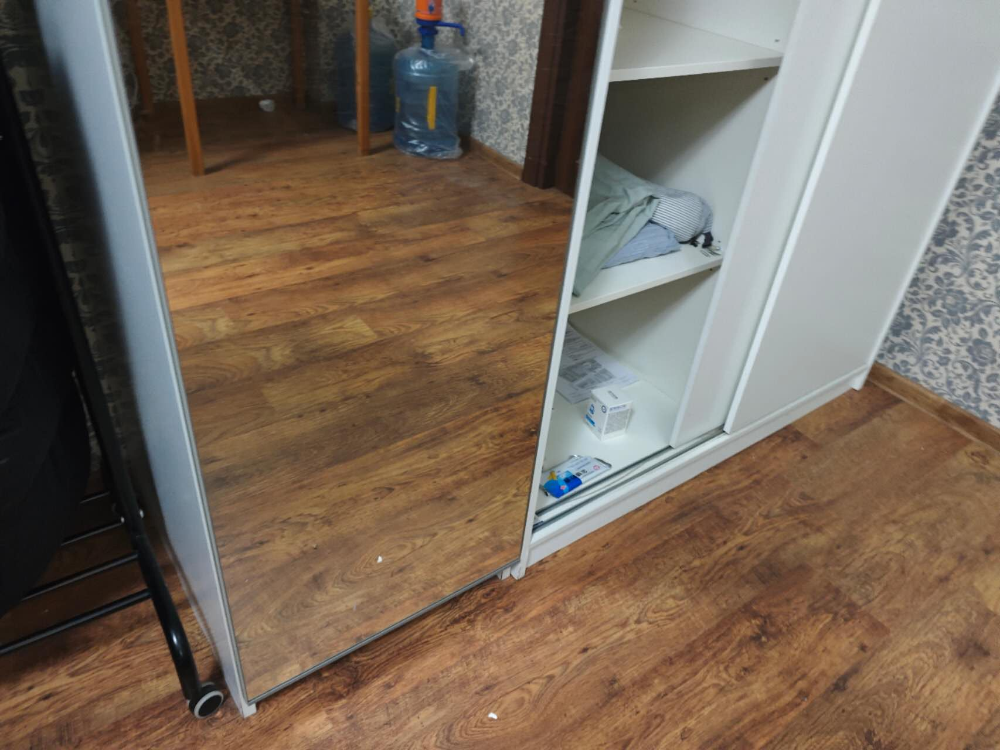</a> | <a id="physical-test-mirror-map"></a><a href="docs/media/physical-test/20261015-mirror/mirror-incomplete-map.png">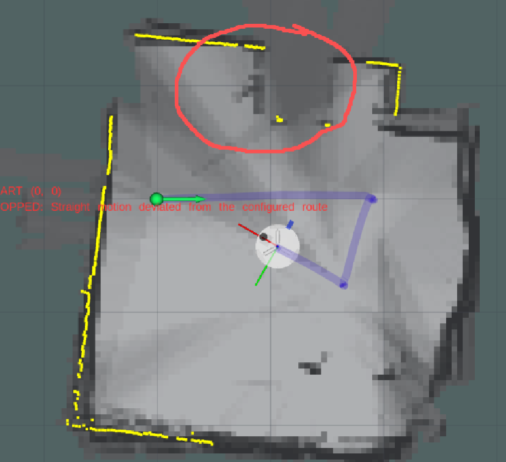</a> |

Observation from Figure 2: the mirror region lacks a usable mapped boundary, which also removes a reference for localization.

**Analysis:**
<!-- PHYSICAL_TEST_ANALYSIS:mirror -->

<!-- /PHYSICAL_TEST_ANALYSIS:mirror -->

<a id="physical-test-real"></a>

### Physical scene

<a href="docs/media/physical-test/20261015/real.gif">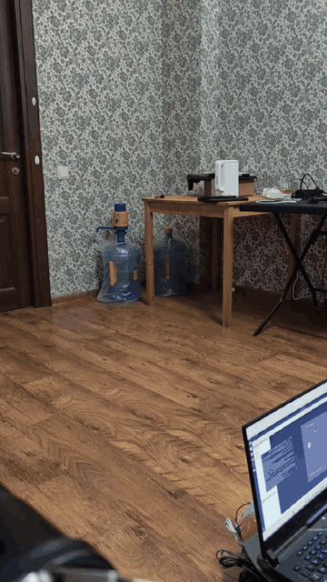</a>


<!-- PHYSICAL_TEST_ANALYSIS:real -->

<!-- /PHYSICAL_TEST_ANALYSIS:real -->

<a id="physical-test-rviz-static"></a>

### RViz static video

<a href="docs/media/physical-test/20261015/rviz_Static.gif">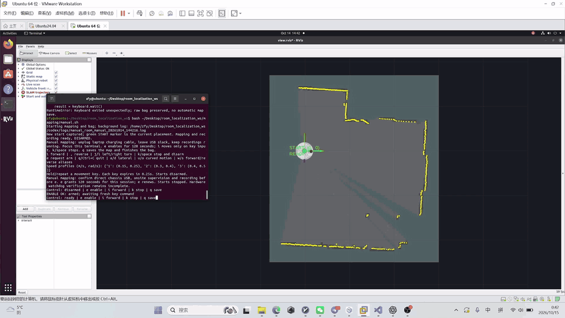</a>
<!-- PHYSICAL_TEST_ANALYSIS:rviz-static -->

<!-- /PHYSICAL_TEST_ANALYSIS:rviz-static -->

<a id="physical-test-rviz-dynamic"></a>

### 3. RViz dynamic video

<a href="docs/media/physical-test/20261015/rviz_dyn.gif">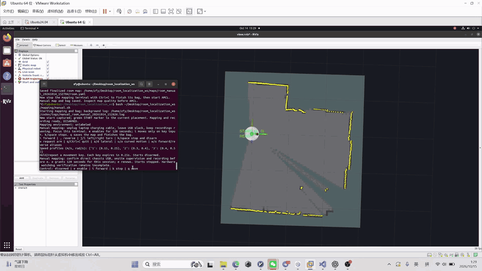</a>


**Analysis:** The video suggests distortion during fast motion, and the moving person leaves unwanted points in the map. These are the author's observations motivating separate controlled tests.
<!-- PHYSICAL_TEST_ANALYSIS:rviz-dynamic -->

<!-- /PHYSICAL_TEST_ANALYSIS:rviz-dynamic -->

<a id="physical-test-additional"></a>

### Additional physical tests

| Test 4 · `4.mp4` | Test 5 · `5.mp4` |
| --- | --- |
| <a href="docs/media/physical-test/20261016-additional/4.gif">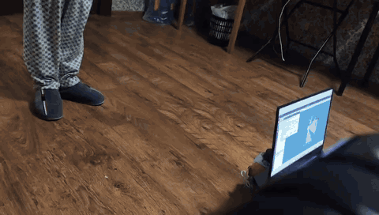</a> | <a href="docs/media/physical-test/20261016-additional/5.gif">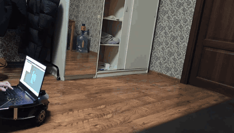</a> |
| **Test 7 · `7.mp4`** | **Test 6 · `6.mp4`** |
| <a href="docs/media/physical-test/20261016-additional/7.gif">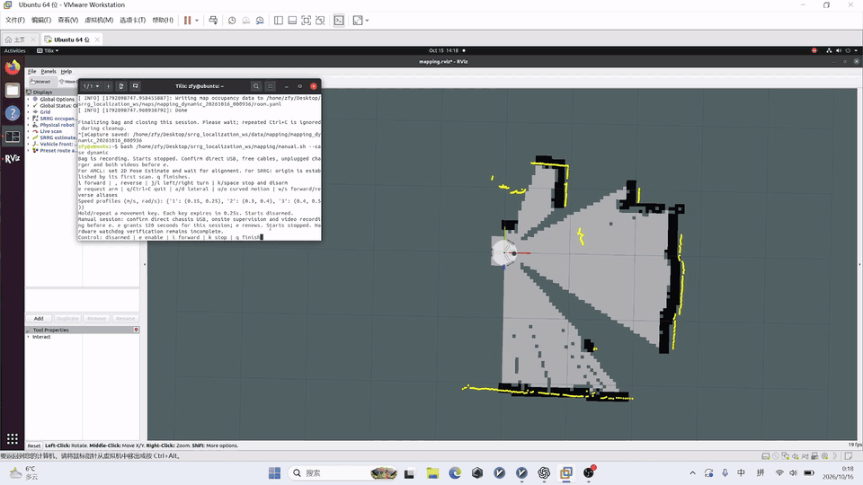</a> | <a href="docs/media/physical-test/20261016-additional/6.gif">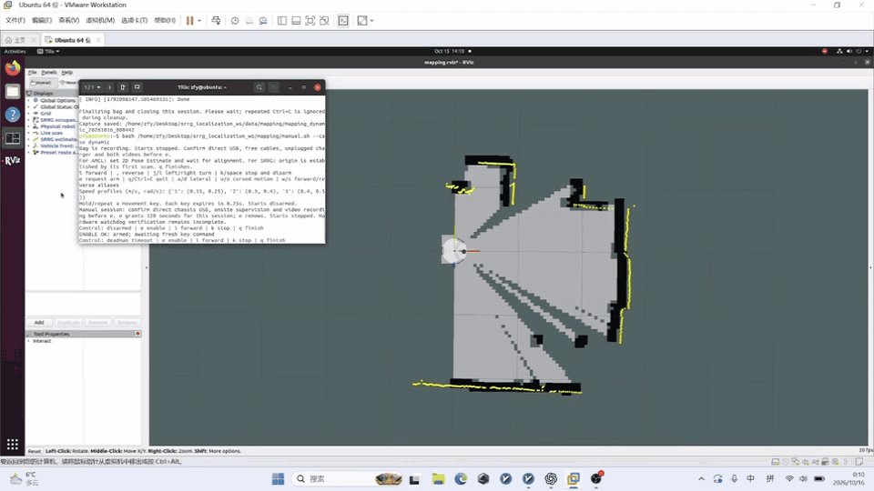</a> |

**Analysis:**
<!-- PHYSICAL_TEST_ANALYSIS:additional-four -->

<!-- /PHYSICAL_TEST_ANALYSIS:additional-four -->

<a id="physical-test-annotated-maps"></a>

### Annotated map comparison

<a href="docs/media/physical-test/20261016-additional/annotated-maps.png">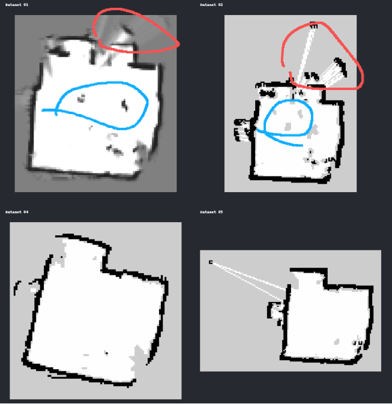</a>

**Analysis:**
<!-- PHYSICAL_TEST_ANALYSIS:annotated-maps -->

<!-- /PHYSICAL_TEST_ANALYSIS:annotated-maps -->

## Direction analysis

### 1. What does the research title ask?

**Direction: robust localization and SLAM in dynamic environments.**

Mapping and localization support each other. Our evaluation changes the map, then uses the same localization method to test whether error decreases.

My understanding of localization:

- Given a motion prior, use current observations to score consistency with the map and infer pose and confidence.
- AMCL represents possible poses with particles and weights them using an observation model; GICP estimates pose through geometric consistency.
- The map supplies the references against which sensor observations can be matched.

Our goal is therefore **to improve mapping and test the resulting improvement in localization**.

- **Moving objects leave traces that contaminate the map. This is our main focus.** Detect and remove motion while preserving static structures.
  - 2D LiDAR: SRRG.
  - 3D LiDAR: DUFOMap and BeautyMap.

    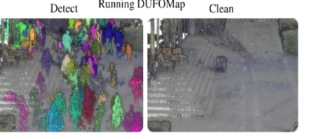

  - Depth/RGB camera: DynaSLAM.

    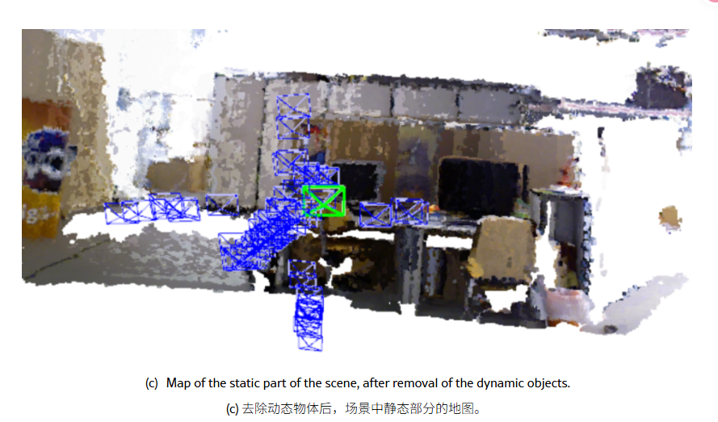

- **Sensor motion within a scan causes motion distortion**, which can affect registration, trajectory drift and map alignment. High speed or rotation makes timing errors more visible; drift can also have other causes.

  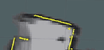

  FAST-LIO estimates motion using LiDAR and IMU and compensates points before registration. This is a candidate for fast-motion tests, rather than a guarantee against all failures. [Official implementation](https://github.com/hku-mars/FAST_LIO/tree/ROS2).

  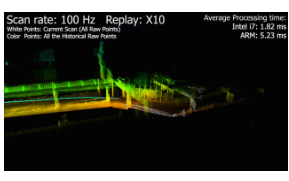

  My interpretation: combining vision, LiDAR and odometry can provide complementary evidence, but synchronization, calibration and fusion themselves need validation.

- **Special materials and geometrically weak environments can damage mapping and localization.**
  - Mirrors:

    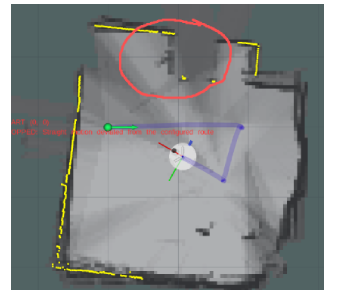

  - Corridors:

    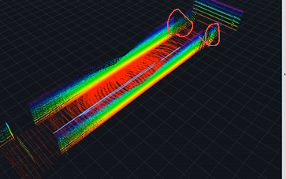

    Repeated or parallel structures can leave the along-corridor position weakly constrained. A possible intervention is an identifiable landmark, such as a mapped visual marker. A QR marker requires a camera and detector; a LiDAR-only test must use visible geometry.

- **Maps need maintenance after construction** to remain useful for localization. Relocated furniture motivates updates, for example Khronos.

  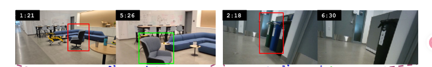

  Temporal evidence helps distinguish persistent structures, occasional relocation and rapid motion. Recognition and segmentation can support these decisions and object-level navigation or manipulation; a semantic class alone does not establish whether something is moving now.

The core question is:

**In a dynamic environment, how can we build a geometrically trustworthy map that retains useful static constraints, and test whether it improves localization accuracy and continuity?**

## Open question

**Broad direction: which strategies enable reliable mapping in changing environments, and thereby reliable localization?**

**Question 1:** Given multiple scans and mapping poses, how can dynamic traces be removed while preserving static structures, and under which contamination and geometric conditions does this improve independent localization?

**Question 2:** With other conditions controlled, how can motion distortion caused by fast translation or rotation of the sensor be reduced?

**Question 3:** How can special obstacles be identified and weak environments such as corridors handled, limiting their effect on mapping and subsequent localization?

<a id="mapping-hypothesis-tests"></a>

## Hypothesis

<!-- SIMPLE_HYPOTHESES_V2 -->
<!-- OWN_HYPOTHESES_20261016 -->

| Question | Hypothesis and method | Controls | Metrics |
| --- | --- | --- | --- |
| H1 / Q1 | Align scans to repeatedly observed structure and filter traces using hit support and free-space evidence to improve subsequent localization. | M₀: wheel-pose accumulation / M₁: own alignment + cleaning | A: DA, SA; B: XY RMSE |
| H2 / Q2 | Wheel-odometry compensation for point timestamps reduces map and held-out localization error. | M₀: compensation off / M₁: on | A: map RMSE; B: XY RMSE |

Both interventions are implemented in this repository; AMCL is the common downstream localizer. Mirror identification still needs physical validation.

<a id="hypothesis-math"></a>

### Mathematical form

A builds the maps; B is acquired independently. $`M_0`$ is the baseline and $`M_1`$ the intervention. Freeze both maps and share B scans, odometry, AMCL parameters and initialization; truth is used only for scoring.

| Symbol | Meaning |
| --- | --- |
| $`T_k^o,T_k`$ | Wheel-derived / corrected sensor pose at frame $`k`$, both sensor-to-map transforms |
| $`c,\mathbf x_c,b`$ | A 5 cm cell, its center, a 0.5 s time bin |
| $`\mathbf1[\cdot],M`$ | Indicator function, set of occupied-cell centers; coordinates in m |

Maps and static scoring references must be nonempty. Score point sets in the same frame before inflation and generate AMCL maps identically. Transforms use homogeneous coordinates; distances use XY.

**XY localization RMSE on frozen maps:**

```math
E_{{\rm loc},m}=\sqrt{\frac{1}{|\mathcal T|}\sum_{k\in\mathcal T}\|\hat{\mathbf p}_{m,k}-\mathbf p_k^*\|_2^2}.
```

$`\hat{\mathbf p}_{m,k},\mathbf p_k^*`$ are estimated and true positions. $`\mathcal T`$ contains common valid times: 10 Hz after 5 s warmup, output age at most 0.15 s. Pool common samples across trials; this is not output success rate or navigation arrival rate.

**H1: align scans to repeatedly observed structure and filter traces using hit support and free-space evidence to improve subsequent localization.**

Wheel increments initialize the pose; let $`\mathbf p=T_k\mathbf z`$, where $`\mathbf z`$ is a scan point and $`\mathbf q`$ its nearest point in the prior reference:

```math
\begin{aligned}
T_{k,0}&=T_{k-1}(T_{k-1}^o)^{-1}T_k^o,\\
w_{\mathbf p}&=\min\!\left(1,\frac{0.05}{\max(\|\mathbf p-\mathbf q\|_2,10^{-9})}\right).
\end{aligned}
```

**Robust alignment:** $`\mathcal C_k`$ contains selected correspondence pairs. References are retained prior-map positions with neighborhood support in at least three bins. Iteratively solve a 2D rigid increment and update the pose; fall back to wheel prediction for insufficient references or excessive correction.

```math
\begin{gathered}
\boxed{\boldsymbol{\Delta T=\arg\min_{U\in\mathrm{SE}(2)}\sum_{(\mathbf p,\mathbf q)\in\mathcal C_k}w_{\mathbf p}\|U\mathbf p-\mathbf q\|_2^2}}\\
T_k\leftarrow\Delta T T_k.
\end{gathered}
```

Under corrected poses, count direct hits $`h`$, hits within 10 cm $`s`$, and free crossings $`f`$. Each evidence type counts at most once per bin; rays stop 15 cm before returns:

```math
\begin{aligned}
h(c)&=\sum_b\mathbf1[\text{hit at }c\text{ in bin }b],\quad\widetilde M=\{\mathbf x_c:h(c)>0\},\\
s(c)&=\sum_b\mathbf1[\exists c':\|\mathbf x_{c'}-\mathbf x_c\|_2\le0.10,\ \text{hit at }c'\text{ in bin }b],\\
f(c)&=\sum_b\mathbf1[\text{free ray through }c\text{ in bin }b].
\end{aligned}
```

**Occupancy retention:** delete only when $`f\ge3`$ and $`f\ge1.5s`$; low hit count alone does not trigger deletion. The retained map and temporal support inform the next alignment.

```math
\boxed{\boldsymbol{M_1=\{\mathbf x_c\in\widetilde M:f(c)<3\ \lor\ f(c)<1.5s(c)\}}}
```

Score against shared static references $`S`$ and historical dynamic references $`D`$ from A, deduplicated in 10 cm cells. $`D`$ must later be verified free by rays and exclude overlap with static support or current obstacles. Set $`r=0.15\,\mathrm m`$:

```math
\begin{aligned}
d(\mathbf q,M)&=\min_{\mathbf x\in M}\|\mathbf q-\mathbf x\|_2,\\
\mathrm{SA}(M)&=\frac{\sum_{\mathbf q\in S}\mathbf1[d(\mathbf q,M)\le r]}{|S|},\\
\mathrm{DA}(M)&=\frac{\sum_{\mathbf q\in D}\mathbf1[d(\mathbf q,M)>r]}{|D|}.
\end{aligned}
```

SA measures static coverage; DA measures removal of trace-reference coverage. Neither is geometric accuracy. Formulas use 0–1, tables use percentages; DA is omitted for empty $`D`$. **H1 requires all three conditions:**

```math
\mathrm{DA}(M_1)>\mathrm{DA}(M_0),\qquad\mathrm{SA}(M_1)\ge\mathrm{SA}(M_0)-0.01,\qquad E_{{\rm loc},1}<E_{{\rm loc},0}.
```

Here 0.01 is one percentage point; ablations separate alignment and cleaning contributions.

**H2: point-time motion compensation.** $`\mathbf z_i`$ is a homogeneous point acquired at $`t_i`$; $`\hat T(t)`$ is the wheel-interpolated sensor-to-map transform and $`t_e`$ is scan end:

```math
\boxed{\boldsymbol{\bar{\mathbf z}_i=\hat T(t_e)^{-1}\hat T(t_i)\mathbf z_i}}
```

$`M_0`$ omits compensation; $`M_1`$ expresses points at $`t_e`$ first. Both integrate with $`\hat T(t_e)`$ without H1 filtering. This compensates robot motion. Score one-way map error against static support $`S`$ from this A:

```math
E_{\rm map}(M)=\sqrt{\frac1{|M|}\sum_{\mathbf x\in M}d(\mathbf x,S)^2}.
```

This score does not measure completeness. Maps and static references must be nonempty; an empty map is a mapping failure. **H2 requires lower map and independent localization error:**

```math
E_{\rm map}(M_1)<E_{\rm map}(M_0)\quad\land\quad E_{{\rm loc},1}<E_{{\rm loc},0}.
```

<a id="hypothesis-srrg-comparison"></a>

### Innovation and conceptual comparison with SRRG

**Design difference: neighborhood temporal evidence jointly selects registration references and decides trace deletion.** Compare concepts with SRRG only; literature novelty and metric superiority are unproven. [SRRG paper, Section III](https://iris.uniroma1.it/handle/11573/1340118).

| Aspect | SRRG | Current H1 |
| --- | --- | --- |
| Registration | Points + normals | Temporal support + robust alignment |
| Cleaning | Projection + fusion | Temporal evidence + threshold deletion |
| Scope | Global SLAM + long-term mapping | Local updates + held-out localization |

H2 uses standard relative-pose compensation and is not claimed as a separate innovation.

<a id="hypothesis-pseudocode"></a>

### Pseudocode

```text
for test, scene in [(H1, static), (H1, dynamic), (H2, motion)]:
    A = acquire_scans_and_wheel_odometry(scene)
    if test == H1:
        M0 = integrate_A_with_wheel_poses(A)
        M1, h, s, f = initialize_map_and_evidence()
        for scan in A.in_time_order():
            predicted = wheel_increment_from_previous_corrected_pose(scan)
            reference = previous_retained_cells_with_support(M1, s, min_bins=3)
            pose = own_robust_alignment_or_wheel_fallback(scan, predicted, reference)
            update_binned_evidence(h, s, f, scan, pose, bin_s=0.5, radius=0.10, stop_margin=0.15)
            M1 = cell_centers_where((h > 0) & ((f < 3) | (f < 1.5 * s)))
    else:
        M0, M1 = integrate_A_deskew_off_and_on(A)  # no H1 filtering
    freeze(M0, M1)
    B = acquire_independent_scans_and_wheel_odometry(scene)
    positions = [same_AMCL(B, map, same_initial_config) for map in (M0, M1)]
    score_maps_with_A_truth(test, scene, M0, M1)  # H1: SA (+ DA if dynamic); H2: map RMSE
    score_position_RMSE(positions, B_truth, common_valid_times)  # truth only for scoring
```

[Implementation, experiments and recordings](#hypothesis-test-index)

## Related works

<!-- HOME_RELATED_TABLE -->
Grouped by algorithm family. Click a GIF for the full video. The application-direction column is intentionally blank. Different data protocols prevent cross-row ranking.

| Method / algorithm family | Native GIF / original-source illustration | Measured metrics and scope | Application direction |
| --- | --- | --- | --- |
| <a id="related-fast_lio"></a>[FAST-LIO / FAST-LIO2](docs/papers/fast_lio.md) | 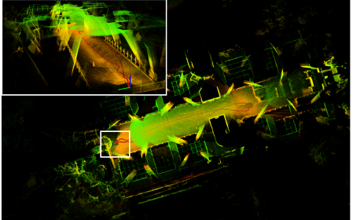 | Original-paper experiments: **not reproduced**; original figure and method summary; custom-scene tests in Practice |  |
| <a id="related-srrg_mapper2d"></a>[SRRG / srrg_mapper2d](docs/papers/srrg_mapper2d.md) | 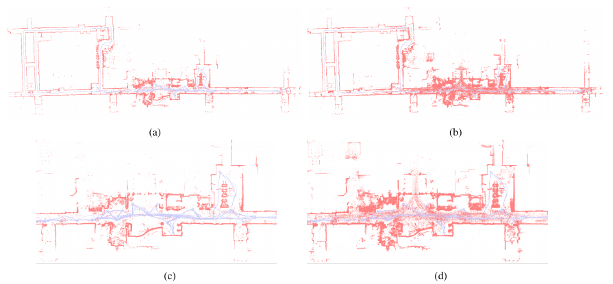 | Original-paper experiments: **not reproduced**; original figure and method summary; custom-scene tests in Practice |  |
| <a id="related-dufomap"></a>[DUFOMap](docs/papers/dufomap.md)<br>3D map cleaning | <a href="results/reference/desktop-live-dufomap/execution.mp4">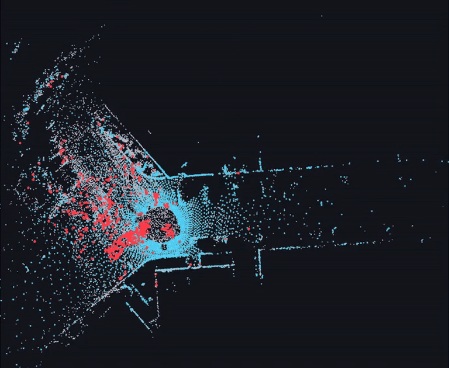</a><br>[Point-cloud capture excerpt](results/reference/desktop-live-dufomap/execution.mp4) | SA 97.98% / DA 98.7%<br>KITTI-00 · 141 scans; cleaning demonstrated<br>[Record](results/reference/desktop-live-dufomap/record.json) |  |
| <a id="related-beautymap"></a>[BeautyMap](docs/papers/beautymap.md)<br>Offline 3D map cleaning | <a href="results/reference/desktop-live-beautymap/execution.mp4">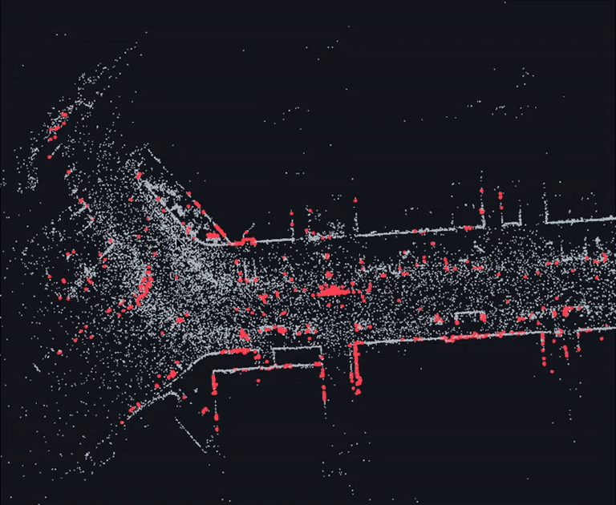</a><br>[Point-cloud capture excerpt](results/reference/desktop-live-beautymap/execution.mp4) | SA 96.95% / DA 98.34%<br>KITTI-00 · 141 scans; cleaning demonstrated<br>[Record](results/reference/desktop-live-beautymap/record.json) |  |
| <a id="related-amcl"></a>[AMCL / Nav2](https://github.com/ros-navigation/navigation2/tree/main/nav2_amcl)<br>2D particle localization | <a href="https://github.com/ros-navigation/docs.nav2.org/blob/8f6571b599d6b1e899f11ac58c5c1982d3b0a8b5/docs/getting_started/quickstart/assets/rviz/navstack_ready.png">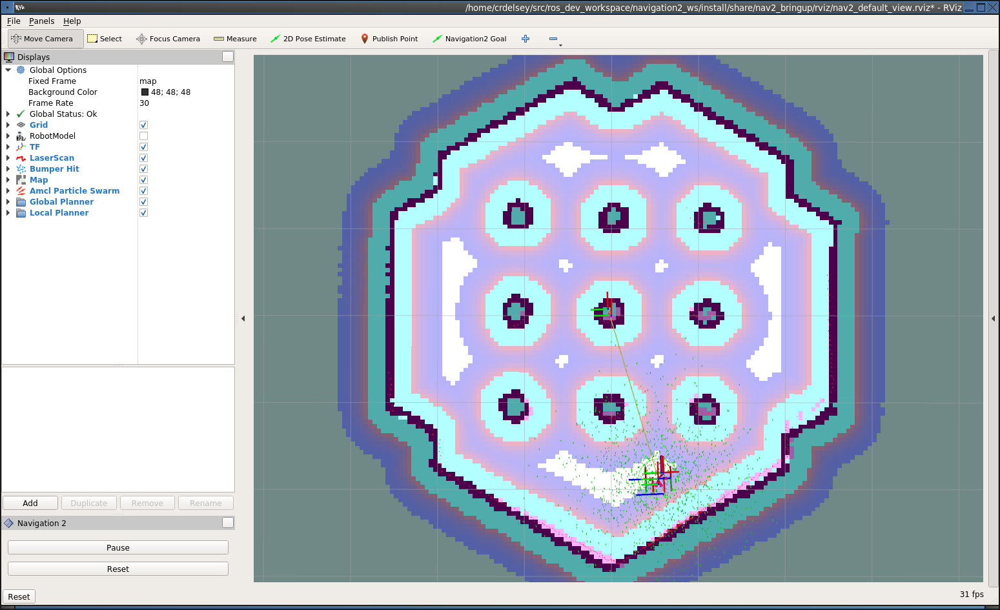</a><br>Original Nav2 documentation-repository image | Common 2D frozen-map localizer; XY / yaw RMSE. Source illustration, not our recording; [method](#related-amcl-details) |  |
| <a id="related-gicp"></a>[GICP](https://github.com/avsegal/gicp)<br>3D geometric registration | <a href="https://www.robots.ox.ac.uk/~avsegal/generalized_icp.html">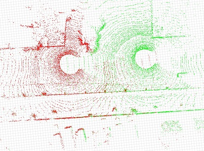</a><br>Original GICP author-page image | Common 3D frozen-map localizer; XYZ / rotation RMSE. Author illustration, not our recording; [method](#related-gicp-details) |  |
| <a id="related-ir-mcl"></a>[IR-MCL](docs/papers/ir-mcl.md)<br>2D neural-field localization | <a href="results/reference/desktop-live-ir-mcl/execution.mp4">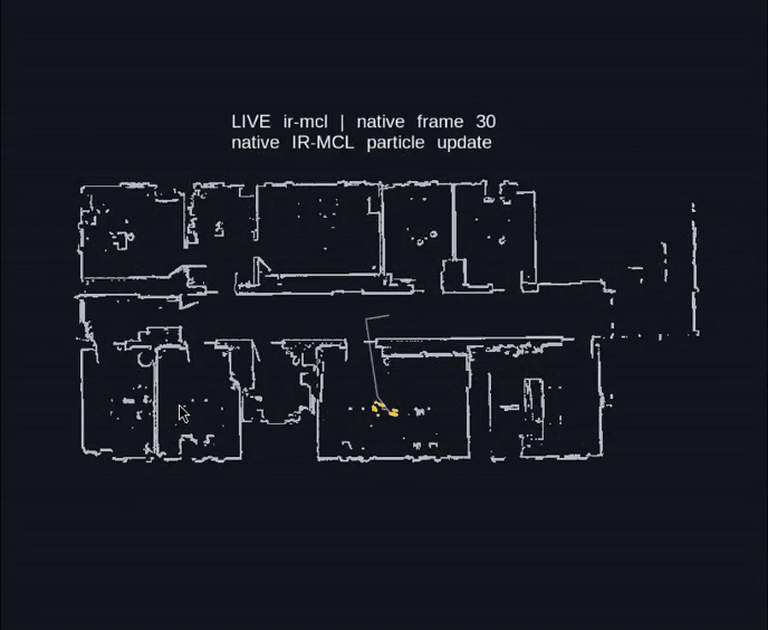</a><br>[Point-cloud capture excerpt](results/reference/desktop-live-ir-mcl/execution.mp4) | RMSE 5.31 cm / 1.07°<br>Bonn IPBLab Seq 1<br>[Record](results/reference/desktop-live-ir-mcl/record.json) |  |
| <a id="related-adam-mcl"></a>[AdaM-MCL](docs/papers/adam-mcl.md)<br>Learned proposals + particle localization | <a href="results/reference/desktop-adam-mcl/result.mp4"></a><br>2D particle-result replay | RMSE 32.23 cells; authored 128-cell map, 2432 training steps; historical sustained convergence 0/10, no comparison to paper metre-scale accuracy<br>[Record](results/reference/desktop-adam-mcl/record.json) |  |
<!-- /HOME_RELATED_TABLE -->

See [Metrics](#metrics) for SA/DA and pose-RMSE definitions. SRRG scores 2D observed support; DUFOMap/BeautyMap score 3D points. IR-MCL/AdaM-MCL do not clean maps.

<details>
<summary>Inputs, processing and reproduction boundaries</summary>

<!-- HOME_RELATED_DETAILS -->
### DUFOMap — dynamic-point removal during map integration

**Input:** successive 3D LiDAR scans and provided sensor poses. **Process:** observed free space supplies evidence that earlier occupied points are transient; an octree accumulates this evidence with margins for pose uncertainty. **Output:** a map with dynamic remnants removed. It does not estimate the robot pose. [Paper and reproduced scope](docs/papers/dufomap.md).

In the live video, gray points are retained, red points are removed, and cyan points are the current scan. Watch how decisions change as later scans supply evidence. KITTI-00, 141 scans; SA 97.98% / DA 98.70%. SA measures retained static points and DA measures removed dynamic points; neither is localization error.

[Live MP4](results/reference/desktop-live-dufomap/execution.mp4) · [record](results/reference/desktop-live-dufomap/record.json)

### BeautyMap — clean an existing point-cloud map

**Input:** the full accumulated 3D map, scans and provided poses. **Process:** the native occupancy representation detects inconsistent occupied structure, followed by the authors' static-structure recovery stage. **Output:** a cleaned reference map. This offline map cleaner is shown while it computes; the input map already exists at the start. [Paper and reproduced scope](docs/papers/beautymap.md).

Gray/red show retained/removed points. Watch the cumulative removal decisions, rather than interpreting the complete initial map as online SLAM. KITTI-00, 141 scans; SA 96.95% / DA 98.34%. Cleaner maps may help downstream localization, but that requires a separate test.

[Live MP4](results/reference/desktop-live-beautymap/execution.mp4) · [record](results/reference/desktop-live-beautymap/record.json)

### IR-MCL — localize with a neural observation model

**Input:** a pretrained neural occupancy field, measured 2D scans and motion input. **Process:** each particle represents a possible robot pose; the field renders a predicted scan at that pose, scan agreement changes particle weights, and resampling concentrates the belief. **Output:** an estimated pose and particle distribution. [Paper, original code and protocol](docs/papers/ir-mcl.md).

In RViz, the map supplies context, yellow particles show pose hypotheses, blue is the displayed estimate and green is the reference trajectory. Watch particle concentration and agreement with the reference. The displayed weighted particle mean is an observer; scoring uses the native saved estimate. Bonn IPBLab Seq 1: 1543 processed / 1354 scored poses, fresh RMSE 5.31 cm / 1.07°. This author-data run is separate from deployment into Gazebo.

[Live MP4](results/reference/desktop-live-ir-mcl/execution.mp4) · [record](results/reference/desktop-live-ir-mcl/record.json)

### AdaM-MCL — combine learned proposals and particle tracking

**Input:** a map, laser observation, motion input and trained proposal model. **Process:** the learned model proposes candidate poses; the adaptive mixture combines proposals with conventional particle tracking. **Output:** pose belief, including hypotheses after a kidnapping event. [Paper and limits](docs/papers/adam-mcl.md).

Our run uses an authored 128-cell map and a 2432-step checkpoint: 123 filter updates, RMSE 32.23 cells. The released paper dataset/checkpoint was unavailable. This verifies a limited original-code workflow; it neither reproduces the paper's metre-scale scores nor demonstrates successful recovery. [Score correction](results/reference/adam-mcl/ERRATUM.md).

[Live MP4](results/reference/desktop-adam-mcl/execution.mp4) · [record](results/reference/desktop-adam-mcl/record.json)

[Result MP4](results/reference/desktop-adam-mcl/result.mp4)

<!-- SRRG_RELATED -->
### SRRG · Native 2D dynamic-environment mapping

**Original-paper experiments: not reproduced.** The original figure introduces the method. Custom Gazebo runs of the author code appear separately in [Practice](#practice-srrg); these do not reproduce the LCAS/MIT Stata long-term multi-session benchmark.


Source: Lázaro et al., *Efficient Long-term Mapping in Dynamic Environments*, IROS 2018, Fig. 7, page 6. [Paper](https://iris.uniroma1.it/handle/11573/1340118) · [Author code](https://gitlab.com/srrg-software/srrg_mapper2d). Registration, local maintenance and graph optimization connect H1 to geometric conditions in Q3.
<!-- /SRRG_RELATED -->

<!-- FASTLIO_RELATED -->
### FAST-LIO / FAST-LIO2 · LiDAR–IMU estimation and point compensation

**Original-paper experiments: not reproduced.** This is the original FAST-LIO2 paper figure. Our custom-scene ablation uses the official ROS2 branch and FAST-LIO2 direct registration, distinct from reproducing the first FAST-LIO paper. [FAST-LIO Practice](#practice-fastlio).


Source: Xu et al., *FAST-LIO2: Fast Direct LiDAR-inertial Odometry*, Fig. 12, page 16. [FAST-LIO](https://arxiv.org/abs/2010.08196) · [FAST-LIO2](https://arxiv.org/abs/2107.06829) · [Official ROS2 code](https://github.com/hku-mars/FAST_LIO/tree/ROS2). IMU propagation and backward point compensation address H2. The incremental spatial index is not a dynamic-object removal or mirror detector.
<!-- /FASTLIO_RELATED -->
<!-- LOCALIZERS_RELATED -->
<a id="related-amcl-details"></a>

### AMCL · Localization in a prebuilt 2D map

**Input → process → output:** a fixed occupancy grid, laser scans and odometry → particle motion prediction, scan-to-map weighting, resampling and adaptive particle counts → planar position, yaw and pose uncertainty. AMCL localizes; it does not build or clean the map.


**Image source:** [original Nav2 documentation-repository image](https://github.com/ros-navigation/docs.nav2.org/blob/8f6571b599d6b1e899f11ac58c5c1982d3b0a8b5/docs/getting_started/quickstart/assets/rviz/navstack_ready.png), showing the robot, particle distribution and navigation-stack layers; not our recording. [Official AMCL code](https://github.com/ros-navigation/navigation2/tree/main/nav2_amcl).

**Role here:** 2D Practice and our H1/H2 use AMCL on frozen A maps with independently acquired B. Paired controls share scans, odometry, parameters and initialization; evaluate XY localization RMSE and yaw when relevant. Map remnants and lost static constraints affect observation weights. DA/SA do not evaluate AMCL. Custom-scene tests are in [Practice](#practice-index) and [Hypothesis test](#hypothesis-test-index); original-paper benchmarks are not reproduced.

<a id="related-gicp-details"></a>

### GICP · Register a 3D scan to a fixed point-cloud map

**Input → process → output:** a fixed 3D point-cloud map, a current scan and an initial pose prediction → establish correspondences, weight residuals using local surface covariances on both sides, and iteratively solve a rigid transform → 3D position and orientation. GICP is originally a registration algorithm; a localization system uses it for scan-to-map matching. It does not remove dynamic objects itself.


**Image source:** [original GICP author-page image](https://www.robots.ox.ac.uk/~avsegal/generalized_icp.html). The author's reference repository contains no image; this uses the author's own point-cloud illustration, not our recording. [Reference code](https://github.com/avsegal/gicp) · [PCL implementation](https://pointclouds.org/documentation/classpcl_1_1_generalized_iterative_closest_point.html) · [ROS2 localization framework used here](https://github.com/rsasaki0109/lidar_localization_ros2).

**Role here:** 3D Practice freezes Raw/DUFOMap/BeautyMap A maps and applies the same GICP configuration to fresh B clouds and wheel odometry, evaluating XYZ and full-rotation RMSE. The preceding methods clean the maps; GICP evaluates downstream localization. Local registration depends on initialization and geometric constraints; small angular errors can coexist with metre-scale longitudinal drift in corridors. See [3D Practice](#scene-static-3d). Our installed ROS2/PCL implementation is distinct from the author's reference code; original-paper benchmarks are not reproduced.
<!-- /LOCALIZERS_RELATED -->

<!-- /HOME_RELATED_DETAILS -->

</details>

## Metrics

| Metric | Definition |
| --- | --- |
| DA ↑ / SA ↑ | Cleaning A only: dynamic removal / static retention; omit DA without dynamics. Units are observed support in 2D and points in 3D. |
| Map RMSE ↓ | Deskew A: map-point distance RMSE to static reference geometry, cm. |
| XY / XYZ RMSE ↓ | Localization B on frozen maps: 2D / 3D position error, cm. |
| Angular RMSE ↓ | Yaw or 3D rotation error when pose orientation is evaluated, degrees; A odometry is labelled separately. |

### Evidence

| DUFOMap · KITTI-00 · Metric | Paper % | Reproduced % |
| --- | ---: | ---: |
| SA | 97.96 | 97.9635 |
| DA | 98.72 | 98.7196 |

| BeautyMap · KITTI-02 · Metric | Paper % | Reproduced % |
| --- | ---: | ---: |
| SA | 83.40 | 83.3978 |
| DA | 82.41 | 82.4092 |

| IR-MCL · Metric | Paper, Seq 1 | Reproduced |
| --- | ---: | ---: |
| Location RMSE (cm) | 5.13 | 5.32 |
| Yaw RMSE (deg) | 1.05 | 1.07 |

## Practice

This section practices methods in Related works. A = mapping; B = a separate localization session on frozen maps. Click A/B in the contents to reach its recordings and metrics.

<a id="practice-index"></a>

### Experiment contents

| No. | Method / subexperiment | Go directly |
| --- | --- | --- |
| P0 | Setup and devices | [Open experiment](#practice-setup) |
| P0.1 | Raw baseline definitions | [Open experiment](#raw-baseline-definitions) |
| P1.1 | SRRG · Static | [A](#h1-static-a) / [B](#h1-static-b) |
| P1.2 | SRRG · Dynamic | [A](#h1-dynamic-a) / [B](#h1-dynamic-b) |
| P1.3 | SRRG · Original corridor | [A](#h3-original-a) / [B](#h3-original-b) |
| P1.4 | SRRG · Persistent change | [A](#supp-srrg) / [B](#supp-srrg-b) |
| P2.1 | FAST-LIO · Mapping and motion phases | [A](#h2-a) / [Stationary](#h2-stationary) / [Slow turn](#h2-slow) / [Fast turn](#h2-fast) / [Translation](#h2-translation) |
| P2.2 | FAST-LIO · Frozen-map localization | [B](#h2-b) |
| P3.0 | DUFOMap / BeautyMap · KITTI-00 | [Map-cleaning practice](#practice-kitti) |
| P3.1 | DUFOMap / BeautyMap · 3D · Static | [A](#scene-static-3d) / [B](#scene-static-3d-b) |
| P3.2 | DUFOMap / BeautyMap · 3D · Dynamic | [A](#scene-dynamic-3d) / [B](#scene-dynamic-3d-b) |
| P3.3 | DUFOMap / BeautyMap · 3D · Corridor | [A](#scene-corridor-3d) / [B](#scene-corridor-3d-b) |
| P3.4 | DUFOMap / BeautyMap · 3D · Changed world | [A](#scene-change-3d) / [B](#scene-change-3d-b) |

<a id="practice-setup"></a>

### Setup

| Item | Setting |
| --- | --- |
| Platform | Windows / WSL2 · ROS 2 Jazzy · Gazebo Harmonic · RViz2 |
| Robot | Sim2Real omni chassis; rendered URDF below. |
| 2D devices | 720-beam 2D LiDAR + wheel odometry. |
| 3D devices | 16×720 3D LiDAR; FAST-LIO arm adds a 200 Hz IMU. |


<a id="robot-urdf"></a>

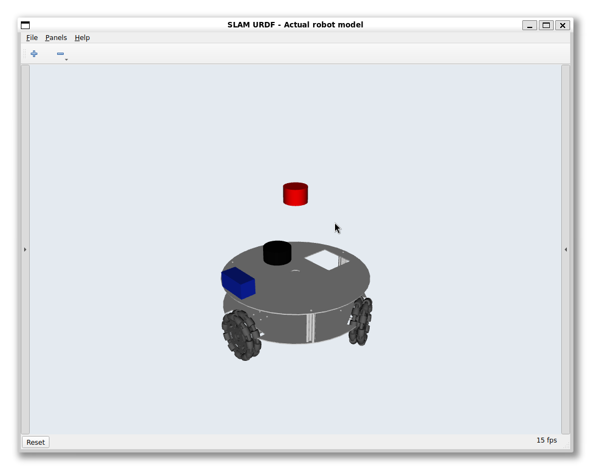

<a id="practice-metrics"></a>

### Metric definitions

[Short definitions in Metrics](#metrics)

A measures cleaning or geometry; B measures localization after 5 s warmup. P3 3D uses scan timestamps common to all three outputs; other groups retain common 10 Hz times with pose age ≤0.15 s. Counts and missing outputs remain in records. One trial per arm; complete navigation outcomes were not measured.

<a id="raw-baseline-definitions"></a>

### Raw baseline definitions

**Meaning of Raw.** Raw labels this repository's accumulated baseline without dynamic-map cleaning. It is not a standalone SLAM/localization algorithm or completely unprocessed sensor data.

| Context | How Raw is built | Downstream localization |
| --- | --- | --- |
| Own H1 | Transform valid 2D returns using the known start, wheel odometry and sensor extrinsic; retain each 5 cm cell hit at least once, without retracting earlier occupied cells or applying H1 temporal filtering. | Frozen-map AMCL |
| Practice: SRRG 2D comparison | Accumulate returns using SRRG's online sensor-pose estimate at each frame; do not reproject accumulated historical points with the final optimized graph. SRRG output additionally includes map maintenance and graph optimization. | Frozen-map AMCL |
| Practice: Raw / DUFOMap / BeautyMap 3D comparison | Transform and concatenate 3D scans using provided sensor poses from controlled mapping A, without DUFOMap/BeautyMap cleaning. A uses supplied simulation poses. | Frozen-map GICP; no truth input in B |

These Raw maps and pose sources differ between experiments; compare within the matched experiment. The SRRG comparison includes pose optimization and map maintenance, not just a deletion-rule ablation. Current H1 also adds own pose alignment, which Raw does not use; filter-only / alignment-only ablations distinguish their contributions. H2 calls its baseline Off: only point-time compensation is disabled. FAST-LIO Practice Off still retains LiDAR–IMU estimation.


<a id="practice-srrg"></a>

### P1 · SRRG · Static and dynamic

| Scene | Change | Keep fixed |
| --- | --- | --- |
| Static control / moving obstacles | Raw / SRRG | Shared A scans, shared B scans, AMCL settings and initial offset |


<a id="h1-static-a"></a>

#### Static · A

| Method | SA ↑ |
| --- | --- |
| Raw | 100.00% |
| SRRG | 100.00% |


[Record](results/reference/direction-20261016-v2/2d-A-static/record.json)

| A · Raw / SRRG |
| --- |
| <a href="results/reference/direction-20261016-v2/2d-A-static/execution.mp4">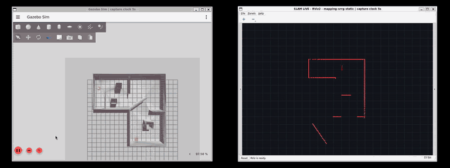</a> |


**Analysis:**
<!-- PRACTICE_ANALYSIS:h1-static-a -->

<!-- /PRACTICE_ANALYSIS:h1-static-a -->

[↑ Contents](#practice-index)

<a id="h1-static-b"></a>

#### Static · B

| Map | XY RMSE / cm | yaw / ° | Localization B (click for MP4) |
| --- | --- | --- | --- |
| Raw | 5.03 | 2.88 | <a href="results/reference/direction-20261016-v2/2d-static/executions/raw.mp4"></a> |
| SRRG | 5.84 | 2.91 | <a href="results/reference/direction-20261016-v2/2d-static/executions/srrg.mp4">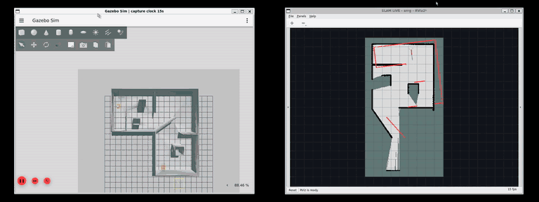</a> |


[Scores](results/reference/direction-20261016-v2/2d-static/time-grid-score.json)

**Analysis:**
<!-- PRACTICE_ANALYSIS:h1-static-b -->

<!-- /PRACTICE_ANALYSIS:h1-static-b -->

[↑ Contents](#practice-index)

<a id="h1-dynamic-a"></a>

#### Dynamic · A

| Method | DA ↑ | SA ↑ |
| --- | --- | --- |
| Raw | 0.00% | 100.00% |
| SRRG | 36.94% | 99.84% |


[Record](results/reference/direction-20261016-v2/2d-A-dynamic/record.json)

| A · Raw / SRRG |
| --- |
| <a href="results/reference/direction-20261016-v2/2d-A-dynamic/execution.mp4">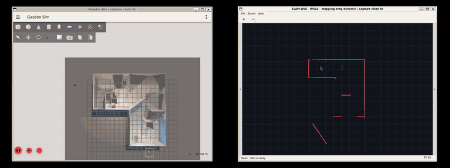</a> |


**Analysis:**
<!-- PRACTICE_ANALYSIS:h1-dynamic-a -->

<!-- /PRACTICE_ANALYSIS:h1-dynamic-a -->

[↑ Contents](#practice-index)

<a id="h1-dynamic-b"></a>

#### Dynamic · B

| Map | XY RMSE / cm | yaw / ° | Localization B (click for MP4) |
| --- | --- | --- | --- |
| Raw | 5.53 | 0.76 | <a href="results/reference/direction-20261016-v2/2d-dynamic/executions/raw.mp4">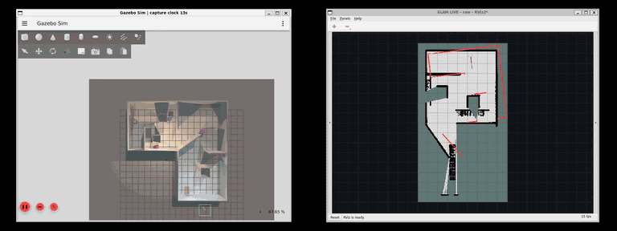</a> |
| SRRG | 5.13 | 0.70 | <a href="results/reference/direction-20261016-v2/2d-dynamic/executions/srrg.mp4">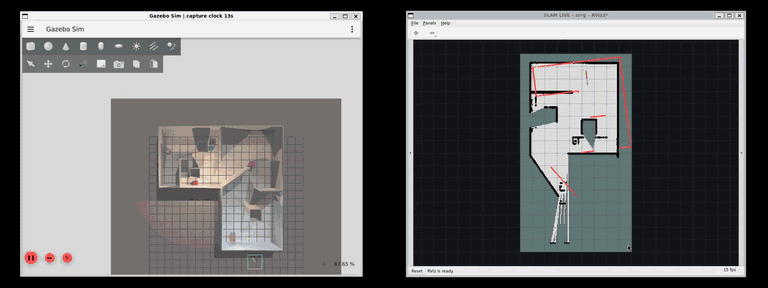</a> |


[Scores](results/reference/direction-20261016-v2/2d-dynamic/time-grid-score.json)

**Analysis:**
<!-- PRACTICE_ANALYSIS:h1-dynamic-b -->

<!-- /PRACTICE_ANALYSIS:h1-dynamic-b -->

[↑ Contents](#practice-index)

<a id="practice-srrg-corridor"></a>

### P1.3 · SRRG · Corridor

<a id="h3-original-a"></a>

#### Original corridor · A

| Method | SA ↑ |
| --- | --- |
| Raw | 82.63% |
| SRRG | 82.05% |


[Record](results/reference/direction-20261016-v2/2d-A-corridor/record.json)

| A · Raw / SRRG |
| --- |
| <a href="results/reference/direction-20261016-v2/2d-A-corridor/execution.mp4">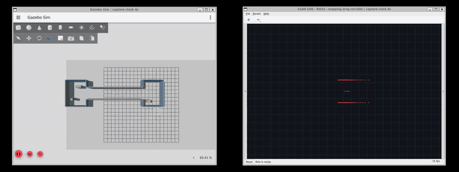</a> |


**Analysis:**
<!-- PRACTICE_ANALYSIS:h3-original-a -->

<!-- /PRACTICE_ANALYSIS:h3-original-a -->

[↑ Contents](#practice-index)

<a id="h3-original-b"></a>

#### Original corridor · B

| Map | XY RMSE / cm | yaw / ° | Localization B (click for MP4) |
| --- | --- | --- | --- |
| Raw | 113.30 | 1.38 | <a href="results/reference/direction-20261016-v2/2d-corridor/executions/degraded_raw.mp4">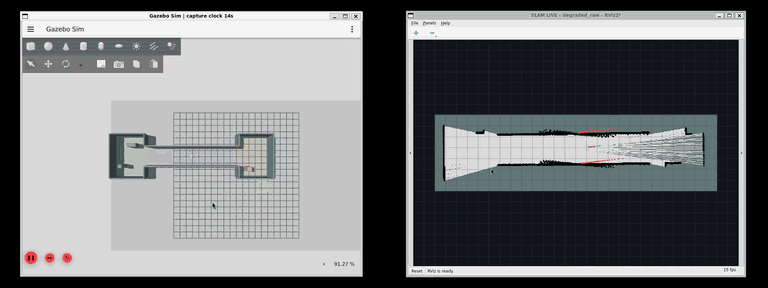</a> |
| SRRG | 102.72 | 1.08 | <a href="results/reference/direction-20261016-v2/2d-corridor/executions/degraded_srrg.mp4">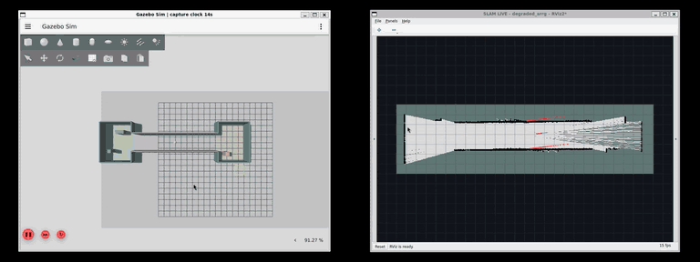</a> |


[Scores](results/reference/direction-20261016-v2/2d-corridor/time-grid-score.json)

**Analysis:**
<!-- PRACTICE_ANALYSIS:h3-original-b -->

<!-- /PRACTICE_ANALYSIS:h3-original-b -->

[↑ Contents](#practice-index)

<a id="practice-fastlio"></a>

### P2 · FAST-LIO · Motion distortion

| Scene | Change | Keep fixed |
| --- | --- | --- |
| Existing static scene; stationary → slow/fast turns → translation | FAST-LIO point compensation off / on | Same scans, point timing, IMU and state prediction; identical GICP for B |


Three measured 120° sectors form a 0.2 s scan; this is controlled grouped sampling.

<a id="h2-a"></a>

#### A · Mapping and motion phases

| Point compensation | Map RMSE / cm ↓ |
| --- | --- |
| Off | 13.49 |
| On | 4.61 |


[Scores](results/reference/direction-20261016-v2/fastlio-maps/score.json)

| A · FAST-LIO on / off |
| --- |
| <a href="results/reference/direction-20261016-v2/fastlio-motion/execution.mp4">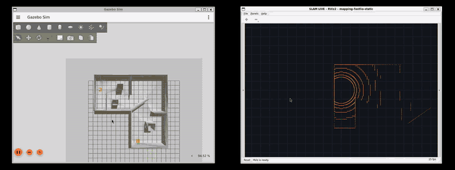</a> |


<a id="h2-stationary"></a>

##### Stationary

| Point compensation | Phase time | A odometry XYZ RMSE / cm | Rotation / ° |
| --- | --- | --- | --- |
| Off | 0–7 s | 0.12 | 0.02 |
| On | 0–7 s | 0.15 | 0.03 |


<a id="h2-slow"></a>

##### Slow turn

| Point compensation | Phase time | A odometry XYZ RMSE / cm | Rotation / ° |
| --- | --- | --- | --- |
| Off | 7–15 s | 1.30 | 0.95 |
| On | 7–15 s | 0.42 | 0.14 |


<a id="h2-fast"></a>

##### Fast turn

| Point compensation | Phase time | A odometry XYZ RMSE / cm | Rotation / ° |
| --- | --- | --- | --- |
| Off | 15–31 s | 3.18 | 4.35 |
| On | 15–31 s | 0.79 | 0.26 |


<a id="h2-translation"></a>

##### Translation

| Point compensation | Phase time | A odometry XYZ RMSE / cm | Rotation / ° |
| --- | --- | --- | --- |
| Off | 31–39 s | 5.33 | 3.68 |
| On | 31–39 s | 1.45 | 0.25 |


**Analysis:**
<!-- PRACTICE_ANALYSIS:h2-a -->

<!-- /PRACTICE_ANALYSIS:h2-a -->

[↑ Contents](#practice-index)

<a id="h2-b"></a>

#### B · GICP on frozen maps

| A compensation | XYZ RMSE / cm | Rotation / ° | Localization B (click for MP4) |
| --- | --- | --- | --- |
| Off | 14.03 | 3.62 | <a href="results/reference/direction-20261016-v2/fastlio-B/executions/no_deskew.mp4">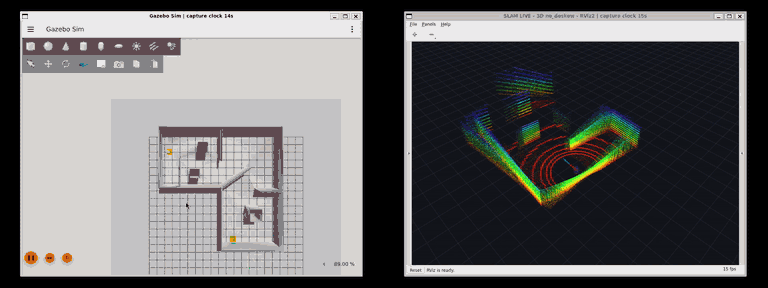</a> |
| On | 2.04 | 0.87 | <a href="results/reference/direction-20261016-v2/fastlio-B/executions/deskew.mp4">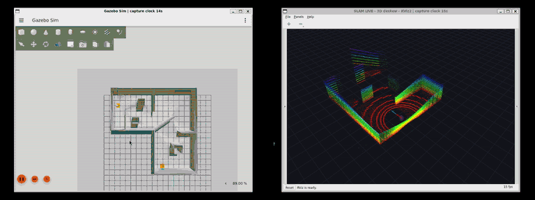</a> |


[Scores](results/reference/direction-20261016-v2/fastlio-B/score-3d.json)

**Analysis:**
<!-- PRACTICE_ANALYSIS:h2-b -->

<!-- /PRACTICE_ANALYSIS:h2-b -->

[↑ Contents](#practice-index)

<a id="practice-kitti"></a>

### P3.0 · DUFOMap / BeautyMap · KITTI-00

KITTI-00, 141 scans; this experiment evaluates map cleaning only.

| Method | DA ↑ | SA ↑ | Point-cloud excerpt (click for full recording) | Record |
| --- | --- | --- | --- | --- |
| DUFOMap | 98.70% | 97.98% | <a href="results/reference/desktop-live-dufomap/execution.mp4"></a> | [Record](results/reference/desktop-live-dufomap/record.json) |
| BeautyMap | 98.34% | 96.95% | <a href="results/reference/desktop-live-beautymap/execution.mp4"></a> | [Record](results/reference/desktop-live-beautymap/record.json) |

<a id="baseline-3d"></a>

### 3D maps and held-out localization

Reacquire 3D A, run Raw/DUFOMap/BeautyMap, freeze the maps, then acquire separate B. All three localizers share B clouds and fixed GICP parameters. A/B videos capture live Gazebo + RViz windows; B does not update maps.

A shows live 16-channel XYZ clouds and wall height in an oblique view. A uses supplied simulation poses to isolate cleaning, rather than evaluate full 3D SLAM. B: grey = frozen map, green = current scan, pink = estimated pose, cyan = estimated path. B receives no truth input.

This controlled simulation has no configured 3D LiDAR noise model. B uses wheel odometry and fixed initial offsets (0.25 m, 0.15 m, 0.12 rad); global relocalization and complete navigation are not tested. Freezing stops updates; localization benefit from cleaning requires lower B error.

XYZ/rotation RMSE now uses common scan timestamps, with truth interpolated to the same instant. The previous 10 Hz latest-pose score mixed in output age and is not directly comparable.
[Dimension, map and scoring audit](results/reference/practice-3d-visible-20261016/audit.json) · [Historical records](results/reference/practice-frozen-20261016)

<a id="scene-static-3d"></a>

#### Static · 3D

**A · Map cleaning**

| Map | SA ↑ |
| --- | --- |
| Raw | 100.00% |
| DUFOMap | 99.99% |
| BeautyMap | 87.71% |


| A · Live 3D acquisition | A · Saved cleaning results (Raw / DUFOMap / BeautyMap) |
| --- | --- |
| <a href="results/reference/practice-3d-visible-20261016/static-A/execution.mp4">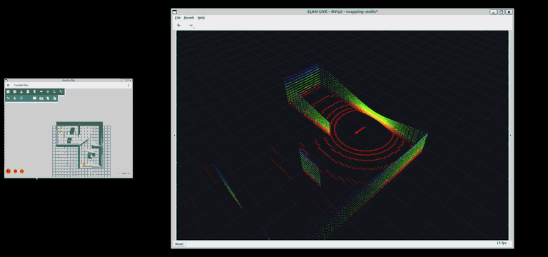</a> | <a href="results/reference/practice-3d-visible-20261016/static-A/cleaning-review/result.mp4">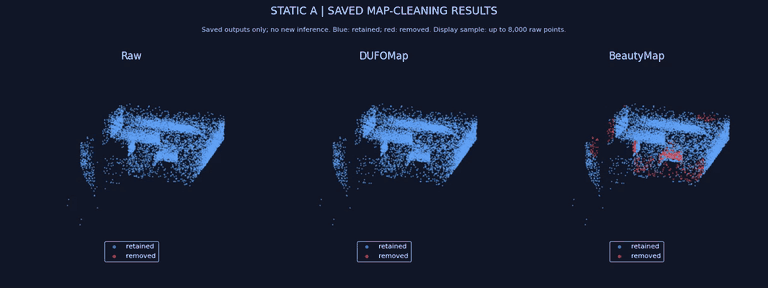</a> |


The right panel reviews saved cleaning outputs without new inference; click a GIF for the full MP4.

[A acquisition record](results/reference/practice-3d-visible-20261016/static-A/record.json) · [Cleaning review record](results/reference/practice-3d-visible-20261016/static-A/cleaning-review/record.json)

[Mapping A processing record](results/reference/practice-3d-visible-20261016/static-A/maps/record.json)

<a id="scene-static-3d-b"></a>

**B · Localization on frozen maps**

<!-- HOME_EXPERIMENT_TABLE -->
| Frozen map | XYZ RMSE / cm ↓ | Rotation RMSE / ° | Localization B (click for MP4) | Evidence |
| --- | --- | --- | --- | --- |
| Raw | 0.92 | 0.16 | <a href="results/reference/practice-3d-visible-20261016/static-B/executions/raw.mp4">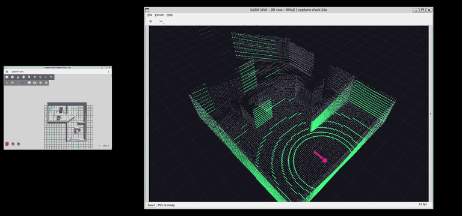</a> | [Record](results/reference/practice-3d-visible-20261016/static-B/record.json) |
| DUFOMap | 0.98 | 0.18 | <a href="results/reference/practice-3d-visible-20261016/static-B/executions/dufomap.mp4">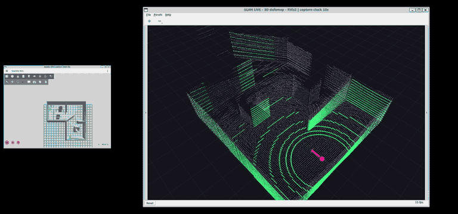</a> | [Record](results/reference/practice-3d-visible-20261016/static-B/record.json) |
| BeautyMap | 1.14 | 0.21 | <a href="results/reference/practice-3d-visible-20261016/static-B/executions/beautymap.mp4">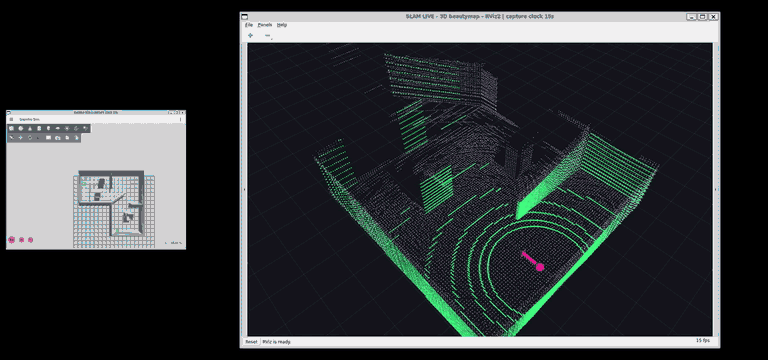</a> | [Record](results/reference/practice-3d-visible-20261016/static-B/record.json) |
<!-- /HOME_EXPERIMENT_TABLE -->

[Common-scan-time scores](results/reference/practice-3d-visible-20261016/static-B/score.json) · Common valid scans: 458/600

Valid scan-output fraction: Raw 87.83%, DUFOMap 86.83%, BeautyMap 97.33%; output availability is not localization success; RMSE covers common valid scans only.

DUFOMap removes only 39/684477 points, with identical occupied 15 cm cells to Raw. There is no dynamic pollution in this static case, so little pose change is expected.

**Analysis:**
<!-- PRACTICE_ANALYSIS:scene-static-3d -->

<!-- /PRACTICE_ANALYSIS:scene-static-3d -->

[↑ Contents](#practice-index)

<a id="scene-dynamic-3d"></a>

#### Dynamic · 3D

**A · Map cleaning**

| Map | DA ↑ | SA ↑ |
| --- | --- | --- |
| Raw | 0.00% | 100.00% |
| DUFOMap | 52.20% | 99.99% |
| BeautyMap | 71.81% | 87.33% |


| A · Live 3D acquisition | A · Saved cleaning results (Raw / DUFOMap / BeautyMap) |
| --- | --- |
| <a href="results/reference/practice-3d-visible-20261016/dynamic-A/execution.mp4">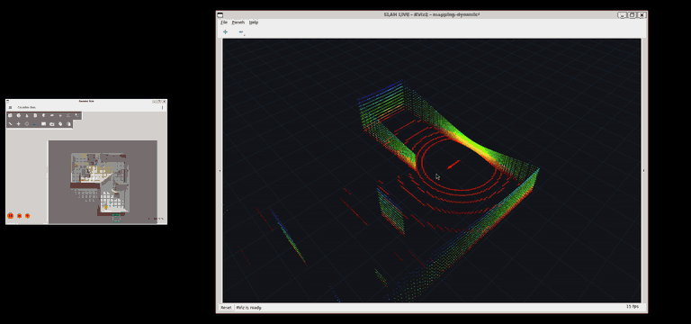</a> | <a href="results/reference/practice-3d-visible-20261016/dynamic-A/cleaning-review/result.mp4">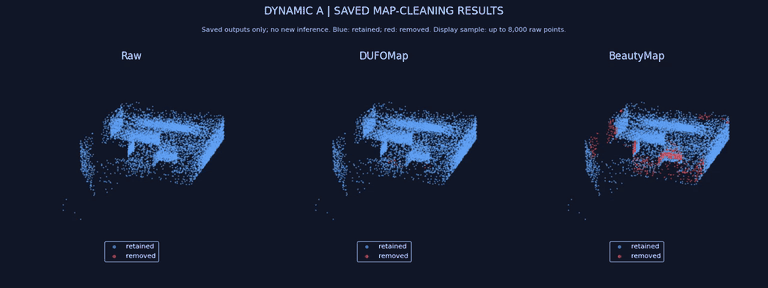</a> |


The right panel reviews saved cleaning outputs without new inference; click a GIF for the full MP4.

[A acquisition record](results/reference/practice-3d-visible-20261016/dynamic-A/record.json) · [Cleaning review record](results/reference/practice-3d-visible-20261016/dynamic-A/cleaning-review/record.json)

[Mapping A processing record](results/reference/practice-3d-visible-20261016/dynamic-A/maps/record.json)

<a id="scene-dynamic-3d-b"></a>

**B · Localization on frozen maps**

<!-- HOME_EXPERIMENT_TABLE -->
| Frozen map | XYZ RMSE / cm ↓ | Rotation RMSE / ° | Localization B (click for MP4) | Evidence |
| --- | --- | --- | --- | --- |
| Raw | 1.18 | 0.22 | <a href="results/reference/practice-3d-visible-20261016/dynamic-B/executions/raw.mp4"></a> | [Record](results/reference/practice-3d-visible-20261016/dynamic-B/record.json) |
| DUFOMap | 1.00 | 0.17 | <a href="results/reference/practice-3d-visible-20261016/dynamic-B/executions/dufomap.mp4">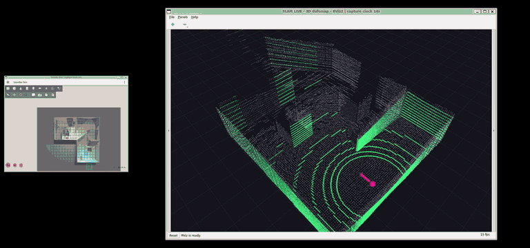</a> | [Record](results/reference/practice-3d-visible-20261016/dynamic-B/record.json) |
| BeautyMap | 1.39 | 0.25 | <a href="results/reference/practice-3d-visible-20261016/dynamic-B/executions/beautymap.mp4">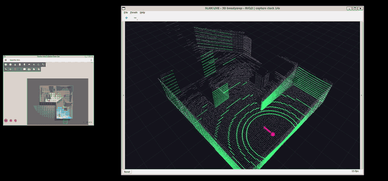</a> | [Record](results/reference/practice-3d-visible-20261016/dynamic-B/record.json) |
<!-- /HOME_EXPERIMENT_TABLE -->

[Common-scan-time scores](results/reference/practice-3d-visible-20261016/dynamic-B/score.json) · Common valid scans: 554/600

Valid scan-output fraction: Raw 96.50%, DUFOMap 95.17%, BeautyMap 99.67%; output availability is not localization success; RMSE covers common valid scans only.

DA/SA describe dynamic removal and static retention; removing traces does not guarantee stronger GICP constraints. Without lower B error, the result supports cleaning only.

**Analysis:**
<!-- PRACTICE_ANALYSIS:scene-dynamic-3d -->

<!-- /PRACTICE_ANALYSIS:scene-dynamic-3d -->

[↑ Contents](#practice-index)

<a id="scene-corridor-3d"></a>

#### Corridor · 3D

**A · Map cleaning**

| Map | SA ↑ |
| --- | --- |
| Raw | 100.00% |
| DUFOMap | 100.00% |
| BeautyMap | 99.84% |


| A · Live 3D acquisition | A · Saved cleaning results (Raw / DUFOMap / BeautyMap) |
| --- | --- |
| <a href="results/reference/practice-3d-visible-20261016/corridor-A/execution.mp4">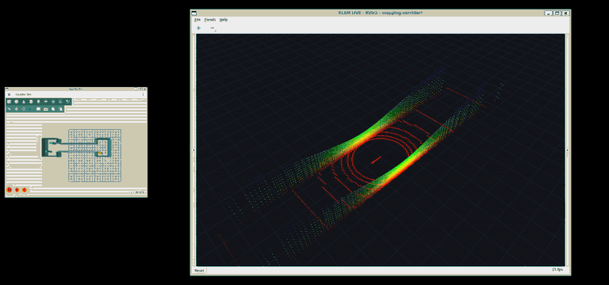</a> | <a href="results/reference/practice-3d-visible-20261016/corridor-A/cleaning-review/result.mp4">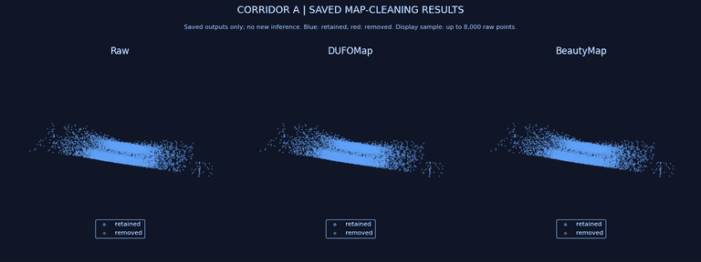</a> |


The right panel reviews saved cleaning outputs without new inference; click a GIF for the full MP4.

[A acquisition record](results/reference/practice-3d-visible-20261016/corridor-A/record.json) · [Cleaning review record](results/reference/practice-3d-visible-20261016/corridor-A/cleaning-review/record.json)

[Mapping A processing record](results/reference/practice-3d-visible-20261016/corridor-A/maps/record.json)

<a id="scene-corridor-3d-b"></a>

**B · Localization on frozen maps**

<!-- HOME_EXPERIMENT_TABLE -->
| Frozen map | XYZ RMSE / cm ↓ | Rotation RMSE / ° | Localization B (click for MP4) | Evidence |
| --- | --- | --- | --- | --- |
| Raw | 756.40 | 5.65 | <a href="results/reference/practice-3d-visible-20261016/corridor-B/executions/raw.mp4">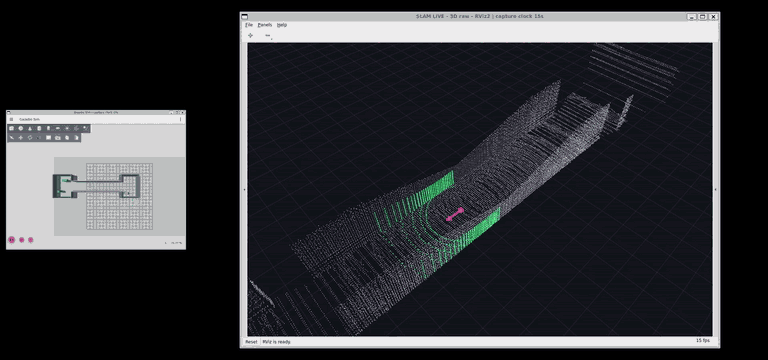</a> | [Record](results/reference/practice-3d-visible-20261016/corridor-B/record.json) |
| DUFOMap | 449.10 | 0.49 | <a href="results/reference/practice-3d-visible-20261016/corridor-B/executions/dufomap.mp4">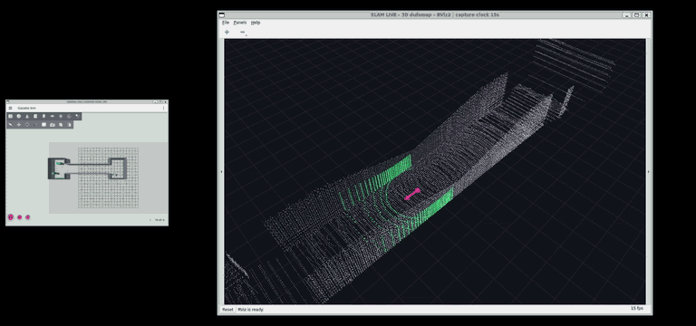</a> | [Record](results/reference/practice-3d-visible-20261016/corridor-B/record.json) |
| BeautyMap | 482.16 | 0.43 | <a href="results/reference/practice-3d-visible-20261016/corridor-B/executions/beautymap.mp4">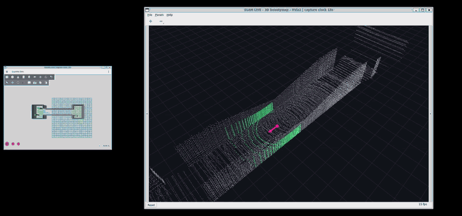</a> | [Record](results/reference/practice-3d-visible-20261016/corridor-B/record.json) |
<!-- /HOME_EXPERIMENT_TABLE -->

[Common-scan-time scores](results/reference/practice-3d-visible-20261016/corridor-B/score.json) · Common valid scans: 381/599

Observations are restricted for 50 s, then restored; all three cases drift by metres in this trial. Raw and DUFOMap frozen maps are byte-identical; separate processes can have different scan histories, so a single-run pose difference cannot be attributed to cleaning.

Valid scan-output fraction: Raw 74.29%, DUFOMap 69.95%, BeautyMap 94.49%; output availability is not localization success; RMSE covers common valid scans only.

**Analysis:**
<!-- PRACTICE_ANALYSIS:scene-corridor-3d -->

<!-- /PRACTICE_ANALYSIS:scene-corridor-3d -->

[↑ Contents](#practice-index)

<a id="scene-change-3d"></a>

#### Changed world · 3D

This group freezes static-A maps and acquires B in the changed world; the A table retains cleaning scores for those static maps.

**A · Map cleaning**

| Map | SA ↑ |
| --- | --- |
| Raw | 100.00% |
| DUFOMap | 99.99% |
| BeautyMap | 87.71% |


| A · Live 3D acquisition | A · Saved cleaning results (Raw / DUFOMap / BeautyMap) |
| --- | --- |
| <a href="results/reference/practice-3d-visible-20261016/static-A/execution.mp4"></a> | <a href="results/reference/practice-3d-visible-20261016/static-A/cleaning-review/result.mp4"></a> |


The right panel reviews saved cleaning outputs without new inference; click a GIF for the full MP4.

[A acquisition record](results/reference/practice-3d-visible-20261016/static-A/record.json) · [Cleaning review record](results/reference/practice-3d-visible-20261016/static-A/cleaning-review/record.json)

[Mapping A processing record](results/reference/practice-3d-visible-20261016/static-A/maps/record.json)

<a id="scene-change-3d-b"></a>

**B · Localization on frozen maps**

<!-- HOME_EXPERIMENT_TABLE -->
| Frozen map | XYZ RMSE / cm ↓ | Rotation RMSE / ° | Localization B (click for MP4) | Evidence |
| --- | --- | --- | --- | --- |
| Raw | 1.06 | 0.23 | <a href="results/reference/practice-3d-visible-20261016/change-B/executions/raw.mp4"></a> | [Record](results/reference/practice-3d-visible-20261016/change-B/record.json) |
| DUFOMap | 1.08 | 0.24 | <a href="results/reference/practice-3d-visible-20261016/change-B/executions/dufomap.mp4"></a> | [Record](results/reference/practice-3d-visible-20261016/change-B/record.json) |
| BeautyMap | 1.24 | 0.27 | <a href="results/reference/practice-3d-visible-20261016/change-B/executions/beautymap.mp4"></a> | [Record](results/reference/practice-3d-visible-20261016/change-B/record.json) |
<!-- /HOME_EXPERIMENT_TABLE -->

[Common-scan-time scores](results/reference/practice-3d-visible-20261016/change-B/score.json) · Common valid scans: 486/599

Valid scan-output fraction: Raw 91.32%, DUFOMap 90.32%, BeautyMap 97.33%; output availability is not localization success; RMSE covers common valid scans only.

**Analysis:**
<!-- PRACTICE_ANALYSIS:scene-change-3d -->

<!-- /PRACTICE_ANALYSIS:scene-change-3d -->

[↑ Contents](#practice-index)

<a id="practice-appendix"></a>

### Supplementary experiments

<a id="supp-srrg"></a>

#### SRRG · Persistent change

| Method | SA | New structure coverage |
| --- | --- | --- |
| Raw | 100.00% | 100.00% |
| SRRG | 99.71% | 98.90% |


[Record](results/reference/srrg-2d-large-change/record.json)

| SRRG changed-world A |
| --- |
| <a href="results/reference/srrg-2d-large-change/execution.mp4"></a> |


<a id="supp-srrg-b"></a>

**B · Localization on frozen maps**

Freeze both maps from persistent-change mapping A; acquire fresh B in the changed world and localize with identical AMCL settings.

| Frozen map | XY RMSE / cm ↓ | yaw RMSE / ° | Localization B (click for MP4) | Evidence |
| --- | --- | --- | --- | --- |
| Raw | 5.40 | 2.86 | <a href="results/reference/practice-frozen-20261016/srrg-change/executions/raw.mp4"></a> | [Record](results/reference/practice-frozen-20261016/srrg-change/record.json) |
| SRRG | 4.36 | 2.65 | <a href="results/reference/practice-frozen-20261016/srrg-change/executions/srrg.mp4"></a> | [Record](results/reference/practice-frozen-20261016/srrg-change/record.json) |


[Common-time scores](results/reference/practice-frozen-20261016/srrg-change/score.json) · Common valid samples: 273/601

AMCL publishes after motion thresholds are met; the count includes only common times with pose age ≤0.15 s and is not a localization success rate.

**Analysis:**
<!-- PRACTICE_ANALYSIS:srrg-large-change-2d -->

<!-- /PRACTICE_ANALYSIS:srrg-large-change-2d -->

[↑ Contents](#practice-index)

<a id="hypothesis-test"></a>

## Hypothesis test

<a id="hypothesis-test-index"></a>

Experiments for project-written methods. H1 rebuilds maps from the same original A and uses old B for development ablation. After fixing the rule, acquire one fresh static B and three fresh dynamic B sessions. H2 retains its original single A/B trial. Each paired trial shares scans, odometry, AMCL parameters and initialization.

| Experiment | Mapping and scores | Held-out localization and scores |
| --- | --- | --- |
| H1 old-B development ablation | — | [↗](#h1-revision-ablation) |
| H1 Static retention | [A](#own-static-a) | [B](#own-static-b) |
| H1 Dynamic cleaning | [A](#own-dynamic-a) | [B](#own-dynamic-b) |
| H2 Odometry deskew | [A](#own-motion-a) | [B](#own-motion-b) |

Use the same omni robot as Practice; algorithms use only 2D LiDAR and wheel odometry. H2 combines sectors from three actual scan times, preserving each point timestamp, without FAST-LIO.

[Own cleaner](src/slam_learning/runtime/own_mapping.py) · [Own alignment](src/slam_learning/runtime/own_refinement.py) · [Record H1 confirmation](demo/record-h1-revision.ps1) · [Settings fixed before acquisition](results/reference/h1-refined-20261016/confirmation-protocol.json)

H2 recording phases: stationary 0–7 s, slow turn 7–15 s, fast turns 15–31 s, translation 31–39 s.

<a id="h1-revision-ablation"></a>

### H1 · Old-B development ablation

The old rule loses 6.95 percentage points of SA, while A wheel-pose RMSE is 7.74 cm. Cleaning cannot correct mapping-pose error, so the final method adds own robust 2D alignment. This table reruns the same old B for development ablation and is excluded from final fresh-B scores.

| Method | DA ↑ | SA ↑ | XY RMSE / cm ↓ |
| --- | --- | --- | --- |
| Raw | 5.13% | 99.50% | 5.72 |
| Old per-cell filtering | 94.87% | 92.55% | 6.11 |
| Later-free confirmation (pilot) | 29.49% | 99.50% | 5.81 |
| Neighborhood temporal: filter only | 79.49% | 99.17% | 5.66 |
| Own alignment only | 0.00% | 100.00% | 4.86 |
| Own alignment + cleaning (final) | 58.97% | 99.67% | 4.41 |

[Native AMCL rerun record](results/reference/h1-refined-20261016/dynamic-replay/trial-1/record.json) · [Original negative result](results/reference/own-hypotheses-20261016/dynamic-B/record.json)

Three fresh B sessions for filter-only yielded Raw 6.02 cm and filter-only 6.06 cm, without improvement; that full batch is retained. The main experiment below uses another fresh B batch for the final joint method. [Filter-only confirmation](results/reference/h1-supported-20261016/confirmation-score.json)

<a id="own-static-a"></a>

### H1 · Static retention · A

| Control | SA ↑ |
| --- | --- |
| M₀ · Raw: wheel-pose accumulation | 99.55% |
| M₁ · Align+Temporal: own alignment + cleaning | 100.00% |

| Original A acquisition (old algorithm view) | Same A reprocessed: grey Raw, blue revised |
| --- | --- |
| <a href="results/reference/own-hypotheses-20261016/static-A/execution.mp4"></a> | <a href="results/reference/h1-refined-20261016/static-A/execution.mp4"></a> |

[Record](results/reference/h1-refined-20261016/static-A/record.json)

**Analysis:**
<!-- OWN_ANALYSIS:static-a -->

<!-- /OWN_ANALYSIS:static-a -->

<a id="own-static-b"></a>

### H1 · Static retention · B

Acquire fresh B and use the same AMCL on frozen maps. One static control session.

| Map / AMCL | XY RMSE / cm ↓ | Localization recording (click MP4) |
| --- | --- | --- |
| M₀ · Raw: wheel-pose accumulation | 5.44 | <a href="results/reference/h1-refined-20261016/static-B/executions/raw.mp4"></a> |
| M₁ · Align+Temporal: own alignment + cleaning | 4.64 | <a href="results/reference/h1-refined-20261016/static-B/executions/temporal.mp4"></a> |

[Common-time scores](results/reference/h1-refined-20261016/static-B/time-grid-score.json) · [Record](results/reference/h1-refined-20261016/static-B/record.json)

**Analysis:**
<!-- OWN_ANALYSIS:static-b -->

<!-- /OWN_ANALYSIS:static-b -->

[↑ Contents](#hypothesis-test-index)

<a id="own-dynamic-a"></a>

### H1 · Dynamic cleaning · A

| Control | DA ↑ | SA ↑ |
| --- | --- | --- |
| M₀ · Raw: wheel-pose accumulation | 5.13% | 99.50% |
| M₁ · Align+Temporal: own alignment + cleaning | 58.97% | 99.67% |

| Original A acquisition (old algorithm view) | Same A reprocessed: grey Raw, blue revised |
| --- | --- |
| <a href="results/reference/own-hypotheses-20261016/dynamic-A/execution.mp4"></a> | <a href="results/reference/h1-refined-20261016/dynamic-A/execution.mp4"></a> |

[Record](results/reference/h1-refined-20261016/dynamic-A/record.json)

**Analysis:**
<!-- OWN_ANALYSIS:dynamic-a -->

<!-- /OWN_ANALYSIS:dynamic-a -->

<a id="own-dynamic-b"></a>

### H1 · Dynamic cleaning · B

Acquire fresh B and use the same AMCL on frozen maps. The table pools common-time samples from all three B sessions; GIFs always show trial 1.

| Map / AMCL | XY RMSE / cm ↓ | Localization recording (click MP4) |
| --- | --- | --- |
| M₀ · Raw: wheel-pose accumulation | 5.82 | <a href="results/reference/h1-refined-20261016/dynamic-B/executions/raw.mp4"></a> |
| M₁ · Align+Temporal: own alignment + cleaning | 4.65 | <a href="results/reference/h1-refined-20261016/dynamic-B/executions/temporal.mp4"></a> |

| Trial | Raw / cm | Temporal / cm | Full recordings |
| --- | --- | --- | --- |
| 1 | 4.95 | 4.75 | [Raw MP4](results/reference/h1-refined-20261016/dynamic-B/executions/raw.mp4) · [Temporal MP4](results/reference/h1-refined-20261016/dynamic-B/executions/temporal.mp4) |
| 2 | 5.55 | 4.56 | [Raw MP4](results/reference/h1-refined-20261016/dynamic-B2/executions/raw.mp4) · [Temporal MP4](results/reference/h1-refined-20261016/dynamic-B2/executions/temporal.mp4) |
| 3 | 6.52 | 4.69 | [Raw MP4](results/reference/h1-refined-20261016/dynamic-B3/executions/raw.mp4) · [Temporal MP4](results/reference/h1-refined-20261016/dynamic-B3/executions/temporal.mp4) |

[Common-time scores](results/reference/h1-refined-20261016/confirmation-score.json) · [Record](results/reference/h1-refined-20261016/dynamic-B/record.json)

**Analysis:**
<!-- OWN_ANALYSIS:dynamic-b -->

<!-- /OWN_ANALYSIS:dynamic-b -->

[↑ Contents](#hypothesis-test-index)

<a id="own-motion-a"></a>

### H2 · Odometry deskew · A

| Control | Map RMSE / cm ↓ |
| --- | --- |
| M₀ · Off: uncompensated | 34.10 |
| M₁ · On: motion compensated | 4.57 |

| Mapping: grey baseline, blue own intervention |
| --- |
| <a href="results/reference/own-hypotheses-20261016/motion-A/execution.mp4"></a> |

[Record](results/reference/own-hypotheses-20261016/motion-A/record.json)

**Analysis:**
<!-- OWN_ANALYSIS:motion-a -->

<!-- /OWN_ANALYSIS:motion-a -->

<a id="own-motion-b"></a>

### H2 · Odometry deskew · B

| Map / AMCL | XY RMSE / cm ↓ |
| --- | --- |
| M₀ · Off: uncompensated | 4.70 |
| M₁ · On: motion compensated | 4.71 |

| M₀ · Off: uncompensated | M₁ · On: motion compensated |
| --- | --- |
| <a href="results/reference/own-hypotheses-20261016/motion-B/executions/off.mp4"></a> | <a href="results/reference/own-hypotheses-20261016/motion-B/executions/deskew.mp4"></a> |

[Common-time scores](results/reference/own-hypotheses-20261016/motion-B/time-grid-score.json) · [Record](results/reference/own-hypotheses-20261016/motion-B/record.json)

**Analysis:**
<!-- OWN_ANALYSIS:motion-b -->

<!-- /OWN_ANALYSIS:motion-b -->

[↑ Contents](#hypothesis-test-index)

H1 uses DA/SA for cleaning and only SA in its static control; H2 uses one-way map-to-static-support RMSE. Localization uses common 10 Hz times after 5 s warmup, with output age at most 0.15 s; sample counts and missing outputs remain in the score records. Better mapping scores without lower B error support only the mapping claim.

<a id="references"></a>

## References

Papers behind the rows in [Related works](#related-works), with DOIs. The four reproduced methods come first, then the baselines and the source of the KITTI-00 teaser data.

| # | Work | Citation | DOI |
| --- | --- | --- | --- |
| R1 | [SRRG / srrg_mapper2d](#related-srrg_mapper2d) | M. T. Lázaro, R. Capobianco, G. Grisetti, "Efficient Long-term Mapping in Dynamic Environments," *2018 IEEE/RSJ International Conference on Intelligent Robots and Systems (IROS)*, pp. 153–160. | [10.1109/IROS.2018.8594310](https://doi.org/10.1109/IROS.2018.8594310) |
| R2 | [DUFOMap](#related-dufomap) | D. Duberg, Q. Zhang, M. Jia, P. Jensfelt, "DUFOMap: Efficient Dynamic Awareness Mapping," *IEEE Robotics and Automation Letters*, 9(6):5038–5045, 2024. | [10.1109/LRA.2024.3387658](https://doi.org/10.1109/LRA.2024.3387658) |
| R3 | [BeautyMap](#related-beautymap) | M. Jia, Q. Zhang, B. Yang, J. Wu, M. Liu, P. Jensfelt, "BeautyMap: Binary-Encoded Adaptable Ground Matrix for Dynamic Points Removal in Global Maps," *IEEE Robotics and Automation Letters*, 9(7):6256–6263, 2024. | [10.1109/LRA.2024.3402625](https://doi.org/10.1109/LRA.2024.3402625) |
| R4 | [IR-MCL](#related-ir-mcl) | H. Kuang, X. Chen, T. Guadagnino, N. Zimmerman, J. Behley, C. Stachniss, "IR-MCL: Implicit Representation-Based Online Global Localization," *IEEE Robotics and Automation Letters*, 8(3):1627–1634, 2023. | [10.1109/LRA.2023.3239318](https://doi.org/10.1109/LRA.2023.3239318) |
| R5 | [AdaM-MCL](#related-adam-mcl) | R. Chen, H. Yin, Y. Jiao, G. Dissanayake, Y. Wang, R. Xiong, "Deep Samplable Observation Model for Global Localization and Kidnapping," *IEEE Robotics and Automation Letters*, 6(2):2296–2303, 2021. | [10.1109/LRA.2021.3061339](https://doi.org/10.1109/LRA.2021.3061339) |
| R6 | [FAST-LIO](#related-fast_lio) | W. Xu, F. Zhang, "FAST-LIO: A Fast, Robust LiDAR-Inertial Odometry Package by Tightly-Coupled Iterated Kalman Filter," *IEEE Robotics and Automation Letters*, 6(2):3317–3324, 2021. | [10.1109/LRA.2021.3064227](https://doi.org/10.1109/LRA.2021.3064227) |
| R7 | [FAST-LIO2](#related-fast_lio) | W. Xu, Y. Cai, D. He, J. Lin, F. Zhang, "FAST-LIO2: Fast Direct LiDAR-Inertial Odometry," *IEEE Transactions on Robotics*, 38(4):2053–2073, 2022. | [10.1109/TRO.2022.3141876](https://doi.org/10.1109/TRO.2022.3141876) |
| R8 | [GICP](#related-gicp) | A. Segal, D. Haehnel, S. Thrun, "Generalized-ICP," *Robotics: Science and Systems V*, 2009. | [10.15607/RSS.2009.V.021](https://doi.org/10.15607/RSS.2009.V.021) |
| R9 | KITTI-00 141-scan teaser used by the DUFOMap and BeautyMap rows | Q. Zhang, D. Duberg, R. Geng, M. Jia, L. Wang, P. Jensfelt, "A Dynamic Points Removal Benchmark in Point Cloud Maps," *2023 IEEE 26th International Conference on Intelligent Transportation Systems (ITSC)*, pp. 608–614. | [10.1109/ITSC57777.2023.10422094](https://doi.org/10.1109/ITSC57777.2023.10422094) |

DOIs were resolved from the indexed publisher metadata (OpenAlex records) on 2026-10-16; author lists, volumes and pages follow the publisher record. Where a work also circulates as a preprint, [Related works](#related-works) links the arXiv version: FAST-LIO, FAST-LIO2, DUFOMap, BeautyMap, IR-MCL and AdaM-MCL. GICP also appears as a 2010 MIT Press chapter, DOI 10.7551/mitpress/8727.003.0022, pp. 161–168.

Implementations named in [Related works](#related-works) are cited by repository rather than DOI, at the pinned revision where one is recorded.

| Work | Implementation |
| --- | --- |
| SRRG | [srrg_mapper2d](https://gitlab.com/srrg-software/srrg_mapper2d) · [ROS entry](https://gitlab.com/srrg-software/srrg_mapper2d_ros) |
| DUFOMap | [KTH-RPL/dufomap](https://github.com/KTH-RPL/dufomap) |
| BeautyMap | [MKJia/BeautyMap](https://github.com/MKJia/BeautyMap) |
| IR-MCL | [PRBonn/ir-mcl @ aab8c91](https://github.com/PRBonn/ir-mcl/tree/aab8c91b37e59f94442d8eddfa2f920ab1ecc4c5) |
| AdaM-MCL / DSOM | [Runjian-Chen/AdaM_MCL @ e8aedd2](https://github.com/Runjian-Chen/AdaM_MCL/tree/e8aedd2bae03816aabd5300e5ca2fe181b39d830) |
| FAST-LIO / FAST-LIO2 | [hku-mars/FAST_LIO, ROS 2 branch](https://github.com/hku-mars/FAST_LIO/tree/ROS2) |
| AMCL / Nav2 | [nav2_amcl](https://github.com/ros-navigation/navigation2/tree/main/nav2_amcl) |
| GICP | [avsegal/gicp](https://github.com/avsegal/gicp) · [PCL implementation](https://pointclouds.org/documentation/classpcl_1_1_generalized_iterative_closest_point.html) · [ROS 2 localization framework used here](https://github.com/rsasaki0109/lidar_localization_ros2) |

The AMCL row refers to the Nav2 implementation, so its statistical origin is not cited above. Upstream licences, pinned commits and fetch provenance are in [Sources, credits and asset scope](docs/guides/ATTRIBUTION.md).
