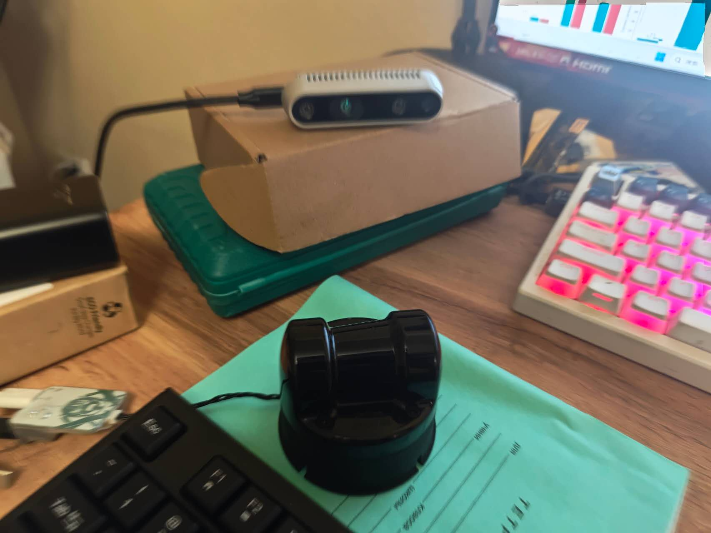

<div align="center">

# SLAM Learning

**地图修复？**

动态环境中的鲁棒定位与 SLAM · 定位系统自恢复

[](https://github.com/p20030920p/slam_learning_updated/actions/workflows/ci.yml)
[](../src/pyproject.toml)

[English](../README.md) | 中文

[研究主线](#研究主线退化与大变动场景下的定位系统自恢复) · [定位实测 GIF](#静态与动态定位录制) · [方向分析](#方向分析) · [开放问题](#开放问题) · [相关工作](#相关工作)

[复现结果](#复现结果) · [实验证据](#实验证据) · [实物测试](#实物测试) · [假设](#假设) · [分支](#分支)

</div>

## 研究主线：退化与大变动场景下的定位系统自恢复

本仓库当前的主线是**定位系统的自恢复**：在几何/感知**退化**与**大变动**（先验地图与现状不再一致）场景下，系统如何判断自身位姿已不可信、如何归因、如何在无人干预下恢复、以及如何确认恢复真的成功。

工作文档（中文先行，英文版在论文集冻结后补齐）：

- [主线定义、证据缺口与平台清单](self-recovery/README.zh-CN.md)
- [论文地图：退化检测、重定位、地图维护、鲁棒后端、评测](self-recovery/SURVEY.zh-CN.md)
- [用现有静态/动态 AMCL 录制做实验的可行性评估](self-recovery/FEASIBILITY.zh-CN.md)
- [候选假设 H1—H6 与证伪条件](self-recovery/HYPOTHESES.zh-CN.md)
- [按策略族分组的假设集，每条绑定到仿真里的一格](self-recovery/HYPOTHESES-BY-PAPER.zh-CN.md)
- [逐篇假设：每篇论文推出哪条主张、用哪一格仿真检验](self-recovery/PAPER-TO-HYPOTHESIS.zh-CN.md)

此前放在本仓库的语义建图与视觉定位方向，已归档到旧库 [SLAM_Learning](https://github.com/p20030920p/SLAM_Learning)。

## 仿真实验与本机演示入口

[**SLAM-Physical 公开实验仓库**](https://github.com/p20030920p/SLAM-Physical)：BeautyMap 静态位姿修正与 C1/C2/C4 对照、首个物体离场场景、实测报告，以及 BeautyMap / DUFOMap 的实时 RViz 演示。本机双击 [demo 文件夹](../demo/README.md) 中的脚本，缺少同级实验仓库时会自动克隆。演示重新执行原生流程；小样本演示不替代下文的论文正式复现。

新增 [Windows / WSL2 键盘 AMCL 操作指南](https://github.com/p20030920p/SLAM-Physical/blob/main/docs/WINDOWS_AMCL.zh-CN.md)：实时真值/估计偏移、自动录制、论文地图适配与同一输入回放对照。

本机 `demo/14_static_keyboard.cmd` 打开纯静态场景，`demo/15_dynamic_keyboard.cmd` 打开含三个运动障碍物的场景并选择原始/论文地图；两个入口均自动录制。`demo/16_record_static_dynamic.cmd` 执行独立建图/测试录制及重复 AMCL 对比。

## 静态与动态定位录制

**2026-10-14 实测：**四份 Gazebo 建图／测试录制、十二张传感器地图、42 次有效 AMCL 回放。下方按四类展示 GIF，包含实际记录的轨迹、地图、运动障碍物位置与实时误差曲线。绿色为真值，蓝色为定位估计，橙色为运动箱体。GIF 保留对应 MP4 的完整播放时长，画面由录制数据重绘。

**效果指标：排除最初 5 秒后的平面位置 RMSE，单位 cm，越小越好。**方法按传感器家族分别比较；动态改善率相对于同一动态测试 B 上的本家族原始地图。

| 地图类别 | 建图方法 | 纯静态 | 动态 | 动态 RMSE 降幅 | 干净地图＋动态测试 |
| --- | --- | ---: | ---: | ---: | ---: |
| LiDAR | 原始，不使用论文算法 | 5.59 | 6.29 | 基线 | 4.86 |
| LiDAR | BeautyMap | 6.01 | 5.52 | 12.3% | 5.52 |
| LiDAR | DUFOMap | 6.21 | 5.06 | 19.5% | 4.75 |
| RGB-D 几何 | 原始，不使用论文算法 | 5.97 | 6.45 | 基线 | 6.48 |

另有两个 RGB-D 几何地图族由已归档到旧库方向的方法按同一协议录制——ConceptGraphs 与 HOV-SG，静态／动态／干净地图条件下的位置 RMSE 分别为 5.48／6.02／6.36 cm 与 6.35／6.28／5.71 cm——见下文第 3 类。

静态、动态主实验各重新启动 AMCL 回放三次相同输入，位置估计相同，用于检查可复现性；干净地图控制组每种方法回放一次。这是一处受控场景的结果。[完整精度 CSV](../results/localization/static-dynamic/summary.csv) · [协议、地图与报告](https://github.com/p20030920p/SLAM-Physical/blob/main/docs/results/static-dynamic/README.md)。

### 1. 纯静态场景


静态建图 A 和独立录制的静态测试 B 中均没有运动箱体。BeautyMap、DUFOMap 的定位 RMSE 在这里略高于原始 LiDAR 地图；干净场景中的过滤不保证定位收益。[MP4](../results/localization/static-dynamic/static.mp4)。

### 2. 动态场景——LiDAR 地图过滤


建图与测试期间均有三个运动箱体。同一测试 B 上，相比未过滤的 LiDAR 地图，BeautyMap 的 RMSE 降低 **0.78 cm**，DUFOMap 降低 **1.23 cm**。[MP4](../results/localization/static-dynamic/dynamic-lidar.mp4)。

### 3. 动态场景——RGB-D 几何地图


以 RGB-D 原始地图为基线，上表所述两个已归档的 RGB-D 几何方法分别使 RMSE 降低 **0.43 cm** 与 **0.18 cm**。[MP4](../results/localization/static-dynamic/dynamic-rgbd.mp4)。

### 4. 控制组——干净地图＋相同动态测试


复用第 2、3 类的**同一份动态测试 B**，只将建图 A 改为静态录制。原始 LiDAR 在干净地图上的 RMSE 为 **4.86 cm**，在动态建图结果上为 **6.29 cm**，用于区分地图残影与定位期间动态遮挡的影响。[MP4](../results/localization/static-dynamic/clean-map-dynamic-test.mp4)。

建图 A 使用仿真提供的传感器位姿，单独检验地图构建；测试 B 的 AMCL 仅接收扫描、轮速里程计和待测地图，真值用于评分与显示。GIF 展示第 1 次回放，曲线为 AMCL＋里程计的实时预测误差，表格评分对象为 AMCL 位姿更新；地图生成在离线完成。[GIF 时序、来源哈希与录制轨迹](../results/localization/static-dynamic/README.md) · [原始六方法动态 MP4](https://github.com/p20030920p/SLAM-Physical/blob/main/docs/results/static-dynamic/dynamic-localization-replay.mp4)。

**本机一键测试：**已准备环境的 Windows / WSL2 电脑双击 [14：静态键盘驾驶](../demo/14_static_keyboard.cmd)、[15：动态键盘驾驶与地图菜单](../demo/15_dynamic_keyboard.cmd) 或 [16：自动录制对照](../demo/16_record_static_dynamic.cmd)。`i` 前进，`,` 后退，`j` / `l` 转向，`k` 停止；`Ctrl+C` 结束并保存录制。[环境与操作说明](../demo/README.md)。

## 方向分析

**SLAM — Simultaneous Localization and Mapping，同步定位与建图：**利用传感器观测，同时估计自身运动并构建地图。

- **动态环境中的鲁棒定位与 SLAM：**物体运动时仍能可靠估计自身运动并维护稳定地图；当地图与现状不再一致时，保持位姿估计可信。

本仓库只保留这一个方向。用五个要素理解这个过程，当前主线在其外围加上检测与恢复：

```text
传感器数据 → 前端 → 后端（优化） → 地图构建与位姿输出
              ↓        ↑                    ↓
          回环检测 ────┘            失效检测 → 恢复
```

| 要素 | 收益 | 本仓库的做法 |
| --- | --- | --- |
| 传感器数据 | 干净输入 | 已录制的 Gazebo 激光与 RGB-D 采集；桌面硬件采集检查 |
| 前端 | 稳定匹配 | 定位前先做静态结构过滤（DUFOMap、BeautyMap） |
| 后端 | 一致位姿 | 由扫描与轮速里程计驱动的 AMCL 位姿更新；异常约束处理不在这些实验内 |
| 回环检测 | 减少漂移 | 不在这些实验内：本平台是 AMCL，没有因子图后端 |
| 地图构建 | 稳定地图 | 给定位姿的建图 A 生成各地图；同一测试 B 上为六个地图族打分 |
| 失效检测与恢复 | 位姿可信 | 当前开放主线：检测 → 归因 → 恢复 → 确认，工作文档见上 |

这里保留的方向重在可靠运动与几何。已完成的建图实验使用给定位姿，单独检查**地图构建**；完整 SLAM、导航与因子图后端不在这些实验范围内。位姿误差仍可能误导静态结构过滤，这正是下面开放问题的来源。

## 开放问题

**在退化与大变动环境中，什么样的策略能够有效地让定位系统自恢复？**

两份工作文档给出候选主张与证伪所需的测量：

- [按策略族分组的假设集，每条绑定到仿真里的一格](self-recovery/HYPOTHESES-BY-PAPER.zh-CN.md)（中文文档）
- [指标定义、实验矩阵与证伪条件](self-recovery/HYPOTHESES.zh-CN.md)（中文文档）

## 相关工作

以下回放给定位姿建图后的保存结果。GIF 保留对应 MP4 的播放时序；每个选定地图观测在 12 fps 下保持八帧。[DUFOMap 时序](../results/reference/dufomap/media/timing.json) · [BeautyMap 时序](../results/reference/beautymap/media/timing.json)。

### [DUFOMap](papers/dufomap.zh-CN.md)


**KITTI-00 户外场景，141 帧激光雷达扫描。**用已观测的空区域识别动态点，位姿容差保护静态几何。GIF 节选 21 帧，对比原始、剔除与保留点，背景为最终地图。[MP4](../results/reference/dufomap/media/replay/replay.mp4)。

### [BeautyMap](papers/beautymap.zh-CN.md)


**KITTI-00 户外场景，141 帧激光雷达扫描。**通过占据比较清理动态残影，用恢复机制保护静态几何。GIF 节选 21 帧，对比原始、剔除与保留点，背景为最终地图。[MP4](../results/reference/beautymap/media/replay/replay.mp4)。

## 复现结果

| 工作 | 数据 | 结果 |
| --- | --- | --- |
| [DUFOMap](https://github.com/p20030920p/SLAM_Learning/blob/535a2780af7ca7eb3aa02f722e1340fe90bc2dcf/docs/DUFOMAP_TABLE4.zh-CN.md) | KITTI-00，141 扫描 | 表 IV 准确率匹配 |
| [BeautyMap](https://github.com/p20030920p/SLAM_Learning/blob/535a2780af7ca7eb3aa02f722e1340fe90bc2dcf/docs/KITTI_PAPER_PROTOCOL.zh-CN.md) | 历史 KITTI-02，91 扫描 | 表 III 准确率匹配 |

## 实验证据

以下数值取自作者源库链接的论文及我们保存的作者代码运行结果。每张表仅对照同一种方法，不作跨方法排名。

**共用指标。** DUFOMap 和 BeautyMap 的 SA、DA 定义相同。$S,D$ 为真值中的静态／动态点数；$S_k,D_r$ 为正确保留的静态点数／正确剔除的动态点数。AA（DUFOMap）为几何平均，HA（BeautyMap）为调和平均。[DUFOMap 定义](https://arxiv.org/html/2403.01449v1#S4.SS2) · [BeautyMap 定义](https://arxiv.org/html/2405.07283v1#S4)。

$$
\begin{aligned}
\mathrm{SA} &= 100\frac{S_k}{S}, &
\mathrm{DA} &= 100\frac{D_r}{D},\\
\mathrm{AA} &= \sqrt{\mathrm{SA}\,\mathrm{DA}}, &
\mathrm{HA} &= \frac{2\,\mathrm{SA}\,\mathrm{DA}}{\mathrm{SA}+\mathrm{DA}}.
\end{aligned}
$$

### DUFOMap

KITTI-00，141 扫描公开数据；完整设置：体素 0.1 m、d_s=0.2 m、d_p=1。[作者源库](https://github.com/KTH-RPL/dufomap/tree/9e239ddd5995136e14f5212f33382a6ebc59e518) · [论文表 IV](https://arxiv.org/html/2403.01449v1#S5.T4) · [我们的结果](https://github.com/p20030920p/SLAM_Learning/blob/535a2780af7ca7eb3aa02f722e1340fe90bc2dcf/docs/DUFOMAP_TABLE4.zh-CN.md)。

| 指标 | 论文 % | 复现 % |
| --- | ---: | ---: |
| SA | 97.96 | 97.9635 |
| DA | 98.72 | 98.7196 |
| AA | 98.34 | 98.3408 |

完整设置的三项数值保留两位小数后均与论文一致。表 IV 五组设置共 15 项准确率均匹配；本表不包含运行时间和在线实验。

### BeautyMap

历史 KITTI-02，第 860–950 帧，共 91 扫描；XY=1 m、Z=0.5 m、范围 40 m。[作者源库](https://github.com/MKJia/BeautyMap/tree/98bce4a97db96ddd0d5342e31425c7679f58ba2e) · [论文表 III](https://arxiv.org/html/2405.07283v1#S4.T3) · [我们的结果](https://github.com/p20030920p/SLAM_Learning/blob/535a2780af7ca7eb3aa02f722e1340fe90bc2dcf/docs/KITTI_PAPER_PROTOCOL.zh-CN.md)。

| 指标 | 论文 % | 复现 % |
| --- | ---: | ---: |
| SA | 83.40 | 83.3978 |
| DA | 82.41 | 82.4092 |
| HA | 82.90 | 82.9006 |

三项数值保留两位小数后均一致。XY=0.5／1／2 m 的九项准确率全部匹配。使用历史预处理／GT 与作者 HA 评分器；论文当时的精确方法提交尚未确定。其他序列及运行时间不在本表范围内。

## 实物测试



桌面设备：RealSense D435 深度相机（不带 IMU）与宇树 L2 激光雷达。

| 设备 | 简单测试 | 完整视频 |
| --- | --- | --- |
| D435 | RGB／深度／左右红外采集 | [24.6 s](media/hardware/d435-input.mp4) |
| L2 | 点云与 ICP 显示 | [42.2 s](media/hardware/l2.mp4) |


补充：[D435 RGB-D odometry, 44.9 s](media/hardware/d435.mp4). 以上为已有采集和显示测试，硬件精度、SLAM 与跨传感器融合未验证。 [时间与来源](media/hardware/record.json).

## 假设

我们假设，保留地图更新背后的观测证据，并随着位姿估计的改善重新审视这些更新，能够减少持续性建图错误，保持几何地图更加一致。当前自恢复主线的候选假设列在[开放问题](#开放问题)一节。

## 分支

| 分支 | 用途 |
| --- | --- |
| main | 提交展示：单一方向（动态环境中的鲁棒定位与 SLAM）、两项方法复现、开放问题与假设。 |
| [reproduce/author-originals](https://github.com/p20030920p/SLAM_Learning/tree/reproduce/author-originals) | 作者原流程、论文表格评分与录制。 |
| [notes/personal-study-guide-20261008](https://github.com/p20030920p/SLAM_Learning/tree/notes/personal-study-guide-20261008) | 个人学习笔记与 `src/physical/` 实物实验，保留操作说明和失败记录。 |


[AI 使用](guides/DISCLOSURE.zh-CN.md) · [来源／许可](guides/ATTRIBUTION.zh-CN.md) · [引用](CITATION.cff) · [许可](../src/LICENSE)
