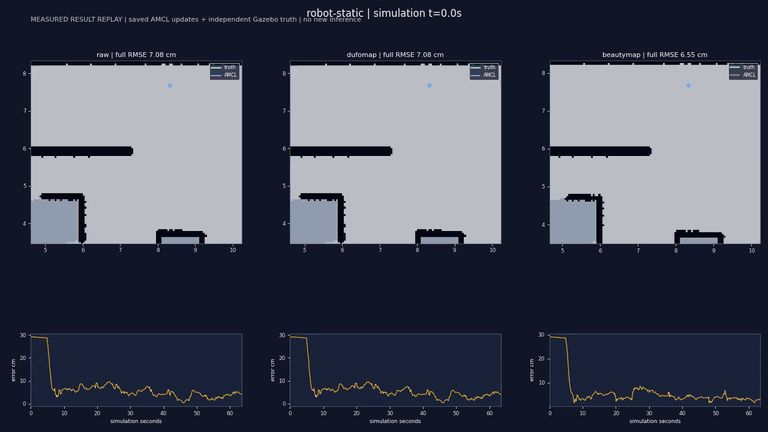
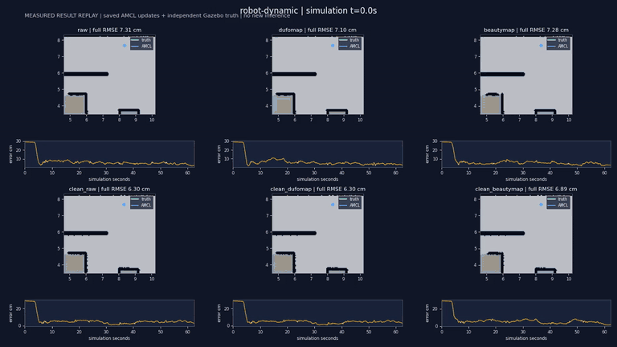
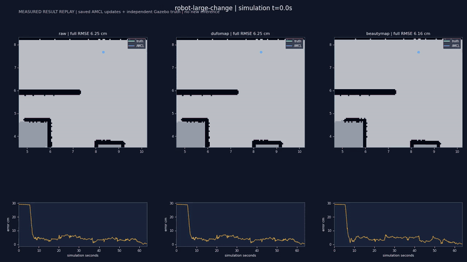
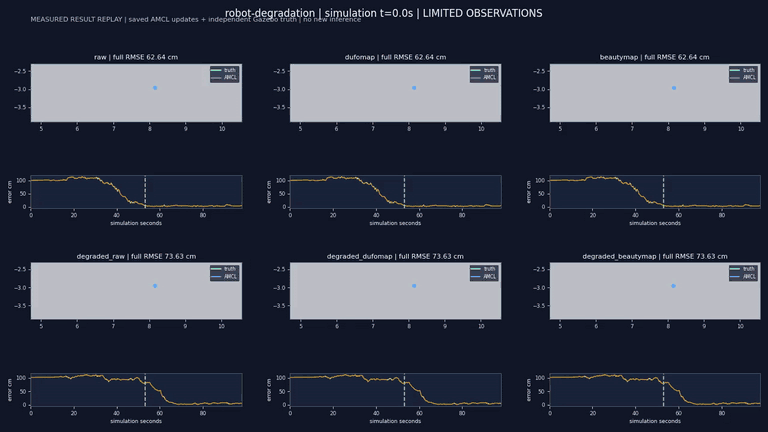

# SLAM Learning

**动态环境中的鲁棒定位与 SLAM**

动态环境中的鲁棒定位与 SLAM · 定位系统自恢复

[English](../README.md) | 中文

[开放问题](#开放问题) · [定位实测 GIF](#静态与动态定位录制) · [方向分析](#方向分析) · [相关工作](#相关工作)

[复现结果](#复现结果) · [实验证据](#实验证据) · [假设](#假设) · [分支](#分支)

## 开放问题

**在退化与大变动环境中，什么样的策略能够有效地让定位系统自恢复？** 先分析失效原因、恢复目标和适用边界，再选择策略。成果包括作者原库复现，以及使用 Sim2Real-AlgoBench 机器人逐步加难的点云建图与定位测试。[问题分析与收窄](self-recovery/DESIGN.zh-CN.md) · [机器人测试协议](testing/PROTOCOL.zh-CN.md) · [汇报稿](self-recovery/TALK.zh-CN.md) · [接续状态](self-recovery/STATUS.zh-CN.md)。

## 仿真实验与本机演示入口

当前真实 Gazebo／RViz／终端流程：[一键说明](../demo/README.md)、[成对视频页](../demo/gallery.html)、[评分协议](testing/LIVE.zh-CN.md)。已准备的 Windows 脚本在 `F:\be2演讲\实机脚本`，分别提供静态、运动障碍物、持久变化及走廊观测恢复的键盘入口和自动录制入口。

[逐步演示 Notebook](../notebooks/presentation/SLAM_实验逐步展示.ipynb) 串起四种作者原库执行及四类机器人场景，保存视频、地图、独立误差复算和结论边界。本机 Notebook 与离线 HTML 在 `F:\be2演讲\展示`；[打开说明](../notebooks/presentation/README.md)。

[SLAM-Physical](https://github.com/p20030920p/SLAM-Physical) 保留此前 C1/C2/C4、物体离场与地图适配实验。其旧 `demo/14–16` 流程及历史回放分数与下面的本机现场录屏分开。

## 静态与动态定位录制

**2026-10-14 本机现场录制。**真实 Gazebo＋RViz＋终端窗口，另配本次数据的结果回放。Sim2Real 三轮全向底盘，原生二维激光＋独立三维版本。[测试与计算口径](testing/LIVE.zh-CN.md)

| Gazebo 类别 | 现场执行 | 本次结果回放 | 实际效果 |
| --- | --- | --- | --- |
| 纯静态 |  [MP4](../results/reference/robot-static/execution.mp4) |  [MP4](../results/reference/robot-static/result.mp4) | 小初值偏移，未失效 |
| 运动障碍物 |  [MP4](../results/reference/robot-dynamic/execution.mp4) |  [MP4](../results/reference/robot-dynamic/result.mp4) | 三个运动箱体，六组同时定位 |
| 持久结构变化 |  [MP4](../results/reference/robot-large-change/execution.mp4) |  [MP4](../results/reference/robot-large-change/result.mp4) | 沿用旧地图，本路线未诱发失效 |
| 走廊退化 |  [MP4](../results/reference/robot-degradation/execution.mp4) |  [MP4](../results/reference/robot-degradation/result.mp4) | 受限扫描恢复后，约 11.3 秒持续收敛 |

**Gazebo 平面位置 RMSE（cm），包含初始化的全部原生 AMCL 更新。**DUFOMap／BeautyMap 离线处理三维地图，再由同一二维 AMCL 定位，属于平台适配。建图 A 使用给定位姿；独立测试 B 接收扫描与轮速，仿真真值只作评分。每种条件当前一次运行。

| 条件 | 原始 | DUFOMap | BeautyMap | 每方法更新数 |
| --- | ---: | ---: | ---: | ---: |
| 纯静态 | 7.08 | 7.08 | 6.55 | 290 |
| 运动障碍物 | 7.31 | 7.10 | 7.28 | 291 |
| 静态地图＋同一动态输入 | 6.30 | 6.30 | 6.89 | 291 |
| 持久结构变化 | 6.25 | 6.25 | 6.16 | 290 |
| 走廊退化 | 62.64 | 62.64 | 62.64 | 478 |
| 走廊受限→恢复扫描 | 73.63 | 73.63 | 73.63 | 478 |

走廊使用明确记录的 X 方向 1 m 初值偏移，其他场景为 0.25 m。走廊在 72 束／240°／3.5 m 观测持续 50 个仿真秒后，恢复 720 束／360°／12 m 观测；机器人继续运动以触发 AMCL 更新，持续收敛检查覆盖 5 秒。这是初始信念恢复测试，不是实体绑架。

**实体机器人测试**

| 场景 | 机器人／传感器 | 状态 |
| --- | --- | --- |
| 静态／动态／退化／持久变化 | 同底盘，二维与三维分层 | 待测 |

本机一键键盘演示与录制：`F:\be2演讲\实机脚本`；[instructions](../demo/README.md) · [旧误差表审计](../results/localization/static-dynamic/scored/audit.json).

## 方向分析

**SLAM（Simultaneous Localization and Mapping）**在构建地图的同时估计自身运动。大方向包含动态环境下的建图、定位和 SLAM，自恢复是其中的开放问题。

| 成果 | 内容 |
| --- | --- |
| 原库复现 | 作者代码、数据与协议，保留各论文自己的指标及实际复现范围 |
| 机器人测试 | Sim2Real-AlgoBench 三轮全向底盘；原生二维＋独立三维激光版本，逐级测试点云建图、定位与恢复 |
| 问题分析 | 区分约束不足与地图失配，通过失败与恢复对照收窄问题，方法保持开放 |

语义建图方向及早期投影比较保留在[原库](https://github.com/p20030920p/SLAM_Learning)。

## 相关工作

本机重新执行作者代码，现场终端与本次结果回放成对展示。论文原数据与上面的 Gazebo 平台测试分开。下文旧论文表格证据保留；本次 LiDAR 分数来自独立评分器，未重新作 PCL 交叉核验。

| 方法 | 原生执行 | 本次结果回放 | 范围 |
| --- | --- | --- | --- |
| [dufomap](../docs/papers/dufomap.zh-CN.md) |  [MP4](../results/reference/desktop-dufomap/execution.mp4) |  [MP4](../results/reference/desktop-dufomap/result.mp4) | KITTI-00，141 帧；最终地图环视，不冒充在线增长 · [record](../results/reference/desktop-dufomap/record.json) |
| [beautymap](../docs/papers/beautymap.zh-CN.md) |  [MP4](../results/reference/desktop-beautymap/execution.mp4) |  [MP4](../results/reference/desktop-beautymap/result.mp4) | KITTI-00，141 帧；与旧 KITTI-02 论文匹配不是同一口径 · [record](../results/reference/desktop-beautymap/record.json) |
| [ir-mcl](../docs/papers/ir-mcl.zh-CN.md) |  [MP4](../results/reference/desktop-ir-mcl/execution.mp4) |  [MP4](../results/reference/desktop-ir-mcl/result.mp4) | Bonn IPBLab：处理1543、评分1354帧；本轮5.36 cm／1.06° · [record](../results/reference/desktop-ir-mcl/record.json) |
| [adam-mcl](../docs/papers/adam-mcl.zh-CN.md) |  [MP4](../results/reference/desktop-adam-mcl/execution.mp4) |  [MP4](../results/reference/desktop-adam-mcl/result.mp4) | 自建128格地图，已有2432步权重，本轮123次更新×1次；RMSE32.23格，不比论文值 · [record](../results/reference/desktop-adam-mcl/record.json) |

AdaM-MCL 终端看板末尾含旧版统计公式错误；新指标从作者保存的距离日志重算。作者滤波器未改，后续演示包装器的末尾公式已修正。[erratum](../results/reference/adam-mcl/ERRATUM.md).

## 复现结果

| 工作 | 数据 | 结果 |
| --- | --- | --- |
| [DUFOMap](https://github.com/p20030920p/SLAM_Learning/blob/535a2780af7ca7eb3aa02f722e1340fe90bc2dcf/docs/DUFOMAP_TABLE4.zh-CN.md) | KITTI-00，141 扫描 | 表 IV 准确率匹配 |
| [BeautyMap](https://github.com/p20030920p/SLAM_Learning/blob/535a2780af7ca7eb3aa02f722e1340fe90bc2dcf/docs/KITTI_PAPER_PROTOCOL.zh-CN.md) | 历史 KITTI-02，91 扫描 | 表 III 准确率匹配 |
| [IR-MCL](papers/ir-mcl.zh-CN.md) | 波恩 IPBLab，公开定位序列，1543 扫描 | 位置 RMSE 5.32 cm，论文 5.13 cm |
| [AdaM-MCL](papers/adam-mcl.zh-CN.md) | 自建 128 格平面，一个留出场景，123 次更新 × 10 次重复 | 上游流程跑通；未与论文数值对照 |

## 实验证据

以下数值取自作者源库链接的论文及我们保存的作者代码运行结果。每张表仅对照同一种方法，不作跨方法排名。

**共用指标。** DUFOMap 和 BeautyMap 的 SA、DA 定义相同。$S,D$ 为真值中的静态／动态点数；$S_k,D_r$ 为正确保留的静态点数／正确剔除的动态点数。AA（DUFOMap）为几何平均，HA（BeautyMap）为调和平均。[DUFOMap 定义](https://arxiv.org/html/2403.01449v1#S4.SS2) · [BeautyMap 定义](https://arxiv.org/html/2405.07283v1#S4)。

$$
\begin{aligned}
\mathrm{SA} &= 100\frac{S_k}{S}, &
\mathrm{DA} &= 100\frac{D_r}{D},\\
\mathrm{AA} &= \sqrt{\mathrm{SA}\,\mathrm{DA}}, &
\mathrm{HA} &= \frac{2\,\mathrm{SA}\,\mathrm{DA}}{\mathrm{SA}+\mathrm{DA}}.
\end{aligned}
$$

### DUFOMap

KITTI-00，141 扫描公开数据；完整设置：体素 0.1 m、d_s=0.2 m、d_p=1。[作者源库](https://github.com/KTH-RPL/dufomap/tree/9e239ddd5995136e14f5212f33382a6ebc59e518) · [论文表 IV](https://arxiv.org/html/2403.01449v1#S5.T4) · [我们的结果](https://github.com/p20030920p/SLAM_Learning/blob/535a2780af7ca7eb3aa02f722e1340fe90bc2dcf/docs/DUFOMAP_TABLE4.zh-CN.md)。

| 指标 | 论文 % | 复现 % |
| --- | ---: | ---: |
| SA | 97.96 | 97.9635 |
| DA | 98.72 | 98.7196 |
| AA | 98.34 | 98.3408 |

完整设置的三项数值保留两位小数后均与论文一致。表 IV 五组设置共 15 项准确率均匹配；本表不包含运行时间和在线实验。

### BeautyMap

历史 KITTI-02，第 860–950 帧，共 91 扫描；XY=1 m、Z=0.5 m、范围 40 m。[作者源库](https://github.com/MKJia/BeautyMap/tree/98bce4a97db96ddd0d5342e31425c7679f58ba2e) · [论文表 III](https://arxiv.org/html/2405.07283v1#S4.T3) · [我们的结果](https://github.com/p20030920p/SLAM_Learning/blob/535a2780af7ca7eb3aa02f722e1340fe90bc2dcf/docs/KITTI_PAPER_PROTOCOL.zh-CN.md)。

| 指标 | 论文 % | 复现 % |
| --- | ---: | ---: |
| SA | 83.40 | 83.3978 |
| DA | 82.41 | 82.4092 |
| HA | 82.90 | 82.9006 |

三项数值保留两位小数后均一致。XY=0.5／1／2 m 的九项准确率全部匹配。使用历史预处理／GT 与作者 HA 评分器；论文当时的精确方法提交尚未确定。其他序列及运行时间不在本表范围内。

### IR-MCL

波恩 IPBLab，官方公开的唯一一个定位序列；评分窗口为 1543 帧中的 1354 帧，因为仓库自带的评估会剔除最初 20 秒。[作者源库](https://github.com/PRBonn/ir-mcl/tree/aab8c91b37e59f94442d8eddfa2f920ab1ecc4c5) · [论文 IV-B 定位结果表](https://arxiv.org/html/2210.03113v2#S4.SS2) · [我们的运行](../results/reference/ir-mcl/runs/ir-mcl-wsl/record.json)。

| 指标 | 论文 Seq 1 | 复现 |
| --- | ---: | ---: |
| 位置 RMSE（cm） | 5.13 | 5.32 |
| 偏航 RMSE（度） | 1.05 | 1.07 |
| 位置 < 5 cm（%） | 63.15 | 61.74 |
| 位置 < 10 cm（%） | 97.27 | 96.01 |
| 位置 < 20 cm（%） | 100.00 | 100.00 |
| 偏航 < 0.5°（%） | 47.12 | 47.64 |
| 偏航 < 1°（%） | 74.59 | 75.85 |
| 偏航 < 2°（%） | 94.24 | 93.57 |

论文 Seq 1 的百分比恰好是 1354 个样本上的整数计数，与本仓库评估产生的窗口一致，因此两行可直接对照。C++ 运动模型的随机数发生器由 `std::random_device` 播种，重复运行会略有差异；第二次完整运行给出 5.28 cm。上游 README 补遗表中的 6.62 cm／1.11° 是整个自录数据集的汇总而非 Seq 1，本表不使用它。

### AdaM-MCL

自建 128 格室内平面、一个留出场景、123 次滤波更新、200 个粒子、$T_{\mathrm{cut}}=0.6$——粒子数与信赖阈值取自论文的仿真设置。[作者源库](https://github.com/Runjian-Chen/AdaM_MCL/tree/e8aedd2bae03816aabd5300e5ca2fe181b39d830) · [论文表 II](https://arxiv.org/html/2009.00211v3) · [我们的运行](../results/reference/adam-mcl/runs/adam-mcl-wsl/record.json)。

| 指标 | 论文表 II | 本次复现 |
| --- | ---: | ---: |
| 全局定位 $E_{pos}$ | 0.153 m | 未做数值对照 |
| 绑架 $E_{pos}$ | 0.128 m | 未做数值对照 |

**未做数值对照。** 论文的 20 张仿真地图为 43 m × 43 m，另有 6 条评测序列与已发布权重，全部是外部下载；本次用自建平面，训练 **2432** 次优化步而作者默认 **2 880 000** 步，格不是米。本次实测（单位：格）：10 次重复的每次运行 RMSE 均值 34.82，末帧误差均值 47.71，每次更新 0.43 s，10 次重复中 0 次满足折算到本平面的论文收敛判据。 [指标勘误](../results/reference/adam-mcl/ERRATUM.md)。

## 假设

待检验：地图更干净是否也更容易恢复，更好的正常观测模型是否扩大恢复范围，剩余稳定结构怎样限制地图过期后的恢复。先完成原库复现与逐级测试，再根据可重复失败选择恢复策略。[分析与反例](self-recovery/DESIGN.zh-CN.md)。

## 分支

| 分支 | 用途 |
| --- | --- |
| main | 提交展示：动态环境鲁棒定位主线、按范围记录的建图／定位复现，以及候选自恢复实验。 |
| [reproduce/author-originals](https://github.com/p20030920p/SLAM_Learning/tree/reproduce/author-originals) | 作者原流程、论文表格评分与录制。 |
| [notes/personal-study-guide-20261008](https://github.com/p20030920p/SLAM_Learning/tree/notes/personal-study-guide-20261008) | 个人学习笔记与 `src/physical/` 实物实验，保留操作说明和失败记录。 |

[AI 使用](guides/DISCLOSURE.zh-CN.md) · [来源／许可](guides/ATTRIBUTION.zh-CN.md) · [引用](CITATION.cff) · [许可](../src/LICENSE)
