

# SLAM Learning

**动态环境中的鲁棒定位与 SLAM**

动态残影清理 · 静态结构保留 · 下游定位检验

[English](../README.md) | 中文

[实物测试问题](#problem-getting-from-physical-test) · [方向分析](#方向分析) · [开放问题](#开放问题) · [假设](#假设) · [相关工作](#相关工作) · [指标](#指标)

[实践](#实践) · [假设检验实验](#假设检验实验) · [实机实验](#实机实验) · [分支](#分支)

## Problem getting from Physical test

### 镜面与建图不全

| 图1：镜面 | 图2：镜面导致的建图不全 |
| --- | --- |
|  |  |

图2红圈为用户标注的问题区域。

**分析：**
<!-- PHYSICAL_TEST_ANALYSIS:mirror -->

<!-- /PHYSICAL_TEST_ANALYSIS:mirror -->

### 1. 实物现场

12.17 s

**分析：**
<!-- PHYSICAL_TEST_ANALYSIS:real -->

<!-- /PHYSICAL_TEST_ANALYSIS:real -->

### 2. RViz 静态视频

17.11 s

**分析：**
<!-- PHYSICAL_TEST_ANALYSIS:rviz-static -->

<!-- /PHYSICAL_TEST_ANALYSIS:rviz-static -->

### 3. RViz 动态视频

24.38 s

**分析：**
<!-- PHYSICAL_TEST_ANALYSIS:rviz-dynamic -->

<!-- /PHYSICAL_TEST_ANALYSIS:rviz-dynamic -->

## 方向分析

### 1. 题目究竟在研究什么？

**方向：动态环境中的鲁棒定位与 SLAM。** 核心问题是：**环境会变化、观测也可能不可靠时，怎样建立几何可信、保留有效静态约束的地图，并检验它能否让定位更准确、更连续？**

| 题目中的词 | 研究对象 | 怎样判断有进展 |
| --- | --- | --- |
| 动态环境 | 运动物体形成的残影，以及物体搬动等持久变化；两者需要不同的时序判断 | 区分短时运动与应当更新的真实结构，检查动态删除和静态保留 |
| 鲁棒定位 | 异常观测、地图失配或几何约束不足时，机器人位姿是否仍可信 | 同时看位置／旋转误差、P95、输出覆盖与失败；当前单轮实验不等于验证了普遍恢复能力 |
| SLAM | 位姿与地图的联合估计；位姿负责对齐观测，地图又为后续定位提供约束 | 既检查地图几何误差与覆盖，也检查独立定位；完整 SLAM 还要验证自估位姿下的闭环表现 |

SLAM 的基础是联合估计位姿与地图。[SLAM 综述](https://arxiv.org/abs/1606.05830)。本轮把建图位姿作为已知条件，先隔离地图层的作用；这项控制不代表完整 SLAM 已经解决。

### 2. 实物问题为什么与题目有关？

[图1的镜面与图2红圈中的建图不全](#physical-test-mirror)给出了具体研究入口：**“环境静止”与“观测可靠”是两个判断。** 镜面／玻璃可能带来缺失回波或反射造成的错误几何，影响地图边界和后续匹配；相关机制见[反射观测研究](https://arxiv.org/abs/2406.10494)。两张图记录了用户指出的现象，具体缺失原因仍需结合原始扫描、覆盖和轨迹做对照。

因此分开处理两条问题线：**运动物体 → 动态残影；静态镜面 → 观测缺失／反射异常。** 前者对应当前清图实验；后者是从实物提出的扩展问题。删掉错误点以后，还必须检查真实结构是否被误删、缺测区域是否仍然未知。

### 3. SLAM 的流程，以及哪些位置重要

**观测 → 预处理 → 前端位姿估计 → 后端优化 → 地图融合／维护 → 地图支持后续定位。** 这是功能流程；不同系统可以交错执行这些环节。

| 步骤 | 做什么、为什么影响题目 | 我们关注的位置 |
| --- | --- | --- |
| ① 观测 | 采集激光／图像与运动信息；运动目标、镜面、遮挡、距离与采样密度决定可用信息 | 实物镜面问题首先发生在这里；需要区分缺测与真实空闲空间 |
| ② 预处理 | 同步时间、校准外参、按传感器条件补偿运动畸变，标记不可靠观测 | 避免把时间／位姿误差误判为动态；镜面观测处理属于可扩展入口 |
| ③ 前端定位 | 运动预测、数据关联、扫描匹配，估计当前位姿 | **地图中留下什么约束**会影响这里；走廊要检查弱约束方向，而不只看点数 |
| ④ 后端优化 | 综合相邻帧、多传感器及经过验证的回环约束，修正轨迹一致性 | 位姿错会把正确扫描融合到错误位置；错误关联／回环也会反过来损坏地图 |
| ⑤ 地图融合与维护 | 按位姿整合扫描，处理动态残影、结构保留和持久变化 | **M1 的主要干预点；M5 在这里选择保留哪些静态几何** |
| ⑥ 地图使用与检验 | 地图反馈给后续跟踪／重定位；实验中冻结 A 地图，用独立 B 检验定位 | **M4 检验⑤→⑥的收益，M5检验保留下来的结构是否真正提供约束** |

关键反馈是 **位姿误差 → 对齐错误 → 地图错层／重影 → 匹配错误 → 后续位姿误差**。因此，“好地图”需要几何可信、有效结构有覆盖、重复观测一致，而且结构在定位时可见、有区分度；仅仅看起来更干净还不够。[流程依据](https://arxiv.org/abs/1606.05830)。

### 4. 我们的假设具体放在哪里？

| 假设 | 干预或检验位置 | 对照与指标 | 当前进度 |
| --- | --- | --- | --- |
| **M1：减少动态残影，同时限制静态损失** | ⑤ 地图观测筛选／清理 | 同一 A、相同建图位姿，对比 Raw／DUFOMap／BeautyMap；看表面误差、已观测静态覆盖、DA／SA | 静态、动态、长廊已有首轮联合评分；不以单项删除率判定成功 |
| **M4：地图改善在什么污染条件下转化为定位收益？** | **⑤→⑥：换地图，固定定位器和独立 B** | 比较配对 RMSE 改善、P95、旋转误差和输出覆盖；污染梯度实验还要控制静态支持 | 已有三场景地图配对定位；受控污染剂量关系待测 |
| **M5：哪些静态结构值得保留？** | **⑤ 的几何选择 → ③／⑥ 的匹配约束** | 在相近 DA／SA、点数与预算下，比较几何保护与均匀／阈值保留；检查方向、空间覆盖与定位误差 | 长廊已作边界观察；匹配预算的几何保护消融待测 |

我们的当前验证路线是 **A 采集 → 地图处理与地图质量评分（M1）→ 冻结地图 → 独立 B 定位（M4）→ 分析静态约束条件（M5）**。镜面扩展先处理①／②的观测可靠性，再进入同一套地图与定位评测；现有动态清理录像不能代替镜面验证。

[本轮实践与指标](#current-map-hypotheses) · [精确命题、对照与证伪条件](testing/MAPPING-FOCUS.zh-CN.md)

## 开放问题

**大方向：变化环境中的可靠建图与定位。** 原来的“退化与大变动下定位自恢复”适合作为长期方向，但同时跨越建图、配准、重定位和多传感器融合，对当前论文与实验过于开放。

**本轮小问题：在给定多帧扫描和建图位姿的条件下，如何删除动态障碍物残影，同时保留静态结构；这种地图改善在什么污染和几何条件下，能够降低独立定位的误差？** 先验证地图，再检验定位；不把“地图更干净”直接写成“保证定位准确”。[问题边界与论文依据](testing/MAPPING-FOCUS.zh-CN.md) · [原自恢复背景](self-recovery/DESIGN.zh-CN.md)。

## 假设

<!-- HOME_HYPOTHESIS_PROGRESS -->
**新一轮已完成静态、动态、长廊的A建图→清图→独立B定位。** [实践数值与新录像](#current-map-hypotheses)同时报告地图表面误差、已观测静态覆盖和定位误差／输出覆盖。每场景1轮；M4污染剂量关系、M5匹配预算的几何保护消融及SRRG独立B仍待测。下方Guard／Depth／Search折叠为历史定位探索。
<!-- /HOME_HYPOTHESIS_PROGRESS -->

围绕当前开放问题，依次检验**联合地图质量→污染条件下的定位收益→收益成立的几何条件**。M1合并原M1／M2；保留M4／M5编号以便对应历史记录。投影只作表示与评分诊断，不再单列M3假设。

| 假设 | 受控检验与现有证据 |
| --- | --- |
| M1：抑制动态残影，同时限制静态结构损失（合并原M1／M2） | 同输入联合评价删除与保留：DUFOMap的DA为46.59%、SA为99.998%；BeautyMap的DA为74.36%、SA为81.15%。原生二维SRRG按自身定义得到残影删除42.31%、静态覆盖99.51%。这些是单轮观察，不跨表示排名。 |
| M4：定位收益取决于测试时遇到的地图污染 | 固定定位器及独立测试B，在事先指定区域改变地图污染，并控制静态支持；假设遇到更多误导性地图支持时，清理带来的配对误差／失败改善更明显。已有动态GICP的Raw／DUFO／Beauty XYZ RMSE为0.98／0.98／1.04 cm，未建立收益；受控关系及SRRG独立定位B仍待测。 |
| M5：保留的静态几何分布，会影响全局删除／保留分数之外的定位表现 | 在同一表示及相近DA／SA、点数和计算预算下，对比几何结构保护与均匀／仅阈值保留；假设保住可重复观测、具有区分度且方向互补的结构更有利于定位。该地图选择实验未运行，旧Depth定位实验不能验证它。 |

[精确命题、对照与证伪条件](testing/MAPPING-FOCUS.zh-CN.md) · [地图指标与故障时间点](testing/MAP-METRICS.zh-CN.md)。点级与格级百分数不同，本身不能衡量定位收益损失。静态和走廊保留为边界对照；增加传感器与持久变化更新属于另行验证的扩展。

## 相关工作

<!-- HOME_RELATED_TABLE -->
按算法类型排列；GIF可直接查看，点击可播放完整视频。适用方向列保留空白，供后续填写。各行数据协议不同，不跨数据集排名。

| 方法／算法类型 | 原库复现GIF | 评价指标与本次范围 | 适用方向 |
| --- | --- | --- | --- |
| [DUFOMap](papers/dufomap.md) 三维地图清理 |  [现场实录](../results/reference/desktop-live-dufomap/execution.mp4) | SA 97.98% / DA 98.7% KITTI-00 · 141 帧；清理有效 [记录](../results/reference/desktop-live-dufomap/record.json) |  |
| [BeautyMap](papers/beautymap.md) 三维离线地图清理 |  [现场实录](../results/reference/desktop-live-beautymap/execution.mp4) | SA 96.95% / DA 98.34% KITTI-00 · 141 帧；清理有效 [记录](../results/reference/desktop-live-beautymap/record.json) |  |
| [srrg_mapper2d](papers/srrg_mapper2d.zh-CN.md) 原生二维动态建图 |  [现场实录](../results/reference/srrg-2d-dynamic/execution.mp4) | DA 42.31% / SA 99.51% Gazebo单轮动态场景；已编译作者原库，四场景见Practice；定位B待测 [记录](../results/reference/srrg-2d-dynamic/record.json) |  |
| [IR-MCL](papers/ir-mcl.md) 二维神经场定位 |  [现场实录](../results/reference/desktop-live-ir-mcl/execution.mp4) | RMSE 5.31 cm / 1.07° Bonn IPBLab Seq 1 [记录](../results/reference/desktop-live-ir-mcl/record.json) |  |
| [AdaM-MCL](papers/adam-mcl.md) 学习提议＋粒子定位 |  [现场实录](../results/reference/desktop-adam-mcl/execution.mp4)  [结果回放（无新推理）](../results/reference/desktop-adam-mcl/result.mp4) | RMSE 32.23 格；自建128格地图、2432步训练；历史10轮持续收敛0/10，不能比较论文米制精度 [记录](../results/reference/desktop-adam-mcl/record.json) |  |
<!-- /HOME_RELATED_TABLE -->

SA／DA与定位RMSE的定义见[指标](#指标)。SRRG按二维观测支持评分，DUFOMap／BeautyMap按三维点评分；IR-MCL／AdaM-MCL不清理地图。

各论文的输入、处理流程与复现边界

<!-- HOME_RELATED_DETAILS -->
### DUFOMap — 在地图积分过程中去除动态点

**输入：**连续三维激光扫描与给定传感器位姿。**处理：**用扫描实际观测到的空闲空间判断过去的占据点是否为动态残留；八叉树累积证据，并为位姿不确定性留出裕量。**输出：**去除动态残留的点云地图。它本身不估计机器人位姿。[论文与复现范围](papers/dufomap.zh-CN.md)。

录像中灰色是保留点、红色是移除点、青色是当前扫描。重点看后续扫描如何改变旧点的保留决策。KITTI-00，141 帧；SA 97.98%／DA 98.70%。SA 是静态点保留率，DA 是动态点删除率，都不是定位误差。

[Live MP4](../results/reference/desktop-live-dufomap/execution.mp4) · [record](../results/reference/desktop-live-dufomap/record.json)

### BeautyMap — 清理已有点云地图

**输入：**完整累积三维地图、扫描与给定位姿。**处理：**作者占据表示检测不一致结构，再通过静态结构恢复步骤减少误删。**输出：**清理后的参考地图。这是离线地图清理，录像展示它正在计算，开始时完整输入地图已经存在。[论文与复现范围](papers/beautymap.zh-CN.md)。

灰色／红色分别表示保留／移除。重点看累计移除决策，不把初始完整地图理解成在线 SLAM 的建图结果。KITTI-00，141 帧；SA 96.95%／DA 98.34%。更干净的地图是否改善定位，需要另做下游测试。

[Live MP4](../results/reference/desktop-live-beautymap/execution.mp4) · [record](../results/reference/desktop-live-beautymap/record.json)

### IR-MCL — 用神经观测模型定位

**输入：**预训练神经占据场、真实二维扫描与运动输入。**处理：**每个粒子代表一个候选机器人位姿；神经场在该位姿渲染预测扫描，与真实扫描比较后更新权重，再重采样。**输出：**估计位姿与粒子分布。[论文、原库与评分协议](papers/ir-mcl.zh-CN.md)。

RViz 中地图提供环境参照，黄色粒子是候选位置，蓝色是显示估计，绿色是真值轨迹。重点看粒子是否集中，以及估计是否贴近参照。显示用加权粒子均值，评分用原生保存轨迹。Bonn IPBLab Seq 1：处理 1543／评分 1354 帧，本次 RMSE 5.31 cm／1.07°。这次作者数据运行与接入 Gazebo 是两项不同实验。

[Live MP4](../results/reference/desktop-live-ir-mcl/execution.mp4) · [record](../results/reference/desktop-live-ir-mcl/record.json)

### AdaM-MCL — 学习式候选位置与粒子跟踪混合

**输入：**地图、激光观测、运动输入与训练好的候选位姿模型。**处理：**学习模型提出候选位置，自适应混合机制将其与常规粒子跟踪结合。**输出：**位姿分布，可包含绑架事件后的新位置假设。[论文与范围限制](papers/adam-mcl.zh-CN.md)。

当前使用自建 128 格地图、2432 步权重，123 次滤波更新，RMSE 32.23 格。未获取论文发布数据与权重，因此这是受限原库流程执行；没有复现论文的米制精度，也没有证明成功自恢复。[评分更正](../results/reference/adam-mcl/ERRATUM.md)。

[Live MP4](../results/reference/desktop-adam-mcl/execution.mp4) · [record](../results/reference/desktop-adam-mcl/record.json)

**保存结果回放**

[Result MP4](../results/reference/desktop-adam-mcl/result.mp4)

<!-- SRRG_RELATED -->
### srrg_mapper2d · 原生二维动态残影维护

[IROS 2018 论文](https://iris.uniroma1.it/handle/11573/1340118) · [作者建图库](https://gitlab.com/srrg-software/srrg_mapper2d) · [ROS入口](https://gitlab.com/srrg-software/srrg_mapper2d_ros) · [merger2d.cpp](https://gitlab.com/srrg-software/srrg_scan_matcher/-/blob/master/src/merger2d.cpp)。

原文针对连续二维点云的长期动态环境建图，使用 LCAS–STRANDS 与 MIT Stata Center；动态处理嵌在多帧配准／合并和图维护中。已编译并完成本机同四场景录制。

[2D 实践：视频与指标](#srrg-2d) · [失败诊断](#srrg-diagnostics) · [原文适用条件](papers/srrg_mapper2d.zh-CN.md)

<!-- /SRRG_RELATED -->
<!-- /HOME_RELATED_DETAILS -->

## 指标

### 地图清理指标 · SA / DA / AA / HA

**共用指标。** DUFOMap 和 BeautyMap 的 SA、DA 定义相同。$S,D$ 为真值中的静态／动态点数；$S_k,D_r$ 为正确保留的静态点数／正确剔除的动态点数。AA（DUFOMap）为几何平均，HA（BeautyMap）为调和平均。[DUFOMap 定义](https://arxiv.org/html/2403.01449v1#S4.SS2) · [BeautyMap 定义](https://arxiv.org/html/2405.07283v1#S4)。

$$
\begin{aligned}
\mathrm{SA} &= 100\frac{S_k}{S}, &
\mathrm{DA} &= 100\frac{D_r}{D},\\
\mathrm{AA} &= \sqrt{\mathrm{SA}\,\mathrm{DA}}, &
\mathrm{HA} &= \frac{2\,\mathrm{SA}\,\mathrm{DA}}{\mathrm{SA}+\mathrm{DA}}.
\end{aligned}
$$

### 实测结果如何计算

每条原生定位输出按时间与独立 Gazebo 机器人真值关联，最近时间差必须 **≤0.05 个仿真秒**。二者使用相同地图／世界坐标，不做空间拟合；评分包含初始化阶段，并记录时间不匹配的丢弃数量。

$$e_i=\sqrt{(\hat x_i-x_i)^2+(\hat y_i-y_i)^2},\quad \mathrm{RMSE}_{xy}=\sqrt{\frac1N\sum_{i=1}^N e_i^2}.$$

三维GICP使用完整三维地图和点云，读取`*-poses3d.csv`的原生XYZ输出，按相同≤0.05s同步规则计算下式。缺失输出不补零；须同时检查有效数量、首末时间及共同覆盖。走廊三方法输出覆盖不同，不能直接用整段RMSE排名。地图动态删除／静态保留是另一组指标。

$$e_{i,xyz}=\sqrt{(\hat x_i-x_i)^2+(\hat y_i-y_i)^2+(\hat z_i-z_i)^2},\quad \mathrm{RMSE}_{xyz}=100\sqrt{\frac1N\sum_{i=1}^N e_{i,xyz}^2}\;\text{cm}.$$

偏航差先折回 $[-\pi,\pi]$，再求均方根并转换成度；米乘 100 得到厘米。**Live execution** 是按真实时间录制的现场计算；**Measured result replay** 按仿真时间绘制已保存估计与真值，不重新运行算法。曲线显示每时刻误差，RMSE 标注来自完整评分 CSV。[CSV、窗口与恢复判据](testing/LIVE.zh-CN.md) · [可执行评分代码](../src/scripts/presentation/observe_session.py)。

### 复现结果

| 工作 | 数据 | 结果 |
| --- | --- | --- |
| [DUFOMap](https://github.com/p20030920p/SLAM_Learning/blob/535a2780af7ca7eb3aa02f722e1340fe90bc2dcf/docs/DUFOMAP_TABLE4.zh-CN.md) | KITTI-00，141 扫描 | 表 IV 准确率匹配 |
| [BeautyMap](https://github.com/p20030920p/SLAM_Learning/blob/535a2780af7ca7eb3aa02f722e1340fe90bc2dcf/docs/KITTI_PAPER_PROTOCOL.zh-CN.md) | 历史 KITTI-02，91 扫描 | 表 III 准确率匹配 |
| [IR-MCL](papers/ir-mcl.zh-CN.md) | 波恩 IPBLab，公开定位序列，1543 扫描 | 位置 RMSE 5.32 cm，论文 5.13 cm |
| [AdaM-MCL](papers/adam-mcl.zh-CN.md) | 自建 128 格平面，一个留出场景，123 次更新 × 10 次重复 | 上游流程跑通；未与论文数值对照 |

### 实验证据

以下数值取自作者源库链接的论文及我们保存的作者代码运行结果。每张表仅对照同一种方法，不作跨方法排名。

#### DUFOMap

KITTI-00，141 扫描公开数据；完整设置：体素 0.1 m、d_s=0.2 m、d_p=1。[作者源库](https://github.com/KTH-RPL/dufomap/tree/9e239ddd5995136e14f5212f33382a6ebc59e518) · [论文表 IV](https://arxiv.org/html/2403.01449v1#S5.T4) · [我们的结果](https://github.com/p20030920p/SLAM_Learning/blob/535a2780af7ca7eb3aa02f722e1340fe90bc2dcf/docs/DUFOMAP_TABLE4.zh-CN.md)。

| 指标 | 论文 % | 复现 % |
| --- | ---: | ---: |
| SA | 97.96 | 97.9635 |
| DA | 98.72 | 98.7196 |
| AA | 98.34 | 98.3408 |

完整设置的三项数值保留两位小数后均与论文一致。表 IV 五组设置共 15 项准确率均匹配；本表不包含运行时间和在线实验。

#### BeautyMap

历史 KITTI-02，第 860–950 帧，共 91 扫描；XY=1 m、Z=0.5 m、范围 40 m。[作者源库](https://github.com/MKJia/BeautyMap/tree/98bce4a97db96ddd0d5342e31425c7679f58ba2e) · [论文表 III](https://arxiv.org/html/2405.07283v1#S4.T3) · [我们的结果](https://github.com/p20030920p/SLAM_Learning/blob/535a2780af7ca7eb3aa02f722e1340fe90bc2dcf/docs/KITTI_PAPER_PROTOCOL.zh-CN.md)。

| 指标 | 论文 % | 复现 % |
| --- | ---: | ---: |
| SA | 83.40 | 83.3978 |
| DA | 82.41 | 82.4092 |
| HA | 82.90 | 82.9006 |

三项数值保留两位小数后均一致。XY=0.5／1／2 m 的九项准确率全部匹配。使用历史预处理／GT 与作者 HA 评分器；论文当时的精确方法提交尚未确定。其他序列及运行时间不在本表范围内。

#### IR-MCL

波恩 IPBLab，官方公开的唯一一个定位序列；评分窗口为 1543 帧中的 1354 帧，因为仓库自带的评估会剔除最初 20 秒。[作者源库](https://github.com/PRBonn/ir-mcl/tree/aab8c91b37e59f94442d8eddfa2f920ab1ecc4c5) · [论文 IV-B 定位结果表](https://arxiv.org/html/2210.03113v2#S4.SS2) · [我们的运行](../results/reference/ir-mcl/runs/ir-mcl-wsl/record.json)。

| 指标 | 论文 Seq 1 | 复现 |
| --- | ---: | ---: |
| 位置 RMSE（cm） | 5.13 | 5.32 |
| 偏航 RMSE（度） | 1.05 | 1.07 |
| 位置 < 5 cm（%） | 63.15 | 61.74 |
| 位置 < 10 cm（%） | 97.27 | 96.01 |
| 位置 < 20 cm（%） | 100.00 | 100.00 |
| 偏航 < 0.5°（%） | 47.12 | 47.64 |
| 偏航 < 1°（%） | 74.59 | 75.85 |
| 偏航 < 2°（%） | 94.24 | 93.57 |

论文 Seq 1 的百分比恰好是 1354 个样本上的整数计数，与本仓库评估产生的窗口一致，因此两行可直接对照。C++ 运动模型的随机数发生器由 `std::random_device` 播种，重复运行会略有差异；第二次完整运行给出 5.28 cm。上游 README 补遗表中的 6.62 cm／1.11° 是整个自录数据集的汇总而非 Seq 1，本表不使用它。

#### AdaM-MCL

自建 128 格室内平面、一个留出场景、123 次滤波更新、200 个粒子、$T_{\mathrm{cut}}=0.6$——粒子数与信赖阈值取自论文的仿真设置。[作者源库](https://github.com/Runjian-Chen/AdaM_MCL/tree/e8aedd2bae03816aabd5300e5ca2fe181b39d830) · [论文表 II](https://arxiv.org/html/2009.00211v3) · [我们的运行](../results/reference/adam-mcl/runs/adam-mcl-wsl/record.json)。

| 指标 | 论文表 II | 本次复现 |
| --- | ---: | ---: |
| 全局定位 $E_{pos}$ | 0.153 m | 未做数值对照 |
| 绑架 $E_{pos}$ | 0.128 m | 未做数值对照 |

**未做数值对照。** 论文的 20 张仿真地图为 43 m × 43 m，另有 6 条评测序列与已发布权重，全部是外部下载；本次用自建平面，训练 **2432** 次优化步而作者默认 **2 880 000** 步，格不是米。本次实测（单位：格）：10 次重复的每次运行 RMSE 均值 34.82，末帧误差均值 47.71，每次更新 0.43 s，10 次重复中 0 次满足折算到本平面的论文收敛判据。 [指标勘误](../results/reference/adam-mcl/ERRATUM.md)。

## 实践

<!-- HOME_EXPERIMENTS_V2 -->

### 小目录

[实验设置](#practice-setup) · [指标说明](#practice-metrics)

[新假设实验](#current-map-hypotheses) · [静态](#current-hypothesis-static) · [动态](#current-hypothesis-dynamic) · [长廊](#current-hypothesis-corridor)

此前基线目录

| 场景 | 二维建图 | 二维定位 | 三维定位 |
| --- | --- | --- | --- |
| [纯静态](#practice-static) | [Raw / SRRG](#srrg-static-2d) | [AMCL](#scene-static-2d) | [GICP](#scene-static-3d) |
| [运动障碍物](#practice-dynamic) | [Raw / SRRG](#srrg-dynamic-2d) | [AMCL](#scene-dynamic-2d) | [GICP](#scene-dynamic-3d) |
| [走廊退化](#practice-corridor) | [Raw / SRRG](#srrg-corridor-2d) | [AMCL](#scene-corridor-2d) | [GICP](#scene-corridor-3d) |

[补充实验](#practice-appendix) · [假设实验](#hypothesis-experiments) · [视频目录](../demo/gallery.html)

<!-- HOME_SIMULATION -->

### 实验设置

| 项目 | 设置 |
| --- | --- |
| 平台 | ROS 2 Jazzy + Gazebo Harmonic；当前结果均为仿真 |
| 机器人 | Sim2Real-AlgoBench 三轮全向底盘；轮间隔120°，轮半径0.06364 m |
| 二维设备 | 仿真二维 LiDAR + 轮式里程计；720束、360°、10 Hz、0.08–12 m |
| 三维设备 | 独立仿真三维 LiDAR；720×16束、360°×30°、10 Hz、0.08–12 m |
| 其他设备 | RGB 640×480 / 15 Hz；深度320×240 / 10 Hz / 0.25–4 m，仅历史深度假设组使用 |
| 物理硬件 | 已有实体底盘、Unitree L2、RealSense D435；本节SLAM结果为仿真；新假设组另列运行机 |
| 场景 | 静态房间、运动箱体、平行长廊；持久结构变化放入补充实验 |
| 长廊设置 | 历史记录包含72束 / 3.5 m受限扫描，录制后50仿真秒恢复；定位初值有偏移，三维另限240°视场 |
| 二维建图任务 | Raw累计图 vs SRRG维护图；作者节点自估位姿、已知起点；主组关闭图合并，独立定位B待测 |
| 地图与定位任务 | 给定位姿建图A → Raw / DUFOMap / BeautyMap → 冻结地图 → 独立B；二维固定AMCL，三维固定GICP |
| 地图表示 | 二维投影0.05 m格、Z=0.12–1.20 m、一格膨胀；三维保留完整点云；SRRG为原生二维 |
| 定位评分 | 真值仅评分，同步≤0.05仿真秒；原始流保留初始化，新假设表按共同录制时段评分；不拟合轨迹、不补零 |

[机器人URDF](../config/robot_profiles/omni-3d-v1/omni_car_lidar3d.urdf) · [场景文件](../config/presentation/worlds) · [传感器分组](../src/scripts/presentation/probe_sensors.py) · [实物器材记录](media/hardware/record.json)

<!-- /HOME_SIMULATION -->

### 指标说明

| 指标 | 含义 |
| --- | --- |
| DA ↑ | 动态删除比例；无动态分母为 N/A |
| SA ↑ | 静态保留／覆盖比例；三类表的样本定义见下行 |
| DA / SA 口径 | SRRG：10 cm去重支持格、15 cm覆盖容差；二维投影：5 cm动静专属格；三维：带标签源点 |
| RMSE ↓ | 位置误差均方根，cm；建图轨迹与独立定位分列，二维XY、三维XYZ |
| 角度 RMSE ↓ | 二维偏航角 / 三维完整旋转误差的均方根，° |
| P95 ↓ / N | 位置误差95分位数 / 有效评分位姿数量；仅统计实际有效输出 |
| 新增结构覆盖 ↑ | 被维护图覆盖的新增静态支持格比例 |
| 几何误差 / 完整率 / F-score | 新假设组测表面误差与已观测静态覆盖；全环境完整率／F-score待测；DA／SA不替代几何指标 |
| — / N/A | 未评分或未记录 / 不适用 |

[完整计算定义](#指标)

### 新假设实验：建图质量 → 独立定位

目录：[静态](#current-hypothesis-static) · [动态](#current-hypothesis-dynamic) · [长廊](#current-hypothesis-corridor)

| 项目 | 设置 |
| --- | --- |
| 任务 | 新采集A → 同源60帧 → Raw / DUFOMap / BeautyMap → 冻结图 → 新采集B + 固定GICP |
| 设备 | 沿用上方全向底盘与720×16三维LiDAR；B使用点云和轮式里程计；真值仅评分 |
| 运行机 | AMD Ryzen 5 7500F 6-Core Processor; 31.65 GiB; D3D12 (NVIDIA GeForce RTX 4070 SUPER) |
| 时长／次数 | A各90仿真秒；B静态／动态90秒，长廊120秒；每场景1轮 |
| 检验范围 | M1地图联合评分；M4独立定位配对；M5长廊约束边界。污染剂量关系与几何保护消融仍待测 |

[固定实验设置](../results/reference/map-hypotheses-20261015/protocol.json) · [原始数值](../results/reference/map-hypotheses-20261015/summary.json) · [运行机记录](../results/reference/map-hypotheses-20261015/host.json)

| 指标 | 解释 |
| --- | --- |
| 表面 RMSE ↓ | 地图点到渲染静态三角面的距离均方根；cm；去地面／自体，5cm体素等权 |
| P@5cm／C@5cm ↑ | 5cm内正确表面比例／A已观测静态参考覆盖；C不表示全环境完整率 |
| DA / SA ↑ | 带标签源点的动态删除／静态保留；静态场景DA为N/A，SA使用几何确认静态点 |
| 定位 RMSE／P95 ↓ | 录制时段10Hz网格，仅在三图共同有效时配对；最新输出≤0.15s；不拟合轨迹 |
| 输出覆盖／达标时段 ↑ | 全时段有效输出比例／位置<10cm且旋转<5°的比例；缺失算未达标 |
| 改善量 ↑ | Raw RMSE − 方法RMSE；正值为改善，负值为变差 |

#### 静态场景

**A · 建图指标**

| 方法 | 表面 RMSE / cm | P@5cm | C@5cm | DA | SA |
| --- | --- | --- | --- | --- | --- |
| Raw | 1.03 | 99.79% | 100.00% | N/A | 100.00% |
| DUFOMap | 1.03 | 99.79% | 100.00% | N/A | 100.00% |
| BeautyMap | 1.04 | 99.77% | 71.67% | N/A | 77.23% |

[地图评分记录](../results/reference/map-hypotheses-20261015/static/map-quality/record.json)

**B · 独立定位**

| 地图 | XYZ RMSE / cm | 旋转 RMSE / ° | P95 / cm | 输出覆盖 | 达标时段 | 较Raw改善 / cm |
| --- | --- | --- | --- | --- | --- | --- |
| Raw | 0.76 | 0.14 | 1.45 | 99.45% | 99.45% | 0.00 |
| DUFOMap | 0.74 | 0.14 | 1.46 | 99.89% | 99.89% | 0.03 |
| BeautyMap | 0.83 | 0.15 | 1.30 | 99.78% | 99.78% | -0.07 |

共同评分时点：895 / 901 · [定位记录](../results/reference/map-hypotheses-20261015/static/localization-3d/record.json)

新录制：采集／处理／定位

<a href="../results/reference/map-hypotheses-20261015/static/mapping-a/execution.mp4">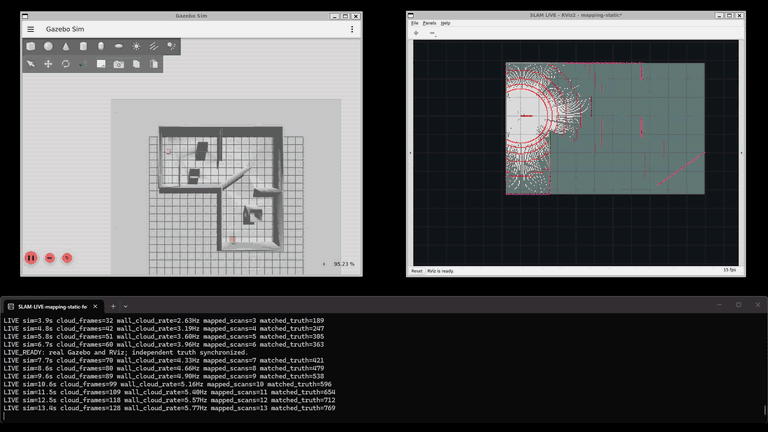</a> [A采集现场](../results/reference/map-hypotheses-20261015/static/mapping-a/execution.mp4)

 [三方法实际处理终端](../results/reference/map-hypotheses-20261015/static/map-processing/full-session.mp4)

<a href="../results/reference/map-hypotheses-20261015/static/localization-3d/executions/raw.mp4">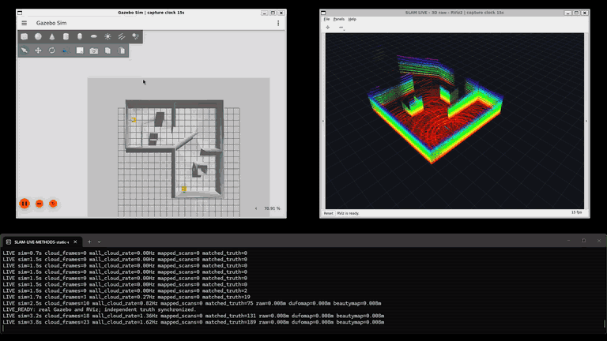</a> [Raw · 独立B现场](../results/reference/map-hypotheses-20261015/static/localization-3d/executions/raw.mp4)

<a href="../results/reference/map-hypotheses-20261015/static/localization-3d/executions/dufomap.mp4">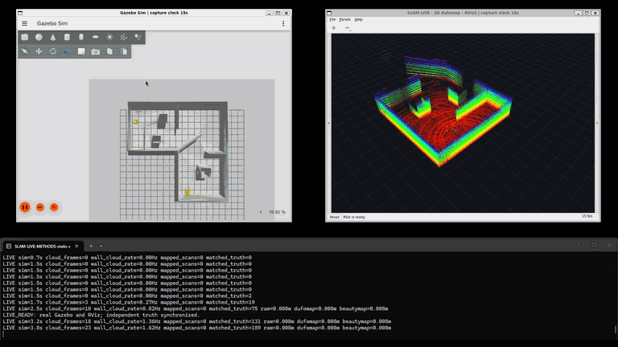</a> [DUFOMap · 独立B现场](../results/reference/map-hypotheses-20261015/static/localization-3d/executions/dufomap.mp4)

<a href="../results/reference/map-hypotheses-20261015/static/localization-3d/executions/beautymap.mp4">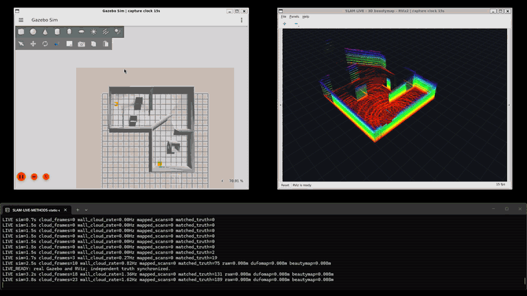</a> [BeautyMap · 独立B现场](../results/reference/map-hypotheses-20261015/static/localization-3d/executions/beautymap.mp4)

**分析：**
<!-- PRACTICE_ANALYSIS:current-hypothesis-static -->

<!-- /PRACTICE_ANALYSIS:current-hypothesis-static -->

#### 动态场景

**A · 建图指标**

| 方法 | 表面 RMSE / cm | P@5cm | C@5cm | DA | SA |
| --- | --- | --- | --- | --- | --- |
| Raw | 7.04 | 96.56% | 99.98% | 0.00% | 100.00% |
| DUFOMap | 4.67 | 98.06% | 99.98% | 50.68% | 99.99% |
| BeautyMap | 3.66 | 98.88% | 73.81% | 71.90% | 84.31% |

[地图评分记录](../results/reference/map-hypotheses-20261015/dynamic/map-quality/record.json)

**B · 独立定位**

| 地图 | XYZ RMSE / cm | 旋转 RMSE / ° | P95 / cm | 输出覆盖 | 达标时段 | 较Raw改善 / cm |
| --- | --- | --- | --- | --- | --- | --- |
| Raw | 1.00 | 0.15 | 1.36 | 90.34% | 90.34% | 0.00 |
| DUFOMap | 0.98 | 0.15 | 1.34 | 90.57% | 90.57% | 0.02 |
| BeautyMap | 1.13 | 0.19 | 1.62 | 97.23% | 97.23% | -0.13 |

共同评分时点：737 / 901 · [定位记录](../results/reference/map-hypotheses-20261015/dynamic/localization-3d/record.json)

新录制：采集／处理／定位

<a href="../results/reference/map-hypotheses-20261015/dynamic/mapping-a/execution.mp4">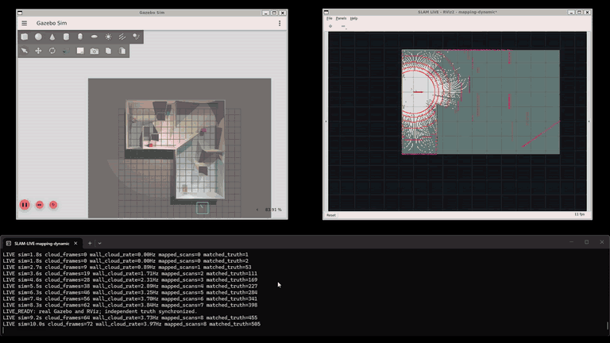</a> [A采集现场](../results/reference/map-hypotheses-20261015/dynamic/mapping-a/execution.mp4)

 [三方法实际处理终端](../results/reference/map-hypotheses-20261015/dynamic/map-processing/full-session.mp4)

<a href="../results/reference/map-hypotheses-20261015/dynamic/localization-3d/executions/raw.mp4">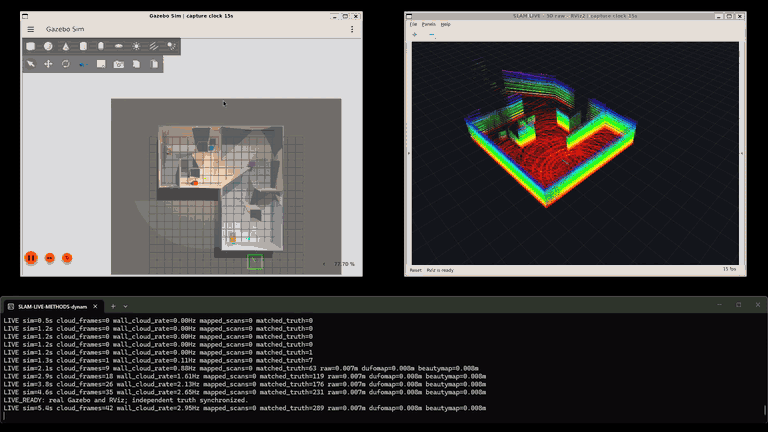</a> [Raw · 独立B现场](../results/reference/map-hypotheses-20261015/dynamic/localization-3d/executions/raw.mp4)

<a href="../results/reference/map-hypotheses-20261015/dynamic/localization-3d/executions/dufomap.mp4">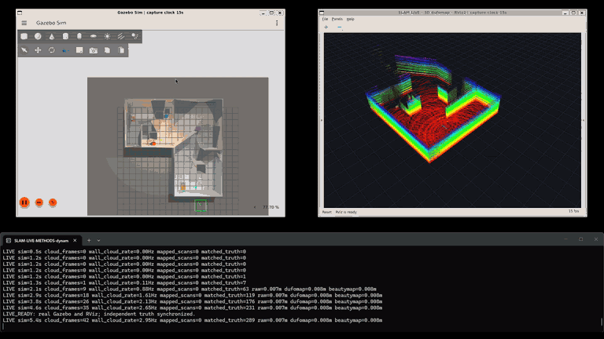</a> [DUFOMap · 独立B现场](../results/reference/map-hypotheses-20261015/dynamic/localization-3d/executions/dufomap.mp4)

<a href="../results/reference/map-hypotheses-20261015/dynamic/localization-3d/executions/beautymap.mp4">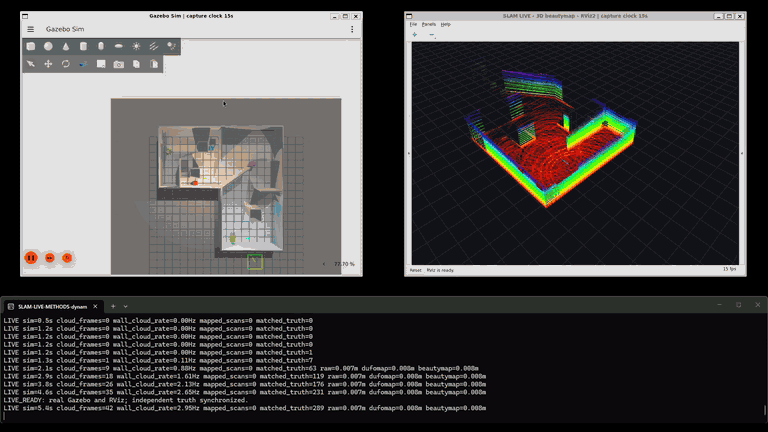</a> [BeautyMap · 独立B现场](../results/reference/map-hypotheses-20261015/dynamic/localization-3d/executions/beautymap.mp4)

**分析：**
<!-- PRACTICE_ANALYSIS:current-hypothesis-dynamic -->

<!-- /PRACTICE_ANALYSIS:current-hypothesis-dynamic -->

#### 长廊退化

**A · 建图指标**

| 方法 | 表面 RMSE / cm | P@5cm | C@5cm | DA | SA |
| --- | --- | --- | --- | --- | --- |
| Raw | 1.41 | 98.96% | 99.99% | N/A | 100.00% |
| DUFOMap | 1.41 | 98.96% | 99.99% | N/A | 100.00% |
| BeautyMap | 1.41 | 98.96% | 99.41% | N/A | 99.84% |

[地图评分记录](../results/reference/map-hypotheses-20261015/corridor/map-quality/record.json)

**B · 独立定位**

| 地图 | XYZ RMSE / cm | 旋转 RMSE / ° | P95 / cm | 输出覆盖 | 达标时段 | 较Raw改善 / cm |
| --- | --- | --- | --- | --- | --- | --- |
| Raw | 390.87 | 0.24 | 704.80 | 50.62% | 1.50% | 0.00 |
| DUFOMap | 343.09 | 0.30 | 573.49 | 63.95% | 1.33% | 47.78 |
| BeautyMap | 311.21 | 0.41 | 594.03 | 99.58% | 54.79% | 79.67 |

共同评分时点：597 / 1201 · [定位记录](../results/reference/map-hypotheses-20261015/corridor/localization-3d/record.json)

长廊：前50秒限制为3.5m／240°／72水平采样，随后恢复完整观测；完整观测组自始运行。两组均有1m初始X偏差。

本轮长廊Raw／DUFOMap点云哈希一致；定位结果来自各自节点。

**受限阶段** · 共同评分时点 497

| 地图 | XYZ RMSE / cm | 旋转 RMSE / ° | P95 / cm | 输出覆盖 | 达标时段 | 较Raw改善 / cm |
| --- | --- | --- | --- | --- | --- | --- |
| Raw | 370.05 | 0.22 | 717.95 | 99.80% | 2.99% | 0.00 |
| DUFOMap | 316.43 | 0.31 | 554.43 | 99.60% | 1.80% | 53.62 |
| BeautyMap | 331.07 | 0.37 | 600.27 | 99.80% | 2.20% | 38.98 |

**恢复观测后** · 共同评分时点 100

| 地图 | XYZ RMSE / cm | 旋转 RMSE / ° | P95 / cm | 输出覆盖 | 达标时段 | 较Raw改善 / cm |
| --- | --- | --- | --- | --- | --- | --- |
| Raw | 481.17 | 0.30 | 583.43 | 15.43% | 0.43% | 0.00 |
| DUFOMap | 452.88 | 0.24 | 581.95 | 38.43% | 1.00% | 28.28 |
| BeautyMap | 182.84 | 0.57 | 311.27 | 99.43% | 92.43% | 298.32 |

**从开始使用完整观测** · 共同评分时点 260

| 地图 | XYZ RMSE / cm | 旋转 RMSE / ° | P95 / cm | 输出覆盖 | 达标时段 | 较Raw改善 / cm |
| --- | --- | --- | --- | --- | --- | --- |
| Raw | 299.47 | 0.54 | 543.88 | 48.13% | 1.00% | 0.00 |
| DUFOMap | 302.77 | 0.52 | 541.69 | 22.48% | 0.58% | -3.29 |
| BeautyMap | 0.61 | 0.14 | 0.77 | 99.67% | 99.67% | 298.86 |

新录制：采集／处理／定位

<a href="../results/reference/map-hypotheses-20261015/corridor/mapping-a/execution.mp4">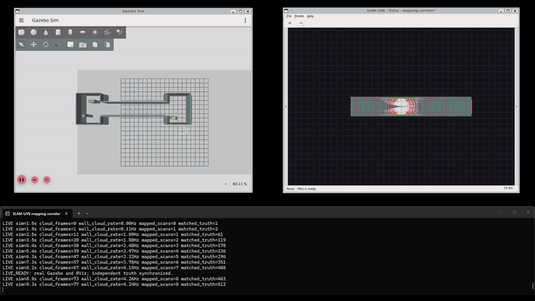</a> [A采集现场](../results/reference/map-hypotheses-20261015/corridor/mapping-a/execution.mp4)

 [三方法实际处理终端](../results/reference/map-hypotheses-20261015/corridor/map-processing/full-session.mp4)

<a href="../results/reference/map-hypotheses-20261015/corridor/localization-3d/executions/raw.mp4">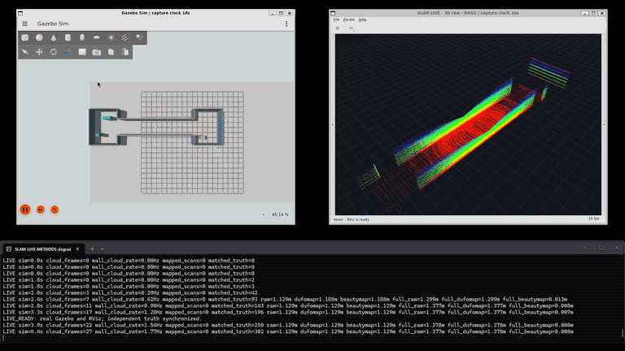</a> [Raw · 独立B现场](../results/reference/map-hypotheses-20261015/corridor/localization-3d/executions/raw.mp4)

<a href="../results/reference/map-hypotheses-20261015/corridor/localization-3d/executions/dufomap.mp4">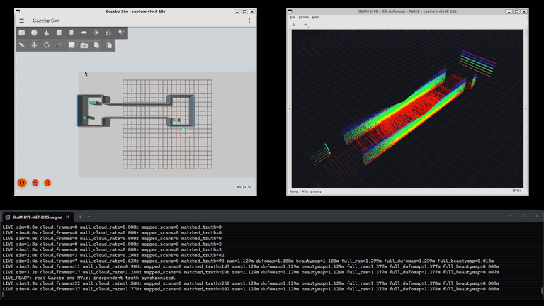</a> [DUFOMap · 独立B现场](../results/reference/map-hypotheses-20261015/corridor/localization-3d/executions/dufomap.mp4)

<a href="../results/reference/map-hypotheses-20261015/corridor/localization-3d/executions/beautymap.mp4">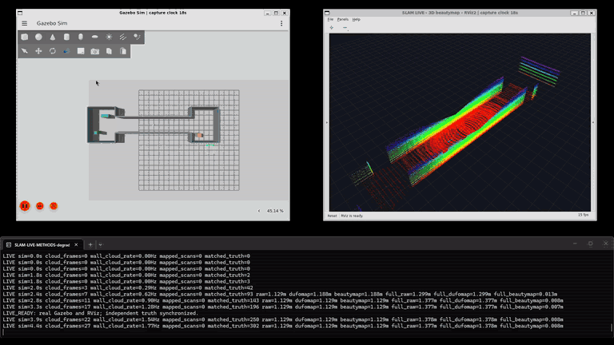</a> [BeautyMap · 独立B现场](../results/reference/map-hypotheses-20261015/corridor/localization-3d/executions/beautymap.mp4)

**分析：**
<!-- PRACTICE_ANALYSIS:current-hypothesis-corridor -->

<!-- /PRACTICE_ANALYSIS:current-hypothesis-corridor -->

此前基线与补充实验

### 1 · 纯静态

#### 原生二维建图 · Raw / SRRG

<!-- HOME_EXPERIMENT_TABLE -->
| 方法 | DA | SA | 建图轨迹 XY RMSE / cm |
| --- | --- | --- | --- |
| Raw | N/A | 100% | — |
| SRRG | N/A | 99.84% | 0.71 |
<!-- /HOME_EXPERIMENT_TABLE -->

[记录](../results/reference/srrg-2d-static/record.json) · 独立定位 B：待测

视频

**Raw / SRRG**

 [现场实录](../results/reference/srrg-2d-static/execution.mp4)

**分析：**
<!-- PRACTICE_ANALYSIS:srrg-static-2d -->

<!-- /PRACTICE_ANALYSIS:srrg-static-2d -->

#### 二维投影地图 + AMCL

<!-- HOME_EXPERIMENT_TABLE -->
| 地图 | DA | SA | XY RMSE / cm | yaw RMSE / ° | P95 / cm | N |
| --- | --- | --- | --- | --- | --- | --- |
| Raw | N/A | 100% | 7.28 | 1.03 | 10.74 | 290 |
| DUFOMap | N/A | 100% | 7.28 | 1.03 | 10.74 | 290 |
| BeautyMap | N/A | 96.51% | 6.89 | 1.05 | 8.44 | 290 |
<!-- /HOME_EXPERIMENT_TABLE -->

[记录](../results/reference/robot-live-static/record.json) · [地图评分](../results/analysis/map-quality/static.json)

视频

**Raw**

 [现场实录](../results/reference/robot-live-static/executions/raw.mp4)  [结果回放（无新推理）](../results/reference/robot-live-static/methods/raw/result.mp4)

**DUFOMap**

 [现场实录](../results/reference/robot-live-static/executions/dufomap.mp4)  [结果回放（无新推理）](../results/reference/robot-live-static/methods/dufomap/result.mp4)

**BeautyMap**

 [现场实录](../results/reference/robot-live-static/executions/beautymap.mp4)  [结果回放（无新推理）](../results/reference/robot-live-static/methods/beautymap/result.mp4)

**分析：**
<!-- PRACTICE_ANALYSIS:scene-static-2d -->

<!-- /PRACTICE_ANALYSIS:scene-static-2d -->

#### 三维地图 + GICP

<!-- HOME_EXPERIMENT_TABLE -->
| 地图 | DA | SA | XYZ RMSE / cm | 旋转 RMSE / ° | P95 / cm | N |
| --- | --- | --- | --- | --- | --- | --- |
| Raw | N/A | 100% | 0.95 | 0.15 | 1.47 | 845 |
| DUFOMap | N/A | 99.999% | 0.99 | 0.16 | 1.47 | 835 |
| BeautyMap | N/A | 83.33% | 1.07 | 0.17 | 1.44 | 917 |
<!-- /HOME_EXPERIMENT_TABLE -->

[记录](../results/reference/robot-3d-static/record.json) · [地图评分](../results/analysis/map-quality/static.json)

视频

**Raw**

 [现场实录](../results/reference/robot-3d-static/executions/raw.mp4)

**DUFOMap**

 [现场实录](../results/reference/robot-3d-static/executions/dufomap.mp4)

**BeautyMap**

 [现场实录](../results/reference/robot-3d-static/executions/beautymap.mp4)

**分析：**
<!-- PRACTICE_ANALYSIS:scene-static-3d -->

<!-- /PRACTICE_ANALYSIS:scene-static-3d -->

[↑ 实践目录](#practice-index)

### 2 · 运动障碍物

#### 原生二维建图 · Raw / SRRG

<!-- HOME_EXPERIMENT_TABLE -->
| 方法 | DA | SA | 建图轨迹 XY RMSE / cm |
| --- | --- | --- | --- |
| Raw | 0% | 100% | — |
| SRRG | 42.31% | 99.51% | 0.64 |
<!-- /HOME_EXPERIMENT_TABLE -->

[记录](../results/reference/srrg-2d-dynamic/record.json) · 独立定位 B：待测

视频

**Raw / SRRG**

 [现场实录](../results/reference/srrg-2d-dynamic/execution.mp4)

**分析：**
<!-- PRACTICE_ANALYSIS:srrg-dynamic-2d -->

<!-- /PRACTICE_ANALYSIS:srrg-dynamic-2d -->

#### 二维投影地图 + AMCL

<!-- HOME_EXPERIMENT_TABLE -->
| 地图 | DA | SA | XY RMSE / cm | yaw RMSE / ° | P95 / cm | N |
| --- | --- | --- | --- | --- | --- | --- |
| Raw | 0% | 100% | 7.52 | 1.78 | 13.93 | 291 |
| DUFOMap | 8.33% | 100% | 8.19 | 1.76 | 12.83 | 291 |
| BeautyMap | 33.33% | 96.64% | 7.29 | 1.79 | 13.41 | 291 |
<!-- /HOME_EXPERIMENT_TABLE -->

[记录](../results/reference/robot-2d-dynamic-matched/record.json) · [地图评分](../results/analysis/map-quality/projected-dynamic.json)

视频

**Raw**

 [现场实录](../results/reference/robot-2d-dynamic-matched/executions/raw.mp4)  [结果回放（无新推理）](../results/reference/robot-2d-dynamic-matched/methods/raw/result.mp4)

**DUFOMap**

 [现场实录](../results/reference/robot-2d-dynamic-matched/executions/dufomap.mp4)  [结果回放（无新推理）](../results/reference/robot-2d-dynamic-matched/methods/dufomap/result.mp4)

**BeautyMap**

 [现场实录](../results/reference/robot-2d-dynamic-matched/executions/beautymap.mp4)  [结果回放（无新推理）](../results/reference/robot-2d-dynamic-matched/methods/beautymap/result.mp4)

**分析：**
<!-- PRACTICE_ANALYSIS:scene-dynamic-2d -->

<!-- /PRACTICE_ANALYSIS:scene-dynamic-2d -->

#### 三维地图 + GICP

<!-- HOME_EXPERIMENT_TABLE -->
| 地图 | DA | SA | XYZ RMSE / cm | 旋转 RMSE / ° | P95 / cm | N |
| --- | --- | --- | --- | --- | --- | --- |
| Raw | 0% | 100% | 0.98 | 0.17 | 1.96 | 967 |
| DUFOMap | 46.59% | 99.998% | 0.98 | 0.18 | 2.00 | 963 |
| BeautyMap | 74.36% | 81.15% | 1.04 | 0.17 | 1.99 | 1022 |
<!-- /HOME_EXPERIMENT_TABLE -->

[记录](../results/reference/robot-3d-dynamic/record.json) · [地图评分](../results/reference/robot-3d-map-audit/record.json)

视频

**Raw**

 [现场实录](../results/reference/robot-3d-dynamic/executions/raw.mp4)

**DUFOMap**

 [现场实录](../results/reference/robot-3d-dynamic/executions/dufomap.mp4)

**BeautyMap**

 [现场实录](../results/reference/robot-3d-dynamic/executions/beautymap.mp4)

**分析：**
<!-- PRACTICE_ANALYSIS:scene-dynamic-3d -->

<!-- /PRACTICE_ANALYSIS:scene-dynamic-3d -->

[↑ 实践目录](#practice-index)

### 3 · 走廊退化

#### 原生二维建图 · Raw / SRRG

<!-- HOME_EXPERIMENT_TABLE -->
| 方法 | DA | SA | 建图轨迹 XY RMSE / cm |
| --- | --- | --- | --- |
| Raw | N/A | 83.43% | — |
| SRRG | N/A | 82.24% | 83.23 |
<!-- /HOME_EXPERIMENT_TABLE -->

[记录](../results/reference/srrg-2d-corridor/record.json) · 独立定位 B：待测

视频

**Raw / SRRG**

 [现场实录](../results/reference/srrg-2d-corridor/execution.mp4)

**分析：**
<!-- PRACTICE_ANALYSIS:srrg-corridor-2d -->

<!-- /PRACTICE_ANALYSIS:srrg-corridor-2d -->

#### 二维投影地图 + AMCL

<!-- HOME_EXPERIMENT_TABLE -->
| 地图 | DA | SA | XY RMSE / cm | yaw RMSE / ° | P95 / cm | N |
| --- | --- | --- | --- | --- | --- | --- |
| Raw | N/A | 100% | 72.53 | 0.85 | 132.56 | 508 |
| DUFOMap | N/A | 100% | 72.53 | 0.85 | 132.56 | 508 |
| BeautyMap | N/A | 100% | 72.53 | 0.85 | 132.56 | 508 |
<!-- /HOME_EXPERIMENT_TABLE -->

[记录](../results/reference/robot-corridor-v2/record.json) · [地图评分](../results/analysis/map-quality/corridor.json)

视频

**Raw**

 [现场实录](../results/reference/robot-corridor-v2/executions/degraded_raw.mp4)  [结果回放（无新推理）](../results/reference/robot-corridor-v2/methods/degraded_raw/result.mp4)

**DUFOMap**

 [现场实录](../results/reference/robot-corridor-v2/executions/degraded_dufomap.mp4)  [结果回放（无新推理）](../results/reference/robot-corridor-v2/methods/degraded_dufomap/result.mp4)

**BeautyMap**

 [现场实录](../results/reference/robot-corridor-v2/executions/degraded_beautymap.mp4)  [结果回放（无新推理）](../results/reference/robot-corridor-v2/methods/degraded_beautymap/result.mp4)

**分析：**
<!-- PRACTICE_ANALYSIS:scene-corridor-2d -->

<!-- /PRACTICE_ANALYSIS:scene-corridor-2d -->

#### 三维地图 + GICP

<!-- HOME_EXPERIMENT_TABLE -->
| 地图 | DA | SA | XYZ RMSE / cm | 旋转 RMSE / ° | P95 / cm | N |
| --- | --- | --- | --- | --- | --- | --- |
| Raw | N/A | 100% | 474.38 | 0.53 | 828.94 | 530 |
| DUFOMap | N/A | 100% | 497.05 | 0.48 | 814.15 | 599 |
| BeautyMap | N/A | 99.9% | 592.00 | 49.16 | 917.05 | 655 |
<!-- /HOME_EXPERIMENT_TABLE -->

[记录](../results/reference/robot-3d-corridor/record.json) · [地图评分](../results/analysis/map-quality/corridor.json)

<!-- HOME_EXPERIMENT_TABLE -->
| 地图 | 有效位姿时间范围 / 仿真秒 |
| --- | --- |
| Raw | 1.6–63.5 |
| DUFOMap | 1.6–76.4 |
| BeautyMap | 1.6–119.3 |
<!-- /HOME_EXPERIMENT_TABLE -->

视频

**Raw**

 [现场实录](../results/reference/robot-3d-corridor/executions/raw.mp4)

**DUFOMap**

 [现场实录](../results/reference/robot-3d-corridor/executions/dufomap.mp4)

**BeautyMap**

 [现场实录](../results/reference/robot-3d-corridor/executions/beautymap.mp4)

**分析：**
<!-- PRACTICE_ANALYSIS:scene-corridor-3d -->

<!-- /PRACTICE_ANALYSIS:scene-corridor-3d -->

[↑ 实践目录](#practice-index)

### 补充实验

持久结构变化

#### 原生二维建图 · Raw / SRRG

<!-- HOME_EXPERIMENT_TABLE -->
| 方法 | DA | SA | 建图轨迹 XY RMSE / cm | 新增结构覆盖 |
| --- | --- | --- | --- | --- |
| Raw | N/A | 100% | — | 100% |
| SRRG | N/A | 99.71% | 0.46 | 98.9% |
<!-- /HOME_EXPERIMENT_TABLE -->

[记录](../results/reference/srrg-2d-large-change/record.json) · 独立定位 B：待测

视频

**Raw / SRRG**

 [现场实录](../results/reference/srrg-2d-large-change/execution.mp4)

**分析：**
<!-- PRACTICE_ANALYSIS:srrg-large-change-2d -->

<!-- /PRACTICE_ANALYSIS:srrg-large-change-2d -->

#### 二维投影地图 + AMCL

<!-- HOME_EXPERIMENT_TABLE -->
| 地图 | DA | SA | XY RMSE / cm | yaw RMSE / ° | P95 / cm | N |
| --- | --- | --- | --- | --- | --- | --- |
| Raw | N/A | 100% | 6.84 | 1.02 | 8.89 | 290 |
| DUFOMap | N/A | 100% | 6.84 | 1.02 | 8.89 | 290 |
| BeautyMap | N/A | 96.51% | 6.39 | 1.04 | 7.25 | 290 |
<!-- /HOME_EXPERIMENT_TABLE -->

[记录](../results/reference/robot-live-large-change/record.json) · [地图评分](../results/analysis/map-quality/static.json)

设置：冻结静态 A 旧图，B 中不更新地图；DA／SA 为旧图 A 数值。

视频

**Raw**

 [现场实录](../results/reference/robot-live-large-change/executions/raw.mp4)  [结果回放（无新推理）](../results/reference/robot-live-large-change/methods/raw/result.mp4)

**DUFOMap**

 [现场实录](../results/reference/robot-live-large-change/executions/dufomap.mp4)  [结果回放（无新推理）](../results/reference/robot-live-large-change/methods/dufomap/result.mp4)

**BeautyMap**

 [现场实录](../results/reference/robot-live-large-change/executions/beautymap.mp4)  [结果回放（无新推理）](../results/reference/robot-live-large-change/methods/beautymap/result.mp4)

**分析：**
<!-- PRACTICE_ANALYSIS:scene-change-2d -->

<!-- /PRACTICE_ANALYSIS:scene-change-2d -->

#### 三维地图 + GICP

<!-- HOME_EXPERIMENT_TABLE -->
| 地图 | DA | SA | XYZ RMSE / cm | 旋转 RMSE / ° | P95 / cm | N |
| --- | --- | --- | --- | --- | --- | --- |
| Raw | N/A | 100% | 0.93 | 0.17 | 1.45 | 859 |
| DUFOMap | N/A | 99.999% | 1.01 | 0.19 | 1.45 | 860 |
| BeautyMap | N/A | 83.33% | 1.04 | 0.17 | 1.46 | 945 |
<!-- /HOME_EXPERIMENT_TABLE -->

[记录](../results/reference/robot-3d-large-change/record.json) · [地图评分](../results/analysis/map-quality/static.json)

设置：冻结静态 A 旧图，B 中不更新地图；DA／SA 为旧图 A 数值。

视频

**Raw**

 [现场实录](../results/reference/robot-3d-large-change/executions/raw.mp4)

**DUFOMap**

 [现场实录](../results/reference/robot-3d-large-change/executions/dufomap.mp4)

**BeautyMap**

 [现场实录](../results/reference/robot-3d-large-change/executions/beautymap.mp4)

**分析：**
<!-- PRACTICE_ANALYSIS:scene-change-3d -->

<!-- /PRACTICE_ANALYSIS:scene-change-3d -->

三维清理图回放

视频类型：已保存地图回放，无新推理；数值沿用动态场景三维表。

 [已保存地图回放（无新推理）](../results/reference/robot-3d-map-review-v2/execution.mp4)

早期Raw地图 · NDT / GICP

<!-- HOME_EXPERIMENT_TABLE -->
| 方法 | XY RMSE / cm | yaw RMSE / ° | N | 记录 |
| --- | --- | --- | --- | --- |
| NDT · 首轮 | 34.43 | 0.15 | 399 | [记录](../results/reference/robot-ndt-static-initial/record.json) |
| NDT | 0.93 | 0.17 | 402 | [记录](../results/reference/robot-ndt-static/record.json) |
| GICP | 1.09 | 0.16 | 397 | [记录](../results/reference/robot-gicp-static/record.json) |
<!-- /HOME_EXPERIMENT_TABLE -->

视频

**NDT**

 [现场实录](../results/reference/robot-ndt-static/execution.mp4)  [结果回放（无新推理）](../results/reference/robot-ndt-static/result.mp4)

**GICP**

 [现场实录](../results/reference/robot-gicp-static/execution.mp4)  [结果回放（无新推理）](../results/reference/robot-gicp-static/result.mp4)

**分析：**
<!-- PRACTICE_ANALYSIS:earlier-raw-map-3d-static-trials -->

<!-- /PRACTICE_ANALYSIS:earlier-raw-map-3d-static-trials -->

补充采集与定位

帧数＝已保存扫描数量；已知格＝非未知栅格数。

<!-- HOME_EXPERIMENT_TABLE -->
| 场景 | 方法 | 帧数 | 已知格 | XY RMSE / cm | 记录 |
| --- | --- | --- | --- | --- | --- |
| 纯静态 | slam_toolbox | 54 | 20568 | — | [记录](../results/reference/robot-supp-static/record.json) |
| 运动障碍物 | slam_toolbox | 55 | 20509 | — | [记录](../results/reference/robot-supp-dynamic/record.json) |
| 持久结构变化 | AMCL | — | — | 6.99 | [记录](../results/reference/robot-supp-large-change/record.json) |
<!-- /HOME_EXPERIMENT_TABLE -->

视频

**纯静态**

 [现场实录](../results/reference/robot-supp-static/execution.mp4)

**运动障碍物**

 [现场实录](../results/reference/robot-supp-dynamic/execution.mp4)

**持久结构变化**

 [现场实录](../results/reference/robot-supp-large-change/execution.mp4)

**分析：**
<!-- PRACTICE_ANALYSIS:supplementary-live-scene-recordings -->

<!-- /PRACTICE_ANALYSIS:supplementary-live-scene-recordings -->

SRRG失败记录

<!-- HOME_SRRG_DIAGNOSTICS -->
<!-- HOME_EXPERIMENT_TABLE -->
| 环节 | 状态 | 记录 | 视频 |
| --- | --- | --- | --- |
| Eigen ABI | diagnostic_failed | [记录](../results/reference/srrg-diagnostic-20261015-025711-mapping-srrg-static-dd423d/record.json) | [GIF](../results/reference/srrg-diagnostic-20261015-025711-mapping-srrg-static-dd423d/execution.gif) · [MP4](../results/reference/srrg-diagnostic-20261015-025711-mapping-srrg-static-dd423d/execution.mp4) |
| stdout transport | diagnostic_failed | [记录](../results/reference/srrg-diagnostic-20261015-030327-mapping-srrg-static-a275d3/record.json) | [GIF](../results/reference/srrg-diagnostic-20261015-030327-mapping-srrg-static-a275d3/execution.gif) · [MP4](../results/reference/srrg-diagnostic-20261015-030327-mapping-srrg-static-a275d3/execution.mp4) |
| g2o / graph merge | diagnostic_failed | [记录](../results/reference/srrg-diagnostic-20261015-030729-mapping-srrg-dynamic-14123d/record.json) | [GIF](../results/reference/srrg-diagnostic-20261015-030729-mapping-srrg-dynamic-14123d/execution.gif) · [MP4](../results/reference/srrg-diagnostic-20261015-030729-mapping-srrg-dynamic-14123d/execution.mp4) |
<!-- /HOME_EXPERIMENT_TABLE -->

<!-- /HOME_SRRG_DIAGNOSTICS -->
**分析：**
<!-- PRACTICE_ANALYSIS:srrg-diagnostics -->

<!-- /PRACTICE_ANALYSIS:srrg-diagnostics -->

[↑ 实践目录](#practice-index)

## 假设检验实验

[新一轮建图质量 → 独立定位实验](#current-map-hypotheses)

历史定位层实验：Guard／Depth／Search

<!-- EARLIER_LOCALIZATION_ONLY -->
此附录保留此前的定位层探索；地图冻结，不能据此声称验证了动态建图。

根据此前录像，先提出三个方向，再做对应实验：

- **H1 · 退化保护：**抑制不一致匹配，弱约束方向减少激光修正，保留轮式里程计预测。
- **H2 · 深度补充：**用二维雷达＋深度相机补充可见的高度结构，并用三维雷达做对应对照。
- **H3 · 搜索与确认：**搜索多个附近位置，只有候选足够独特、连续两次与里程计运动一致时才接受。

这是自写的地面机器人小原型。二维组没有三维雷达；三维组使用XYZ观测、约束x/y/yaw运动。建图A给定位姿，地图冻结，定位B不读取真值。保留四个原场景，另将增加两块高处几何的场景单独标为派生对照。理想仿真单轮结果不构成稳定排名。

[固定假设、对照与结果解释](testing/HYPOTHESES.zh-CN.md) · [实验视频目录](../demo/hypotheses.html) · [一键脚本](../demo/README.md#开放问题假设与简单实验)

<!-- PROBE_APPENDIX_RESULTS -->

| 场景 | 2D＋深度 | 3D＋深度 |
| --- | --- | --- |
| 纯静态 | [查看实验](#probe-calibrated-2d-static) | [查看实验](#probe-calibrated-3d-static) |
| 运动障碍物 | [查看实验](#probe-calibrated-2d-dynamic) | [查看实验](#probe-calibrated-3d-dynamic) |
| 持久结构变化 | [查看实验](#probe-calibrated-2d-large-change) | [查看实验](#probe-calibrated-3d-large-change) |
| 原走廊退化 | [查看实验](#probe-calibrated-2d-corridor) | [查看实验](#probe-calibrated-3d-corridor) |
| 高处标志 · 派生对照 | [查看实验](#probe-calibrated-2d-height-corridor) | [查看实验](#probe-calibrated-3d-height-corridor) |

[粗到细补充实验](#probe-refinement-index)

[结果解释与后续方向](#hypothesis-findings)

本轮固定同源Raw图，五个原型严格共享已配对输入。红Plain、黄Guard、橙Depth、紫雷达搜索、绿深度＋搜索、蓝原生AMCL／GICP。二维报XY，三维报XYZ；单轮结果不构成稳定排名。

### 2D · 真实窗口实验

#### 纯静态 · 2D

[↑ 返回目录](#hypothesis-experiment-index)

| 方法 | 地图／观测 | 指标效果 |
| --- | --- | --- |
| Raw + AMCL | 同源二维栅格投影图 | XY RMSE 6.82 cm |
| Plain ICP | 二维雷达点图 | XY RMSE 0.15 cm |
| H1 · Guard | 二维雷达点图 | XY RMSE 0.15 cm；接近Plain |
| H2 · Guard＋Depth | 二维雷达点图＋深度点图 | XY RMSE 0.21 cm；较Guard高0.06 cm |
| H3 · 雷达搜索 | 二维雷达点图 | XY RMSE 0.15 cm；接近Guard |
| H3 · 深度＋搜索 | 二维雷达点图＋深度点图 | XY RMSE 0.21 cm；接近Depth |

五原型各264帧；有效深度219/264帧；原生参照287次输出。车体高度由建图A标定。

原生参照最后一次有效输出在仿真73.2s，原型记录至99.4s；无输出时段未填补，其RMSE只覆盖已有输出。

[MP4](../results/reference/probe-calibrated-2d-static/execution.mp4) · [record](../results/reference/probe-calibrated-2d-static/record.json) · [CSV](../results/reference/probe-calibrated-2d-static/recover-samples.csv)

#### 运动障碍物 · 2D

[↑ 返回目录](#hypothesis-experiment-index)

| 方法 | 地图／观测 | 指标效果 |
| --- | --- | --- |
| Raw + AMCL | 同源二维栅格投影图 | XY RMSE 7.08 cm |
| Plain ICP | 二维雷达点图 | XY RMSE 0.37 cm |
| H1 · Guard | 二维雷达点图 | XY RMSE 0.19 cm；较Plain低0.18 cm |
| H2 · Guard＋Depth | 二维雷达点图＋深度点图 | XY RMSE 0.18 cm；接近Guard |
| H3 · 雷达搜索 | 二维雷达点图 | XY RMSE 0.19 cm；接近Guard |
| H3 · 深度＋搜索 | 二维雷达点图＋深度点图 | XY RMSE 0.18 cm；接近Depth |

五原型各265帧；有效深度181/265帧；原生参照292次输出。车体高度由建图A标定。

原生参照最后一次有效输出在仿真72.3s，原型记录至99.7s；无输出时段未填补，其RMSE只覆盖已有输出。

[MP4](../results/reference/probe-calibrated-2d-dynamic/execution.mp4) · [record](../results/reference/probe-calibrated-2d-dynamic/record.json) · [CSV](../results/reference/probe-calibrated-2d-dynamic/recover-samples.csv)

#### 持久结构变化 · 2D

[↑ 返回目录](#hypothesis-experiment-index)

| 方法 | 地图／观测 | 指标效果 |
| --- | --- | --- |
| Raw + AMCL | 同源二维栅格投影图 | XY RMSE 6.28 cm |
| Plain ICP | 二维雷达点图 | XY RMSE 7.98 cm |
| H1 · Guard | 二维雷达点图 | XY RMSE 0.49 cm；较Plain低7.49 cm |
| H2 · Guard＋Depth | 二维雷达点图＋深度点图 | XY RMSE 0.49 cm；接近Guard |
| H3 · 雷达搜索 | 二维雷达点图 | XY RMSE 0.49 cm；接近Guard |
| H3 · 深度＋搜索 | 二维雷达点图＋深度点图 | XY RMSE 0.49 cm；接近Depth |

五原型各263帧；有效深度187/263帧；原生参照288次输出。车体高度由建图A标定。

原生参照最后一次有效输出在仿真71.3s，原型记录至99.3s；无输出时段未填补，其RMSE只覆盖已有输出。

旧图保持冻结；此处检验不一致观测的处理，没有执行地图更新。

[MP4](../results/reference/probe-calibrated-2d-large-change/execution.mp4) · [record](../results/reference/probe-calibrated-2d-large-change/record.json) · [CSV](../results/reference/probe-calibrated-2d-large-change/recover-samples.csv)

#### 原走廊退化 · 2D

[↑ 返回目录](#hypothesis-experiment-index)

| 方法 | 地图／观测 | 指标效果 |
| --- | --- | --- |
| Raw + AMCL | 同源二维栅格投影图 | XY RMSE 100.61 cm；恢复后45.7 s持续收敛 |
| Plain ICP | 二维雷达点图 | XY RMSE 1037.69 cm；未持续收敛 |
| H1 · Guard | 二维雷达点图 | XY RMSE 100.48 cm；较Plain低937.21 cm；未持续收敛 |
| H2 · Guard＋Depth | 二维雷达点图＋深度点图 | XY RMSE 100.54 cm；较Guard高0.06 cm；未持续收敛 |
| H3 · 雷达搜索 | 二维雷达点图 | XY RMSE 70.40 cm；较Guard低30.08 cm；恢复后5.8 s持续收敛 |
| H3 · 深度＋搜索 | 二维雷达点图＋深度点图 | XY RMSE 70.44 cm；较Depth低30.11 cm；恢复后5.8 s持续收敛 |

五原型各338帧；有效深度195/338帧；原生参照600次输出。车体高度由建图A标定。

[MP4](../results/reference/probe-calibrated-2d-corridor/execution.mp4) · [record](../results/reference/probe-calibrated-2d-corridor/record.json) · [CSV](../results/reference/probe-calibrated-2d-corridor/recover-samples.csv)

#### 高处标志 · 派生对照 · 2D

[↑ 返回目录](#hypothesis-experiment-index)

| 方法 | 地图／观测 | 指标效果 |
| --- | --- | --- |
| Raw + AMCL | 同源二维栅格投影图 | XY RMSE 67.00 cm；恢复后11.7 s持续收敛 |
| Plain ICP | 二维雷达点图 | XY RMSE 285.54 cm；未持续收敛 |
| H1 · Guard | 二维雷达点图 | XY RMSE 101.15 cm；较Plain低184.39 cm；未持续收敛 |
| H2 · Guard＋Depth | 二维雷达点图＋深度点图 | XY RMSE 100.77 cm；较Guard低0.38 cm；未持续收敛 |
| H3 · 雷达搜索 | 二维雷达点图 | XY RMSE 70.93 cm；较Guard低30.22 cm；恢复后5.0 s持续收敛 |
| H3 · 深度＋搜索 | 二维雷达点图＋深度点图 | XY RMSE 21.15 cm；较Depth低79.61 cm；恢复后0.2 s持续收敛 |

五原型各345帧；有效深度239/345帧；原生参照620次输出。车体高度由建图A标定。

此场景额外加入两块高处几何，作为结构互补的可行性对照；与原走廊分别报告。

[MP4](../results/reference/probe-calibrated-2d-height-corridor/execution.mp4) · [record](../results/reference/probe-calibrated-2d-height-corridor/record.json) · [CSV](../results/reference/probe-calibrated-2d-height-corridor/recover-samples.csv)

### 3D · 真实窗口实验

#### 纯静态 · 3D

[↑ 返回目录](#hypothesis-experiment-index)

| 方法 | 地图／观测 | 指标效果 |
| --- | --- | --- |
| Raw + GICP | 三维雷达点图 | XYZ RMSE 1.08 cm |
| Plain ICP | 三维雷达点图 | XYZ RMSE 0.12 cm |
| H1 · Guard | 三维雷达点图 | XYZ RMSE 0.12 cm；接近Plain |
| H2 · Guard＋Depth | 三维雷达点图＋深度点图 | XYZ RMSE 0.21 cm；较Guard高0.09 cm |
| H3 · 雷达搜索 | 三维雷达点图 | XYZ RMSE 0.12 cm；接近Guard |
| H3 · 深度＋搜索 | 三维雷达点图＋深度点图 | XYZ RMSE 0.21 cm；接近Depth |

五原型各266帧；有效深度184/266帧；原生参照994次输出。车体高度由建图A标定。

[MP4](../results/reference/probe-calibrated-3d-static/execution.mp4) · [record](../results/reference/probe-calibrated-3d-static/record.json) · [CSV](../results/reference/probe-calibrated-3d-static/recover-samples.csv)

#### 运动障碍物 · 3D

[↑ 返回目录](#hypothesis-experiment-index)

| 方法 | 地图／观测 | 指标效果 |
| --- | --- | --- |
| Raw + GICP | 三维雷达点图 | XYZ RMSE 1.39 cm |
| Plain ICP | 三维雷达点图 | XYZ RMSE 0.17 cm |
| H1 · Guard | 三维雷达点图 | XYZ RMSE 0.13 cm；较Plain低0.04 cm |
| H2 · Guard＋Depth | 三维雷达点图＋深度点图 | XYZ RMSE 0.13 cm；接近Guard |
| H3 · 雷达搜索 | 三维雷达点图 | XYZ RMSE 0.13 cm；接近Guard |
| H3 · 深度＋搜索 | 三维雷达点图＋深度点图 | XYZ RMSE 0.13 cm；接近Depth |

五原型各258帧；有效深度154/258帧；原生参照951次输出。车体高度由建图A标定。

[MP4](../results/reference/probe-calibrated-3d-dynamic/execution.mp4) · [record](../results/reference/probe-calibrated-3d-dynamic/record.json) · [CSV](../results/reference/probe-calibrated-3d-dynamic/recover-samples.csv)

#### 持久结构变化 · 3D

[↑ 返回目录](#hypothesis-experiment-index)

| 方法 | 地图／观测 | 指标效果 |
| --- | --- | --- |
| Raw + GICP | 三维雷达点图 | XYZ RMSE 1.25 cm |
| Plain ICP | 三维雷达点图 | XYZ RMSE 3.69 cm |
| H1 · Guard | 三维雷达点图 | XYZ RMSE 0.24 cm；较Plain低3.45 cm |
| H2 · Guard＋Depth | 三维雷达点图＋深度点图 | XYZ RMSE 0.35 cm；较Guard高0.11 cm |
| H3 · 雷达搜索 | 三维雷达点图 | XYZ RMSE 0.24 cm；接近Guard |
| H3 · 深度＋搜索 | 三维雷达点图＋深度点图 | XYZ RMSE 0.35 cm；接近Depth |

五原型各264帧；有效深度163/264帧；原生参照950次输出。车体高度由建图A标定。

旧图保持冻结；此处检验不一致观测的处理，没有执行地图更新。

[MP4](../results/reference/probe-calibrated-3d-large-change/execution.mp4) · [record](../results/reference/probe-calibrated-3d-large-change/record.json) · [CSV](../results/reference/probe-calibrated-3d-large-change/recover-samples.csv)

#### 原走廊退化 · 3D

[↑ 返回目录](#hypothesis-experiment-index)

| 方法 | 地图／观测 | 指标效果 |
| --- | --- | --- |
| Raw + GICP | 三维雷达点图 | XYZ RMSE 397.82 cm；未持续收敛 |
| Plain ICP | 三维雷达点图 | XYZ RMSE 733.38 cm；未持续收敛 |
| H1 · Guard | 三维雷达点图 | XYZ RMSE 100.49 cm；较Plain低632.88 cm；未持续收敛 |
| H2 · Guard＋Depth | 三维雷达点图＋深度点图 | XYZ RMSE 100.62 cm；较Guard高0.12 cm；未持续收敛 |
| H3 · 雷达搜索 | 三维雷达点图 | XYZ RMSE 56.77 cm；较Guard低43.72 cm；恢复后6.2 s持续收敛 |
| H3 · 深度＋搜索 | 三维雷达点图＋深度点图 | XYZ RMSE 57.56 cm；较Depth低43.06 cm；恢复后6.6 s持续收敛 |

五原型各247帧；有效深度122/247帧；原生参照712次输出。车体高度由建图A标定。

原生参照最后一次有效输出在仿真75.6s，原型记录至132.8s；无输出时段未填补，其RMSE只覆盖已有输出。

[MP4](../results/reference/probe-calibrated-3d-corridor/execution.mp4) · [record](../results/reference/probe-calibrated-3d-corridor/record.json) · [CSV](../results/reference/probe-calibrated-3d-corridor/recover-samples.csv)

#### 高处标志 · 派生对照 · 3D

[↑ 返回目录](#hypothesis-experiment-index)

| 方法 | 地图／观测 | 指标效果 |
| --- | --- | --- |
| Raw + GICP | 三维雷达点图 | XYZ RMSE 512.79 cm；未持续收敛 |
| Plain ICP | 三维雷达点图 | XYZ RMSE 46.60 cm；恢复后8.7 s持续收敛 |
| H1 · Guard | 三维雷达点图 | XYZ RMSE 100.36 cm；较Plain高53.76 cm；未持续收敛 |
| H2 · Guard＋Depth | 三维雷达点图＋深度点图 | XYZ RMSE 100.38 cm；较Guard高0.02 cm；未持续收敛 |
| H3 · 雷达搜索 | 三维雷达点图 | XYZ RMSE 47.70 cm；较Guard低52.66 cm；恢复后8.7 s持续收敛 |
| H3 · 深度＋搜索 | 三维雷达点图＋深度点图 | XYZ RMSE 50.79 cm；较Depth低49.59 cm；恢复后12.8 s持续收敛 |

五原型各203帧；有效深度124/203帧；原生参照716次输出。车体高度由建图A标定。

原生参照最后一次有效输出在仿真75.1s，原型记录至132.5s；无输出时段未填补，其RMSE只覆盖已有输出。

此场景额外加入两块高处几何，作为结构互补的可行性对照；与原走廊分别报告。

[MP4](../results/reference/probe-calibrated-3d-height-corridor/execution.mp4) · [record](../results/reference/probe-calibrated-3d-height-corridor/record.json) · [CSV](../results/reference/probe-calibrated-3d-height-corridor/recover-samples.csv)

### 补充假设：粗到细搜索与恢复确认

首轮高处对照出现约20cm平台误差。补充试验将候选平移网格从0.4m细化到0.1m，并把更多已检查位置纳入分数差检验；H1／H2、分数门槛和连续确认规则保持一致。使用上方同一B包的雷达、深度、里程计数组重新推理，下面的视频是保存输出的结果回放。

| 场景 | 2D重算 | 3D重算 |
| --- | --- | --- |
| 原走廊退化 | [2D](#probe-calibrated-refinement-2d-corridor) | [3D](#probe-calibrated-refinement-3d-corridor) |
| 高处标志 · 派生对照 | [2D](#probe-calibrated-refinement-2d-height-corridor) | [3D](#probe-calibrated-refinement-3d-height-corridor) |

#### 2D · 原走廊退化 · 同输入细化

[↑ 返回目录](#hypothesis-experiment-index)

| 方法 | 地图／观测 | 指标效果 |
| --- | --- | --- |
| 粗搜索·雷达 | 雷达点图 | XY RMSE 70.40 cm；首次输出后61.1s持续收敛 |
| 粗搜索·深度＋雷达 | 雷达点图＋深度点图 | XY RMSE 70.44 cm；首次输出后61.1s持续收敛 |
| 细化·雷达 | 雷达点图 | XY RMSE 70.40 cm；首次输出后61.1s持续收敛 |
| 细化·深度＋雷达 | 雷达点图＋深度点图 | XY RMSE 70.44 cm；首次输出后61.1s持续收敛 |

[结果回放MP4](../results/reference/probe-calibrated-refinement-2d-corridor/result.mp4) · [record](../results/reference/probe-calibrated-refinement-2d-corridor/record.json)

#### 2D · 高处标志 · 派生对照 · 同输入细化

[↑ 返回目录](#hypothesis-experiment-index)

| 方法 | 地图／观测 | 指标效果 |
| --- | --- | --- |
| 粗搜索·雷达 | 雷达点图 | XY RMSE 70.93 cm；首次输出后60.7s持续收敛 |
| 粗搜索·深度＋雷达 | 雷达点图＋深度点图 | XY RMSE 21.15 cm；首次输出后55.9s持续收敛 |
| 细化·雷达 | 雷达点图 | XY RMSE 70.93 cm；首次输出后60.7s持续收敛 |
| 细化·深度＋雷达 | 雷达点图＋深度点图 | XY RMSE 16.20 cm；首次输出后3.3s持续收敛 |

[结果回放MP4](../results/reference/probe-calibrated-refinement-2d-height-corridor/result.mp4) · [record](../results/reference/probe-calibrated-refinement-2d-height-corridor/record.json)

#### 3D · 原走廊退化 · 同输入细化

[↑ 返回目录](#hypothesis-experiment-index)

| 方法 | 地图／观测 | 指标效果 |
| --- | --- | --- |
| 粗搜索·雷达 | 雷达点图 | XYZ RMSE 56.77 cm；首次输出后63.7s持续收敛 |
| 粗搜索·深度＋雷达 | 雷达点图＋深度点图 | XYZ RMSE 57.56 cm；首次输出后64.1s持续收敛 |
| 细化·雷达 | 雷达点图 | XYZ RMSE 56.77 cm；首次输出后63.7s持续收敛 |
| 细化·深度＋雷达 | 雷达点图＋深度点图 | XYZ RMSE 56.84 cm；首次输出后63.7s持续收敛 |

[结果回放MP4](../results/reference/probe-calibrated-refinement-3d-corridor/result.mp4) · [record](../results/reference/probe-calibrated-refinement-3d-corridor/record.json)

#### 3D · 高处标志 · 派生对照 · 同输入细化

[↑ 返回目录](#hypothesis-experiment-index)

| 方法 | 地图／观测 | 指标效果 |
| --- | --- | --- |
| 粗搜索·雷达 | 雷达点图 | XYZ RMSE 47.70 cm；首次输出后66.1s持续收敛 |
| 粗搜索·深度＋雷达 | 雷达点图＋深度点图 | XYZ RMSE 50.79 cm；首次输出后70.2s持续收敛 |
| 细化·雷达 | 雷达点图 | XYZ RMSE 47.70 cm；首次输出后66.1s持续收敛 |
| 细化·深度＋雷达 | 雷达点图＋深度点图 | XYZ RMSE 47.71 cm；首次输出后66.1s持续收敛 |

[结果回放MP4](../results/reference/probe-calibrated-refinement-3d-height-corridor/result.mp4) · [record](../results/reference/probe-calibrated-refinement-3d-height-corridor/record.json)

<!-- PROBE_APPENDIX_RESULTS_END -->

### 本轮实验支持的方向

- **稳健匹配＋里程计保底**：持久变化中，二维RMSE由Plain的7.98降到Guard的0.49cm，三维由3.69降到0.24cm。但三维高处走廊中Guard保留约1m偏差，反而差于恢复后自行收敛的Plain；保护跟踪不能替代重定位。
- **二维雷达＋深度＋候选细化**：在额外高度几何对照中，同输入细化将持续收敛从首次输出后55.9s提前到3.3s，完整XY RMSE由21.15降到16.20cm。原走廊没有同样收益；三维高处组也未提前恢复，负结果均列在上方。
- **有界搜索＋恢复确认**：原走廊完整观测恢复后，雷达搜索在二维／三维分别用5.8／6.2s持续收敛。几何分数高、连续两次一致仍不保证正确：二维粗深度搜索曾确认约20cm偏差，细化实验才纠正它。

[详细原因与后续方向](testing/HYPOTHESES.zh-CN.md#hypothesis-findings) · [逐帧汇总](../results/analysis/hypotheses/calibrated-summary.json) · [首轮与无效细化录像](../demo/hypotheses-diagnostics.html)。本轮是给定位姿建图A、冻结图定位B的理想仿真，尚未验证仅廉价传感器的自主建图、实际绑架恢复或实体效果。

## 实机实验

<!-- 待补：实机实验内容。 -->

## 分支

| 分支 | 用途 |
| --- | --- |
| main | 提交展示：动态环境鲁棒定位主线、按范围记录的建图／定位复现，以及候选自恢复实验。 |
| [reproduce/author-originals](https://github.com/p20030920p/SLAM_Learning/tree/reproduce/author-originals) | 作者原流程、论文表格评分与录制。 |
| [notes/personal-study-guide-20261008](https://github.com/p20030920p/SLAM_Learning/tree/notes/personal-study-guide-20261008) | 个人学习笔记与 `src/physical/` 实物实验，保留操作说明和失败记录。 |

[AI 使用](guides/DISCLOSURE.zh-CN.md) · [来源／许可](guides/ATTRIBUTION.zh-CN.md) · [引用](CITATION.cff) · [许可](../src/LICENSE)
