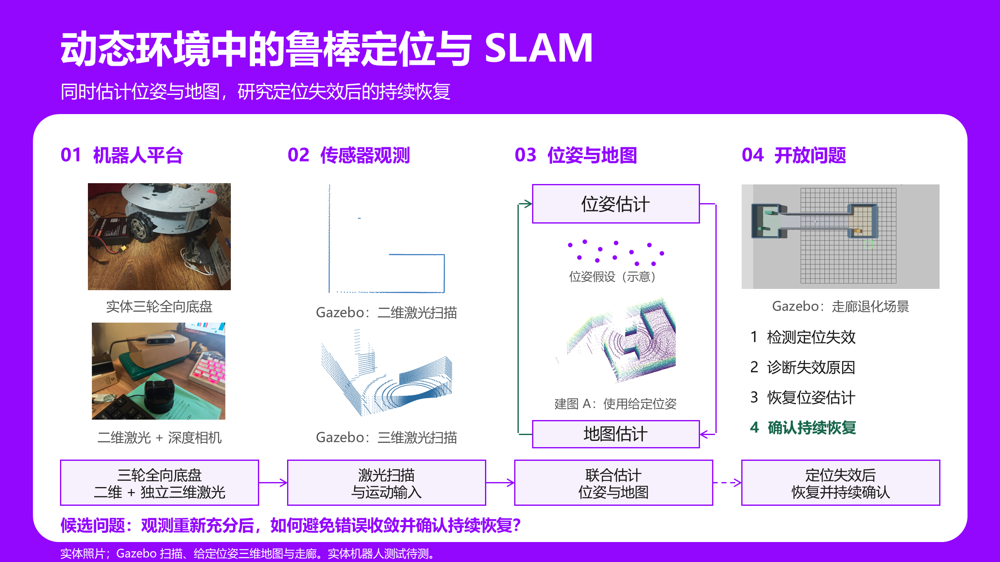

# SLAM Learning

**动态环境中的鲁棒定位与 SLAM**

动态环境中的鲁棒定位与 SLAM · 定位系统自恢复

[English](../README.md) | 中文

[开放问题](#开放问题) · [方向分析](#方向分析) · [相关工作](#相关工作) · [假设](#假设)

[复现结果](#复现结果) · [实验证据](#实验证据) · [假设](#假设) · [分支](#分支)

## 开放问题

**在退化与大变动环境中，什么样的策略能够有效地让定位系统自恢复？** 先分析失效原因、恢复目标和适用边界，再选择策略。成果包括作者原库复现，以及使用 Sim2Real-AlgoBench 机器人逐步加难的点云建图与定位测试。[问题分析与收窄](self-recovery/DESIGN.zh-CN.md) · [机器人测试协议](testing/PROTOCOL.zh-CN.md) · [汇报稿](self-recovery/TALK.zh-CN.md) · [接续状态](self-recovery/STATUS.zh-CN.md)。

## 方向分析

**SLAM（Simultaneous Localization and Mapping）**在构建地图的同时估计自身运动。大方向包含动态环境下的建图、定位和 SLAM，自恢复是其中的开放问题。

开放问题属于**位姿估计失效后的恢复**，受观测质量与地图有效性影响。可收窄为：**几何观测重新充分后，固定地图定位如何避免错误收敛，并确认持续恢复？** [可编辑中文流程图](assets/slam-recovery-flow.zh-CN.v2.pptx) · [图像来源](assets/direction/sources.json)。照片为已有底盘与传感器，实体测试仍待测。

| 成果 | 内容 |
| --- | --- |
| 原库复现 | 作者代码、数据与协议，保留各论文自己的指标及实际复现范围 |
| 机器人测试 | Sim2Real-AlgoBench 三轮全向底盘；原生二维＋独立三维激光版本，逐级测试点云建图、定位与恢复 |
| 问题分析 | 区分约束不足与地图失配，通过失败与恢复对照收窄问题，方法保持开放 |

语义建图方向及早期投影比较保留在[原库](https://github.com/p20030920p/SLAM_Learning)。

## 相关工作

**作者原库现场执行：RViz＋终端。**显示器观察当前计算状态，仅在可视化时稀疏展示点／粒子；观察器开销不作论文运行时间对比。

**论文场景与本次观察效果——先看表，再看视频。**原文数据集说明论文实际评估过的范围，不代表适用于所有动态环境。此表数值来自最新原库现场运行；历史论文表格复现在后面单独列出。SA／DA评价地图点分类，位姿RMSE评价定位。

| 方法 | 原文数据集与任务 | 本实验有效的现象 | 无效、未见收益或尚未验证 |
| --- | --- | --- | --- |
| DUFOMap | KITTI 00／01（城镇／高速）、Argoverse 2（城市）、半室内运动行人；另有测绘、车站、两层建筑定性展示。输入三维扫描与给定位姿，去除动态点。[原文§IV–V](https://arxiv.org/html/2403.01449v1#S4) | KITTI-00，141帧：SA 97.98%、DA 98.70%；动态残留被删除，大部分静态结构保留。[现场记录](../results/reference/desktop-live-dufomap/record.json) | 两项分类指标都未达100%。方法本身不估计位姿、也不执行位姿恢复；地图清理有效尚不能证明定位更好。 |
| BeautyMap | KITTI 00／01／05；02用于栅格大小实验；另有半室内数据。给定位姿下离线清理已有完整三维地图。[原文§IV](https://arxiv.org/html/2405.07283v1#S4) | 最新KITTI-00，141帧：SA 96.95%、DA 98.34%；动态残留被删除。历史KITTI-02，91帧，另行匹配表III九项准确率。[现场记录](../results/reference/desktop-live-beautymap/record.json) | 仍有静态点损失与动态点残留。“静态结构恢复”不是“机器人位姿恢复”。本次没有验证在线SLAM或长期变化后的恢复。 |
| IR-MCL | 波恩IPBLab办公室／走廊／厨房，五条全局定位序列；Freiburg 079、Intel Lab、MIT CSAIL只评估扫描渲染，未评估全局定位。[原文§IV](https://ar5iv.labs.arxiv.org/html/2210.03113#S4) | 已公开Seq 1：处理1543／评分1354帧，RMSE 5.31 cm／1.07°，接近原文同序列5.13 cm／1.05°。[现场记录](../results/reference/desktop-live-ir-mcl/record.json) | 其余四条定位序列未复现；严重观测丢失、地图过期、绑架恢复均未在本次验证，也尚未接入Gazebo。 |
| AdaM-MCL | 20张43×43 m仿真地图（18训练、2测试），UPO王宫、Bicocca室内数据；未知障碍、结构移除、全局定位和绑架。[原文§V](https://arxiv.org/html/2009.00211#S5) | 作者数据生成、训练、滤波流程在自建128格地图与2432步权重上跑通。最新123次更新，RMSE 32.23格。[现场记录](../results/reference/desktop-adam-mcl/record.json) | 未证明恢复有效。历史十次的平均每次RMSE为34.82格，全局／绑架两阶段持续收敛均0/10；缺少原发布数据／权重，不能比较论文米制精度。[更正证据](../results/reference/adam-mcl/ERRATUM.md) |

各论文卡片补充原文数据、实验前提和失效排查线索；排查假设与本实验已经确认的原因分开说明。

### DUFOMap — 在地图积分过程中去除动态点

**输入：**连续三维激光扫描与给定传感器位姿。**处理：**用扫描实际观测到的空闲空间判断过去的占据点是否为动态残留；八叉树累积证据，并为位姿不确定性留出裕量。**输出：**去除动态残留的点云地图。它本身不估计机器人位姿。[论文与复现范围](papers/dufomap.zh-CN.md)。

录像中灰色是保留点、红色是移除点、青色是当前扫描。重点看后续扫描如何改变旧点的保留决策。KITTI-00，141 帧；SA 97.98%／DA 98.70%。SA 是静态点保留率，DA 是动态点删除率，都不是定位误差。

**现场执行 · Live execution**

[Live MP4](../results/reference/desktop-live-dufomap/execution.mp4) · [record](../results/reference/desktop-live-dufomap/record.json)

### BeautyMap — 清理已有点云地图

**输入：**完整累积三维地图、扫描与给定位姿。**处理：**作者占据表示检测不一致结构，再通过静态结构恢复步骤减少误删。**输出：**清理后的参考地图。这是离线地图清理，录像展示它正在计算，开始时完整输入地图已经存在。[论文与复现范围](papers/beautymap.zh-CN.md)。

灰色／红色分别表示保留／移除。重点看累计移除决策，不把初始完整地图理解成在线 SLAM 的建图结果。KITTI-00，141 帧；SA 96.95%／DA 98.34%。更干净的地图是否改善定位，需要另做下游测试。

**现场执行 · Live execution**

[Live MP4](../results/reference/desktop-live-beautymap/execution.mp4) · [record](../results/reference/desktop-live-beautymap/record.json)

### IR-MCL — 用神经观测模型定位

**输入：**预训练神经占据场、真实二维扫描与运动输入。**处理：**每个粒子代表一个候选机器人位姿；神经场在该位姿渲染预测扫描，与真实扫描比较后更新权重，再重采样。**输出：**估计位姿与粒子分布。[论文、原库与评分协议](papers/ir-mcl.zh-CN.md)。

RViz 中地图提供环境参照，黄色粒子是候选位置，蓝色是显示估计，绿色是真值轨迹。重点看粒子是否集中，以及估计是否贴近参照。显示用加权粒子均值，评分用原生保存轨迹。Bonn IPBLab Seq 1：处理 1543／评分 1354 帧，本次 RMSE 5.31 cm／1.07°。这次作者数据运行与接入 Gazebo 是两项不同实验。

**现场执行 · Live execution**

[Live MP4](../results/reference/desktop-live-ir-mcl/execution.mp4) · [record](../results/reference/desktop-live-ir-mcl/record.json)

### AdaM-MCL — 学习式候选位置与粒子跟踪混合

**输入：**地图、激光观测、运动输入与训练好的候选位姿模型。**处理：**学习模型提出候选位置，自适应混合机制将其与常规粒子跟踪结合。**输出：**位姿分布，可包含绑架事件后的新位置假设。[论文与范围限制](papers/adam-mcl.zh-CN.md)。

当前使用自建 128 格地图、2432 步权重，123 次滤波更新，RMSE 32.23 格。未获取论文发布数据与权重，因此这是受限原库流程执行；没有复现论文的米制精度，也没有证明成功自恢复。[评分更正](../results/reference/adam-mcl/ERRATUM.md)。

**现场执行 · Live execution**

[Live MP4](../results/reference/desktop-adam-mcl/execution.mp4) · [record](../results/reference/desktop-adam-mcl/record.json)

**保存结果回放**

[Result MP4](../results/reference/desktop-adam-mcl/result.mp4)

## 假设

待检验：地图更干净是否也更容易恢复，更好的正常观测模型是否扩大恢复范围，剩余稳定结构怎样限制地图过期后的恢复。先完成原库复现与逐级测试，再根据可重复失败选择恢复策略。[分析与反例](self-recovery/DESIGN.zh-CN.md)。

## 复现结果

| 工作 | 数据 | 结果 |
| --- | --- | --- |
| [DUFOMap](https://github.com/p20030920p/SLAM_Learning/blob/535a2780af7ca7eb3aa02f722e1340fe90bc2dcf/docs/DUFOMAP_TABLE4.zh-CN.md) | KITTI-00，141 扫描 | 表 IV 准确率匹配 |
| [BeautyMap](https://github.com/p20030920p/SLAM_Learning/blob/535a2780af7ca7eb3aa02f722e1340fe90bc2dcf/docs/KITTI_PAPER_PROTOCOL.zh-CN.md) | 历史 KITTI-02，91 扫描 | 表 III 准确率匹配 |
| [IR-MCL](papers/ir-mcl.zh-CN.md) | 波恩 IPBLab，公开定位序列，1543 扫描 | 位置 RMSE 5.32 cm，论文 5.13 cm |
| [AdaM-MCL](papers/adam-mcl.zh-CN.md) | 自建 128 格平面，一个留出场景，123 次更新 × 10 次重复 | 上游流程跑通；未与论文数值对照 |

## 实验证据

以下数值取自作者源库链接的论文及我们保存的作者代码运行结果。每张表仅对照同一种方法，不作跨方法排名。

**共用指标。** DUFOMap 和 BeautyMap 的 SA、DA 定义相同。$S,D$ 为真值中的静态／动态点数；$S_k,D_r$ 为正确保留的静态点数／正确剔除的动态点数。AA（DUFOMap）为几何平均，HA（BeautyMap）为调和平均。[DUFOMap 定义](https://arxiv.org/html/2403.01449v1#S4.SS2) · [BeautyMap 定义](https://arxiv.org/html/2405.07283v1#S4)。

$$
\begin{aligned}
\mathrm{SA} &= 100\frac{S_k}{S}, &
\mathrm{DA} &= 100\frac{D_r}{D},\\
\mathrm{AA} &= \sqrt{\mathrm{SA}\,\mathrm{DA}}, &
\mathrm{HA} &= \frac{2\,\mathrm{SA}\,\mathrm{DA}}{\mathrm{SA}+\mathrm{DA}}.
\end{aligned}
$$

### DUFOMap

KITTI-00，141 扫描公开数据；完整设置：体素 0.1 m、d_s=0.2 m、d_p=1。[作者源库](https://github.com/KTH-RPL/dufomap/tree/9e239ddd5995136e14f5212f33382a6ebc59e518) · [论文表 IV](https://arxiv.org/html/2403.01449v1#S5.T4) · [我们的结果](https://github.com/p20030920p/SLAM_Learning/blob/535a2780af7ca7eb3aa02f722e1340fe90bc2dcf/docs/DUFOMAP_TABLE4.zh-CN.md)。

| 指标 | 论文 % | 复现 % |
| --- | ---: | ---: |
| SA | 97.96 | 97.9635 |
| DA | 98.72 | 98.7196 |
| AA | 98.34 | 98.3408 |

完整设置的三项数值保留两位小数后均与论文一致。表 IV 五组设置共 15 项准确率均匹配；本表不包含运行时间和在线实验。

### BeautyMap

历史 KITTI-02，第 860–950 帧，共 91 扫描；XY=1 m、Z=0.5 m、范围 40 m。[作者源库](https://github.com/MKJia/BeautyMap/tree/98bce4a97db96ddd0d5342e31425c7679f58ba2e) · [论文表 III](https://arxiv.org/html/2405.07283v1#S4.T3) · [我们的结果](https://github.com/p20030920p/SLAM_Learning/blob/535a2780af7ca7eb3aa02f722e1340fe90bc2dcf/docs/KITTI_PAPER_PROTOCOL.zh-CN.md)。

| 指标 | 论文 % | 复现 % |
| --- | ---: | ---: |
| SA | 83.40 | 83.3978 |
| DA | 82.41 | 82.4092 |
| HA | 82.90 | 82.9006 |

三项数值保留两位小数后均一致。XY=0.5／1／2 m 的九项准确率全部匹配。使用历史预处理／GT 与作者 HA 评分器；论文当时的精确方法提交尚未确定。其他序列及运行时间不在本表范围内。

### IR-MCL

波恩 IPBLab，官方公开的唯一一个定位序列；评分窗口为 1543 帧中的 1354 帧，因为仓库自带的评估会剔除最初 20 秒。[作者源库](https://github.com/PRBonn/ir-mcl/tree/aab8c91b37e59f94442d8eddfa2f920ab1ecc4c5) · [论文 IV-B 定位结果表](https://arxiv.org/html/2210.03113v2#S4.SS2) · [我们的运行](../results/reference/ir-mcl/runs/ir-mcl-wsl/record.json)。

| 指标 | 论文 Seq 1 | 复现 |
| --- | ---: | ---: |
| 位置 RMSE（cm） | 5.13 | 5.32 |
| 偏航 RMSE（度） | 1.05 | 1.07 |
| 位置 < 5 cm（%） | 63.15 | 61.74 |
| 位置 < 10 cm（%） | 97.27 | 96.01 |
| 位置 < 20 cm（%） | 100.00 | 100.00 |
| 偏航 < 0.5°（%） | 47.12 | 47.64 |
| 偏航 < 1°（%） | 74.59 | 75.85 |
| 偏航 < 2°（%） | 94.24 | 93.57 |

论文 Seq 1 的百分比恰好是 1354 个样本上的整数计数，与本仓库评估产生的窗口一致，因此两行可直接对照。C++ 运动模型的随机数发生器由 `std::random_device` 播种，重复运行会略有差异；第二次完整运行给出 5.28 cm。上游 README 补遗表中的 6.62 cm／1.11° 是整个自录数据集的汇总而非 Seq 1，本表不使用它。

### AdaM-MCL

自建 128 格室内平面、一个留出场景、123 次滤波更新、200 个粒子、$T_{\mathrm{cut}}=0.6$——粒子数与信赖阈值取自论文的仿真设置。[作者源库](https://github.com/Runjian-Chen/AdaM_MCL/tree/e8aedd2bae03816aabd5300e5ca2fe181b39d830) · [论文表 II](https://arxiv.org/html/2009.00211v3) · [我们的运行](../results/reference/adam-mcl/runs/adam-mcl-wsl/record.json)。

| 指标 | 论文表 II | 本次复现 |
| --- | ---: | ---: |
| 全局定位 $E_{pos}$ | 0.153 m | 未做数值对照 |
| 绑架 $E_{pos}$ | 0.128 m | 未做数值对照 |

**未做数值对照。** 论文的 20 张仿真地图为 43 m × 43 m，另有 6 条评测序列与已发布权重，全部是外部下载；本次用自建平面，训练 **2432** 次优化步而作者默认 **2 880 000** 步，格不是米。本次实测（单位：格）：10 次重复的每次运行 RMSE 均值 34.82，末帧误差均值 47.71，每次更新 0.43 s，10 次重复中 0 次满足折算到本平面的论文收敛判据。 [指标勘误](../results/reference/adam-mcl/ERRATUM.md)。

## 分支

| 分支 | 用途 |
| --- | --- |
| main | 提交展示：动态环境鲁棒定位主线、按范围记录的建图／定位复现，以及候选自恢复实验。 |
| [reproduce/author-originals](https://github.com/p20030920p/SLAM_Learning/tree/reproduce/author-originals) | 作者原流程、论文表格评分与录制。 |
| [notes/personal-study-guide-20261008](https://github.com/p20030920p/SLAM_Learning/tree/notes/personal-study-guide-20261008) | 个人学习笔记与 `src/physical/` 实物实验，保留操作说明和失败记录。 |

[AI 使用](guides/DISCLOSURE.zh-CN.md) · [来源／许可](guides/ATTRIBUTION.zh-CN.md) · [引用](CITATION.cff) · [许可](../src/LICENSE)
## 实践

[键盘演示](../demo/README.md) · [视频目录](../demo/gallery.html) · [代码 Notebook](../notebooks/presentation/SLAM_实验逐步展示.ipynb)。

**机器人实验效果——先看表，再看视频。**以下都是Gazebo仿真；Raw／DUFOMap／BeautyMap是三种地图，定位器同为AMCL。表中为当前展示的新运行、含初始化；除明确标注外，每条件仅一次，小数值差异不能形成方法排名。

| 场景／方法 | 有效的现象 | 无效、未见收益或尚未验证 | 证据 |
| --- | --- | --- | --- |
| 纯静态·三地图＋AMCL | 本路线定位跟随；XY RMSE按Raw／DUFOMap／BeautyMap顺序为7.28／7.28／6.89 cm，各290次更新。 | DUFOMap相对Raw未见改善；BeautyMap的小差异没有重复验证。路线未诱发失效，因此没有测试恢复。 | [record](../results/reference/robot-live-static/record.json) |
| 三个运动箱体·三地图＋AMCL | 运动障碍下继续定位；XY RMSE为7.41／7.35／7.14 cm，各288次更新。 | DUFOMap／BeautyMap相对Raw仅降低0.06／0.27 cm；单次结果不足以证明稳定清理收益或恢复改善。 | [record](../results/reference/robot-live-dynamic/record.json) |
| 持久结构变化·旧地图＋AMCL | 本路线仍可定位；XY RMSE为6.84／6.84／6.39 cm，各290次更新。 | 本路线未诱发失效，不能证明大幅地图失配后的恢复；DUFOMap相对Raw也未见RMSE收益。 | [record](../results/reference/robot-live-large-change/record.json) |
| 走廊·受限→完整扫描＋AMCL | 66.2仿真秒恢复完整扫描后，受限组13.3 s开始持续收敛；连续确认5 s、≥8次更新、位置<0.1 m且yaw<5°。完整扫描对照从同一参考事件算为6.6 s。 | 全程XY RMSE仍为受限72.53 cm／完整71.60 cm，各508次更新，包含1 m初值偏移。三张投影地图相同，无法区分清理方法；起点是偏移初始位姿分布，尚不是正常跟踪中失效后的恢复。 | [record](../results/reference/robot-corridor-v2/record.json) |
| 纯静态·原生NDT_OMP | 最新短时三维固定地图定位：XY RMSE 0.927 cm／yaw 0.171°，402次更新。 | 相同估计器参数的首轮为34.43 cm、399次更新，原因未查明；动态、退化和恢复测试仍待完成。 | [最新](../results/reference/robot-ndt-static/record.json)·[首轮](../results/reference/robot-ndt-static-initial/record.json) |
| 纯静态·原生GICP | 短时三维固定地图定位：XY RMSE 1.091 cm／yaw 0.160°，397次更新。 | 只有约35仿真秒静态部署验证；动态、退化和恢复尚未测试。三维输入与AMCL二维输入不同，不能直接按数值排名。 | [record](../results/reference/robot-gicp-static/record.json) |
| 补充建图场景 | 原生slam_toolbox在线生成二维地图；独立三维分支采集扫描，使用给定传感器位姿生成地图。 | 三维分支没有估计自身位姿，不是完整三维SLAM；实体机器人精度与恢复仍待测。 | [静态建图](../results/reference/robot-supp-static/record.json)·[走廊建图](../results/reference/robot-corridor-v2-mapping/record.json) |

## 实测结果如何计算

每条原生定位输出按时间与独立 Gazebo 机器人真值关联，最近时间差必须 **≤0.05 个仿真秒**。二者使用相同地图／世界坐标，不做空间拟合；评分包含初始化阶段，并记录时间不匹配的丢弃数量。

$$e_i=\sqrt{(\hat x_i-x_i)^2+(\hat y_i-y_i)^2},\quad \mathrm{RMSE}_{xy}=\sqrt{\frac1N\sum_{i=1}^N e_i^2}.$$

偏航差先折回 $[-\pi,\pi]$，再求均方根并转换成度；米乘 100 得到厘米。**Live execution** 是按真实时间录制的现场计算；**Measured result replay** 按仿真时间绘制已保存估计与真值，不重新运行算法。曲线显示每时刻误差，RMSE 标注来自完整评分 CSV。[CSV、窗口与恢复判据](testing/LIVE.zh-CN.md) · [可执行评分代码](../src/scripts/presentation/observe_session.py)。

## 三维定位原库部署实测

以下短静态试验使用实时三维点云和固定 Raw 三维地图；不使用 IMU／去畸变。评分为 XY／yaw 并包含初始化，传感器与时长不同，不能与二维 AMCL 直接排名。[Libraries and scope](testing/LOCALIZERS.zh-CN.md).

### Pure static — NDT_OMP

**Live execution**

[Live MP4](../results/reference/robot-ndt-static/execution.mp4) · [record](../results/reference/robot-ndt-static/record.json)

**Measured result replay**

[Result MP4](../results/reference/robot-ndt-static/result.mp4) · XY RMSE **0.93 cm** · yaw **0.17°** · 402 updates.

### Pure static — GICP

**Live execution**

[Live MP4](../results/reference/robot-gicp-static/execution.mp4) · [record](../results/reference/robot-gicp-static/record.json)

**Measured result replay**

[Result MP4](../results/reference/robot-gicp-static/result.mp4) · XY RMSE **1.09 cm** · yaw **0.16°** · 397 updates.

相同估计器参数的首次 NDT 试验为 34.43 cm，记录也保留。差异原因尚未定位，不能只用最新分数宣称鲁棒性。[Initial trial](../results/reference/robot-ndt-static-initial/record.json).

## 静态与动态定位录制

**2026-10-14 本机重新实测。**每种方法都有自己的真实 RViz 窗口、地图主题、原生 AMCL 位姿／粒子和独立显示 TF；每段 GIF 录制 Gazebo＋该方法 RViz＋终端，使用同一次场景的实时输入。

**Raw／DUFOMap／BeautyMap 表示地图处理方式，实时定位器统一为 AMCL。**建图使用给定位姿并作共用二维投影，属于三维地图到二维定位的平台适配。下面的数值来自本次新运行，含初始化；每条件一次。

[计算口径与控制组](testing/LIVE.zh-CN.md) · [录像名称对照](../demo/recording-index.json) · [逐方法一键演示](../demo/README.md#逐方法独立-rviz-现场对照)

### 纯静态

小初值偏移，本路线未失效。

#### Raw map + AMCL

**现场执行 · Live execution — Raw RViz**

[Live MP4](../results/reference/robot-live-static/executions/raw.mp4) · [RViz config](../results/reference/robot-live-static/view-raw.rviz) · [record](../results/reference/robot-live-static/record.json)

**结果回放 · Measured result replay — Raw**

[Result MP4](../results/reference/robot-live-static/methods/raw/result.mp4) · [case record](../results/reference/robot-live-static/methods/raw/record.json) · RMSE **7.28 cm** · 290 次原生更新。

#### DUFOMap map + AMCL

**现场执行 · Live execution — DUFOMap RViz**

[Live MP4](../results/reference/robot-live-static/executions/dufomap.mp4) · [RViz config](../results/reference/robot-live-static/view-dufomap.rviz) · [record](../results/reference/robot-live-static/record.json)

**结果回放 · Measured result replay — DUFOMap**

[Result MP4](../results/reference/robot-live-static/methods/dufomap/result.mp4) · [case record](../results/reference/robot-live-static/methods/dufomap/record.json) · RMSE **7.28 cm** · 290 次原生更新。

#### BeautyMap map + AMCL

**现场执行 · Live execution — BeautyMap RViz**

[Live MP4](../results/reference/robot-live-static/executions/beautymap.mp4) · [RViz config](../results/reference/robot-live-static/view-beautymap.rviz) · [record](../results/reference/robot-live-static/record.json)

**结果回放 · Measured result replay — BeautyMap**

[Result MP4](../results/reference/robot-live-static/methods/beautymap/result.mp4) · [case record](../results/reference/robot-live-static/methods/beautymap/record.json) · RMSE **6.89 cm** · 290 次原生更新。

### 运动障碍物

三个运动箱体。现场分别展示三种动态地图下的定位；同输入另运行三种静态地图控制组，数值见评分协议。

#### Raw map + AMCL

**现场执行 · Live execution — Raw RViz**

[Live MP4](../results/reference/robot-live-dynamic/executions/raw.mp4) · [RViz config](../results/reference/robot-live-dynamic/view-raw.rviz) · [record](../results/reference/robot-live-dynamic/record.json)

**结果回放 · Measured result replay — Raw**

[Result MP4](../results/reference/robot-live-dynamic/methods/raw/result.mp4) · [case record](../results/reference/robot-live-dynamic/methods/raw/record.json) · RMSE **7.41 cm** · 288 次原生更新。

#### DUFOMap map + AMCL

**现场执行 · Live execution — DUFOMap RViz**

[Live MP4](../results/reference/robot-live-dynamic/executions/dufomap.mp4) · [RViz config](../results/reference/robot-live-dynamic/view-dufomap.rviz) · [record](../results/reference/robot-live-dynamic/record.json)

**结果回放 · Measured result replay — DUFOMap**

[Result MP4](../results/reference/robot-live-dynamic/methods/dufomap/result.mp4) · [case record](../results/reference/robot-live-dynamic/methods/dufomap/record.json) · RMSE **7.35 cm** · 288 次原生更新。

#### BeautyMap map + AMCL

**现场执行 · Live execution — BeautyMap RViz**

[Live MP4](../results/reference/robot-live-dynamic/executions/beautymap.mp4) · [RViz config](../results/reference/robot-live-dynamic/view-beautymap.rviz) · [record](../results/reference/robot-live-dynamic/record.json)

**结果回放 · Measured result replay — BeautyMap**

[Result MP4](../results/reference/robot-live-dynamic/methods/beautymap/result.mp4) · [case record](../results/reference/robot-live-dynamic/methods/beautymap/record.json) · RMSE **7.14 cm** · 288 次原生更新。

### 持久结构变化

环境变化后继续使用旧静态地图；本次路线仍未诱发失效。

#### Raw map + AMCL

**现场执行 · Live execution — Raw RViz**

[Live MP4](../results/reference/robot-live-large-change/executions/raw.mp4) · [RViz config](../results/reference/robot-live-large-change/view-raw.rviz) · [record](../results/reference/robot-live-large-change/record.json)

**结果回放 · Measured result replay — Raw**

[Result MP4](../results/reference/robot-live-large-change/methods/raw/result.mp4) · [case record](../results/reference/robot-live-large-change/methods/raw/record.json) · RMSE **6.84 cm** · 290 次原生更新。

#### DUFOMap map + AMCL

**现场执行 · Live execution — DUFOMap RViz**

[Live MP4](../results/reference/robot-live-large-change/executions/dufomap.mp4) · [RViz config](../results/reference/robot-live-large-change/view-dufomap.rviz) · [record](../results/reference/robot-live-large-change/record.json)

**结果回放 · Measured result replay — DUFOMap**

[Result MP4](../results/reference/robot-live-large-change/methods/dufomap/result.mp4) · [case record](../results/reference/robot-live-large-change/methods/dufomap/record.json) · RMSE **6.84 cm** · 290 次原生更新。

#### BeautyMap map + AMCL

**现场执行 · Live execution — BeautyMap RViz**

[Live MP4](../results/reference/robot-live-large-change/executions/beautymap.mp4) · [RViz config](../results/reference/robot-live-large-change/view-beautymap.rviz) · [record](../results/reference/robot-live-large-change/record.json)

**结果回放 · Measured result replay — BeautyMap**

[Result MP4](../results/reference/robot-live-large-change/methods/beautymap/result.mp4) · [case record](../results/reference/robot-live-large-change/methods/beautymap/record.json) · RMSE **6.39 cm** · 290 次原生更新。

### 走廊退化

X 初值偏移 1 m；72 束／240°／3.5 m 观测持续 50 个仿真秒后恢复完整扫描。本次恢复后约 13.3 s 开始持续收敛，并覆盖 5 s 确认。本走廊三种占据地图相同。

#### Raw map + AMCL

**现场执行 · Live execution — Raw RViz**

[Live MP4](../results/reference/robot-corridor-v2/executions/degraded_raw.mp4) · [RViz config](../results/reference/robot-corridor-v2/view-degraded_raw.rviz) · [record](../results/reference/robot-corridor-v2/record.json)

**结果回放 · Measured result replay — Raw**

[Result MP4](../results/reference/robot-corridor-v2/methods/degraded_raw/result.mp4) · [case record](../results/reference/robot-corridor-v2/methods/degraded_raw/record.json) · RMSE **72.53 cm** · 508 次原生更新。

#### DUFOMap map + AMCL

**现场执行 · Live execution — DUFOMap RViz**

[Live MP4](../results/reference/robot-corridor-v2/executions/degraded_dufomap.mp4) · [RViz config](../results/reference/robot-corridor-v2/view-degraded_dufomap.rviz) · [record](../results/reference/robot-corridor-v2/record.json)

**结果回放 · Measured result replay — DUFOMap**

[Result MP4](../results/reference/robot-corridor-v2/methods/degraded_dufomap/result.mp4) · [case record](../results/reference/robot-corridor-v2/methods/degraded_dufomap/record.json) · RMSE **72.53 cm** · 508 次原生更新。

#### BeautyMap map + AMCL

**现场执行 · Live execution — BeautyMap RViz**

[Live MP4](../results/reference/robot-corridor-v2/executions/degraded_beautymap.mp4) · [RViz config](../results/reference/robot-corridor-v2/view-degraded_beautymap.rviz) · [record](../results/reference/robot-corridor-v2/record.json)

**结果回放 · Measured result replay — BeautyMap**

[Result MP4](../results/reference/robot-corridor-v2/methods/degraded_beautymap/result.mp4) · [case record](../results/reference/robot-corridor-v2/methods/degraded_beautymap/record.json) · RMSE **72.53 cm** · 508 次原生更新。

**实体机器人待测。**本机键盘演示在 `F:\be2演讲\实机脚本` 的 `20–23`；`24` 自动录制四类场景。此前现场及结果回放保留归档，与上面这轮录像区分。

## 补充场景实时录制

真实 Gazebo＋RViz＋终端；RViz 使用完整视口，并按地图坐标居中。旧自建看图程序录像保留归档。

### S1 static · slam_toolbox mapping

[MP4](../results/reference/robot-supp-static/execution.mp4) · [record](../results/reference/robot-supp-static/record.json)

### S2 dynamic · slam_toolbox mapping

[MP4](../results/reference/robot-supp-dynamic/execution.mp4) · [record](../results/reference/robot-supp-dynamic/record.json)

### S3 persistent change · Raw map + AMCL

[MP4](../results/reference/robot-supp-large-change/execution.mp4) · [record](../results/reference/robot-supp-large-change/record.json)

### S4 new corridor · limited → restored AMCL

[MP4](../results/reference/robot-corridor-v2/executions/degraded_raw.mp4) · [record](../results/reference/robot-corridor-v2/record.json)
