| 极简实践 | 跳转 |
| --- | --- |
| 语言／主文 | [English](MINIMAL.md) · [中文](MINIMAL.zh-CN.md) · [主README](HOME.zh-CN.md) |
| 查看 | 表内GIF直接播放；点击预览打开完整视频；DA／SA为动态删除／静态保留，单次不排名 |
| Related works · 原库实践 | [▶ 查看](#related-works) |
| 原生二维建图 · SRRG | [▶ 查看](#srrg-2d) |
| 二维投影地图＋AMCL | [▶ 查看](#practice-2d) |
| 三维地图＋GICP | [▶ 查看](#practice-3d) |
| 三维地图清理效果 | [▶ 查看](#map-review) |
| NDT／GICP早期实践 | [▶ 查看](#registration) |
| 简单传感器实践 | [▶ 查看](#sensor-practice) |
| 二维＋深度 · 定位假设实践 | [▶ 查看](#hypotheses-2d) |
| 三维＋深度 · 定位假设实践 | [▶ 查看](#hypotheses-3d) |
| 同输入候选细化 · 结果回放 | [▶ 查看](#refinement) |
| 实机传感器采集 | [▶ 查看](#hardware) |
| 历史实践与失败诊断 | [展开查看](#archive) |

| Related works · 原库实践 | GIF预览（点击看视频） | 指标效果 |
| --- | --- | --- |
| [DUFOMap · 原库实录](HOME.zh-CN.md#dufomap) |  [完整视频](../results/reference/desktop-live-dufomap/execution.mp4) · [GIF](../results/reference/desktop-live-dufomap/execution.gif) · [记录](../results/reference/desktop-live-dufomap/record.json) | 动态点删除 98.70%；静态点保留 97.98% |
| [BeautyMap · 原库实录](HOME.zh-CN.md#beautymap) | <a href="../results/reference/desktop-live-beautymap/execution.mp4">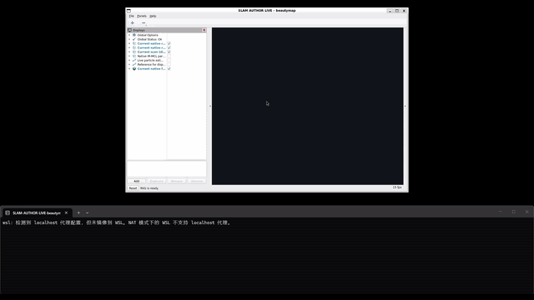</a> [完整视频](../results/reference/desktop-live-beautymap/execution.mp4) · [GIF](../results/reference/desktop-live-beautymap/execution.gif) · [记录](../results/reference/desktop-live-beautymap/record.json) | 动态点删除 98.34%；静态点保留 96.95% |
| [IR-MCL · 原库实录](HOME.zh-CN.md#ir-mcl) |  [完整视频](../results/reference/desktop-live-ir-mcl/execution.mp4) · [GIF](../results/reference/desktop-live-ir-mcl/execution.gif) · [记录](../results/reference/desktop-live-ir-mcl/record.json) | 定位RMSE 5.31cm / 1.07°；清理指标不适用 |
| [AdaM-MCL · 原库实录](HOME.zh-CN.md#adam-mcl) |  [完整视频](../results/reference/desktop-adam-mcl/execution.mp4) · [GIF](../results/reference/desktop-adam-mcl/execution.gif) · [记录](../results/reference/desktop-adam-mcl/record.json) | 定位RMSE 32.23格；清理指标不适用 |
| [AdaM-MCL · 结果回放](HOME.zh-CN.md#adam-mcl) |  [完整视频](../results/reference/desktop-adam-mcl/result.mp4) · [GIF](../results/reference/desktop-adam-mcl/result.gif) · [记录](../results/reference/desktop-adam-mcl/record.json) | 定位RMSE 32.23格；清理指标不适用 |

| 原生二维建图 · SRRG | GIF预览（点击看视频） | 指标效果 |
| --- | --- | --- |
| [纯静态 · 原生二维SRRG建图](HOME.zh-CN.md#srrg-static-2d) | <a href="../results/reference/srrg-2d-static/execution.mp4">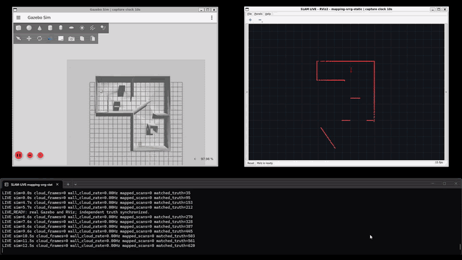</a> [完整视频](../results/reference/srrg-2d-static/execution.mp4) · [GIF](../results/reference/srrg-2d-static/execution.gif) · [记录](../results/reference/srrg-2d-static/record.json) | 动态残影删除 N/A；静态覆盖保留 99.84%；独立定位B待测 |
| [运动障碍物 · 原生二维SRRG建图](HOME.zh-CN.md#srrg-dynamic-2d) | <a href="../results/reference/srrg-2d-dynamic/execution.mp4">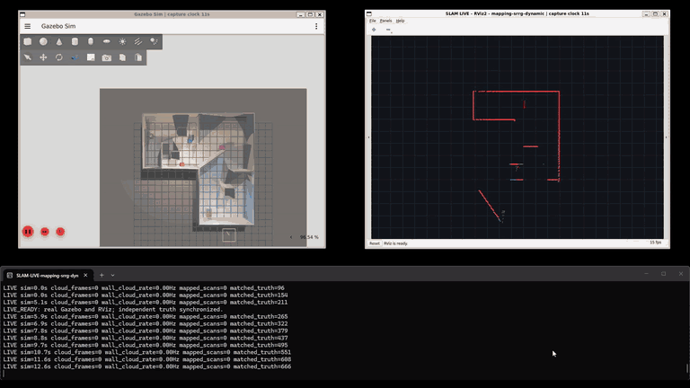</a> [完整视频](../results/reference/srrg-2d-dynamic/execution.mp4) · [GIF](../results/reference/srrg-2d-dynamic/execution.gif) · [记录](../results/reference/srrg-2d-dynamic/record.json) | 动态残影删除 42.31%；静态覆盖保留 99.51%；独立定位B待测 |
| [持久结构变化 · 原生二维SRRG建图](HOME.zh-CN.md#srrg-large-change-2d) | <a href="../results/reference/srrg-2d-large-change/execution.mp4">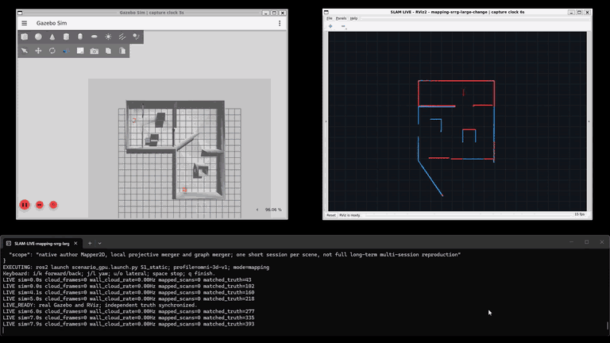</a> [完整视频](../results/reference/srrg-2d-large-change/execution.mp4) · [GIF](../results/reference/srrg-2d-large-change/execution.gif) · [记录](../results/reference/srrg-2d-large-change/record.json) | 动态残影删除 N/A；静态覆盖保留 99.71%；独立定位B待测 |
| [走廊退化 · 原生二维SRRG建图](HOME.zh-CN.md#srrg-corridor-2d) |  [完整视频](../results/reference/srrg-2d-corridor/execution.mp4) · [GIF](../results/reference/srrg-2d-corridor/execution.gif) · [记录](../results/reference/srrg-2d-corridor/record.json) | 动态残影删除 N/A；静态覆盖保留 82.24%；独立定位B待测 |

| 二维投影地图＋AMCL | GIF预览（点击看视频） | 指标效果 |
| --- | --- | --- |
| [纯静态 · 2D · Raw · 实录](HOME.zh-CN.md#scene-static-2d) | <a href="../results/reference/robot-live-static/executions/raw.mp4">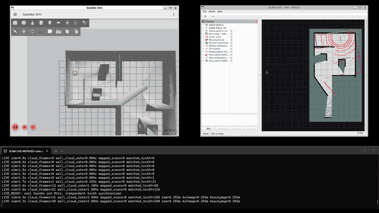</a> [完整视频](../results/reference/robot-live-static/executions/raw.mp4) · [GIF](../results/reference/robot-live-static/executions/raw.gif) · [记录](../results/reference/robot-live-static/record.json) | 动态格删除 N/A；静态格保留 100.00% XY RMSE 7.28 cm |
| [纯静态 · 2D · Raw · 结果回放](HOME.zh-CN.md#scene-static-2d) | <a href="../results/reference/robot-live-static/methods/raw/result.mp4">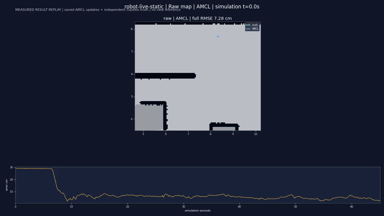</a> [完整视频](../results/reference/robot-live-static/methods/raw/result.mp4) · [GIF](../results/reference/robot-live-static/methods/raw/result.gif) · [记录](../results/reference/robot-live-static/record.json) | 动态格删除 N/A；静态格保留 100.00% XY RMSE 7.28 cm |
| [纯静态 · 2D · DUFOMap · 实录](HOME.zh-CN.md#scene-static-2d) | <a href="../results/reference/robot-live-static/executions/dufomap.mp4">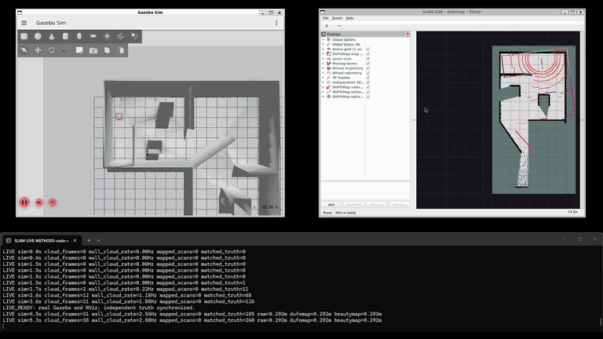</a> [完整视频](../results/reference/robot-live-static/executions/dufomap.mp4) · [GIF](../results/reference/robot-live-static/executions/dufomap.gif) · [记录](../results/reference/robot-live-static/record.json) | 动态格删除 N/A；静态格保留 100.00% XY RMSE 7.28 cm |
| [纯静态 · 2D · DUFOMap · 结果回放](HOME.zh-CN.md#scene-static-2d) |  [完整视频](../results/reference/robot-live-static/methods/dufomap/result.mp4) · [GIF](../results/reference/robot-live-static/methods/dufomap/result.gif) · [记录](../results/reference/robot-live-static/record.json) | 动态格删除 N/A；静态格保留 100.00% XY RMSE 7.28 cm |
| [纯静态 · 2D · BeautyMap · 实录](HOME.zh-CN.md#scene-static-2d) | <a href="../results/reference/robot-live-static/executions/beautymap.mp4">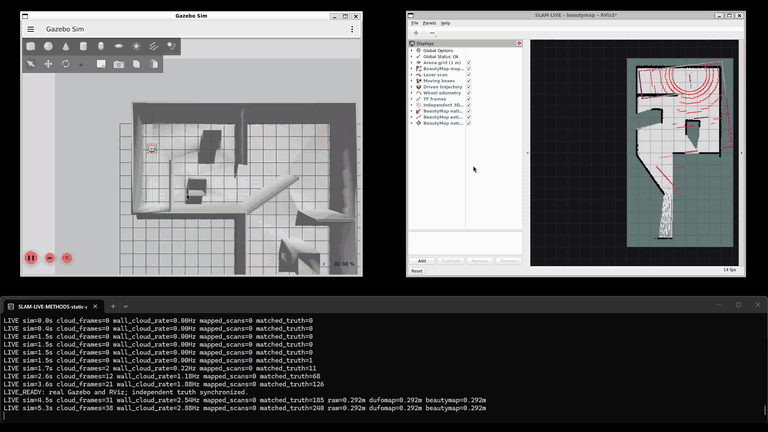</a> [完整视频](../results/reference/robot-live-static/executions/beautymap.mp4) · [GIF](../results/reference/robot-live-static/executions/beautymap.gif) · [记录](../results/reference/robot-live-static/record.json) | 动态格删除 N/A；静态格保留 96.51% XY RMSE 6.89 cm |
| [纯静态 · 2D · BeautyMap · 结果回放](HOME.zh-CN.md#scene-static-2d) | <a href="../results/reference/robot-live-static/methods/beautymap/result.mp4">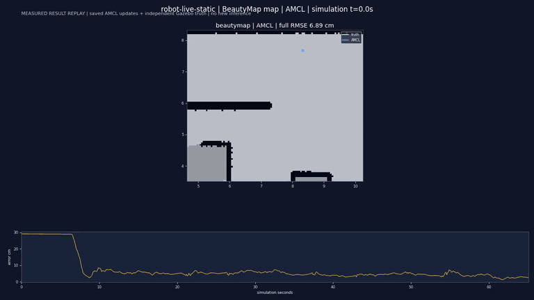</a> [完整视频](../results/reference/robot-live-static/methods/beautymap/result.mp4) · [GIF](../results/reference/robot-live-static/methods/beautymap/result.gif) · [记录](../results/reference/robot-live-static/record.json) | 动态格删除 N/A；静态格保留 96.51% XY RMSE 6.89 cm |
| [运动障碍物 · 2D · Raw · 实录](HOME.zh-CN.md#scene-dynamic-2d) | <a href="../results/reference/robot-2d-dynamic-matched/executions/raw.mp4">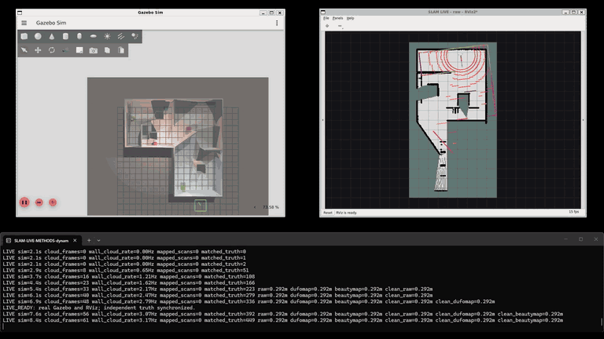</a> [完整视频](../results/reference/robot-2d-dynamic-matched/executions/raw.mp4) · [GIF](../results/reference/robot-2d-dynamic-matched/executions/raw.gif) · [记录](../results/reference/robot-2d-dynamic-matched/record.json) | 动态格删除 0.00%；静态格保留 100.00% XY RMSE 7.52 cm |
| [运动障碍物 · 2D · Raw · 结果回放](HOME.zh-CN.md#scene-dynamic-2d) |  [完整视频](../results/reference/robot-2d-dynamic-matched/methods/raw/result.mp4) · [GIF](../results/reference/robot-2d-dynamic-matched/methods/raw/result.gif) · [记录](../results/reference/robot-2d-dynamic-matched/record.json) | 动态格删除 0.00%；静态格保留 100.00% XY RMSE 7.52 cm |
| [运动障碍物 · 2D · DUFOMap · 实录](HOME.zh-CN.md#scene-dynamic-2d) | <a href="../results/reference/robot-2d-dynamic-matched/executions/dufomap.mp4">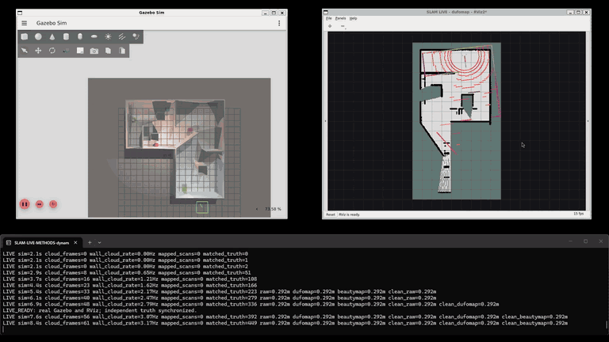</a> [完整视频](../results/reference/robot-2d-dynamic-matched/executions/dufomap.mp4) · [GIF](../results/reference/robot-2d-dynamic-matched/executions/dufomap.gif) · [记录](../results/reference/robot-2d-dynamic-matched/record.json) | 动态格删除 8.33%；静态格保留 100.00% XY RMSE 8.19 cm |
| [运动障碍物 · 2D · DUFOMap · 结果回放](HOME.zh-CN.md#scene-dynamic-2d) | <a href="../results/reference/robot-2d-dynamic-matched/methods/dufomap/result.mp4">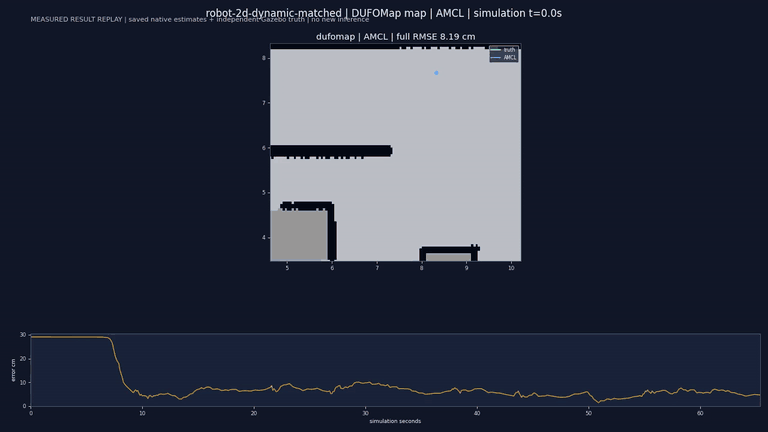</a> [完整视频](../results/reference/robot-2d-dynamic-matched/methods/dufomap/result.mp4) · [GIF](../results/reference/robot-2d-dynamic-matched/methods/dufomap/result.gif) · [记录](../results/reference/robot-2d-dynamic-matched/record.json) | 动态格删除 8.33%；静态格保留 100.00% XY RMSE 8.19 cm |
| [运动障碍物 · 2D · BeautyMap · 实录](HOME.zh-CN.md#scene-dynamic-2d) | <a href="../results/reference/robot-2d-dynamic-matched/executions/beautymap.mp4">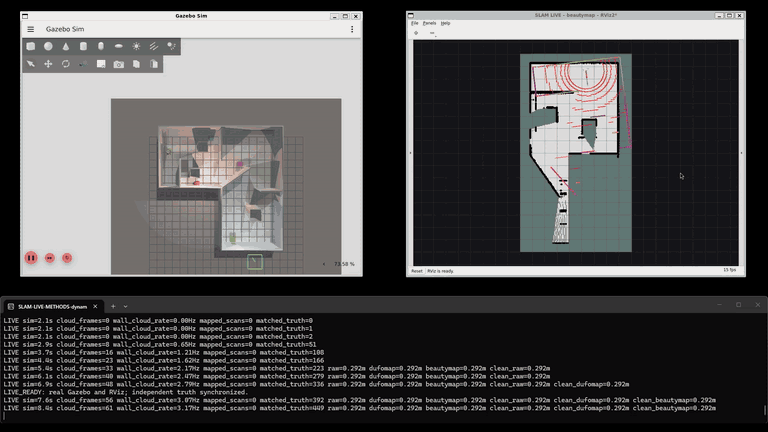</a> [完整视频](../results/reference/robot-2d-dynamic-matched/executions/beautymap.mp4) · [GIF](../results/reference/robot-2d-dynamic-matched/executions/beautymap.gif) · [记录](../results/reference/robot-2d-dynamic-matched/record.json) | 动态格删除 33.33%；静态格保留 96.64% XY RMSE 7.29 cm |
| [运动障碍物 · 2D · BeautyMap · 结果回放](HOME.zh-CN.md#scene-dynamic-2d) | <a href="../results/reference/robot-2d-dynamic-matched/methods/beautymap/result.mp4">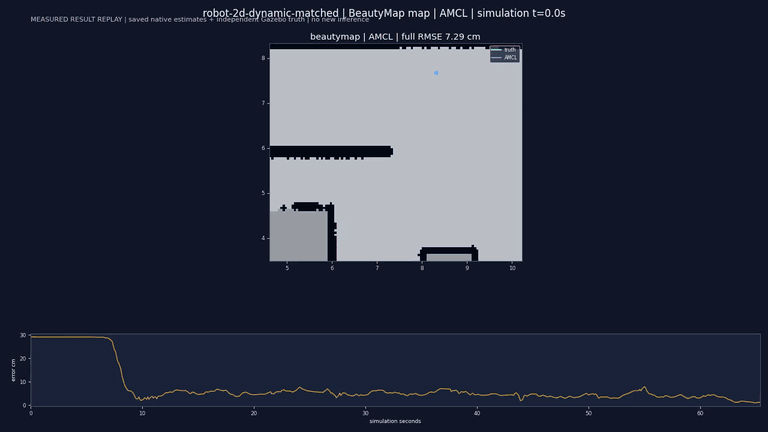</a> [完整视频](../results/reference/robot-2d-dynamic-matched/methods/beautymap/result.mp4) · [GIF](../results/reference/robot-2d-dynamic-matched/methods/beautymap/result.gif) · [记录](../results/reference/robot-2d-dynamic-matched/record.json) | 动态格删除 33.33%；静态格保留 96.64% XY RMSE 7.29 cm |
| [持久结构变化 · 2D · Raw · 实录](HOME.zh-CN.md#scene-change-2d) |  [完整视频](../results/reference/robot-live-large-change/executions/raw.mp4) · [GIF](../results/reference/robot-live-large-change/executions/raw.gif) · [记录](../results/reference/robot-live-large-change/record.json) | 动态格删除 N/A；静态格保留 100.00%（静态A旧图） XY RMSE 6.84 cm |
| [持久结构变化 · 2D · Raw · 结果回放](HOME.zh-CN.md#scene-change-2d) | <a href="../results/reference/robot-live-large-change/methods/raw/result.mp4">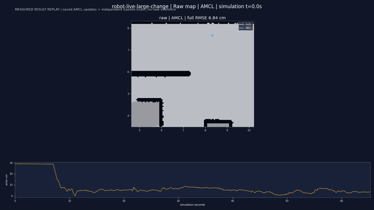</a> [完整视频](../results/reference/robot-live-large-change/methods/raw/result.mp4) · [GIF](../results/reference/robot-live-large-change/methods/raw/result.gif) · [记录](../results/reference/robot-live-large-change/record.json) | 动态格删除 N/A；静态格保留 100.00%（静态A旧图） XY RMSE 6.84 cm |
| [持久结构变化 · 2D · DUFOMap · 实录](HOME.zh-CN.md#scene-change-2d) | <a href="../results/reference/robot-live-large-change/executions/dufomap.mp4">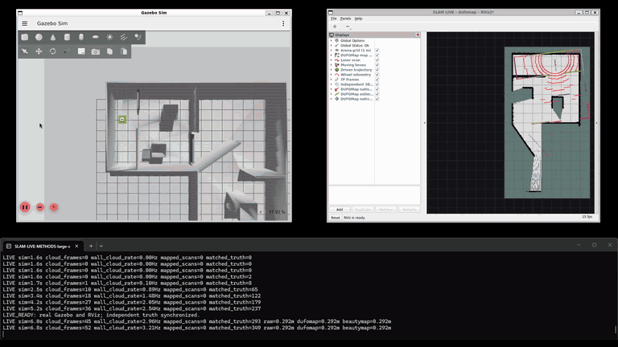</a> [完整视频](../results/reference/robot-live-large-change/executions/dufomap.mp4) · [GIF](../results/reference/robot-live-large-change/executions/dufomap.gif) · [记录](../results/reference/robot-live-large-change/record.json) | 动态格删除 N/A；静态格保留 100.00%（静态A旧图） XY RMSE 6.84 cm |
| [持久结构变化 · 2D · DUFOMap · 结果回放](HOME.zh-CN.md#scene-change-2d) |  [完整视频](../results/reference/robot-live-large-change/methods/dufomap/result.mp4) · [GIF](../results/reference/robot-live-large-change/methods/dufomap/result.gif) · [记录](../results/reference/robot-live-large-change/record.json) | 动态格删除 N/A；静态格保留 100.00%（静态A旧图） XY RMSE 6.84 cm |
| [持久结构变化 · 2D · BeautyMap · 实录](HOME.zh-CN.md#scene-change-2d) | <a href="../results/reference/robot-live-large-change/executions/beautymap.mp4">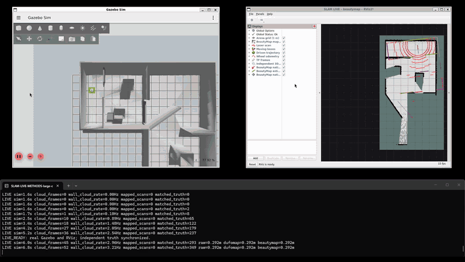</a> [完整视频](../results/reference/robot-live-large-change/executions/beautymap.mp4) · [GIF](../results/reference/robot-live-large-change/executions/beautymap.gif) · [记录](../results/reference/robot-live-large-change/record.json) | 动态格删除 N/A；静态格保留 96.51%（静态A旧图） XY RMSE 6.39 cm |
| [持久结构变化 · 2D · BeautyMap · 结果回放](HOME.zh-CN.md#scene-change-2d) |  [完整视频](../results/reference/robot-live-large-change/methods/beautymap/result.mp4) · [GIF](../results/reference/robot-live-large-change/methods/beautymap/result.gif) · [记录](../results/reference/robot-live-large-change/record.json) | 动态格删除 N/A；静态格保留 96.51%（静态A旧图） XY RMSE 6.39 cm |
| [走廊退化 · 2D · Raw · 实录](HOME.zh-CN.md#scene-corridor-2d) |  [完整视频](../results/reference/robot-corridor-v2/executions/degraded_raw.mp4) · [GIF](../results/reference/robot-corridor-v2/executions/degraded_raw.gif) · [记录](../results/reference/robot-corridor-v2/record.json) | 动态格删除 N/A；静态格保留 100.00% XY RMSE 72.53 cm |
| [走廊退化 · 2D · Raw · 结果回放](HOME.zh-CN.md#scene-corridor-2d) | <a href="../results/reference/robot-corridor-v2/methods/degraded_raw/result.mp4">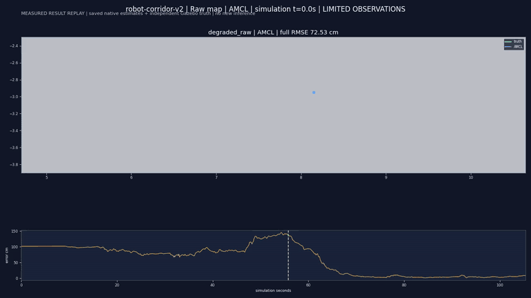</a> [完整视频](../results/reference/robot-corridor-v2/methods/degraded_raw/result.mp4) · [GIF](../results/reference/robot-corridor-v2/methods/degraded_raw/result.gif) · [记录](../results/reference/robot-corridor-v2/record.json) | 动态格删除 N/A；静态格保留 100.00% XY RMSE 72.53 cm |
| [走廊退化 · 2D · DUFOMap · 实录](HOME.zh-CN.md#scene-corridor-2d) | <a href="../results/reference/robot-corridor-v2/executions/degraded_dufomap.mp4">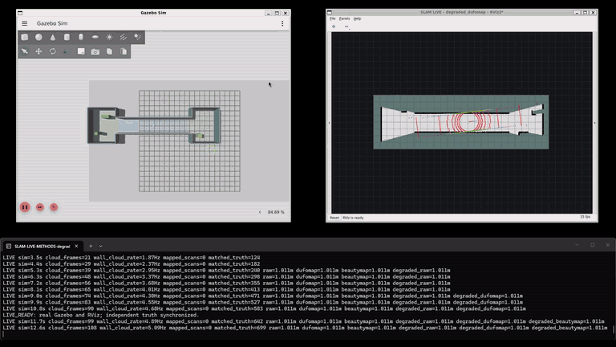</a> [完整视频](../results/reference/robot-corridor-v2/executions/degraded_dufomap.mp4) · [GIF](../results/reference/robot-corridor-v2/executions/degraded_dufomap.gif) · [记录](../results/reference/robot-corridor-v2/record.json) | 动态格删除 N/A；静态格保留 100.00% XY RMSE 72.53 cm |
| [走廊退化 · 2D · DUFOMap · 结果回放](HOME.zh-CN.md#scene-corridor-2d) | <a href="../results/reference/robot-corridor-v2/methods/degraded_dufomap/result.mp4">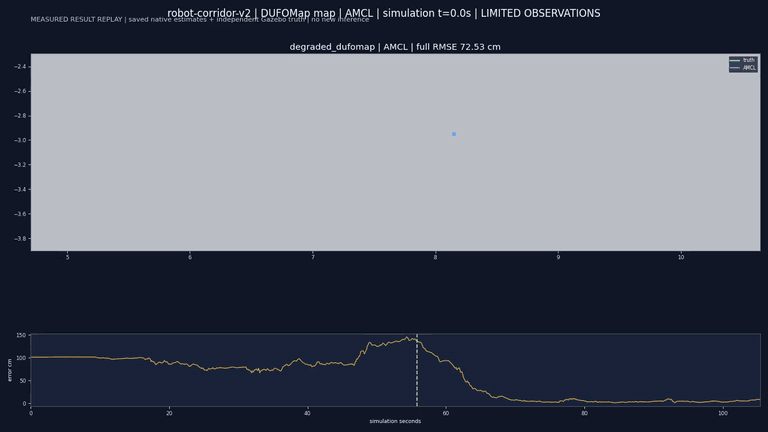</a> [完整视频](../results/reference/robot-corridor-v2/methods/degraded_dufomap/result.mp4) · [GIF](../results/reference/robot-corridor-v2/methods/degraded_dufomap/result.gif) · [记录](../results/reference/robot-corridor-v2/record.json) | 动态格删除 N/A；静态格保留 100.00% XY RMSE 72.53 cm |
| [走廊退化 · 2D · BeautyMap · 实录](HOME.zh-CN.md#scene-corridor-2d) | <a href="../results/reference/robot-corridor-v2/executions/degraded_beautymap.mp4">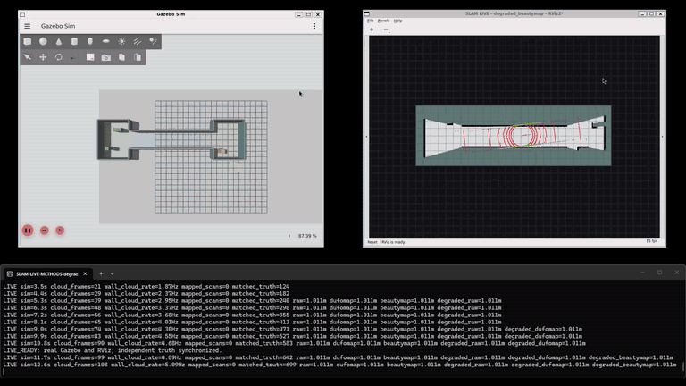</a> [完整视频](../results/reference/robot-corridor-v2/executions/degraded_beautymap.mp4) · [GIF](../results/reference/robot-corridor-v2/executions/degraded_beautymap.gif) · [记录](../results/reference/robot-corridor-v2/record.json) | 动态格删除 N/A；静态格保留 100.00% XY RMSE 72.53 cm |
| [走廊退化 · 2D · BeautyMap · 结果回放](HOME.zh-CN.md#scene-corridor-2d) | <a href="../results/reference/robot-corridor-v2/methods/degraded_beautymap/result.mp4">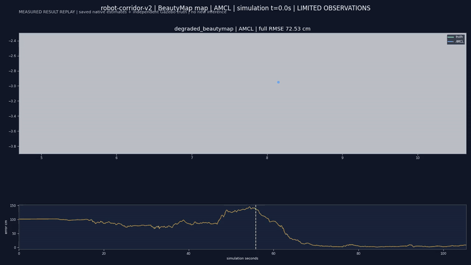</a> [完整视频](../results/reference/robot-corridor-v2/methods/degraded_beautymap/result.mp4) · [GIF](../results/reference/robot-corridor-v2/methods/degraded_beautymap/result.gif) · [记录](../results/reference/robot-corridor-v2/record.json) | 动态格删除 N/A；静态格保留 100.00% XY RMSE 72.53 cm |

| 三维地图＋GICP | GIF预览（点击看视频） | 指标效果 |
| --- | --- | --- |
| [纯静态 · 3D · Raw · 实录](HOME.zh-CN.md#scene-static-3d) | <a href="../results/reference/robot-3d-static/executions/raw.mp4">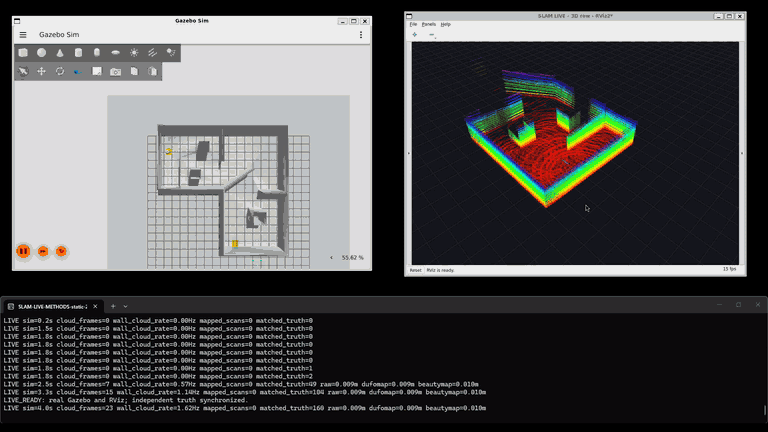</a> [完整视频](../results/reference/robot-3d-static/executions/raw.mp4) · [GIF](../results/reference/robot-3d-static/executions/raw.gif) · [记录](../results/reference/robot-3d-static/record.json) | 动态点删除 N/A；静态点保留 100.00% XYZ RMSE 0.95 cm |
| [纯静态 · 3D · DUFOMap · 实录](HOME.zh-CN.md#scene-static-3d) | <a href="../results/reference/robot-3d-static/executions/dufomap.mp4">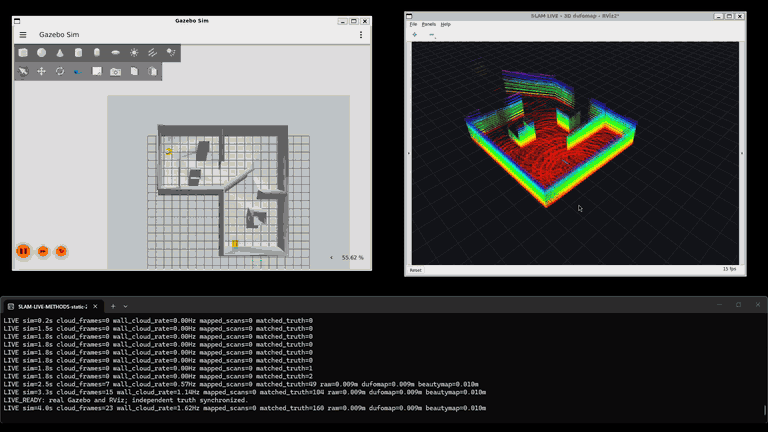</a> [完整视频](../results/reference/robot-3d-static/executions/dufomap.mp4) · [GIF](../results/reference/robot-3d-static/executions/dufomap.gif) · [记录](../results/reference/robot-3d-static/record.json) | 动态点删除 N/A；静态点保留 100.00% XYZ RMSE 0.99 cm |
| [纯静态 · 3D · BeautyMap · 实录](HOME.zh-CN.md#scene-static-3d) | <a href="../results/reference/robot-3d-static/executions/beautymap.mp4">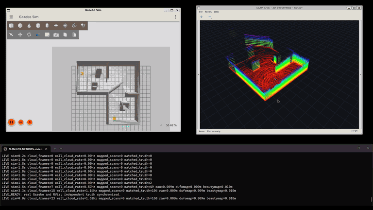</a> [完整视频](../results/reference/robot-3d-static/executions/beautymap.mp4) · [GIF](../results/reference/robot-3d-static/executions/beautymap.gif) · [记录](../results/reference/robot-3d-static/record.json) | 动态点删除 N/A；静态点保留 83.33% XYZ RMSE 1.07 cm |
| [运动障碍物 · 3D · Raw · 实录](HOME.zh-CN.md#scene-dynamic-3d) | <a href="../results/reference/robot-3d-dynamic/executions/raw.mp4">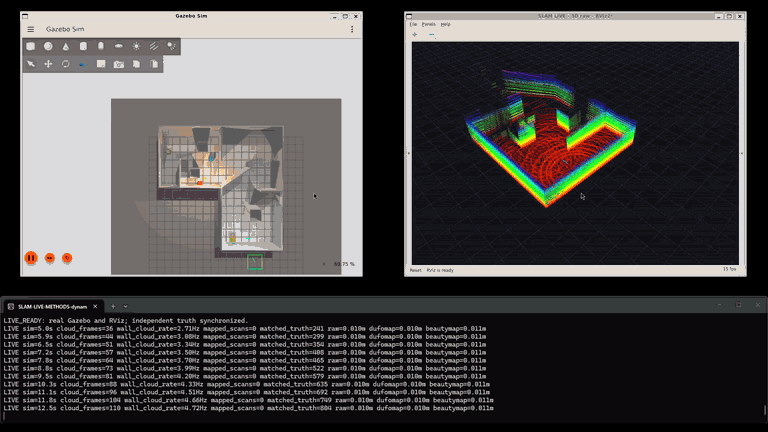</a> [完整视频](../results/reference/robot-3d-dynamic/executions/raw.mp4) · [GIF](../results/reference/robot-3d-dynamic/executions/raw.gif) · [记录](../results/reference/robot-3d-dynamic/record.json) | 动态点删除 0.00%；静态点保留 100.00% XYZ RMSE 0.98 cm |
| [运动障碍物 · 3D · DUFOMap · 实录](HOME.zh-CN.md#scene-dynamic-3d) | <a href="../results/reference/robot-3d-dynamic/executions/dufomap.mp4">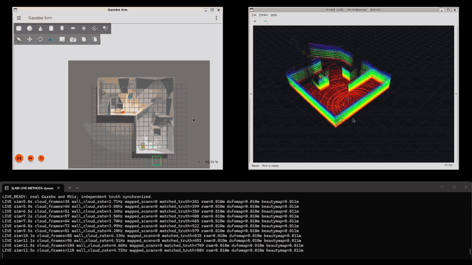</a> [完整视频](../results/reference/robot-3d-dynamic/executions/dufomap.mp4) · [GIF](../results/reference/robot-3d-dynamic/executions/dufomap.gif) · [记录](../results/reference/robot-3d-dynamic/record.json) | 动态点删除 46.59%；静态点保留 100.00% XYZ RMSE 0.98 cm |
| [运动障碍物 · 3D · BeautyMap · 实录](HOME.zh-CN.md#scene-dynamic-3d) | <a href="../results/reference/robot-3d-dynamic/executions/beautymap.mp4">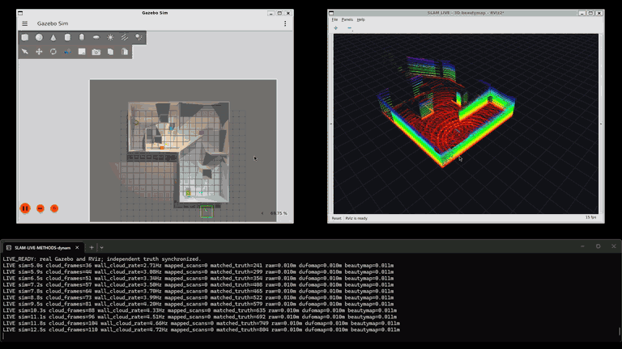</a> [完整视频](../results/reference/robot-3d-dynamic/executions/beautymap.mp4) · [GIF](../results/reference/robot-3d-dynamic/executions/beautymap.gif) · [记录](../results/reference/robot-3d-dynamic/record.json) | 动态点删除 74.36%；静态点保留 81.15% XYZ RMSE 1.04 cm |
| [持久结构变化 · 3D · Raw · 实录](HOME.zh-CN.md#scene-change-3d) |  [完整视频](../results/reference/robot-3d-large-change/executions/raw.mp4) · [GIF](../results/reference/robot-3d-large-change/executions/raw.gif) · [记录](../results/reference/robot-3d-large-change/record.json) | 动态点删除 N/A；静态点保留 100.00%（静态A旧图） XYZ RMSE 0.93 cm |
| [持久结构变化 · 3D · DUFOMap · 实录](HOME.zh-CN.md#scene-change-3d) | <a href="../results/reference/robot-3d-large-change/executions/dufomap.mp4">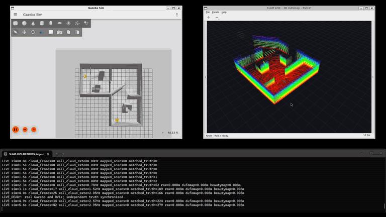</a> [完整视频](../results/reference/robot-3d-large-change/executions/dufomap.mp4) · [GIF](../results/reference/robot-3d-large-change/executions/dufomap.gif) · [记录](../results/reference/robot-3d-large-change/record.json) | 动态点删除 N/A；静态点保留 100.00%（静态A旧图） XYZ RMSE 1.01 cm |
| [持久结构变化 · 3D · BeautyMap · 实录](HOME.zh-CN.md#scene-change-3d) | <a href="../results/reference/robot-3d-large-change/executions/beautymap.mp4">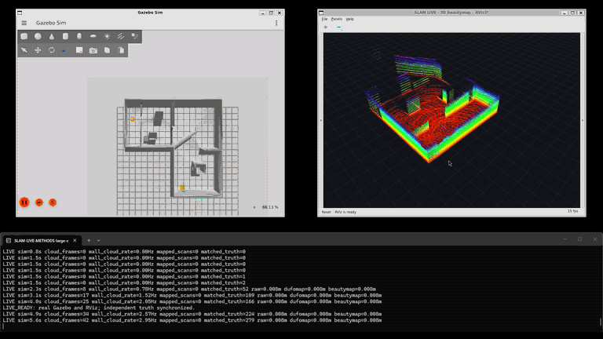</a> [完整视频](../results/reference/robot-3d-large-change/executions/beautymap.mp4) · [GIF](../results/reference/robot-3d-large-change/executions/beautymap.gif) · [记录](../results/reference/robot-3d-large-change/record.json) | 动态点删除 N/A；静态点保留 83.33%（静态A旧图） XYZ RMSE 1.04 cm |
| [走廊退化 · 3D · Raw · 实录](HOME.zh-CN.md#scene-corridor-3d) |  [完整视频](../results/reference/robot-3d-corridor/executions/raw.mp4) · [GIF](../results/reference/robot-3d-corridor/executions/raw.gif) · [记录](../results/reference/robot-3d-corridor/record.json) | 动态点删除 N/A；静态点保留 100.00% XYZ RMSE 474.38 cm；输出覆盖不同，不排名 |
| [走廊退化 · 3D · DUFOMap · 实录](HOME.zh-CN.md#scene-corridor-3d) | <a href="../results/reference/robot-3d-corridor/executions/dufomap.mp4">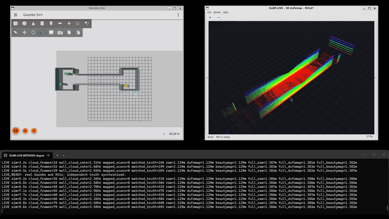</a> [完整视频](../results/reference/robot-3d-corridor/executions/dufomap.mp4) · [GIF](../results/reference/robot-3d-corridor/executions/dufomap.gif) · [记录](../results/reference/robot-3d-corridor/record.json) | 动态点删除 N/A；静态点保留 100.00% XYZ RMSE 497.05 cm；输出覆盖不同，不排名 |
| [走廊退化 · 3D · BeautyMap · 实录](HOME.zh-CN.md#scene-corridor-3d) | <a href="../results/reference/robot-3d-corridor/executions/beautymap.mp4">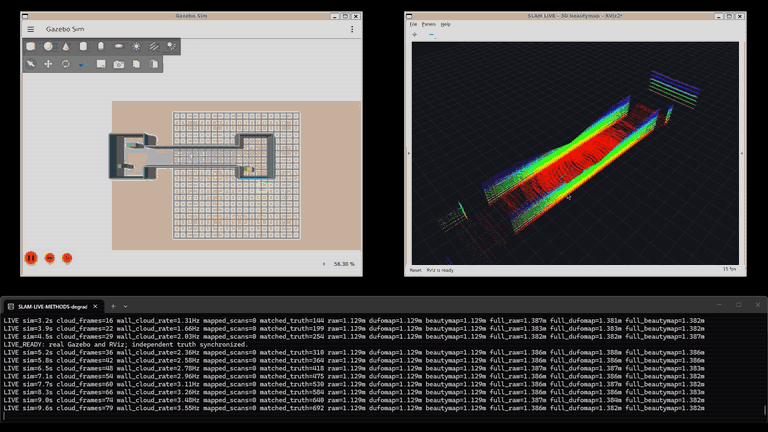</a> [完整视频](../results/reference/robot-3d-corridor/executions/beautymap.mp4) · [GIF](../results/reference/robot-3d-corridor/executions/beautymap.gif) · [记录](../results/reference/robot-3d-corridor/record.json) | 动态点删除 N/A；静态点保留 99.90% XYZ RMSE 592.00 cm；输出覆盖不同，不排名 |

| 三维地图清理效果 | GIF预览（点击看视频） | 指标效果 |
| --- | --- | --- |
| [Raw／DUFOMap／BeautyMap · 三维清理结果](HOME.zh-CN.md#map-review-3d) | <a href="../results/reference/robot-3d-map-review-v2/execution.mp4">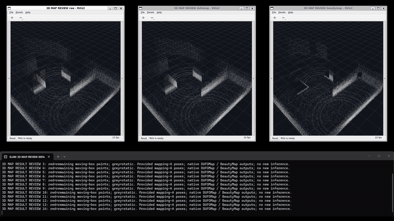</a> [完整视频](../results/reference/robot-3d-map-review-v2/execution.mp4) · [GIF](../results/reference/robot-3d-map-review-v2/execution.gif) · [记录](../results/reference/robot-3d-map-review-v2/record.json) | 动态删除：0／46.59／74.36%；静态保留：100／99.998／81.15%；保存结果展示 |

| NDT／GICP早期实践 | GIF预览（点击看视频） | 指标效果 |
| --- | --- | --- |
| robot-ndt-static / execution.gif | <a href="../results/reference/robot-ndt-static/execution.mp4">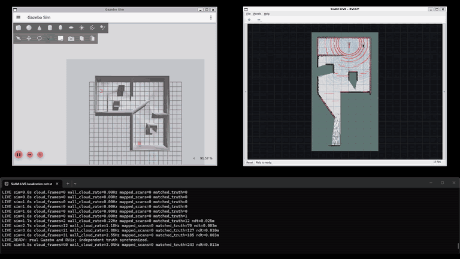</a> [完整视频](../results/reference/robot-ndt-static/execution.mp4) · [GIF](../results/reference/robot-ndt-static/execution.gif) · [记录](../results/reference/robot-ndt-static/record.json) | 定位RMSE（清理指标不适用／未标注）：ndt 0.93cm |
| robot-ndt-static / result.gif | <a href="../results/reference/robot-ndt-static/result.mp4">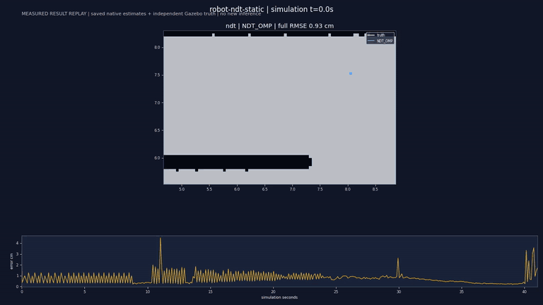</a> [完整视频](../results/reference/robot-ndt-static/result.mp4) · [GIF](../results/reference/robot-ndt-static/result.gif) · [记录](../results/reference/robot-ndt-static/record.json) | 定位RMSE（清理指标不适用／未标注）：ndt 0.93cm |
| robot-gicp-static / execution.gif | <a href="../results/reference/robot-gicp-static/execution.mp4">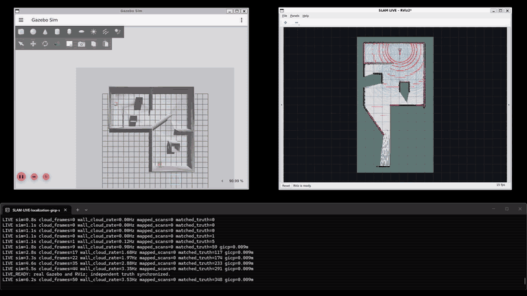</a> [完整视频](../results/reference/robot-gicp-static/execution.mp4) · [GIF](../results/reference/robot-gicp-static/execution.gif) · [记录](../results/reference/robot-gicp-static/record.json) | 定位RMSE（清理指标不适用／未标注）：gicp 1.09cm |
| robot-gicp-static / result.gif | <a href="../results/reference/robot-gicp-static/result.mp4">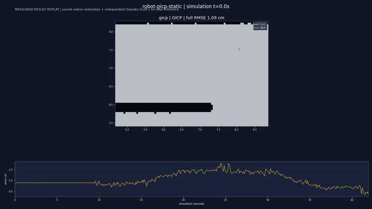</a> [完整视频](../results/reference/robot-gicp-static/result.mp4) · [GIF](../results/reference/robot-gicp-static/result.gif) · [记录](../results/reference/robot-gicp-static/record.json) | 定位RMSE（清理指标不适用／未标注）：gicp 1.09cm |

| 简单传感器实践 | GIF预览（点击看视频） | 指标效果 |
| --- | --- | --- |
| robot-supp-static / execution.gif | <a href="../results/reference/robot-supp-static/execution.mp4">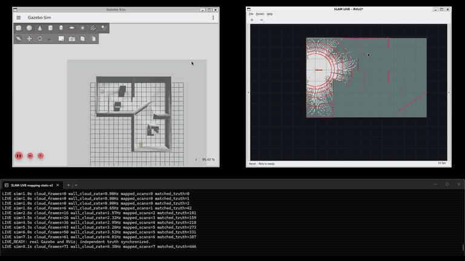</a> [完整视频](../results/reference/robot-supp-static/execution.mp4) · [GIF](../results/reference/robot-supp-static/execution.gif) · [记录](../results/reference/robot-supp-static/record.json) | 传感器／建图过程演示；未评分 |
| robot-supp-dynamic / execution.gif | <a href="../results/reference/robot-supp-dynamic/execution.mp4">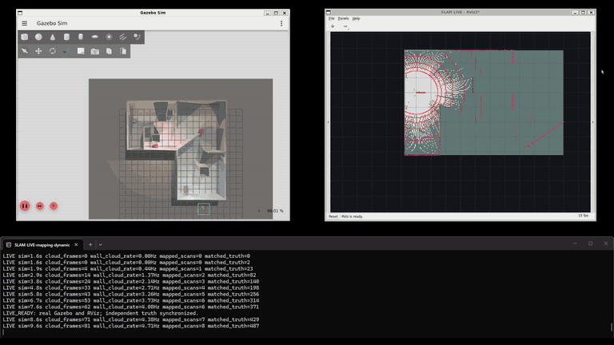</a> [完整视频](../results/reference/robot-supp-dynamic/execution.mp4) · [GIF](../results/reference/robot-supp-dynamic/execution.gif) · [记录](../results/reference/robot-supp-dynamic/record.json) | 传感器／建图过程演示；未评分 |
| robot-supp-large-change / execution.gif | <a href="../results/reference/robot-supp-large-change/execution.mp4">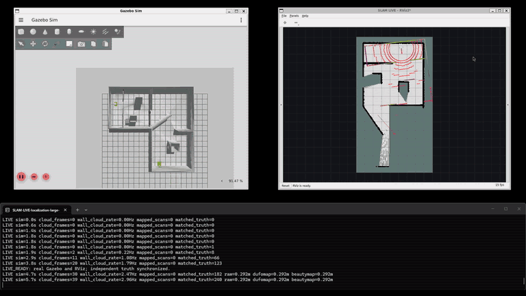</a> [完整视频](../results/reference/robot-supp-large-change/execution.mp4) · [GIF](../results/reference/robot-supp-large-change/execution.gif) · [记录](../results/reference/robot-supp-large-change/record.json) | 定位RMSE（清理指标不适用／未标注）：raw 6.99cm / dufomap 6.99cm / beautymap 7.04cm |

| 二维＋深度 · 定位假设实践 | GIF预览（点击看视频） | 指标效果 |
| --- | --- | --- |
| [probe-calibrated-2d-static：真实窗口录制](HOME.zh-CN.md#probe-calibrated-2d-static) |  [完整视频](../results/reference/probe-calibrated-2d-static/execution.mp4) · [GIF](../results/reference/probe-calibrated-2d-static/execution.gif) · [记录](../results/reference/probe-calibrated-2d-static/record.json) | 定位原型；地图清理指标不适用；plain 0.15cm / guard 0.15cm / depth 0.21cm / search 0.15cm / recover 0.21cm / native 6.82cm |
| [probe-calibrated-2d-dynamic：真实窗口录制](HOME.zh-CN.md#probe-calibrated-2d-dynamic) | <a href="../results/reference/probe-calibrated-2d-dynamic/execution.mp4">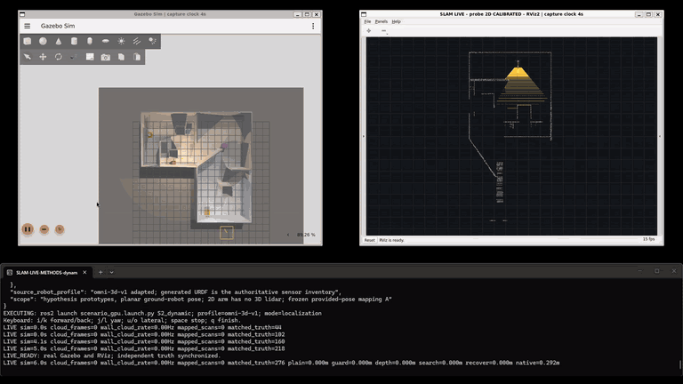</a> [完整视频](../results/reference/probe-calibrated-2d-dynamic/execution.mp4) · [GIF](../results/reference/probe-calibrated-2d-dynamic/execution.gif) · [记录](../results/reference/probe-calibrated-2d-dynamic/record.json) | 定位原型；地图清理指标不适用；plain 0.37cm / guard 0.19cm / depth 0.18cm / search 0.19cm / recover 0.18cm / native 7.08cm |
| [probe-calibrated-2d-large-change：真实窗口录制](HOME.zh-CN.md#probe-calibrated-2d-large-change) |  [完整视频](../results/reference/probe-calibrated-2d-large-change/execution.mp4) · [GIF](../results/reference/probe-calibrated-2d-large-change/execution.gif) · [记录](../results/reference/probe-calibrated-2d-large-change/record.json) | 定位原型；地图清理指标不适用；plain 7.98cm / guard 0.49cm / depth 0.49cm / search 0.49cm / recover 0.49cm / native 6.28cm |
| [probe-calibrated-2d-corridor：真实窗口录制](HOME.zh-CN.md#probe-calibrated-2d-corridor) | <a href="../results/reference/probe-calibrated-2d-corridor/execution.mp4">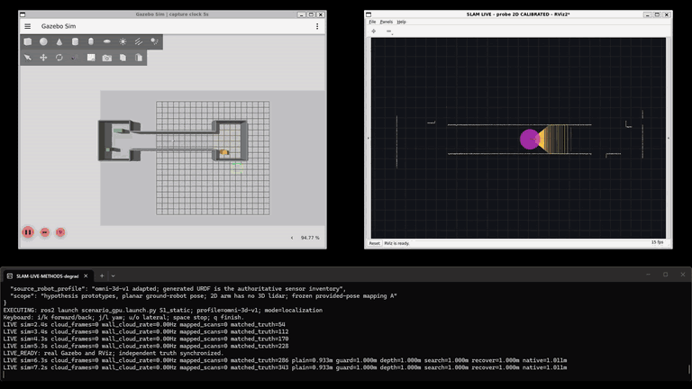</a> [完整视频](../results/reference/probe-calibrated-2d-corridor/execution.mp4) · [GIF](../results/reference/probe-calibrated-2d-corridor/execution.gif) · [记录](../results/reference/probe-calibrated-2d-corridor/record.json) | 定位原型；地图清理指标不适用；plain 1037.69cm / guard 100.48cm / depth 100.54cm / search 70.40cm / recover 70.44cm / native 100.61cm |
| [probe-calibrated-2d-height-corridor：真实窗口录制](HOME.zh-CN.md#probe-calibrated-2d-height-corridor) | <a href="../results/reference/probe-calibrated-2d-height-corridor/execution.mp4">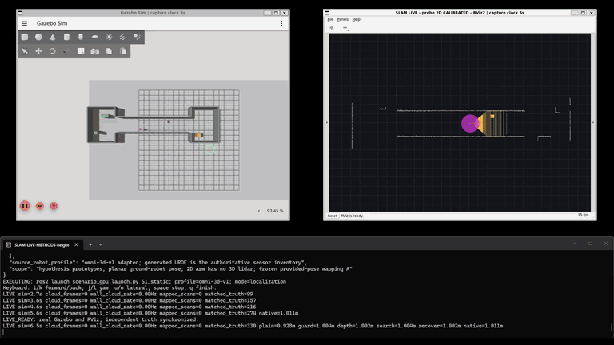</a> [完整视频](../results/reference/probe-calibrated-2d-height-corridor/execution.mp4) · [GIF](../results/reference/probe-calibrated-2d-height-corridor/execution.gif) · [记录](../results/reference/probe-calibrated-2d-height-corridor/record.json) | 定位原型；地图清理指标不适用；plain 285.54cm / guard 101.15cm / depth 100.77cm / search 70.93cm / recover 21.15cm / native 67.00cm |

| 三维＋深度 · 定位假设实践 | GIF预览（点击看视频） | 指标效果 |
| --- | --- | --- |
| [probe-calibrated-3d-static：真实窗口录制](HOME.zh-CN.md#probe-calibrated-3d-static) | <a href="../results/reference/probe-calibrated-3d-static/execution.mp4">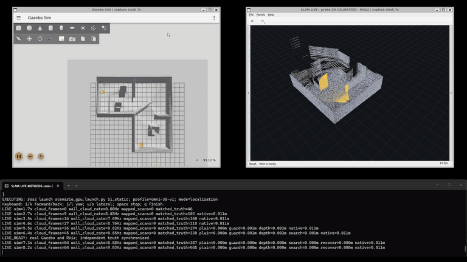</a> [完整视频](../results/reference/probe-calibrated-3d-static/execution.mp4) · [GIF](../results/reference/probe-calibrated-3d-static/execution.gif) · [记录](../results/reference/probe-calibrated-3d-static/record.json) | 定位原型；地图清理指标不适用；plain 0.12cm / guard 0.12cm / depth 0.21cm / search 0.12cm / recover 0.21cm / native 1.08cm |
| [probe-calibrated-3d-dynamic：真实窗口录制](HOME.zh-CN.md#probe-calibrated-3d-dynamic) | <a href="../results/reference/probe-calibrated-3d-dynamic/execution.mp4">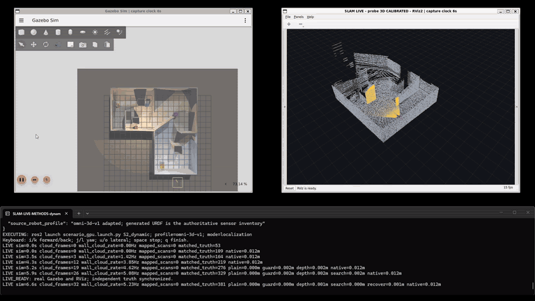</a> [完整视频](../results/reference/probe-calibrated-3d-dynamic/execution.mp4) · [GIF](../results/reference/probe-calibrated-3d-dynamic/execution.gif) · [记录](../results/reference/probe-calibrated-3d-dynamic/record.json) | 定位原型；地图清理指标不适用；plain 0.17cm / guard 0.13cm / depth 0.13cm / search 0.13cm / recover 0.13cm / native 1.39cm |
| [probe-calibrated-3d-large-change：真实窗口录制](HOME.zh-CN.md#probe-calibrated-3d-large-change) | <a href="../results/reference/probe-calibrated-3d-large-change/execution.mp4">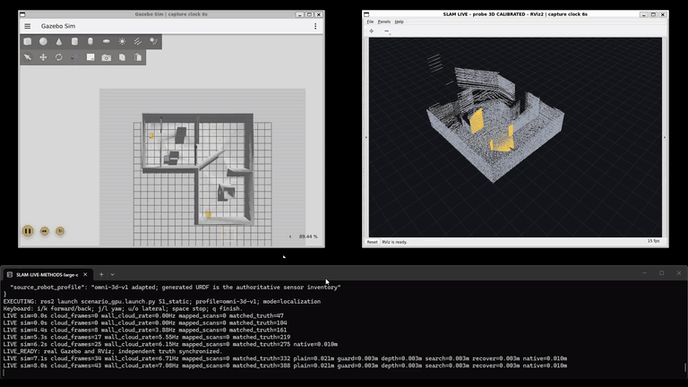</a> [完整视频](../results/reference/probe-calibrated-3d-large-change/execution.mp4) · [GIF](../results/reference/probe-calibrated-3d-large-change/execution.gif) · [记录](../results/reference/probe-calibrated-3d-large-change/record.json) | 定位原型；地图清理指标不适用；plain 3.69cm / guard 0.24cm / depth 0.35cm / search 0.24cm / recover 0.35cm / native 1.25cm |
| [probe-calibrated-3d-corridor：真实窗口录制](HOME.zh-CN.md#probe-calibrated-3d-corridor) | <a href="../results/reference/probe-calibrated-3d-corridor/execution.mp4">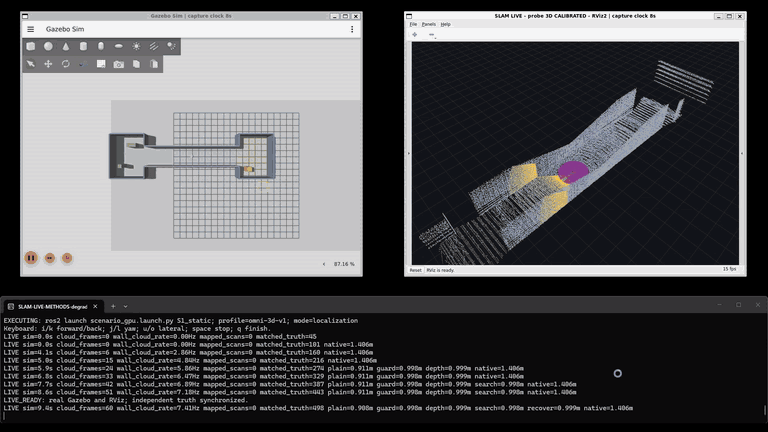</a> [完整视频](../results/reference/probe-calibrated-3d-corridor/execution.mp4) · [GIF](../results/reference/probe-calibrated-3d-corridor/execution.gif) · [记录](../results/reference/probe-calibrated-3d-corridor/record.json) | 定位原型；地图清理指标不适用；plain 733.38cm / guard 100.49cm / depth 100.62cm / search 56.77cm / recover 57.56cm / native 397.82cm |
| [probe-calibrated-3d-height-corridor：真实窗口录制](HOME.zh-CN.md#probe-calibrated-3d-height-corridor) | <a href="../results/reference/probe-calibrated-3d-height-corridor/execution.mp4">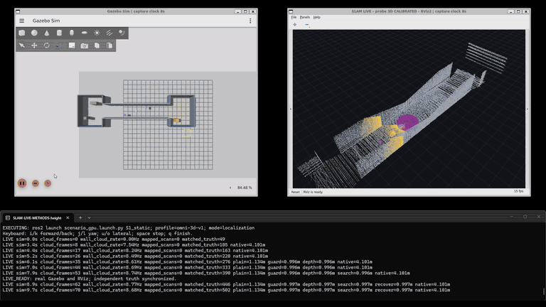</a> [完整视频](../results/reference/probe-calibrated-3d-height-corridor/execution.mp4) · [GIF](../results/reference/probe-calibrated-3d-height-corridor/execution.gif) · [记录](../results/reference/probe-calibrated-3d-height-corridor/record.json) | 定位原型；地图清理指标不适用；plain 46.60cm / guard 100.36cm / depth 100.38cm / search 47.70cm / recover 50.79cm / native 512.79cm |

| 同输入候选细化 · 结果回放 | GIF预览（点击看视频） | 指标效果 |
| --- | --- | --- |
| [probe-calibrated-refinement-2d-corridor：离线重算后的保存输出回放](HOME.zh-CN.md#probe-calibrated-refinement-2d-corridor) | <a href="../results/reference/probe-calibrated-refinement-2d-corridor/result.mp4">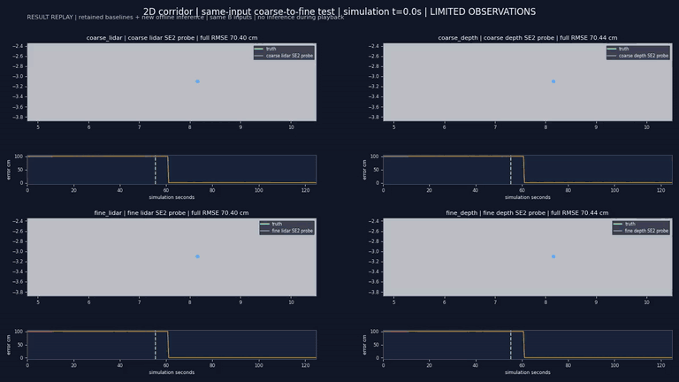</a> [完整视频](../results/reference/probe-calibrated-refinement-2d-corridor/result.mp4) · [GIF](../results/reference/probe-calibrated-refinement-2d-corridor/result.gif) · [记录](../results/reference/probe-calibrated-refinement-2d-corridor/record.json) | 传感器／建图过程演示；未评分 |
| [probe-calibrated-refinement-2d-height-corridor：离线重算后的保存输出回放](HOME.zh-CN.md#probe-calibrated-refinement-2d-height-corridor) | <a href="../results/reference/probe-calibrated-refinement-2d-height-corridor/result.mp4">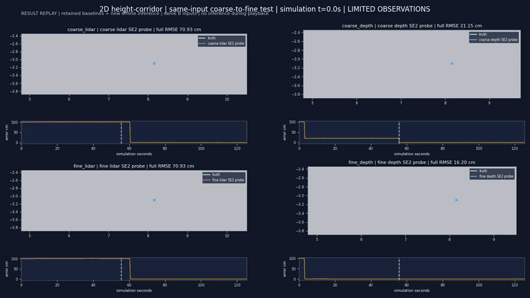</a> [完整视频](../results/reference/probe-calibrated-refinement-2d-height-corridor/result.mp4) · [GIF](../results/reference/probe-calibrated-refinement-2d-height-corridor/result.gif) · [记录](../results/reference/probe-calibrated-refinement-2d-height-corridor/record.json) | 传感器／建图过程演示；未评分 |
| [probe-calibrated-refinement-3d-corridor：离线重算后的保存输出回放](HOME.zh-CN.md#probe-calibrated-refinement-3d-corridor) |  [完整视频](../results/reference/probe-calibrated-refinement-3d-corridor/result.mp4) · [GIF](../results/reference/probe-calibrated-refinement-3d-corridor/result.gif) · [记录](../results/reference/probe-calibrated-refinement-3d-corridor/record.json) | 传感器／建图过程演示；未评分 |
| [probe-calibrated-refinement-3d-height-corridor：离线重算后的保存输出回放](HOME.zh-CN.md#probe-calibrated-refinement-3d-height-corridor) |  [完整视频](../results/reference/probe-calibrated-refinement-3d-height-corridor/result.mp4) · [GIF](../results/reference/probe-calibrated-refinement-3d-height-corridor/result.gif) · [记录](../results/reference/probe-calibrated-refinement-3d-height-corridor/record.json) | 传感器／建图过程演示；未评分 |

| 实机传感器采集 | GIF预览（点击看视频） | 指标效果 |
| --- | --- | --- |
| 简单实物测试 |  [完整视频](../docs/media/hardware/d435-input.mp4) · [GIF](../docs/media/hardware/d435-input.gif) | 实机传感器录制；清理指标不适用 |
| docs/media/hardware/d435.gif |  [完整视频](../docs/media/hardware/d435.mp4) · [GIF](../docs/media/hardware/d435.gif) | 实机传感器录制；清理指标不适用 |
| 简单实物测试 |  [完整视频](../docs/media/hardware/l2.mp4) · [GIF](../docs/media/hardware/l2.gif) | 实机传感器录制；清理指标不适用 |

历史实践与失败诊断 · 104 GIF

| 实践 | GIF预览（点击看视频） | 指标效果 |
| --- | --- | --- |
| results/localization/self-recovery/S1_static.gif |  [完整视频](../results/localization/self-recovery/S1_static.mp4) · [GIF](../results/localization/self-recovery/S1_static.gif) | 早期场景演示；未绑定地图清理评分，保留原片 |
| results/localization/self-recovery/S2_dynamic.gif |  [完整视频](../results/localization/self-recovery/S2_dynamic.mp4) · [GIF](../results/localization/self-recovery/S2_dynamic.gif) | 早期场景演示；未绑定地图清理评分，保留原片 |
| results/localization/self-recovery/S3_large_change.gif |  [完整视频](../results/localization/self-recovery/S3_large_change.mp4) · [GIF](../results/localization/self-recovery/S3_large_change.gif) | 早期场景演示；未绑定地图清理评分，保留原片 |
| results/localization/self-recovery/S4_degradation.gif |  [完整视频](../results/localization/self-recovery/S4_degradation.mp4) · [GIF](../results/localization/self-recovery/S4_degradation.gif) | 早期场景演示；未绑定地图清理评分，保留原片 |
| results/localization/static-dynamic/clean-map-dynamic-test.gif |  [完整视频](../results/localization/static-dynamic/clean-map-dynamic-test.mp4) · [GIF](../results/localization/static-dynamic/clean-map-dynamic-test.gif) | 早期场景演示；未绑定地图清理评分，保留原片 |
| results/localization/static-dynamic/dynamic-lidar.gif |  [完整视频](../results/localization/static-dynamic/dynamic-lidar.mp4) · [GIF](../results/localization/static-dynamic/dynamic-lidar.gif) | 早期场景演示；未绑定地图清理评分，保留原片 |
| results/localization/static-dynamic/dynamic-rgbd.gif |  [完整视频](../results/localization/static-dynamic/dynamic-rgbd.mp4) · [GIF](../results/localization/static-dynamic/dynamic-rgbd.gif) | 早期场景演示；未绑定地图清理评分，保留原片 |
| results/localization/static-dynamic/static.gif |  [完整视频](../results/localization/static-dynamic/static.mp4) · [GIF](../results/localization/static-dynamic/static.gif) | 早期场景演示；未绑定地图清理评分，保留原片 |
| AdaM-MCL 评测会话录制 |  [完整视频](../results/reference/adam-mcl/media/preview.gif) · [GIF](../results/reference/adam-mcl/media/preview.gif) · [记录](../results/reference/adam-mcl/record.json) | 历史10轮定位RMSE均值34.82格（已勘误）；清理指标不适用 |
| BeautyMap 已保存结果回放 |  [完整视频](../results/reference/beautymap/media/preview.gif) · [GIF](../results/reference/beautymap/media/preview.gif) · [记录](../results/reference/beautymap/record.json) | 动态点删除 98.34%；静态点保留 96.95% |
| beautymap / media/replay/preview.gif |  [完整视频](../results/reference/beautymap/media/replay/replay.mp4) · [GIF](../results/reference/beautymap/media/replay/preview.gif) · [记录](../results/reference/beautymap/record.json) | 动态点删除 98.34%；静态点保留 96.95% |
| desktop-beautymap：现场执行 |  [完整视频](../results/reference/desktop-beautymap/execution.mp4) · [GIF](../results/reference/desktop-beautymap/execution.gif) · [记录](../results/reference/desktop-beautymap/record.json) | 传感器／建图过程演示；未评分 |
| desktop-beautymap：本次结果回放 |  [完整视频](../results/reference/desktop-beautymap/result.mp4) · [GIF](../results/reference/desktop-beautymap/result.gif) · [记录](../results/reference/desktop-beautymap/record.json) | 传感器／建图过程演示；未评分 |
| desktop-dufomap：现场执行 |  [完整视频](../results/reference/desktop-dufomap/execution.mp4) · [GIF](../results/reference/desktop-dufomap/execution.gif) · [记录](../results/reference/desktop-dufomap/record.json) | 传感器／建图过程演示；未评分 |
| desktop-dufomap：本次结果回放 |  [完整视频](../results/reference/desktop-dufomap/result.mp4) · [GIF](../results/reference/desktop-dufomap/result.gif) · [记录](../results/reference/desktop-dufomap/record.json) | 传感器／建图过程演示；未评分 |
| desktop-ir-mcl：现场执行 |  [完整视频](../results/reference/desktop-ir-mcl/execution.mp4) · [GIF](../results/reference/desktop-ir-mcl/execution.gif) · [记录](../results/reference/desktop-ir-mcl/record.json) | 传感器／建图过程演示；未评分 |
| desktop-ir-mcl：本次结果回放 |  [完整视频](../results/reference/desktop-ir-mcl/result.mp4) · [GIF](../results/reference/desktop-ir-mcl/result.gif) · [记录](../results/reference/desktop-ir-mcl/record.json) | 传感器／建图过程演示；未评分 |
| DUFOMap 已保存结果回放 |  [完整视频](../results/reference/dufomap/media/preview.gif) · [GIF](../results/reference/dufomap/media/preview.gif) · [记录](../results/reference/dufomap/record.json) | 动态点删除 98.70%；静态点保留 97.98% |
| dufomap / media/replay/preview.gif |  [完整视频](../results/reference/dufomap/media/replay/replay.mp4) · [GIF](../results/reference/dufomap/media/replay/preview.gif) · [记录](../results/reference/dufomap/record.json) | 动态点删除 98.70%；静态点保留 97.98% |
| IR-MCL 已保存定位结果回放 |  [完整视频](../results/reference/ir-mcl/media/preview.gif) · [GIF](../results/reference/ir-mcl/media/preview.gif) · [记录](../results/reference/ir-mcl/record.json) | 定位RMSE 5.32cm / 1.07°；清理指标不适用 |
| probe-2d-corridor：真实窗口录制 |  [完整视频](../results/reference/probe-2d-corridor/execution.mp4) · [GIF](../results/reference/probe-2d-corridor/execution.gif) · [记录](../results/reference/probe-2d-corridor/record.json) | 定位原型；地图清理指标不适用；plain 918.76cm / guard 100.53cm / depth 100.58cm / search 70.33cm / recover 70.35cm / native 66.02cm |
| probe-2d-dynamic：真实窗口录制 |  [完整视频](../results/reference/probe-2d-dynamic/execution.mp4) · [GIF](../results/reference/probe-2d-dynamic/execution.gif) · [记录](../results/reference/probe-2d-dynamic/record.json) | 定位原型；地图清理指标不适用；plain 0.37cm / guard 0.19cm / depth 0.19cm / search 0.19cm / recover 0.19cm / native 7.12cm |
| probe-2d-height-corridor：真实窗口录制 |  [完整视频](../results/reference/probe-2d-height-corridor/execution.mp4) · [GIF](../results/reference/probe-2d-height-corridor/execution.gif) · [记录](../results/reference/probe-2d-height-corridor/record.json) | 定位原型；地图清理指标不适用；plain 290.69cm / guard 101.03cm / depth 100.65cm / search 71.00cm / recover 21.21cm / native 67.25cm |
| probe-2d-large-change：真实窗口录制 |  [完整视频](../results/reference/probe-2d-large-change/execution.mp4) · [GIF](../results/reference/probe-2d-large-change/execution.gif) · [记录](../results/reference/probe-2d-large-change/record.json) | 定位原型；地图清理指标不适用；plain 8.05cm / guard 0.47cm / depth 0.48cm / search 0.47cm / recover 0.48cm / native 6.74cm |
| probe-2d-static：真实窗口录制 |  [完整视频](../results/reference/probe-2d-static/execution.mp4) · [GIF](../results/reference/probe-2d-static/execution.gif) · [记录](../results/reference/probe-2d-static/record.json) | 定位原型；地图清理指标不适用；plain 0.14cm / guard 0.14cm / depth 0.22cm / search 0.14cm / recover 0.22cm / native 6.72cm |
| probe-3d-corridor：真实窗口录制 |  [完整视频](../results/reference/probe-3d-corridor/execution.mp4) · [GIF](../results/reference/probe-3d-corridor/execution.gif) · [记录](../results/reference/probe-3d-corridor/record.json) | 定位原型；地图清理指标不适用；plain 48.45cm / guard 101.03cm / depth 101.01cm / search 58.76cm / recover 60.78cm / native 411.72cm |
| probe-3d-dynamic：真实窗口录制 |  [完整视频](../results/reference/probe-3d-dynamic/execution.mp4) · [GIF](../results/reference/probe-3d-dynamic/execution.gif) · [记录](../results/reference/probe-3d-dynamic/record.json) | 定位原型；地图清理指标不适用；plain 9.42cm / guard 9.41cm / depth 9.41cm / search 9.41cm / recover 9.41cm / native 1.36cm |
| probe-3d-height-corridor：真实窗口录制 |  [完整视频](../results/reference/probe-3d-height-corridor/execution.mp4) · [GIF](../results/reference/probe-3d-height-corridor/execution.gif) · [记录](../results/reference/probe-3d-height-corridor/record.json) | 定位原型；地图清理指标不适用；plain 47.22cm / guard 101.30cm / depth 101.14cm / search 65.60cm / recover 22.62cm / native 411.42cm |
| probe-3d-large-change：真实窗口录制 |  [完整视频](../results/reference/probe-3d-large-change/execution.mp4) · [GIF](../results/reference/probe-3d-large-change/execution.gif) · [记录](../results/reference/probe-3d-large-change/record.json) | 定位原型；地图清理指标不适用；plain 9.49cm / guard 9.42cm / depth 9.42cm / search 9.42cm / recover 9.42cm / native 1.06cm |
| probe-3d-static：真实窗口录制 |  [完整视频](../results/reference/probe-3d-static/execution.mp4) · [GIF](../results/reference/probe-3d-static/execution.gif) · [记录](../results/reference/probe-3d-static/record.json) | 定位原型；地图清理指标不适用；plain 9.42cm / guard 9.41cm / depth 9.42cm / search 9.41cm / recover 9.42cm / native 1.09cm |
| probe-mapping-corridor：真实窗口录制 |  [完整视频](../results/reference/probe-mapping-corridor/execution.mp4) · [GIF](../results/reference/probe-mapping-corridor/execution.gif) · [记录](../results/reference/probe-mapping-corridor/record.json) | 传感器／建图过程演示；未评分 |
| probe-mapping-dynamic：真实窗口录制 |  [完整视频](../results/reference/probe-mapping-dynamic/execution.mp4) · [GIF](../results/reference/probe-mapping-dynamic/execution.gif) · [记录](../results/reference/probe-mapping-dynamic/record.json) | 传感器／建图过程演示；未评分 |
| probe-mapping-height-corridor：真实窗口录制 |  [完整视频](../results/reference/probe-mapping-height-corridor/execution.mp4) · [GIF](../results/reference/probe-mapping-height-corridor/execution.gif) · [记录](../results/reference/probe-mapping-height-corridor/record.json) | 传感器／建图过程演示；未评分 |
| probe-mapping-static：真实窗口录制 |  [完整视频](../results/reference/probe-mapping-static/execution.mp4) · [GIF](../results/reference/probe-mapping-static/execution.gif) · [记录](../results/reference/probe-mapping-static/record.json) | 传感器／建图过程演示；未评分 |
| probe-refinement-2d-corridor：离线重算后的保存输出回放 |  [完整视频](../results/reference/probe-refinement-2d-corridor/result.mp4) · [GIF](../results/reference/probe-refinement-2d-corridor/result.gif) · [记录](../results/reference/probe-refinement-2d-corridor/record.json) | 传感器／建图过程演示；未评分 |
| probe-refinement-2d-height-corridor：离线重算后的保存输出回放 |  [完整视频](../results/reference/probe-refinement-2d-height-corridor/result.mp4) · [GIF](../results/reference/probe-refinement-2d-height-corridor/result.gif) · [记录](../results/reference/probe-refinement-2d-height-corridor/record.json) | 传感器／建图过程演示；未评分 |
| probe-refinement-3d-corridor：离线重算后的保存输出回放 |  [完整视频](../results/reference/probe-refinement-3d-corridor/result.mp4) · [GIF](../results/reference/probe-refinement-3d-corridor/result.gif) · [记录](../results/reference/probe-refinement-3d-corridor/record.json) | 传感器／建图过程演示；未评分 |
| probe-refinement-3d-height-corridor：离线重算后的保存输出回放 |  [完整视频](../results/reference/probe-refinement-3d-height-corridor/result.mp4) · [GIF](../results/reference/probe-refinement-3d-height-corridor/result.gif) · [记录](../results/reference/probe-refinement-3d-height-corridor/record.json) | 传感器／建图过程演示；未评分 |
| robot-2d-dynamic-matched / execution.gif |  [完整视频](../results/reference/robot-2d-dynamic-matched/execution.mp4) · [GIF](../results/reference/robot-2d-dynamic-matched/execution.gif) · [记录](../results/reference/robot-2d-dynamic-matched/record.json) | 动态删／静态留：Raw 0.00%/100.00%；DUFO 8.33%/100.00%；Beauty 33.33%/96.64% |
| robot-2d-dynamic-matched / result.gif |  [完整视频](../results/reference/robot-2d-dynamic-matched/result.mp4) · [GIF](../results/reference/robot-2d-dynamic-matched/result.gif) · [记录](../results/reference/robot-2d-dynamic-matched/record.json) | 动态删／静态留：Raw 0.00%/100.00%；DUFO 8.33%/100.00%；Beauty 33.33%/96.64% |
| robot-3d-corridor / execution.gif |  [完整视频](../results/reference/robot-3d-corridor/execution.mp4) · [GIF](../results/reference/robot-3d-corridor/execution.gif) · [记录](../results/reference/robot-3d-corridor/record.json) | 动态删／静态留：Raw N/A/100.00%；DUFO N/A/100.00%；Beauty N/A/99.90% |
| robot-3d-dynamic / execution.gif |  [完整视频](../results/reference/robot-3d-dynamic/execution.mp4) · [GIF](../results/reference/robot-3d-dynamic/execution.gif) · [记录](../results/reference/robot-3d-dynamic/record.json) | 动态删／静态留：Raw 0.00%/100.00%；DUFO 46.59%/100.00%；Beauty 74.36%/81.15% |
| robot-3d-dynamic-mapping / execution.gif |  [完整视频](../results/reference/robot-3d-dynamic-mapping/execution.mp4) · [GIF](../results/reference/robot-3d-dynamic-mapping/execution.gif) · [记录](../results/reference/robot-3d-dynamic-mapping/record.json) | 传感器／建图过程演示；未评分 |
| robot-3d-large-change / execution.gif |  [完整视频](../results/reference/robot-3d-large-change/execution.mp4) · [GIF](../results/reference/robot-3d-large-change/execution.gif) · [记录](../results/reference/robot-3d-large-change/record.json) | 动态删／静态留：Raw N/A/100.00%；DUFO N/A/100.00%；Beauty N/A/83.33% |
| robot-3d-static / execution.gif |  [完整视频](../results/reference/robot-3d-static/execution.mp4) · [GIF](../results/reference/robot-3d-static/execution.gif) · [记录](../results/reference/robot-3d-static/record.json) | 动态删／静态留：Raw N/A/100.00%；DUFO N/A/100.00%；Beauty N/A/83.33% |
| robot-corridor-mapping：现场执行 |  [完整视频](../results/reference/robot-corridor-mapping/execution.mp4) · [GIF](../results/reference/robot-corridor-mapping/execution.gif) · [记录](../results/reference/robot-corridor-mapping/record.json) | 传感器／建图过程演示；未评分 |
| robot-corridor-v2 / execution.gif |  [完整视频](../results/reference/robot-corridor-v2/execution.mp4) · [GIF](../results/reference/robot-corridor-v2/execution.gif) · [记录](../results/reference/robot-corridor-v2/record.json) | 动态删／静态留：Raw N/A/100.00%；DUFO N/A/100.00%；Beauty N/A/100.00% |
| robot-corridor-v2 / result.gif |  [完整视频](../results/reference/robot-corridor-v2/result.mp4) · [GIF](../results/reference/robot-corridor-v2/result.gif) · [记录](../results/reference/robot-corridor-v2/record.json) | 动态删／静态留：Raw N/A/100.00%；DUFO N/A/100.00%；Beauty N/A/100.00% |
| robot-corridor-v2-mapping / execution.gif |  [完整视频](../results/reference/robot-corridor-v2-mapping/execution.mp4) · [GIF](../results/reference/robot-corridor-v2-mapping/execution.gif) · [记录](../results/reference/robot-corridor-v2-mapping/record.json) | 传感器／建图过程演示；未评分 |
| robot-degradation：现场执行 |  [完整视频](../results/reference/robot-degradation/execution.mp4) · [GIF](../results/reference/robot-degradation/execution.gif) · [记录](../results/reference/robot-degradation/record.json) | 定位RMSE（清理指标不适用／未标注）：raw 62.64cm / dufomap 62.64cm / beautymap 62.64cm / degraded_raw 73.63cm / degraded_dufomap 73.63cm / degraded_beautymap 73.63cm |
| 走廊退化：beautymap 原生 AMCL 保存结果回放 |  [完整视频](../results/reference/robot-degradation/methods/beautymap/result.mp4) · [GIF](../results/reference/robot-degradation/methods/beautymap/result.gif) · [记录](../results/reference/robot-degradation/record.json) | 定位RMSE（清理指标不适用／未标注）：raw 62.64cm / dufomap 62.64cm / beautymap 62.64cm / degraded_raw 73.63cm / degraded_dufomap 73.63cm / degraded_beautymap 73.63cm |
| 走廊退化：degraded_beautymap 原生 AMCL 保存结果回放 |  [完整视频](../results/reference/robot-degradation/methods/degraded_beautymap/result.mp4) · [GIF](../results/reference/robot-degradation/methods/degraded_beautymap/result.gif) · [记录](../results/reference/robot-degradation/record.json) | 定位RMSE（清理指标不适用／未标注）：raw 62.64cm / dufomap 62.64cm / beautymap 62.64cm / degraded_raw 73.63cm / degraded_dufomap 73.63cm / degraded_beautymap 73.63cm |
| 走廊退化：degraded_dufomap 原生 AMCL 保存结果回放 |  [完整视频](../results/reference/robot-degradation/methods/degraded_dufomap/result.mp4) · [GIF](../results/reference/robot-degradation/methods/degraded_dufomap/result.gif) · [记录](../results/reference/robot-degradation/record.json) | 定位RMSE（清理指标不适用／未标注）：raw 62.64cm / dufomap 62.64cm / beautymap 62.64cm / degraded_raw 73.63cm / degraded_dufomap 73.63cm / degraded_beautymap 73.63cm |
| 走廊退化：degraded_raw 原生 AMCL 保存结果回放 |  [完整视频](../results/reference/robot-degradation/methods/degraded_raw/result.mp4) · [GIF](../results/reference/robot-degradation/methods/degraded_raw/result.gif) · [记录](../results/reference/robot-degradation/record.json) | 定位RMSE（清理指标不适用／未标注）：raw 62.64cm / dufomap 62.64cm / beautymap 62.64cm / degraded_raw 73.63cm / degraded_dufomap 73.63cm / degraded_beautymap 73.63cm |
| 走廊退化：dufomap 原生 AMCL 保存结果回放 |  [完整视频](../results/reference/robot-degradation/methods/dufomap/result.mp4) · [GIF](../results/reference/robot-degradation/methods/dufomap/result.gif) · [记录](../results/reference/robot-degradation/record.json) | 定位RMSE（清理指标不适用／未标注）：raw 62.64cm / dufomap 62.64cm / beautymap 62.64cm / degraded_raw 73.63cm / degraded_dufomap 73.63cm / degraded_beautymap 73.63cm |
| 走廊退化：raw 原生 AMCL 保存结果回放 |  [完整视频](../results/reference/robot-degradation/methods/raw/result.mp4) · [GIF](../results/reference/robot-degradation/methods/raw/result.gif) · [记录](../results/reference/robot-degradation/record.json) | 定位RMSE（清理指标不适用／未标注）：raw 62.64cm / dufomap 62.64cm / beautymap 62.64cm / degraded_raw 73.63cm / degraded_dufomap 73.63cm / degraded_beautymap 73.63cm |
| robot-degradation：本次结果回放 |  [完整视频](../results/reference/robot-degradation/result.mp4) · [GIF](../results/reference/robot-degradation/result.gif) · [记录](../results/reference/robot-degradation/record.json) | 定位RMSE（清理指标不适用／未标注）：raw 62.64cm / dufomap 62.64cm / beautymap 62.64cm / degraded_raw 73.63cm / degraded_dufomap 73.63cm / degraded_beautymap 73.63cm |
| robot-dynamic：现场执行 |  [完整视频](../results/reference/robot-dynamic/execution.mp4) · [GIF](../results/reference/robot-dynamic/execution.gif) · [记录](../results/reference/robot-dynamic/record.json) | 定位RMSE（清理指标不适用／未标注）：raw 7.31cm / dufomap 7.10cm / beautymap 7.28cm / clean_raw 6.30cm / clean_dufomap 6.30cm / clean_beautymap 6.89cm |
| 运动障碍物：beautymap 原生 AMCL 保存结果回放 |  [完整视频](../results/reference/robot-dynamic/methods/beautymap/result.mp4) · [GIF](../results/reference/robot-dynamic/methods/beautymap/result.gif) · [记录](../results/reference/robot-dynamic/record.json) | 定位RMSE（清理指标不适用／未标注）：raw 7.31cm / dufomap 7.10cm / beautymap 7.28cm / clean_raw 6.30cm / clean_dufomap 6.30cm / clean_beautymap 6.89cm |
| 运动障碍物：clean_beautymap 原生 AMCL 保存结果回放 |  [完整视频](../results/reference/robot-dynamic/methods/clean_beautymap/result.mp4) · [GIF](../results/reference/robot-dynamic/methods/clean_beautymap/result.gif) · [记录](../results/reference/robot-dynamic/record.json) | 定位RMSE（清理指标不适用／未标注）：raw 7.31cm / dufomap 7.10cm / beautymap 7.28cm / clean_raw 6.30cm / clean_dufomap 6.30cm / clean_beautymap 6.89cm |
| 运动障碍物：clean_dufomap 原生 AMCL 保存结果回放 |  [完整视频](../results/reference/robot-dynamic/methods/clean_dufomap/result.mp4) · [GIF](../results/reference/robot-dynamic/methods/clean_dufomap/result.gif) · [记录](../results/reference/robot-dynamic/record.json) | 定位RMSE（清理指标不适用／未标注）：raw 7.31cm / dufomap 7.10cm / beautymap 7.28cm / clean_raw 6.30cm / clean_dufomap 6.30cm / clean_beautymap 6.89cm |
| 运动障碍物：clean_raw 原生 AMCL 保存结果回放 |  [完整视频](../results/reference/robot-dynamic/methods/clean_raw/result.mp4) · [GIF](../results/reference/robot-dynamic/methods/clean_raw/result.gif) · [记录](../results/reference/robot-dynamic/record.json) | 定位RMSE（清理指标不适用／未标注）：raw 7.31cm / dufomap 7.10cm / beautymap 7.28cm / clean_raw 6.30cm / clean_dufomap 6.30cm / clean_beautymap 6.89cm |
| 运动障碍物：dufomap 原生 AMCL 保存结果回放 |  [完整视频](../results/reference/robot-dynamic/methods/dufomap/result.mp4) · [GIF](../results/reference/robot-dynamic/methods/dufomap/result.gif) · [记录](../results/reference/robot-dynamic/record.json) | 定位RMSE（清理指标不适用／未标注）：raw 7.31cm / dufomap 7.10cm / beautymap 7.28cm / clean_raw 6.30cm / clean_dufomap 6.30cm / clean_beautymap 6.89cm |
| 运动障碍物：raw 原生 AMCL 保存结果回放 |  [完整视频](../results/reference/robot-dynamic/methods/raw/result.mp4) · [GIF](../results/reference/robot-dynamic/methods/raw/result.gif) · [记录](../results/reference/robot-dynamic/record.json) | 定位RMSE（清理指标不适用／未标注）：raw 7.31cm / dufomap 7.10cm / beautymap 7.28cm / clean_raw 6.30cm / clean_dufomap 6.30cm / clean_beautymap 6.89cm |
| robot-dynamic：本次结果回放 |  [完整视频](../results/reference/robot-dynamic/result.mp4) · [GIF](../results/reference/robot-dynamic/result.gif) · [记录](../results/reference/robot-dynamic/record.json) | 定位RMSE（清理指标不适用／未标注）：raw 7.31cm / dufomap 7.10cm / beautymap 7.28cm / clean_raw 6.30cm / clean_dufomap 6.30cm / clean_beautymap 6.89cm |
| robot-dynamic-mapping：现场执行 |  [完整视频](../results/reference/robot-dynamic-mapping/execution.mp4) · [GIF](../results/reference/robot-dynamic-mapping/execution.gif) · [记录](../results/reference/robot-dynamic-mapping/record.json) | 传感器／建图过程演示；未评分 |
| robot-large-change：现场执行 |  [完整视频](../results/reference/robot-large-change/execution.mp4) · [GIF](../results/reference/robot-large-change/execution.gif) · [记录](../results/reference/robot-large-change/record.json) | 定位RMSE（清理指标不适用／未标注）：raw 6.25cm / dufomap 6.25cm / beautymap 6.16cm |
| 持久结构变化：beautymap 原生 AMCL 保存结果回放 |  [完整视频](../results/reference/robot-large-change/methods/beautymap/result.mp4) · [GIF](../results/reference/robot-large-change/methods/beautymap/result.gif) · [记录](../results/reference/robot-large-change/record.json) | 定位RMSE（清理指标不适用／未标注）：raw 6.25cm / dufomap 6.25cm / beautymap 6.16cm |
| 持久结构变化：dufomap 原生 AMCL 保存结果回放 |  [完整视频](../results/reference/robot-large-change/methods/dufomap/result.mp4) · [GIF](../results/reference/robot-large-change/methods/dufomap/result.gif) · [记录](../results/reference/robot-large-change/record.json) | 定位RMSE（清理指标不适用／未标注）：raw 6.25cm / dufomap 6.25cm / beautymap 6.16cm |
| 持久结构变化：raw 原生 AMCL 保存结果回放 |  [完整视频](../results/reference/robot-large-change/methods/raw/result.mp4) · [GIF](../results/reference/robot-large-change/methods/raw/result.gif) · [记录](../results/reference/robot-large-change/record.json) | 定位RMSE（清理指标不适用／未标注）：raw 6.25cm / dufomap 6.25cm / beautymap 6.16cm |
| robot-large-change：本次结果回放 |  [完整视频](../results/reference/robot-large-change/result.mp4) · [GIF](../results/reference/robot-large-change/result.gif) · [记录](../results/reference/robot-large-change/record.json) | 定位RMSE（清理指标不适用／未标注）：raw 6.25cm / dufomap 6.25cm / beautymap 6.16cm |
| robot-live-degradation / execution.gif |  [完整视频](../results/reference/robot-live-degradation/execution.mp4) · [GIF](../results/reference/robot-live-degradation/execution.gif) · [记录](../results/reference/robot-live-degradation/record.json) | 定位RMSE（清理指标不适用／未标注）：raw 53.46cm / dufomap 53.46cm / beautymap 53.46cm / degraded_raw 75.66cm / degraded_dufomap 75.66cm / degraded_beautymap 75.66cm |
| 走廊退化：BeautyMap 独立 RViz 现场执行 |  [完整视频](../results/reference/robot-live-degradation/executions/degraded_beautymap.mp4) · [GIF](../results/reference/robot-live-degradation/executions/degraded_beautymap.gif) · [记录](../results/reference/robot-live-degradation/record.json) | 定位RMSE（清理指标不适用／未标注）：raw 53.46cm / dufomap 53.46cm / beautymap 53.46cm / degraded_raw 75.66cm / degraded_dufomap 75.66cm / degraded_beautymap 75.66cm |
| 走廊退化：DUFOMap 独立 RViz 现场执行 |  [完整视频](../results/reference/robot-live-degradation/executions/degraded_dufomap.mp4) · [GIF](../results/reference/robot-live-degradation/executions/degraded_dufomap.gif) · [记录](../results/reference/robot-live-degradation/record.json) | 定位RMSE（清理指标不适用／未标注）：raw 53.46cm / dufomap 53.46cm / beautymap 53.46cm / degraded_raw 75.66cm / degraded_dufomap 75.66cm / degraded_beautymap 75.66cm |
| 走廊退化：Raw 独立 RViz 现场执行 |  [完整视频](../results/reference/robot-live-degradation/executions/degraded_raw.mp4) · [GIF](../results/reference/robot-live-degradation/executions/degraded_raw.gif) · [记录](../results/reference/robot-live-degradation/record.json) | 定位RMSE（清理指标不适用／未标注）：raw 53.46cm / dufomap 53.46cm / beautymap 53.46cm / degraded_raw 75.66cm / degraded_dufomap 75.66cm / degraded_beautymap 75.66cm |
| 走廊退化：BeautyMap 本次原生更新回放 |  [完整视频](../results/reference/robot-live-degradation/methods/degraded_beautymap/result.mp4) · [GIF](../results/reference/robot-live-degradation/methods/degraded_beautymap/result.gif) · [记录](../results/reference/robot-live-degradation/record.json) | 定位RMSE（清理指标不适用／未标注）：raw 53.46cm / dufomap 53.46cm / beautymap 53.46cm / degraded_raw 75.66cm / degraded_dufomap 75.66cm / degraded_beautymap 75.66cm |
| 走廊退化：DUFOMap 本次原生更新回放 |  [完整视频](../results/reference/robot-live-degradation/methods/degraded_dufomap/result.mp4) · [GIF](../results/reference/robot-live-degradation/methods/degraded_dufomap/result.gif) · [记录](../results/reference/robot-live-degradation/record.json) | 定位RMSE（清理指标不适用／未标注）：raw 53.46cm / dufomap 53.46cm / beautymap 53.46cm / degraded_raw 75.66cm / degraded_dufomap 75.66cm / degraded_beautymap 75.66cm |
| 走廊退化：Raw 本次原生更新回放 |  [完整视频](../results/reference/robot-live-degradation/methods/degraded_raw/result.mp4) · [GIF](../results/reference/robot-live-degradation/methods/degraded_raw/result.gif) · [记录](../results/reference/robot-live-degradation/record.json) | 定位RMSE（清理指标不适用／未标注）：raw 53.46cm / dufomap 53.46cm / beautymap 53.46cm / degraded_raw 75.66cm / degraded_dufomap 75.66cm / degraded_beautymap 75.66cm |
| robot-live-degradation / result.gif |  [完整视频](../results/reference/robot-live-degradation/result.mp4) · [GIF](../results/reference/robot-live-degradation/result.gif) · [记录](../results/reference/robot-live-degradation/record.json) | 定位RMSE（清理指标不适用／未标注）：raw 53.46cm / dufomap 53.46cm / beautymap 53.46cm / degraded_raw 75.66cm / degraded_dufomap 75.66cm / degraded_beautymap 75.66cm |
| robot-live-dynamic / execution.gif |  [完整视频](../results/reference/robot-live-dynamic/execution.mp4) · [GIF](../results/reference/robot-live-dynamic/execution.gif) · [记录](../results/reference/robot-live-dynamic/record.json) | 定位RMSE（清理指标不适用／未标注）：raw 7.41cm / dufomap 7.35cm / beautymap 7.14cm / clean_raw 7.08cm / clean_dufomap 7.08cm / clean_beautymap 6.78cm |
| 运动障碍物：BeautyMap 独立 RViz 现场执行 |  [完整视频](../results/reference/robot-live-dynamic/executions/beautymap.mp4) · [GIF](../results/reference/robot-live-dynamic/executions/beautymap.gif) · [记录](../results/reference/robot-live-dynamic/record.json) | 定位RMSE（清理指标不适用／未标注）：raw 7.41cm / dufomap 7.35cm / beautymap 7.14cm / clean_raw 7.08cm / clean_dufomap 7.08cm / clean_beautymap 6.78cm |
| 运动障碍物：DUFOMap 独立 RViz 现场执行 |  [完整视频](../results/reference/robot-live-dynamic/executions/dufomap.mp4) · [GIF](../results/reference/robot-live-dynamic/executions/dufomap.gif) · [记录](../results/reference/robot-live-dynamic/record.json) | 定位RMSE（清理指标不适用／未标注）：raw 7.41cm / dufomap 7.35cm / beautymap 7.14cm / clean_raw 7.08cm / clean_dufomap 7.08cm / clean_beautymap 6.78cm |
| 运动障碍物：Raw 独立 RViz 现场执行 |  [完整视频](../results/reference/robot-live-dynamic/executions/raw.mp4) · [GIF](../results/reference/robot-live-dynamic/executions/raw.gif) · [记录](../results/reference/robot-live-dynamic/record.json) | 定位RMSE（清理指标不适用／未标注）：raw 7.41cm / dufomap 7.35cm / beautymap 7.14cm / clean_raw 7.08cm / clean_dufomap 7.08cm / clean_beautymap 6.78cm |
| 运动障碍物：BeautyMap 本次原生更新回放 |  [完整视频](../results/reference/robot-live-dynamic/methods/beautymap/result.mp4) · [GIF](../results/reference/robot-live-dynamic/methods/beautymap/result.gif) · [记录](../results/reference/robot-live-dynamic/record.json) | 定位RMSE（清理指标不适用／未标注）：raw 7.41cm / dufomap 7.35cm / beautymap 7.14cm / clean_raw 7.08cm / clean_dufomap 7.08cm / clean_beautymap 6.78cm |
| 运动障碍物：DUFOMap 本次原生更新回放 |  [完整视频](../results/reference/robot-live-dynamic/methods/dufomap/result.mp4) · [GIF](../results/reference/robot-live-dynamic/methods/dufomap/result.gif) · [记录](../results/reference/robot-live-dynamic/record.json) | 定位RMSE（清理指标不适用／未标注）：raw 7.41cm / dufomap 7.35cm / beautymap 7.14cm / clean_raw 7.08cm / clean_dufomap 7.08cm / clean_beautymap 6.78cm |
| 运动障碍物：Raw 本次原生更新回放 |  [完整视频](../results/reference/robot-live-dynamic/methods/raw/result.mp4) · [GIF](../results/reference/robot-live-dynamic/methods/raw/result.gif) · [记录](../results/reference/robot-live-dynamic/record.json) | 定位RMSE（清理指标不适用／未标注）：raw 7.41cm / dufomap 7.35cm / beautymap 7.14cm / clean_raw 7.08cm / clean_dufomap 7.08cm / clean_beautymap 6.78cm |
| robot-live-dynamic / result.gif |  [完整视频](../results/reference/robot-live-dynamic/result.mp4) · [GIF](../results/reference/robot-live-dynamic/result.gif) · [记录](../results/reference/robot-live-dynamic/record.json) | 定位RMSE（清理指标不适用／未标注）：raw 7.41cm / dufomap 7.35cm / beautymap 7.14cm / clean_raw 7.08cm / clean_dufomap 7.08cm / clean_beautymap 6.78cm |
| robot-live-large-change / execution.gif |  [完整视频](../results/reference/robot-live-large-change/execution.mp4) · [GIF](../results/reference/robot-live-large-change/execution.gif) · [记录](../results/reference/robot-live-large-change/record.json) | 动态删／静态留：Raw N/A/100.00%；DUFO N/A/100.00%；Beauty N/A/96.51% |
| robot-live-large-change / result.gif |  [完整视频](../results/reference/robot-live-large-change/result.mp4) · [GIF](../results/reference/robot-live-large-change/result.gif) · [记录](../results/reference/robot-live-large-change/record.json) | 动态删／静态留：Raw N/A/100.00%；DUFO N/A/100.00%；Beauty N/A/96.51% |
| robot-live-static / execution.gif |  [完整视频](../results/reference/robot-live-static/execution.mp4) · [GIF](../results/reference/robot-live-static/execution.gif) · [记录](../results/reference/robot-live-static/record.json) | 动态删／静态留：Raw N/A/100.00%；DUFO N/A/100.00%；Beauty N/A/96.51% |
| robot-live-static / result.gif |  [完整视频](../results/reference/robot-live-static/result.mp4) · [GIF](../results/reference/robot-live-static/result.gif) · [记录](../results/reference/robot-live-static/record.json) | 动态删／静态留：Raw N/A/100.00%；DUFO N/A/100.00%；Beauty N/A/96.51% |
| robot-ndt-static-initial / execution.gif |  [完整视频](../results/reference/robot-ndt-static-initial/execution.mp4) · [GIF](../results/reference/robot-ndt-static-initial/execution.gif) · [记录](../results/reference/robot-ndt-static-initial/record.json) | 定位RMSE（清理指标不适用／未标注）：ndt 34.43cm |
| robot-ndt-static-initial / result.gif |  [完整视频](../results/reference/robot-ndt-static-initial/result.mp4) · [GIF](../results/reference/robot-ndt-static-initial/result.gif) · [记录](../results/reference/robot-ndt-static-initial/record.json) | 定位RMSE（清理指标不适用／未标注）：ndt 34.43cm |
| robot-static：现场执行 |  [完整视频](../results/reference/robot-static/execution.mp4) · [GIF](../results/reference/robot-static/execution.gif) · [记录](../results/reference/robot-static/record.json) | 定位RMSE（清理指标不适用／未标注）：raw 7.08cm / dufomap 7.08cm / beautymap 6.55cm |
| 纯静态：beautymap 原生 AMCL 保存结果回放 |  [完整视频](../results/reference/robot-static/methods/beautymap/result.mp4) · [GIF](../results/reference/robot-static/methods/beautymap/result.gif) · [记录](../results/reference/robot-static/record.json) | 定位RMSE（清理指标不适用／未标注）：raw 7.08cm / dufomap 7.08cm / beautymap 6.55cm |
| 纯静态：dufomap 原生 AMCL 保存结果回放 |  [完整视频](../results/reference/robot-static/methods/dufomap/result.mp4) · [GIF](../results/reference/robot-static/methods/dufomap/result.gif) · [记录](../results/reference/robot-static/record.json) | 定位RMSE（清理指标不适用／未标注）：raw 7.08cm / dufomap 7.08cm / beautymap 6.55cm |
| 纯静态：raw 原生 AMCL 保存结果回放 |  [完整视频](../results/reference/robot-static/methods/raw/result.mp4) · [GIF](../results/reference/robot-static/methods/raw/result.gif) · [记录](../results/reference/robot-static/record.json) | 定位RMSE（清理指标不适用／未标注）：raw 7.08cm / dufomap 7.08cm / beautymap 6.55cm |
| robot-static：本次结果回放 |  [完整视频](../results/reference/robot-static/result.mp4) · [GIF](../results/reference/robot-static/result.gif) · [记录](../results/reference/robot-static/record.json) | 定位RMSE（清理指标不适用／未标注）：raw 7.08cm / dufomap 7.08cm / beautymap 6.55cm |
| robot-static-mapping：现场执行 |  [完整视频](../results/reference/robot-static-mapping/execution.mp4) · [GIF](../results/reference/robot-static-mapping/execution.gif) · [记录](../results/reference/robot-static-mapping/record.json) | 传感器／建图过程演示；未评分 |
| robot-supp-large-change / result.gif |  [完整视频](../results/reference/robot-supp-large-change/result.mp4) · [GIF](../results/reference/robot-supp-large-change/result.gif) · [记录](../results/reference/robot-supp-large-change/record.json) | 定位RMSE（清理指标不适用／未标注）：raw 6.99cm / dufomap 6.99cm / beautymap 7.04cm |
| srrg-2d-static-graph-merge-on / execution.gif |  [完整视频](../results/reference/srrg-2d-static-graph-merge-on/execution.mp4) · [GIF](../results/reference/srrg-2d-static-graph-merge-on/execution.gif) · [记录](../results/reference/srrg-2d-static-graph-merge-on/record.json) | 动态残影删除 N/A；静态覆盖保留 99.69% |
| srrg-diagnostic-20261015-025711-mapping-srrg-static-dd423d / execution.gif |  [完整视频](../results/reference/srrg-diagnostic-20261015-025711-mapping-srrg-static-dd423d/execution.mp4) · [GIF](../results/reference/srrg-diagnostic-20261015-025711-mapping-srrg-static-dd423d/execution.gif) · [记录](../results/reference/srrg-diagnostic-20261015-025711-mapping-srrg-static-dd423d/record.json) | 联调失败诊断；已修复，保留原片 |
| srrg-diagnostic-20261015-030327-mapping-srrg-static-a275d3 / execution.gif |  [完整视频](../results/reference/srrg-diagnostic-20261015-030327-mapping-srrg-static-a275d3/execution.mp4) · [GIF](../results/reference/srrg-diagnostic-20261015-030327-mapping-srrg-static-a275d3/execution.gif) · [记录](../results/reference/srrg-diagnostic-20261015-030327-mapping-srrg-static-a275d3/record.json) | 联调失败诊断；已修复，保留原片 |
| srrg-diagnostic-20261015-030729-mapping-srrg-dynamic-14123d / execution.gif |  [完整视频](../results/reference/srrg-diagnostic-20261015-030729-mapping-srrg-dynamic-14123d/execution.mp4) · [GIF](../results/reference/srrg-diagnostic-20261015-030729-mapping-srrg-dynamic-14123d/execution.gif) · [记录](../results/reference/srrg-diagnostic-20261015-030729-mapping-srrg-dynamic-14123d/record.json) | 失败诊断：图合并数值崩溃，最后成功仿真66.0s／录制55.4s |

| 补充实践视频 | 视频 | 说明 |
| --- | --- | --- |
| results/localization/self-recovery-diagnostics/S1_static-unverified-15-26.mp4 | [▶ 完整视频](../results/localization/self-recovery-diagnostics/S1_static-unverified-15-26.mp4) | 同实验补充片段；不新增评分 |
| adam-mcl/media/replay/replay.mp4 | [▶ 完整视频](../results/reference/adam-mcl/media/replay/replay.mp4) | 同实验补充片段；不新增评分 |
| beautymap/media/rviz/review.mp4 | [▶ 完整视频](../results/reference/beautymap/media/rviz/review.mp4) | 同实验补充片段；不新增评分 |
| dufomap/media/rviz/review.mp4 | [▶ 完整视频](../results/reference/dufomap/media/rviz/review.mp4) | 同实验补充片段；不新增评分 |
| ir-mcl/media/replay/replay.mp4 | [▶ 完整视频](../results/reference/ir-mcl/media/replay/replay.mp4) | 同实验补充片段；不新增评分 |
| ir-mcl/media/session/full-session.mp4 | [▶ 完整视频](../results/reference/ir-mcl/media/session/full-session.mp4) | 同实验补充片段；不新增评分 |
| probe-2d-corridor/executions/recover.mp4 | [▶ 完整视频](../results/reference/probe-2d-corridor/executions/recover.mp4) | 同实验补充片段；不新增评分 |
| probe-2d-dynamic/executions/recover.mp4 | [▶ 完整视频](../results/reference/probe-2d-dynamic/executions/recover.mp4) | 同实验补充片段；不新增评分 |
| probe-2d-height-corridor/executions/recover.mp4 | [▶ 完整视频](../results/reference/probe-2d-height-corridor/executions/recover.mp4) | 同实验补充片段；不新增评分 |
| probe-2d-large-change/executions/recover.mp4 | [▶ 完整视频](../results/reference/probe-2d-large-change/executions/recover.mp4) | 同实验补充片段；不新增评分 |
| probe-2d-static/executions/recover.mp4 | [▶ 完整视频](../results/reference/probe-2d-static/executions/recover.mp4) | 同实验补充片段；不新增评分 |
| probe-3d-corridor/executions/recover.mp4 | [▶ 完整视频](../results/reference/probe-3d-corridor/executions/recover.mp4) | 同实验补充片段；不新增评分 |
| probe-3d-dynamic/executions/recover.mp4 | [▶ 完整视频](../results/reference/probe-3d-dynamic/executions/recover.mp4) | 同实验补充片段；不新增评分 |
| probe-3d-height-corridor/executions/recover.mp4 | [▶ 完整视频](../results/reference/probe-3d-height-corridor/executions/recover.mp4) | 同实验补充片段；不新增评分 |
| probe-3d-large-change/executions/recover.mp4 | [▶ 完整视频](../results/reference/probe-3d-large-change/executions/recover.mp4) | 同实验补充片段；不新增评分 |
| probe-3d-static/executions/recover.mp4 | [▶ 完整视频](../results/reference/probe-3d-static/executions/recover.mp4) | 同实验补充片段；不新增评分 |
| probe-calibrated-2d-corridor/executions/recover.mp4 | [▶ 完整视频](../results/reference/probe-calibrated-2d-corridor/executions/recover.mp4) | 同实验补充片段；不新增评分 |
| probe-calibrated-2d-dynamic/executions/recover.mp4 | [▶ 完整视频](../results/reference/probe-calibrated-2d-dynamic/executions/recover.mp4) | 同实验补充片段；不新增评分 |
| probe-calibrated-2d-height-corridor/executions/recover.mp4 | [▶ 完整视频](../results/reference/probe-calibrated-2d-height-corridor/executions/recover.mp4) | 同实验补充片段；不新增评分 |
| probe-calibrated-2d-large-change/executions/recover.mp4 | [▶ 完整视频](../results/reference/probe-calibrated-2d-large-change/executions/recover.mp4) | 同实验补充片段；不新增评分 |
| probe-calibrated-2d-static/executions/recover.mp4 | [▶ 完整视频](../results/reference/probe-calibrated-2d-static/executions/recover.mp4) | 同实验补充片段；不新增评分 |
| probe-calibrated-3d-corridor/executions/recover.mp4 | [▶ 完整视频](../results/reference/probe-calibrated-3d-corridor/executions/recover.mp4) | 同实验补充片段；不新增评分 |
| probe-calibrated-3d-dynamic/executions/recover.mp4 | [▶ 完整视频](../results/reference/probe-calibrated-3d-dynamic/executions/recover.mp4) | 同实验补充片段；不新增评分 |
| probe-calibrated-3d-height-corridor/executions/recover.mp4 | [▶ 完整视频](../results/reference/probe-calibrated-3d-height-corridor/executions/recover.mp4) | 同实验补充片段；不新增评分 |
| probe-calibrated-3d-large-change/executions/recover.mp4 | [▶ 完整视频](../results/reference/probe-calibrated-3d-large-change/executions/recover.mp4) | 同实验补充片段；不新增评分 |
| probe-calibrated-3d-static/executions/recover.mp4 | [▶ 完整视频](../results/reference/probe-calibrated-3d-static/executions/recover.mp4) | 同实验补充片段；不新增评分 |

