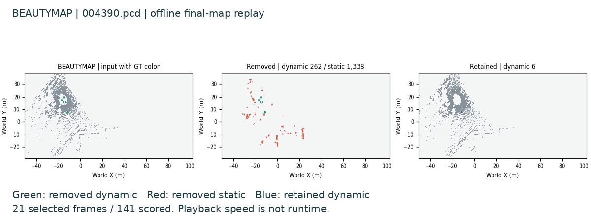

# BeautyMap

English | [中文](beautymap.zh-CN.md)

**KITTI-00, 141 LiDAR scans.** Occupancy comparisons remove dynamic traces; restoration protects static geometry.

## Original paper datasets and scenes

| Evaluation | Data / scene |
| --- | --- |
| Main dynamic-removal comparison | KITTI 00 / 01 / 05 driving sequences and semi-indoor 16-channel scans; selected windows contain substantial dynamics. SemanticKITTI supplies KITTI labels, with SuMa poses; semi-indoor poses use simple-ndt. |
| Separate studies | KITTI 02: cell-size tradeoff, Table III. KITTI 01: runtime and module ablations. |
| Evaluated task | Offline cleaning of an existing 3D global map, not estimating poses or updating a robot's belief. |

[Paper §IV](https://arxiv.org/html/2405.07283v1#S4). Multiple ground levels, online odometry integration and long-term change detection/map updating are future work in §V. Our historical KITTI-02 860–950 experiment and latest KITTI-00 141-scan live run are different experiments.

## Observed effects before watching

| Method | Map type | Metric / effect |
| --- | --- | --- |
| BeautyMap | 3D offline-cleaned map | SA 96.95% / DA 98.34%; cleaning works |

**Failure hypothesis to check:** map/scan registration, cell size, ground levels and occluded static structures can affect cleaning. The paper's module ablation shows static restoration matters for point preservation. Inspect whether the 2D projection retains the differences before inferring a localization benefit; this cause is not established in our runs.

The video below is the retained historical result replay; the [latest actual execution](../../results/reference/desktop-live-beautymap/execution.mp4) observes a fresh native run.

[MP4](../../results/reference/beautymap/media/replay/replay.mp4) · [Run](../../results/reference/beautymap/runs/beautymap-wsl/record.json) · [Timing](../../results/reference/beautymap/media/timing.json)

## Results

The retained wrapper run gives SA / DA / HA = 96.9529 / 98.3382 / 97.6407%. The separate historical KITTI-02 Table III experiment matches all nine paper accuracy values at two decimals.

[Original-code paper protocol](https://github.com/p20030920p/SLAM_Learning/blob/535a2780af7ca7eb3aa02f722e1340fe90bc2dcf/docs/KITTI_PAPER_PROTOCOL.md)

## Usage

[Setup and commands](../guides/REPRODUCE.md) · [Sources](../guides/ATTRIBUTION.md)

## Scope

Supplied poses isolate the declared mapping stages. Videos replay saved outputs; complete SLAM, navigation and hardware accuracy remain unverified.
