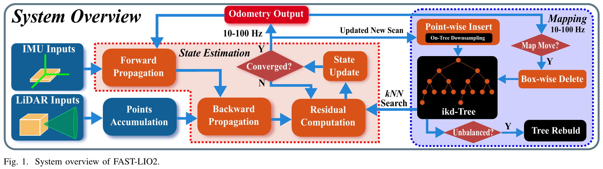

# FAST-LIO / FAST-LIO2

**原文实验：不复现。** 原图与方法介绍见[首页](../HOME.zh-CN.md#related-fast_lio)。自有场景中的代码测试单独放在Practice。

[FAST-LIO论文](https://arxiv.org/abs/2010.08196) · [FAST-LIO2论文](https://arxiv.org/abs/2107.06829) · [官方ROS2分支](https://github.com/hku-mars/FAST_LIO/tree/ROS2)

H2测试逐点补偿：LiDAR和IMU同步、外参和点时间是输入条件。软件采用FAST-LIO2直接配准路径。只跳过反向点补偿的实例属于披露的消融，不能标为未经修改的论文算法；正常实例保留作者算法。官方作者版本及补丁写入实验记录。
