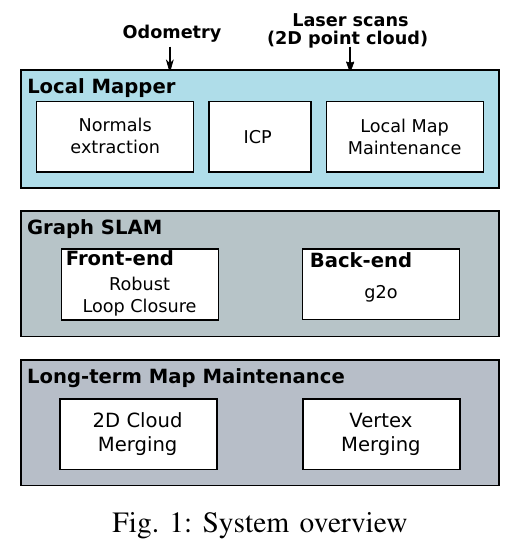

# SRRG / srrg_mapper2d: native 2D mapping

**Original-paper experiments: not reproduced.** Author-code runs on our Gazebo scenes are separate adaptation tests. Current Raw/SRRG mapping and independent AMCL B are in [Practice](../../README.md#direction-experiments-20261016).

Lázaro, Capobianco and Grisetti, *Efficient Long-term Mapping in Dynamic Environments*, IROS 2018. [Paper](https://iris.uniroma1.it/handle/11573/1340118) · [Author mapping code](https://gitlab.com/srrg-software/srrg_mapper2d) · [ROS entry](https://gitlab.com/srrg-software/srrg_mapper2d_ros).

The system registers native 2D scans using an odometry prior, maintains local point maps and a pose graph, and supports map maintenance across sessions. Our short, known-start Gazebo sessions do not reproduce the LCAS/MIT Stata long-term benchmark. Local projective merging is enabled; graph merging follows the author default and is disabled in the main tests. Separate numerical failures remain diagnostic records.

The adapter supplies scan/odometry transport and RViz display. [Build compatibility changes](../../src/scripts/presentation/srrg/build.py) cover OpenCV API names and consistent Eigen layouts, without replacing the author registration or merging rules.

Map scores use unique 10cm observed support and a 15cm coverage tolerance. Dynamic traces are evaluated only where later measured rays provide free-space evidence. These units differ from exact 3D source-point retention. Pose estimation and map maintenance change together; the result does not isolate deletion alone.

Earlier custom runs and migration details remain in the [Chinese technical notes](srrg_mapper2d.zh-CN.md). Their numbers describe those earlier acquisitions; the new H1 table binds each new B to its actual A map.
