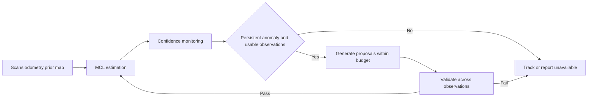

# Localization self recovery research design

English | [中文](DESIGN.zh-CN.md)

The direction is **Robust localization and SLAM in dynamic environments**. The open question is: **What strategies enable a localization system to recover itself under degradation and substantial environmental change?** The first stage studies localization with 2D LiDAR, wheel odometry and a prior map; SLAM back ends and map maintenance are later extensions.

## First research question

When observable structure remains, can **temporal consistency in triggering and recovery confirmation** improve sustained recovery within a fixed computation budget while reducing unnecessary resets during healthy tracking?

This is a candidate question. Start with simple baselines before deciding whether learned proposals, failure attribution or map updates are needed.

## Roles of earlier work

| Work | Evaluated task | Role here |
| --- | --- | --- |
| DUFOMap and BeautyMap | Dynamic removal and static preservation, with each paper's AA or HA protocol | Map preparation controls; test its effect on recovery |
| IR-MCL | Neural occupancy field observation model in MCL | Localization baseline; original-protocol localization is separate from recovery under map changes |
| AdaM-MCL | Samplable observation model and adaptive mixture updates, including global localization and kidnapping | Proposal-generation baseline; separate a custom-data demonstration from paper reproduction |
| LILocBench | Indoor localization under static, dynamic and long-term changes | Real-data validation; an official example score is not our method's score |

Historical semantic-map projections measure their effect on AMCL, rather than the overall quality of semantic mapping. Preserve those artifacts in the archive; current research comparisons concern localization.

## Engineering and algorithmic failures

Check TF, extrinsics, timestamps, odometry frames and dropped data before algorithm comparisons. A recovery routine can hide a configuration error. Establish a healthy baseline and retain runtime parameters, topic rates and timing diagnostics.

Degradation weakens pose constraints. Dynamic occlusion, repeated structures and sensor limits can cause it. Substantial change produces persistent disagreement with the prior map. Initialization errors and kidnapping detach the estimate from the true pose. These can coexist; an environment label is not a diagnosis available to the system.

## Recovery process

Detection, possible attribution, recovery and confirmation form a working framework. Attribution may remain unknown; the first implementation need not classify every cause. Insufficient information calls for an unavailable state or new observations. Particle concentration alone does not establish correctness.

Decisions use measurements, map, odometry and filter outputs. Ground truth and actual failure labels are reserved for offline scoring.

## Candidate hypotheses

| Hypothesis | Minimal comparison | Falsification |
| --- | --- | --- |
| H1 Temporal triggering reduces unnecessary resets | Single-frame and persistent-window triggers with the same action | No reduction under a fixed missed-detection limit, or detection delay removes the benefit |
| H2 Sustained validation reduces false recovery declarations | Identical proposals with and without confirmation | False confirmation does not decrease, or delays reduce correctly available time |
| H3 Observation conditions affect action effectiveness | Stratify the same fault by geometry and map change | A fixed strategy performs at least as well across conditions |

These do not presume an empty research field. Assess novelty after baseline results and a focused literature comparison.

## Baselines and budget

| ID | Method | Fixed setting |
| --- | --- | --- |
| B0 | AMCL with adaptive random injection explicitly disabled | slow=0.0, fast=0.0 |
| B1 | AMCL with fast/slow weight recovery enabled | Initial trial values slow=0.001, fast=0.1; tune on validation data and freeze |
| B2 | Single-frame anomaly triggers global reinitialization | Same particle and action budgets as the candidate |
| B3 | Periodic reinitialization | Include healthy runs to measure disruption |
| P1 | Persistent anomaly trigger and multi-frame proposal confirmation | Same proposal generator as B2; isolate trigger and confirmation changes first |

Nav2 defaults are **0.0/0.0**; 0.001/0.1 are suggested trial values. Save `ros2 param dump` from the running node. [Official parameters](https://docs.nav2.org/rolling/configuration_and_development/configuration_guide/others/configuring_amcl/) · [Jazzy source](https://api.nav2.org/nav2-jazzy/html/amcl__node_8cpp_source.html).

Reproduce IR-MCL and AdaM-MCL with their native protocols first. Common-platform comparisons must specify inputs, training data and particle or compute budgets, reporting native and matched-budget settings separately. IR-MCL's 100,000 initial particles cannot support a direct timing ranking against a smaller AMCL configuration.

## Separate environment and fault axes

| Environment | Intervention | Control |
| --- | --- | --- |
| S1 Healthy static | Map matches the world | Accuracy, false alarms and reset cost |
| S2 Dynamic occlusion | Moving objects in fixed geometry | Vary object count and occlusion duration separately |
| S3 Persistent structural change | Freeze mapping A, alter test B's world | Retain sensor and route conditions; log changed and visible regions |
| S4 Geometric degradation | Corridors, repeated structures, weak constraints | Keep sensor settings fixed |
| R Sensor restrictions | Beam count, range, field of view and noise | Change one factor at a time; report combined stress tests separately |

Cross these with no fault, initial-belief offset and actual kidnapping. An `/initialpose` offset is a belief intervention, not physical kidnapping. Physical relocation requires checking whether odometry reveals the jump. Editing a map tests map error; it does not substitute for altering the world after mapping.

The existing S4 changes geometry and several sensor settings together. Treat it as a combined stress condition and split factors before causal comparisons.

## Scoring protocol

A predetermined fault episode is the statistical unit. Freeze a recovery deadline, position/yaw limits, confirmation window and recurrence window using validation data. Initial working values can be 0.3 m, 5 degrees, 2 seconds and a 30-second deadline; they are not test-set conclusions.

| Metric | Reporting |
| --- | --- |
| Fault incidence | Episodes that actually cross the failure threshold; report condition difficulty |
| Sustained recovery | Position and yaw limits hold continuously before the deadline; successes / all failed episodes |
| Recovery time | Fault to the start of a sustained good interval; report detection and confirmation delays separately, retaining deadline-censored failures |
| Detection | Fixed-window false alarms and missed detections; healthy-run reset count and unavailable time |
| False confirmation | Declared trustworthy while offline truth still violates recovery limits |
| Recurrence and availability | Relapse within a fixed follow-up window; fraction of total time actually meeting trustworthy limits |
| Accuracy and resources | Full trajectory, initialization and recovery errors; CPU, memory, particles and actual latency |

Small covariance is not proof of correctness. `/amcl_pose` provides covariance but its calibration needs checking; it is not automatically an integrity protection level. Particle weights are relative, and resampling/publication timing affects ESS. Fast/slow statistics and injection events may require instrumentation.

Plan at least 10 predetermined independent seeds per first-stage cell. Paired methods share seeds, input and fault timing. Record uncontrolled upstream randomness; identical-input repeats are reproducibility checks. Develop on one layout, validate on another layout or public-ground-truth LILocBench sequences. Train models only on mapping/training data, without test trajectories or changed-world data leaking into training.

Start with passive replays of common input. Active movement changes future observations and belongs in a later closed-loop experiment.

## Presentation and delivery

The talk follows experience, the earlier comparison's scope problem, the new question, completed evidence, the minimal experiment and decisions to discuss with the supervisor. [Chinese talk](TALK.zh-CN.md).

Keep the homepage brief. Related works describes paper mechanisms; Evidence compares each paper under its own protocol; recovery experiments use a separate episode table. Label terminal recordings, live Gazebo/RViz footage and saved-result replays distinctly. Failed rendering checks belong to diagnostics.

## References

[IR-MCL](https://arxiv.org/abs/2210.03113) · [AdaM-MCL](https://arxiv.org/abs/2009.00211) · [LILocBench](https://www.ipb.uni-bonn.de/html/projects/localization_benchmark/) · [Frame dependence of degeneracy detection](https://arxiv.org/abs/2608.15532) · [LF-GICP](https://arxiv.org/abs/2608.19522). The latter two concern 3D registration, not established 2D AMCL recovery gains.
