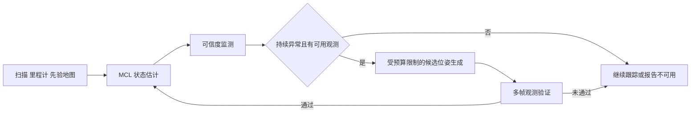

# 定位自恢复研究设计

[English](DESIGN.md) | 中文

研究方向为 **Robust localization and SLAM in dynamic environments**。开放问题是：**在退化与大变动环境中，什么样的策略能够有效地让定位系统自恢复？** 第一阶段在二维激光、轮速里程计和先验地图上研究定位恢复，之后再决定是否扩展到 SLAM 后端与地图维护。

## 首轮研究问题

在仍有足够可观测结构的动态或局部地图变化环境中，加入**时序一致性触发与恢复确认**，能否在固定计算预算下提高定位失效后的持续恢复成功率，并减少正常定位时的误重置？

这是候选问题，尚未证明方法收益或研究新颖性。先比较简单基线，再判断是否需要学习模型、失效归因或地图更新。

## 旧工作的作用

| 工作 | 回答的问题 | 在新主线中的作用 |
| --- | --- | --- |
| DUFOMap、BeautyMap | 动态点去除与静态结构保留，分别按原论文 AA／HA 等指标评价 | 地图清理对照；检查输入地图质量是否影响恢复 |
| IR-MCL | 神经占据场改善 MCL 的观测模型 | 定位基线；公开序列上的原配置复现不等于大变动自恢复实验 |
| AdaM-MCL | 可采样观测模型与自适应混合粒子更新，包含全局定位与绑架问题 | 恢复候选位姿生成的对照；自建数据演示与论文指标复现分别记录 |
| LILocBench | 同一室内环境中静态、动态与长期变化下的定位评测 | 真实数据外部验证；官方示例提交得分不算自己的方法结果 |

历史语义地图的几何投影实验回答的是“投影地图对 AMCL 有何影响”。它不能据此给语义建图论文的整体能力排序。历史产物保留在原库与结果目录，新首页的研究比较仅涉及这条定位主线。

## 工程问题与算法问题

先检查 TF、外参、时间戳、里程计坐标系和数据丢失。这些问题会造成定位失败，但恢复算法可能只是暂时掩盖配置错误。正常场景必须先跑通，并保存运行时配置、话题频率和时序诊断。

退化指观测对某些位姿方向的约束变弱；动态遮挡、重复结构和传感器限制可能导致这种现象。大变动指现有观测与先验地图持续不一致。初值错误或绑架则是估计位姿与真实位置脱离。三者可能同时发生，不能凭场景名称直接当作系统已识别的原因。

## 恢复过程

检测、候选归因、恢复、确认是本研究的工作框架。归因可以输出“未知”；首版不要求可靠区分所有失效原因。信息不足时应报告不可用或等待新观测，不能把粒子集中直接当成恢复成功。

系统触发和确认只使用观测、地图、里程计及滤波器输出。真值只供离线评分；不把真实位姿、真值误差或真实失效类型送入恢复决策。

## 候选假设与证伪条件

| 假设 | 最小对照 | 证伪条件 |
| --- | --- | --- |
| H1 时序触发比单帧阈值减少误重置 | 相同恢复动作，单帧阈值与持续窗口触发 | 在固定漏检上限下，误重置或不可用时间不减少；检测延迟抵消收益 |
| H2 持续验证减少错误宣布恢复 | 相同候选生成，有／无多帧确认 | 错误确认率不减少，或延迟使总体可信可用时间下降 |
| H3 观测条件影响恢复策略收益 | 相同故障，按几何可观测性与地图变化分别分层 | 某固定策略跨条件不劣于条件策略；简单基线已足够 |

这些假设不以“全领域无人研究”为前提。退化判据、重定位、绑架恢复和长期定位已有相关工作；是否形成新贡献需要在对照结果和进一步文献核验后判断。

## 基线与预算

| 代号 | 方法 | 固定项 |
| --- | --- | --- |
| B0 | AMCL，显式关闭自适应随机注入 | `recovery_alpha_slow=0.0`，`recovery_alpha_fast=0.0` |
| B1 | AMCL，显式启用快慢权重恢复 | 初始试验值 slow=0.001、fast=0.1；验证集定值后冻结 |
| B2 | 单帧异常阈值触发全局重初始化 | 与候选策略相同的粒子和动作预算 |
| B3 | 固定周期重初始化 | 正常场景也运行，用于测误重置代价 |
| P1 | 持续异常触发，候选位姿经多帧确认 | 与 B2 共用候选生成器，先只比较触发与确认 |

AMCL 官方默认恢复参数是 **0.0／0.0**；0.001／0.1 是建议试验值而非默认值。每轮保存启动后的 `ros2 param dump`，以实际节点参数为准。[Nav2 参数文档](https://docs.nav2.org/rolling/configuration_and_development/configuration_guide/others/configuring_amcl/) · [Jazzy 源码](https://api.nav2.org/nav2-jazzy/html/amcl__node_8cpp_source.html)。

IR-MCL 与 AdaM-MCL 先按各自原协议复现。接入共同平台后，再固定输入、训练范围、粒子数或算力预算，单独报告原配置和预算匹配结果。IR-MCL 的十万初始粒子不能直接与 AMCL 的较少粒子作耗时排名。

## 场景与故障分开设计

| 环境轴 | 变化方式 | 主要对照 |
| --- | --- | --- |
| S1 正常静态 | 地图与世界一致 | 正常精度、误报与误重置代价 |
| S2 动态遮挡 | 在固定结构中加入运动物体 | 物体数量与遮挡时间分别改变 |
| S3 持久结构变化 | 固定建图 A，修改测试 B 的世界结构 | 保持传感器与路线条件；记录改动区域与可见范围 |
| S4 几何退化 | 长走廊、重复结构、弱约束区域 | 保持传感器配置，分离几何影响 |
| R 传感器限制 | 束数、量程、视场、噪声各自改变 | 每次只改变一个因素；组合压力测试另列 |

每种环境交叉测试无注入、初值偏移与实际绑架三类事件。给 `/initialpose` 施加偏移只叫初值／信念扰动；实际绑架还需验证真实位置变化与里程计是否泄露跳变信息。仅编辑地图是地图误差试验，不能代替“建图后真实世界改动”的实验。

现有 S4 同时更改几何、束数、视场、量程与噪声，适合作组合压力场景，不能单独归因于几何退化。首轮先拆分因素。

## 评分协议

一次预先指定的故障回合是统计单位。预注册恢复截止时间、位置与偏航阈值、持续确认窗口和复发观察窗口。工作起点可用位置 0.3 m、偏航 5°、持续 2 s、截止 30 s，但须在验证集标定后冻结，不按测试结果调整。

| 指标 | 定义与报告方式 |
| --- | --- |
| 故障发生率 | 注入回合中实际越过失效阈值的比例；单独报告场景难度 |
| 持续恢复成功率 | 在截止时间内，位置和偏航误差同时满足阈值并持续规定窗口；报告成功数／全部故障回合数 |
| 恢复时间 | 从故障时刻到持续恢复窗口的起点；另报检测延迟与确认延迟。失败回合标为截至期限未恢复，不能从统计中静默删除 |
| 检测误报与漏报 | 固定评测时间窗，对照离线真值标签；健康场景的误触发次数与不可用时间并列报告 |
| 错误确认率 | 系统宣布可信，但离线真值仍不满足恢复阈值的比例 |
| 复发率与可信可用时间 | 确认后在固定观察窗再次失效的比例，以及全部运行中真实满足可信条件的时长占比 |
| 精度与资源 | 全过程位置／偏航误差、初始化与恢复阶段误差；CPU、内存、粒子数、实际运行时延分开报告 |

协方差小不代表正确，粒子权重是相对量。`/amcl_pose` 有协方差，但应验证其校准；不能直接把它称为有保证的保护级。发布粒子云的时点和重采样可能影响 ESS，需核对版本和消息语义。快慢权重及真实注入事件未必能从普通话题得到，需要明确的内部日志接口。

第一批每格至少 10 个预先固定的独立种子；配对策略共用种子、输入与故障时刻。种子控制不了的上游实现记录其随机源，不把相同输入重复回放当成独立试验。先在一个场景开发，再在第二种布局或 LILocBench 的公开真值序列上验证。模型训练只使用建图／训练数据，测试轨迹和改变后的世界不回流训练。

首次比较使用被动回放，共享相同输入。主动移动会改变后续观测，留到后续闭环试验，不能仍声称各策略收到相同扫描。

## 展示与交付

汇报按“个人经历 → 旧比较的范围问题 → 新问题 → 已有证据 → 最小实验 → 请老师帮助判断的取舍”组织。[中文汇报稿](TALK.zh-CN.md)。

首页简写方向、开放问题和候选假设。Related works 按论文卡片呈现方法，Evidence 保留同论文同协议的数值；自恢复实验另建事件级结果表。视频明确区分现场终端实录、Gazebo／RViz 实时画面与保存结果回放。渲染验收失败的片段只保留作诊断，不进入展示。

## 参考入口

[IR-MCL](https://arxiv.org/abs/2210.03113) · [AdaM-MCL](https://arxiv.org/abs/2009.00211) · [LILocBench](https://www.ipb.uni-bonn.de/html/projects/localization_benchmark/) · [退化判据的坐标系问题](https://arxiv.org/abs/2608.15532) · [LF-GICP](https://arxiv.org/abs/2608.19522)。后两项讨论三维配准，不作为二维 AMCL 判据或恢复收益已成立的证据。
